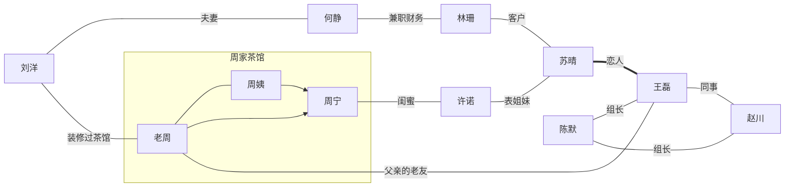

# 人生尽调故事集 · 剧本（第二版，已确认）

> 基于《人生尽职调查：一套用可观测数据替代主观叙事的决策系统》。
> 6 个场景，每个场景有女主版、男主版两集，共 12 集，每集约 4–5 分钟。
> 第二版改动：**人物有连续性**。所有角色属于同一个朋友圈，前一集的人会在后一集出现，人物经历一路往下走。
> 状态：**已确认（2026-10-11）**，制作中。先更新已做好的第 03、04 集，再做其余 10 集。

---

## 〇、相较第一版的改动

1. **一条主线**：苏晴（第 03 集）和王磊（第 04 集）各自被"好故事"骗过，半年后在徒步群相遇，成为贯穿全剧的一对。后面三集都是他们的故事：见他的父母、见她的父母、买婚房。
2. **一个朋友圈**：其余主角都和他们有关系，也都常去周家茶馆。他们是表姐、同事、组长、客户、茶馆装修师傅、导师的女儿。
3. **导师也有自己的故事**：老周和周姨的女儿周宁，成了第 11 集的主角。在女儿买房这件事上，教了别人一辈子的老周，自己也犯了"只听叙事"的毛病。
4. **场景顺序**：见家长篇提到买房篇之前（第 09–10 集），买婚房作为系列终章（第 12 集）。
5. **前后呼应**：前面埋下的人和事，后面会接上。比如江哲后来出现在大鹏的骗局里，王磊被骗这件事，在见岳父时必须主动交代。
6. **改名并入的角色**：原来的何远（第 11 集）、李然（第 12 集）、宋凯（第 09 集）都改成王磊，女友晓雯、陈曦、唐悦都改成苏晴，刘洋的妻子秀芬改成何静。

---

## 一、人物关系

### 常驻角色与人物弧线

| 角色 | 身份 | 出场 | 人物弧线 |
|---|---|---|---|
| **老周** | 63 岁，前投资人，周家茶馆主人 | 几乎每集 | 爱问"他没说什么？"。教了别人一辈子，轮到女儿买房，自己也只听见了"一个人"三个字（第 11 集） |
| **周姨** | 60 岁，婚姻家事律师，半退休 | 婚恋、买房各集 | 犀利又温柔，口头禅"不是让你审他"。终章说出全剧的一句总结 |
| **周宁** | 35 岁，老周夫妇的独女，外企财务经理，单身 | 01 客串，11 主角，12 | 把许诺带回茶馆。自己用尽调说服了爸爸，一个人买了房 |
| **苏晴** | 29 岁，设计师，许诺的表妹 | 03、04 结尾、08、09、10、12 | 被"太好的男朋友"伤过 → 学会看行为数据 → 遇到王磊 → 见他的家人时看清他的选择 → 和他一起决定先租后买 |
| **王磊** | 34 岁，工程师，陈默组里的人，父亲是老周的老友 | 02 客串，04、07、09、10、12 | 孤独，不吭声 → 被杀猪盘骗走 23 万 → 复盘 → 见岳父时主动交代被骗的事 → 承认买房是为了面子，学会把真话说在前面 |
| **许诺** | 32 岁，运营经理，苏晴的表姐，周宁的闺蜜 | 01 主角，03 提及，12 | 面试被问婚育，最后去了坦诚的澄光，后来升了职 |
| **陈默** | 35 岁，技术经理，王磊和赵川的组长，妻子安然 | 02 主角，07，12 | 35 岁头衔焦虑 → 不再错过孩子的家长会；后来劝赵川"合伙前先把丑话说在前头" |
| **刘洋** | 38 岁，装修公司老板，周家茶馆就是他装修的 | 05 主角，06，12 | 差点因为面子掉进兄弟局；终章给王磊装修时说"打折可以，合同照签" |
| **何静** | 36 岁，前会计，全职妈妈，刘洋的妻子 | 05，06 主角，08 | 看穿理财课，也看清了自己怕回职场 → 成为林珊工作室的兼职财务 |
| **赵川** | 30 岁，程序员，王磊的同事 | 07 主角，12 | 和室友合伙，靠尽调和协议，把兄弟情变成能走下去的合作 |
| **林珊** | 33 岁，香薰品牌"山野"创始人，苏晴的客户 | 08 主角，12 | 拒绝要控制权的投资人，守住了自己的公司 |

### 双方父母（第 04、09、10、12 集）

- **王叔、王妈**：王磊的父母，陕西老家。王妈催婚、催房，心疼儿子，但习惯了替他做主（配音用陕西口音）。王叔是家里说了算的那个。
- **苏叔、苏姨**：苏晴的父母。苏叔是退休审计师，查了三十年账。苏姨家里大事小事一手拿主意。

### 跨集的呼应

| 埋下 | 接上 |
|---|---|
| 02：王磊说"回去也没人，在这儿还有人说话" | 04：他的孤独被骗子利用 |
| 03：江哲说"在做投资"，开租来的车 | 05：老孙说，跟着大鹏拉人的，有个开租来的车、自称做投资的江哲 |
| 03、04 结尾：两人在徒步群相遇 | 09、10、12：见家长、买婚房 |
| 04：王磊被骗 23 万 | 10：见岳父时主动交代；12：被骗后最怕"被人觉得没本事" |
| 05：刘洋差点被大鹏拉进去 | 06：刘洋提醒何静，"这回轮到你了？" |
| 06：何静找到兼职财务工作 | 08：林珊说"财务是何静姐在帮我做" |
| 10 结尾：苏姨问"在哪儿买房" | 12：买婚房 |
| 07：小程序 3000 用户 | 12：用户过了一万 |

---

## 二、系列总览

| 集 | 场景 | 版本 | 片名 | 主角 | 重点工具 | 结局 |
|---|---|---|---|---|---|---|
| 01 | 职场 | 女 | 《空着的岗位》 | 许诺 | 模板比较、修饰性语言、行为数据优先、反向防御 | 去了更坦诚的公司 |
| 02 | 职场 | 男 | 《总监这个头衔》 | 陈默 | 渠道审计、信息缺口、时间消费/收入比、对自己尽调 | 留下，争取到清晰的晋升路径 |
| 03 | 恋爱 | 女 | 《太好的男朋友》 | 苏晴 | 对弱势方的态度、怎么谈前任、消费/收入比、冲突方式、三个月观察期 | 体面分手，后来遇到王磊 |
| 04 | 恋爱 | 男 | 《屏幕那头的她》 | 王磊 | 渠道、信息缺口、社会证据、沉没成本、自我矛盾 | 识破杀猪盘，后来遇到苏晴 |
| 05 | 投资 | 男 | 《兄弟局》 | 刘洋 | 五个黄金问题、修饰性语言、消费/收入比、情绪反弹 | 拒绝，对方后来暴雷 |
| 06 | 投资 | 女 | 《姐妹理财课》 | 何静 | 信息来源审计、幸存者偏差、模板比较、对自己尽调 | 识破，重回职场 |
| 07 | 合伙 | 男 | 《五五开》 | 赵川 | 怎么谈前合伙人、承诺兑现率、自我矛盾引导 | 重签协议，合作成功 |
| 08 | 合伙 | 女 | 《你负责情怀》 | 林珊 | 渠道、锚定、自我矛盾引导、反向防御 | 守住公司 |
| 09 | 见家长 | 女 | 《年夜饭》 | 苏晴 | 原生家庭分析（只作为假设）、压力下的选择 | 王磊改变，关系更稳 |
| 10 | 见家长 | 男 | 《审计师岳父》 | 王磊 | 反向防御：信号一致、主动填补缺口 | 被认可 |
| 11 | 买房 | 女 | 《一个人的房子》 | 周宁 | 他没说什么、卖方动机、社区验证、用数据说服家人 | 一个人买了房 |
| 12 | 买房 | 男 | 《婚房》（终章） | 王磊 | 锚定、中介话术、自我消费/收入比、对自己尽调、概率语言 | 先租后买，全员茶馆相聚 |

### 为什么分男女两版

| 场景 | 女主版面对的 | 男主版面对的 |
|---|---|---|
| 职场 | 面试被问婚育、产后被边缘化 | 35 岁焦虑、头衔和面子、养家压力挤掉了家庭时间 |
| 恋爱 | 婚后让她辞职、让她出首付、控制欲 | 孤独和被夸的需要、催婚压力、不好意思求助 |
| 投资 | "女人要经济独立"被拿来当诱饵、怕回不去职场 | 酒桌文化、兄弟义气、"大老爷们儿做不了主"的激将 |
| 合伙 | 被定位成"负责情怀"、被问要不要孩子 | 兄弟之间不好意思谈钱、房贷压着不敢辞职 |
| 见家长 | 观察对方家庭：谁在厨房、谁在客厅，他站在哪边 | 被对方家长审：收入、存款、过去的错，要不要说 |
| 买房 | 被默认"男朋友做主"、"女孩子买什么房"、独居安全 | "没房结不了婚"的面子、母亲施压、动用父母养老钱 |

### 写作原则（沿用第一版）

1. 不把某个性别写成反派，说漂亮话的人和坦诚的人都有男有女。
2. 不是每集都在"拆穿坏人"：第 07、09、10、12 集都是正向结局。
3. 方法的边界写进剧情："后台运行，前台真诚""这只是假设"。
4. 数字不冒充统计，概率说法都是角色自己的样本。

---

## 三、剧本

文中的 `〔识别：……〕` 是画面上弹出的识别标签。**加粗**的是和第一版相比新增或修改的台词。

---

### 第 01 集 · 职场 · 女版《空着的岗位》

**出场**：许诺、刘姐（星河科技 HR）、高总（星河副总裁）、唐姐（星河前运营总监）、周姨、方岚（澄光合伙人）、**周宁（客串）**、旁白

**【片头】**
- **旁白**：人生尽调故事集。职场篇，她的版本：空着的岗位。

**【第一幕 · 周二下午，星河科技面试间】**
- **旁白**：三十二岁的许诺，在一家公司做了六年运营。这天，她来面试星河科技的运营总监。
- **刘姐**（笑）：许小姐，您的履历非常漂亮。我们公司特别重视女性员工，弹性工作，氛围很好。
- **刘姐**：冒昧问一句，您结婚了吧？这两年有要孩子的打算吗？
- **许诺**（迟疑）：这个……和岗位有关系吗？
- **刘姐**（摆手）：不是说我们介意啊，只是这个岗位节奏比较快，想提前了解一下。〔识别：否定-转折结构〕
- **高总**（看表）：我们是创业心态，大家都很拼，不会让你吃亏的。期权、晋升，都好谈。〔识别：数字模糊化〕
- **许诺**：那这个岗位，之前是谁在负责？
- **高总**（停顿）：前任嘛……家里有些情况，后来就主动调整了。〔识别：信息缺口〕
- **旁白**：出门时，许诺看了一眼走廊上的高管照片墙。九个人，没有一位女性。走廊尽头的母婴室门开着，里面堆满了纸箱。〔识别：行为数据〕

**【第二幕 · 周三晚上，周家茶馆】**
- **旁白**：**闺蜜周宁听完，直接把她带回了家。周宁的家，就是周家茶馆。**
- **周宁**：**妈，许诺面试遇到点事，你帮她看看。**
- **许诺**：周姨，我是不是太敏感了？他们说特别重视女性员工。
- **周姨**：你听到了他们说的。我问你，你看到了什么？
- **许诺**：九个高管，没有一个女的。母婴室，堆着纸箱。前任总监，一句话带过。
- **周姨**：说的和做的对不上，就信做的。还有，按照妇女权益保障法，招聘时打听婚育情况，本身就不合规。你可以不答，也可以换个方式答。
- **周姨**：一个岗位的完整信息，至少要有：为什么空出来，前任去了哪儿，直属领导是谁，怎么考核。他们只给了你两个字：好谈。〔识别：模板比较〕
- **周姨**：找到那位前任。人去了哪儿，比 HR 说什么都准。

**【第三幕 · 周五中午，咖啡馆】**
- **旁白**：通过行业群，许诺联系上了星河的前运营总监，唐姐。
- **唐姐**（苦笑）：我在星河干了四年，业绩第一。休完产假回来，工位没了，被调去做"特别项目"。
- **唐姐**：没有项目，没有人，也没有考核标准。三个月后，我自己走了。他们管这个叫"主动调整"。〔识别：修饰性语言〕
- **许诺**：那他们说的弹性工作……
- **唐姐**：工作群凌晨两点还在艾特人。弹性的是下班时间，不是上班时间。

**【第四幕 · 下周一，第二轮面试】**
- **旁白**：第二轮面试，许诺换了一种方式。
- **许诺**：关于家庭计划，我先说清楚：未来三年，我的重心在职业上。任何安排，我都会提前和团队沟通。〔识别：主动填补缺口〕
- **许诺**：我也想了解一下：公司现在有几位女性管理者？去年休产假的同事，回来以后都在什么岗位？
- **高总**（皱眉）：你这问得……是不是想太多了？我们哪有那么复杂！〔识别：情绪性否定〕
- **旁白**：反应越激烈，往往越说明这里有问题。

**【第五幕 · 两周后，澄光公司】**
- **旁白**：两周后，许诺面试了另一家公司，澄光。面试官方岚，是公司的合伙人。
- **方岚**：先说一个你可能关心的情况。去年我们有两位同事休产假，一位回来以后升了职，另一位转了岗，因为她想要更稳定的节奏，是她自己选的。〔识别：坦然谈风险〕
- **方岚**：我们的问题也很明显：规模小，加班不少，期权将来值多少，我也说不准。
- **许诺**（笑）：您为什么连这些都说？
- **方岚**：入职第一周你就会知道。不如我现在告诉你。

**【尾声】**
- **许诺**：我面过的六家公司里，愿意主动谈风险的有两家，管理层里有女性的有三家。两样都占的，只有澄光。〔识别：概率语言〕
- **周姨**：尽调不是为了怀疑每一家公司，是为了找到一个值得你投入几年的地方。
- **旁白**：他们说重视什么，不重要。墙上挂着谁、母婴室里放着什么、前任去了哪里，这些，才是真相。

---

### 第 02 集 · 职场 · 男版《总监这个头衔》

**出场**：陈默、**王磊（客串）**、Kevin（猎头）、韩总（云帆科技 CEO）、老周、安然（陈默的妻子）、李姐（陈默的领导）、旁白

**【片头】**
- **旁白**：人生尽调故事集。职场篇，他的版本：总监这个头衔。

**【第一幕 · 周四晚上十点，公司】**
- **旁白**：三十五岁的陈默，在一家大厂做了八年技术经理。房贷还有二十年，儿子刚上小学。
- **王磊**：**陈哥，还没走啊？**
- **陈默**：**你也是。早点回去吧。**
- **王磊**：**回去也没人。在这儿，好歹还有人说话。**
- **旁白**：**这时，陈默的手机响了。**
- **Kevin**（电话，兴奋）：陈哥！云帆科技，技术总监，薪资涨百分之四十，直接向 CEO 汇报！〔识别：锚定效应〕
- **Kevin**：这个机会特别抢手，他们这周就要定人。我只推荐了您一个！〔识别：制造紧迫〕
- **陈默**：……我考虑一下。
- **旁白**：比起涨薪，"总监"两个字更让他心动。三十五岁，他太想证明自己了。〔识别：光环效应〕

**【第二幕 · 周六，云帆科技】**
- **韩总**：陈默，我们需要一个能扛事的人。团队现在有些问题，需要一个有魄力的人来理顺。
- **陈默**：您说的"理顺"，具体是指什么？
- **韩总**：不是说团队不行，只是……人有点多，效率需要提升。〔识别：否定-转折结构〕
- **陈默**：这个岗位，之前有人做过吗？
- **韩总**：有过两位。一位去了大厂，一位回老家了，都挺好的。〔识别：主动解释〕

**【第三幕 · 周日上午，周家茶馆】**
- **陈默**：周老师，薪资涨四成，还是总监。我觉得可以去。
- **老周**：先做三件事。第一，猎头说只推荐了你一个，你信吗？问问你圈子里的人。〔识别：渠道审计〕
- **老周**：第二，"理顺团队"，翻译成一句话是什么？
- **陈默**：……裁员。让我去裁。
- **老周**：第三，一年换了两任总监，你是第三个。前两个，真的"都挺好"吗？〔识别：信息缺口〕
- **旁白**：周一，陈默问了三个老同事。其中两个人，这周也接到了 Kevin 的电话，说法一模一样："我只推荐了您一个。"

**【第四幕 · 周二夜里，家里】**
- **安然**：你这几天一直盯着手机，是那个总监的事吧？
- **陈默**：嗯。我不是在乎头衔，只是想要一个更大的平台。〔识别：自我修饰〕
- **安然**：你说过，这两年最重要的是家里和孩子。
- **安然**：可儿子的家长会，你今年一次都没去。你每天到家，他都睡了。〔识别：时间消费≠时间收入〕
- **旁白**：那天晚上，陈默在纸上写下他说最重要的三件事：家庭、健康、成长。又写下他上周花时间最多的三件事：开会、加班、刷招聘软件。没有一项重合。〔识别：对自己尽调〕

**【第五幕 · 两周后，现公司】**
- **旁白**：陈默没有接云帆的 offer。他约了自己的领导，李姐。
- **陈默**：我想坦白说，我在看外面的机会。原因是，我在这里三年没有晋升，我想知道差距在哪里。〔识别：主动填补缺口〕
- **李姐**：谢谢你直说。实话讲，你技术很好，但跨团队协作是短板。明年有一个架构负责人的位置，考核标准我发给你。
- **旁白**：没有总监头衔，也没有涨四成。但考核标准是清清楚楚的。

**【尾声 · 半年后】**
- **旁白**：半年后，云帆科技裁员三成，技术总监又换了人。
- **陈默**：我后来数了数，我认识的人里，待过一年换两任总监的公司的有七个，其中五家后来都裁了员。样本不多，但概率不站在那边。〔识别：概率语言〕
- **老周**：头衔是别人给你讲的故事。你每天把时间花在哪儿，才是你自己的行为数据。
- **陈默**：**磊子，今天早点走。周末别老待着，出去走走。**
- **王磊**：**……好。**
- **旁白**：那天晚上，陈默第一次去了儿子的家长会。**可他没有想到，组里那个总是最后一个走的王磊，正在经历一件什么样的事。**

---

### 第 03 集 · 恋爱 · 女版《太好的男朋友》（已有样片，按此更新）

**出场**：苏晴、江哲（男友）、服务员、周姨、**王磊（结尾）**、旁白

**【片头】**
- **旁白**：人生尽调故事集。恋爱篇，她的版本：太好的男朋友。

**【第一幕 · 周六晚上，西餐厅】**
- **旁白**：二十九岁的设计师苏晴，和男友江哲交往了五个月。他体贴、大方、会说话，朋友们都说她捡到宝了。〔识别：社会证据〕
- **江哲**：晴晴，下个月去见我爸妈吧？我妈说今年一定要定下来。房子我都看好了，到时候写我们俩的名字。〔识别：制造紧迫〕
- **苏晴**（开心）：这么快？
- **江哲**：遇到对的人，就不用等。
- **服务员**：不好意思先生，这道菜上错了，我马上给您换。
- **江哲**（冷脸）：你们怎么做事的？把你们经理叫来！〔识别：对弱势方的态度〕
- **旁白**：那一瞬间，苏晴觉得自己好像不认识他。几秒钟后，他转过头来，又对她温柔地笑了。

**【第二幕 · 周日下午，周家茶馆】**
- **苏晴**：周姨，**我表姐许诺说，有事就来找您。**他对我真的很好。就是那天对服务员……可能只是心情不好吧？
- **周姨**：一次不说明什么。那他怎么说起他的前任？
- **苏晴**：他说，前一个太物质，再前一个，情绪不稳定。
- **周姨**：每个前任都有问题，你就要想一想，你会不会是下一个被这样说的人。〔识别：怎么谈论前任〕
- **周姨**：他说他做投资，具体做什么？收入多少？
- **苏晴**：他没细说，我也不好意思问。〔识别：信息缺口〕
- **周姨**：我做了三十年婚姻律师，听到最多的后悔，不是"我嫁错了人"，而是"有些事我早就看到了，只是没往心里去"。
- **周姨**：不是让你审他。心里留个底，相处照常。给自己三个月。〔识别：后台运行，前台真诚〕

**【第三幕 · 第一个月】**
- **旁白**：接下来的一个月，苏晴开始安静地观察。
- **旁白**：他开的车，是租的。他送她的包，是分期买的。有一天，他手机上弹出一条消息：信用卡逾期提醒。〔识别：消费远超收入〕
- **苏晴**：最近工作压力大吗？投资那边还顺利吧？
- **江哲**：还行吧，挺好的。就是最近市场不太好，资金周转一下，大概……差不多年底就回来了。〔识别：数字模糊化〕
- **江哲**：对了，买房首付还差一点，你那边的存款能先放进来吗？反正以后是一家人。

**【第四幕 · 第二个月，一个周五】**
- **旁白**：这个周五，苏晴因为项目加班，取消了约会。
- **江哲**（电话，愤怒）：又加班？你心里到底有没有我？那个破工作有什么好拼的，结婚以后你就别干了！〔识别：攻击型冲突〕
- **苏晴**：你以前说，最欣赏我对工作的认真。
- **江哲**：我什么时候说过？你别老拿我的话堵我！〔识别：情绪反弹〕
- **旁白**：苏晴没再说话。她记得周姨说过，在亲密关系里，不要总去抓对方的矛盾。这一次，她只是把这件事记了下来。

**【第五幕 · 第三个月，周家茶馆】**
- **苏晴**：周姨，我列了一张表。他说的是：做投资、有房、尊重我的事业。我看到的是：车是租的，信用卡逾期，让我出首付，让我婚后辞职。
- **苏晴**：说的和做的，没有一项对得上。
- **周姨**：那你怎么判断？
- **苏晴**：我不是说他这个人坏。只是在钱、工作和吵架这三件事上，我们没法一起走下去。〔识别：假设而非定论〕
- **周姨**：这就是尽调的意义。不是证明谁坏，是看清楚这段关系值不值得你把后半辈子放进去。

**【尾声 · 半年后】**
- **旁白**：分手那天，苏晴没有吵，也没有翻旧账。
- **旁白**：**半年后，她在一个徒步群认识了王磊。第二次一起爬山，他就说起自己还剩多少存款，说起自己被网络诈骗骗走过二十三万，还说起那件事里，他自己错在哪儿。**〔识别：主动填补缺口〕
- **苏晴**：我不知道我们会不会走到最后。但到现在为止，他说的和做的，都对得上。
- **旁白**：他说爱你，不重要。他怎么对服务员、怎么谈前任、怎么花钱、吵架时说了什么，这些，才是真相。

---

### 第 04 集 · 恋爱 · 男版《屏幕那头的她》（已有样片，按此更新）

**出场**：王磊、"悦悦"（只有语音）、老 K、王妈、老周、**苏晴（结尾）**、旁白

第一幕到第五幕与样片相同，只改了尾声。

**【片头】**
- **旁白**：人生尽调故事集。恋爱篇，他的版本：屏幕那头的她。

**【第一幕 · 周日深夜，出租屋】**
- **旁白**：三十四岁的工程师王磊，不太会说话，单身五年。母亲每周一个电话。
- **王妈**（电话）：磊子，你表弟孩子都两岁了。你到底什么时候带个人回来？
- **王磊**：妈，我在找，你别催了。
- **旁白**：挂了电话，一个陌生人加了他的微信。
- **悦悦**（语音）：哎呀，不好意思，加错人了……不过你头像是在爬山吗？好巧，我也喜欢爬山。〔识别：偶遇可以被设计〕
- **旁白**：接下来的三周，她每天发早安、晚安。她夸他踏实、靠谱，说现在这样的男人太少了。〔识别：叙事偏好〕

**【第二幕 · 第四周】**
- **悦悦**：磊哥，我舅舅在做黄金交易平台，有内部消息，稳赚的。我不在乎钱，只是想我们以后的日子轻松一点。
- **王磊**：我不太懂这个……
- **悦悦**：没关系，先放五千试试，赚了就提出来。
- **旁白**：三天后，五千块变成了六千二。他提了出来，钱真的到账了。
- **老 K**（群语音）：兄弟们，今天又赚了两万！跟着悦悦老师，闭眼冲！〔识别：社会证据〕
- **悦悦**：这周是窗口期，过了就没了。磊哥，你相信我吗？〔识别：制造紧迫〕

**【第三幕 · 第二个月】**
- **旁白**：王磊陆续投了二十三万，那是他五年的存款。平台上显示，账户已经有四十万了。
- **旁白**：可是他想提现时，客服说：要先交百分之二十的"个人所得税"。
- **王磊**：悦悦，我们视频一下好不好？我想见见你。
- **悦悦**：我这边摄像头坏了嘛。等你提出来，我就飞过去找你！
- **旁白**：三个月里，她说过家乡、口味、喜欢的电影。唯独没有：一次视频，一张生活照，一个能查到的公司名字。〔识别：信息缺口〕

**【第四幕 · 那个周末，周家茶馆】**
- **旁白**：王磊犹豫了很久，才走进周家茶馆。老周是他父亲的老朋友。
- **王磊**：周叔，我可能遇到点事。但她不像骗子，她说她不在乎钱。
- **老周**：她说不在乎钱。可你们三个月的聊天里，"平台""充值""窗口期"，一共出现了多少次？〔识别：自我矛盾〕
- **王磊**：……一百多次。
- **老周**：一个加错微信的人，三周后正好懂黄金，正好有个舅舅，正好需要你充钱。你自己听听。〔识别：渠道审计〕
- **老周**：故事可以讲得很美，但钱只有一个方向：只进不出。
- **王磊**：可我已经投了二十三万。现在不交税，前面的就全没了……
- **老周**：这就是沉没成本。你现在该问的，不是怎么把钱拿回来，而是再交一块钱，能拿回来的可能性有多大。〔识别：沉没成本〕

**【第五幕 · 周一，派出所】**
- **旁白**：周一，老周陪他去了派出所。民警看了一眼聊天记录，说，这是典型的"杀猪盘"，这个月已经是第六起了。
- **旁白**：那个群里，除了王磊，全是托。那个"悦悦"，可能是一个团伙，甚至未必是个女人。
- **王磊**：她夸我的那些话，我都信了。因为……已经很久没有人这么夸过我了。〔识别：对自己尽调〕

**【尾声 · 半年后】**
- **旁白**：**半年后，王磊在一个线下徒步群认识了苏晴。第二次见面，她就聊起自己的工作、家人，还有一段没走下去的恋爱。他也把自己被骗的事，一五一十地说了。**
- **王妈**（电话）：磊子，这姑娘怎么样？
- **王磊**：妈，**她叫苏晴。**我们才认识两个月，我还在了解。慢一点，没关系。
- **老周**：被骗不丢人，不复盘才丢人。你最怕孤独，所以骗子就从孤独下手。
- **旁白**：屏幕那头说了什么，不重要。她怎么出现的、为什么从不见面、钱往哪个方向流，这些，才是真相。
- **字卡**：遇到可疑投资，请拨打全国反诈专线 96110。

---

### 第 05 集 · 投资 · 男版《兄弟局》

**出场**：刘洋、大鹏（老同学）、老周、老孙（老同学）、**何静（刘洋的妻子）**、旁白

**【片头】**
- **旁白**：人生尽调故事集。投资篇，他的版本：兄弟局。

**【第一幕 · 周六晚上，同学会酒桌】**
- **旁白**：毕业二十年同学会。三十八岁的刘洋开了一家小装修公司，这些年攒下了一百来万。
- **大鹏**（举杯）：老刘！我现在做新能源充电桩，年化百分之十八，保本！老班长投了，王局家的公子也投了！〔识别：社会证据〕
- **大鹏**：兄弟一场，我才带你。名额就剩两个，下周截止。〔识别：制造紧迫〕
- **刘洋**：我回去跟家里商量一下。
- **大鹏**：大老爷们儿，这点主都做不了？还是不是兄弟？
- **旁白**：一桌人都看着他。刘洋端起酒杯，一口干了。

**【第二幕 · 第二天，周家茶馆】**
- **旁白**：**第二天，刘洋去了周家茶馆。这家茶馆，当年就是他的公司装修的。**
- **老周**：保本，还年化十八。你做了二十年生意，见过这种买卖吗？〔识别：模板比较〕
- **刘洋**：没有。可他开的是保时捷。
- **老周**：车是他的，还是租的？他的钱，是挣来的，还是借来的？〔识别：消费/收入比〕
- **老周**：你去问他五个问题：为什么找你？之前找过谁？上一个项目结果怎样？不成的话怎么退出？他觉得最大的风险是什么？〔识别：五个黄金问题〕

**【第三幕 · 周三，大鹏的办公室】**
- **刘洋**：大鹏，你上一个项目做的是什么？结果怎样？
- **大鹏**：上一个嘛……虽然最后没有完全达到预期，但从另一个角度看，积累了很多资源，长远来看也是有价值的。〔识别：过度使用转折〕
- **刘洋**：那这个项目，你觉得最大的风险是什么？
- **大鹏**：没有风险！政策扶持，稳赚不赔！〔识别：只谈好处〕
- **刘洋**：万一收不回来，怎么退出？钱放在哪家银行托管？
- **大鹏**：你这什么意思？不信兄弟？二十年交情，你跟我谈托管？〔识别：情绪反弹〕
- **旁白**：先发火，再反问，最后拿交情压人。刘洋在心里记了下来。

**【第四幕 · 周五晚上，路边烧烤摊】**
- **旁白**：刘洋又约了另一个老同学，老孙。
- **老孙**（叹气）：大鹏前年拉我做民宿，我投了三十万，现在就剩一张营业执照。
- **老孙**：那辆保时捷是融资租赁的，一个月供两万多。他这两年，一直在拿新项目的钱，补旧项目的窟窿。〔识别：消费远超收入〕
- **老孙**：**现在帮他拉人的，还有个叫江哲的年轻人，也开一辆租来的车，见人就说自己是做投资的。**
- **老孙**：我当时不好意思问，怕伤了兄弟感情。结果钱没了，兄弟也没了。

**【第五幕 · 周六，家里】**
- **何静**：你真不投了？大鹏那边，你面子上过得去吗？
- **刘洋**：我想了一宿。我心动，不是因为那十八个点，是想在同学面前证明，我混得不比谁差。〔识别：对自己尽调〕
- **刘洋**：一个连"有什么风险"都答不上来的人，我不能把一家人的钱交给他。
- **刘洋**（电话）：大鹏，钱的事我这次不参与了。兄弟还是兄弟，喝酒随时叫我。

**【尾声 · 一年后】**
- **旁白**：一年后，大鹏的项目暴雷，十几个同学的钱没能拿回来。
- **刘洋**：老周说，他三十年里见过的"保本加高息"项目，没有一个善终。他的样本未必全，但我不想去赌那个例外。〔识别：概率语言〕
- **老周**：真正的兄弟，经得起你问问题。经不起问的，不是兄弟情，是生意。
- **旁白**：他说什么，不重要。他的车是怎么来的、他躲开了哪个问题、被追问时他做了什么，这些，才是真相。

---

### 第 06 集 · 投资 · 女版《姐妹理财课》

**出场**：何静、小雨（闺蜜）、Grace 老师（理财博主）、**刘洋**、老周、旁白

**【片头】**
- **旁白**：人生尽调故事集。投资篇，她的版本：姐妹理财课。

**【第一幕 · 周二晚上，手机直播间】**
- **旁白**：三十六岁的何静，**是刘洋的妻子，**以前是会计。生了二宝以后，她在家带孩子，已经三年了。
- **旁白**：这天，闺蜜小雨把她拉进一个群，群名叫"女性财富觉醒营"。
- **Grace**（直播，激昂）：姐妹们！女人一定要有自己的钱！靠男人，不如靠自己！
- **Grace**：跟着我的课程和产品，年化百分之二十五。我三年前也是全职妈妈，现在住上了江景别墅！〔识别：叙事偏好〕
- **小雨**：静静，我上个月投了五万，已经赚了三千！群里好多姐妹都在晒收益！〔识别：社会证据〕
- **Grace**：这一期只收五十人，学费九千八，今晚十二点截止！〔识别：制造紧迫〕

**【第二幕 · 那天深夜，客厅】**
- **刘洋**（端来一杯水）：**还没睡？去年大鹏那事，你还笑我好面子。这回轮到你了？**
- **何静**：**放心，我当了十年会计，先看账。**
- **何静**（自语）：一个正规的理财产品，至少要写清楚：谁发行，哪家银行托管，风险等级，历史净值，怎么赎回，收多少费用。〔识别：模板比较〕
- **何静**：这些，Grace 一个字都没提。她讲了一个小时，讲她的别墅，讲女人要独立。〔识别：信息缺口〕
- **旁白**：她又查了两件事。Grace 的公司成立刚八个月，注册资本是认缴的。那栋江景别墅的照片，出现在一个民宿网站上，五百块一晚。

**【第三幕 · 第二天，周家茶馆】**
- **何静**：周老师，我查到这些。可小雨是真赚到钱了，三千块真的到账了。
- **老周**：先给一点甜头，是这类模式的标准动作。你再看看，Grace 的收入从哪来？
- **何静**：……学费，还有我们买的产品。
- **老周**：一个人挣的钱，来自你相信她以后会掏的钱，那她说的话，就是广告。〔识别：信息来源审计〕
- **老周**：还有，群里晒收益的有几十个人。亏了钱的人，会在群里说吗？〔识别：幸存者偏差〕

**【第四幕 · 周四，小雨家】**
- **何静**：小雨，你那五万，试试看能不能全部提出来。
- **小雨**（打完电话，脸色变了）：客服说要等季度结算，提前赎回，扣百分之三十。
- **小雨**：她明明说随时能取的……
- **何静**：我陪你去报案吧。也问问，还能拿回来多少。

**【第五幕 · 那个周末，阳台上】**
- **旁白**：那天晚上，何静问了自己一个问题：我为什么差一点就信了？
- **何静**：我一直说，我不是不想上班，只是孩子离不开我。〔识别：自我修饰〕
- **何静**：可两个孩子都上幼儿园了。我真正怕的，是三年没工作，回不去了。所以一个"不用上班也能有钱"的故事，正好戳中了我最怕的地方。〔识别：对自己尽调〕
- **何静**：我说我想经济独立。可这三年，我花时间最多的是刷群、刷短视频，没有一个小时，花在会计继续教育上。〔识别：时间消费/收入比〕

**【尾声 · 半年后】**
- **旁白**：半年后，"女性财富觉醒营"被立案调查。小雨的钱，追回来一部分。
- **旁白**：何静用那九千八，报了一门会计实务的更新课。**年后，她在朋友林珊的香薰工作室，找到了一份兼职财务的工作。**
- **何静**：女人要有自己的钱，这话没有错。但那份钱，得来自我看得清的地方。
- **老周**：越是好听的道理，越容易被拿来当鱼饵。听到让你热血沸腾的话，先问一句：谁会因为我信了它而赚钱？
- **旁白**：她说了什么，不重要。她的钱从哪里来、风险写在哪里、亏钱的人去了哪里，这些，才是真相。

---

### 第 07 集 · 合伙 · 男版《五五开》

**出场**：赵川、孟凯（大学室友）、**陈默、王磊（客串）**、老周、阿杰（孟凯以前的合伙人）、旁白

**【片头】**
- **旁白**：人生尽调故事集。合伙篇，他的版本：五五开。

**【第一幕 · 周五夜里，大排档】**
- **旁白**：三十岁的程序员赵川，**是王磊的同事。**他想辞职，和大学室友孟凯一起创业，做一款健身小程序。
- **孟凯**：川子，你管技术，我管市场，股份五五开！我辞职全职干，你先兼职，稳了再出来。
- **孟凯**：钱我出一半，三十万，下个月到位。
- **赵川**：好兄弟，就这么定了！
- **旁白**：那天他们聊到凌晨两点。孟凯说起自己前两次创业。
- **孟凯**：第一次，合伙人太保守。第二次，合伙人太贪。我这人运气不好，老遇到坑。〔识别：怎么谈论不在场的人〕

**【第二幕 · 周一到周日】**
- **旁白**：**周一，赵川跟组长陈默提了想法。**
- **陈默**：**要走我不拦你。但合伙之前，先把丑话说在前头。**
- **旁白**：**周末，王磊带他去了周家茶馆。**
- **老周**：合伙，就是一场商业婚姻。结婚之前，你会了解对方的过去吗？
- **赵川**：我们认识十年了，还用了解？
- **老周**：你认识的是室友孟凯，不是合伙人孟凯。他怎么说前两个合伙人的？
- **赵川**：一个太保守，一个太贪。
- **老周**：前两个合伙人都有问题，你就要想想，自己会不会是第三个。
- **老周**：先别下结论，这只是一个假设。给自己三个月，看他答应的事做到了多少，看他压力大的时候怎么做。〔识别：三个月观察期〕

**【第三幕 · 第一到第二个月】**
- **旁白**：第一个月，三十万没有到。孟凯说：下个月一定。
- **孟凯**：不是说我不全职，只是时机还不成熟，等年终奖拿了再走。〔识别：否定-转折结构〕
- **旁白**：孟凯的朋友圈每天都在晒客户饭局。可小程序上线两个月了，一个付费用户都没有。〔识别：行为数据〕
- **旁白**：赵川约了孟凯第二次创业时的合伙人，阿杰。
- **阿杰**：他人不坏，真的。点子多，能说。但签了字的事，他大概能做到一半。到最后，谁也不信谁了。〔识别：承诺兑现率〕
- **阿杰**：我们最大的问题，是一开始没写清楚：谁出多少钱，谁干多少活，谁走了股份怎么算。

**【第四幕 · 第三个月，办公室】**
- **赵川**：凯子，你说全职投入，可你还没辞职。你说三十万下个月到，已经三个月了。这两件事，我想听听你怎么想。〔识别：自我矛盾引导〕
- **旁白**：说完，赵川没有接话。他在等。
- **孟凯**（长叹）：你说得对。我不是不想辞，是不敢。房贷压着，我没你那么有底气。钱的事……我爸生病了，我没好意思跟你说。
- **旁白**：这一次，孟凯没有怪别人，他自己认了。能坦白承认，说明他有反思能力。〔识别：坦然承认〕

**【第五幕 · 一周后，重签协议】**
- **赵川**：那我们重新来。股份按实际出资和投入算，分四年兑现。谁中途离开，按约定回购。
- **孟凯**：这样好。说实话，我前两次就是吃了这个亏。
- **老周**：这才是尽调的目的。不是为了找理由不合作，是为了知道哪些地方可以放心，哪些地方要写进合同。〔识别：目的是信任〕

**【尾声 · 一年后】**
- **旁白**：一年后，小程序有了三千个付费用户。孟凯在第六个月辞了职，三十万分三次补齐了。
- **赵川**：我现在心里有数：他嘴上说的打七折，签过字的事，九成能做到。知道这个比例，就够合作了。〔识别：概率语言〕
- **旁白**：兄弟说什么，不重要。他怎么说过去的合伙人、答应的事做到了多少、被问到难处时是推给别人还是自己扛，这些，才是真相。

---

### 第 08 集 · 合伙 · 女版《你负责情怀》

**出场**：林珊、黄总（投资人）、老周、夏夏（黄总投过的品牌创始人）、陆远（另一位投资人）、**苏晴（客串）**、旁白

**【片头】**
- **旁白**：人生尽调故事集。合伙篇，她的版本：你负责情怀。

**【第一幕 · 周三下午，林珊的工作室】**
- **旁白**：三十三岁的林珊，做了五年手工香薰品牌"山野"。**品牌的包装，是设计师苏晴做的。**上个月，一条视频上了热搜，订单翻了十倍。
- **旁白**：第二天，投资人黄总就找上门来。
- **黄总**：林小姐，我投过二十多个消费品牌，渠道、供应链、资源，我都有。〔识别：光环效应〕
- **黄总**：女孩子做产品细腻。你就安心负责情怀和设计，经营的事交给我们。
- **黄总**：我们投五百万，占百分之五十一。好几家都在抢你，合同下周就签吧。〔识别：制造紧迫〕
- **林珊**：您是怎么知道我们的？为什么是现在？〔识别：渠道问题〕
- **黄总**：热搜嘛！好项目谁不想要？我们是来赋能的。对了，你明年要结婚吧？以后有了孩子，精力会不会……

**【第二幕 · 周五，周家茶馆】**
- **苏晴**：**周叔，林珊是我的客户。我觉得这事，得让您听听。**
- **老周**：他是看了热搜来的。被结果吸引来的人，期望会被那个热搜钉住。热度一过呢？〔识别：锚定效应〕
- **林珊**：……他会失望。
- **老周**：合同你看了吗？
- **林珊**：对赌条款：三年营收翻五倍，做不到，我要按年息百分之十二把股份买回来。还有，财务和人事，他们说了算。
- **老周**：他说是来赋能的，合同写的是来控制的。把这两句话放在一起，问问他怎么理解。
- **老周**：再去查查他投的那二十多个品牌，创始人现在还在不在。〔识别：行为数据优先〕

**【第三幕 · 周一，咖啡馆】**
- **旁白**：林珊找到了黄总投过的一个品牌的创始人，夏夏。
- **夏夏**：他投我那年，也说是来赋能的。第二年对赌没完成，他派来一个 CEO，我的产品线砍了一半。第三年，我出局了。
- **夏夏**：我后来数过，他投的品牌里，创始人还留在公司的，不到三分之一。
- **夏夏**：对了，他第一次见我，也问了我要不要孩子。

**【第四幕 · 周三，黄总的办公室】**
- **林珊**：黄总，您说是来赋能的，可合同里又有对赌，又要控制权，风险好像都在我这边。这两点，我该怎么理解？〔识别：自我矛盾引导〕
- **旁白**：说完，她就安静地等着。
- **黄总**：小林，你这就不懂规矩了。投资哪有不对赌的？别的创始人都签了，就你想得多。〔识别：情绪反弹〕
- **黄总**：女人做生意，太计较，格局就小了。
- **旁白**：先发火，再搬出别人，最后给她贴一个标签。林珊心里有了答案。

**【第五幕 · 两周后，另一位投资人】**
- **陆远**：我只投两百万，占百分之十五。没有对赌，我也不进董事会。
- **陆远**：我先说风险：我们基金规模小，下一轮我未必跟得上。我投过的消费品牌里，热搜之后一年还能保持增长的，大概三成。〔识别：坦然谈风险〕
- **林珊**：那我也说说我的短板：我不懂渠道。财务**是朋友何静在兼职帮我做，还没有专职的人。**这两块，是我最需要补的。〔识别：反向防御〕
- **陆远**（笑）：你把短板说出来，我反而更放心了。
- **林珊**：至于我结不结婚、生不生孩子，那是我自己的事。公司的事，我们看数据。

**【尾声 · 一年后】**
- **旁白**：一年后，热度退了。"山野"的营收增长了百分之六十。没有翻五倍，但林珊还是公司的主人。
- **林珊**：钱少一点没关系。我知道它从哪儿来，也知道它想要什么。
- **老周**：投资人说什么，不重要。他什么时候来的、合同里写了什么、他投过的人现在在哪儿，这些，才是真相。

---

### 第 09 集 · 见家长 · 女版《年夜饭》（原第 11 集，主角改为苏晴）

**出场**：苏晴、王磊、王叔（王磊的父亲）、王妈、周姨、旁白

**【片头】**
- **旁白**：人生尽调故事集。见家长篇，她的版本：年夜饭。

**【第一幕 · 腊月二十八，回陕西的高铁上】**
- **旁白**：**交往快一年，苏晴第一次跟王磊回陕西老家过年。**
- **王磊**：放心吧，我爸妈特别好，从来不吵架。〔识别：完全理想化〕
- **旁白**：出发前，周姨跟她说过几句话。
- **周姨**（回忆）：去了以后，别光看他爸妈对你怎么样。看看他爸妈之间怎么相处，再看他在家里是个什么样的人。〔识别：原生家庭分析〕
- **周姨**：记住，这只是帮你提出假设，不是给人下结论。

**【第二幕 · 除夕，年夜饭】**
- **王叔**（坐着不动）：酒呢？这菜咸了！
- **王妈**（从厨房跑出来）：来了来了！
- **旁白**：十二个菜，全是王妈一个人做的。王叔和王磊，在客厅看电视。〔识别：行为数据〕
- **王妈**：晴晴，你们打算什么时候要孩子？**你看他表弟，孩子都三岁了。**有了孩子，工作就别那么拼了，**做设计又不稳定。**
- **旁白**：苏晴看向王磊。王磊低着头剥橘子，一句话也没说。〔识别：压力下的选择〕

**【第三幕 · 那天深夜，院子里】**
- **苏晴**：你小时候，家里一般谁做决定？
- **王磊**：我爸。我妈……一辈子都在忙。说实话，我从小就觉得我妈挺累的。
- **苏晴**：那今天你妈问我孩子和工作的事，你是怎么想的？
- **王磊**：我……习惯了。在我家，遇到这种事，我从来不吭声，有事都自己扛。**被骗那次，我也是拖了两个月，才敢跟人说。**〔识别：回避型冲突〕
- **苏晴**：我不是要你跟你爸妈吵。我只是想知道，以后遇到这种事，我们是不是一边的。
- **旁白**：说完，她没再说话。她在等他的反应。

**【第四幕 · 大年初一，饭桌上】**
- **王妈**：晴晴，昨天说的孩子的事……
- **王磊**：妈，孩子的事，我们俩会商量。晴晴的工作，她自己拿主意，我支持她。
- **王磊**：爸，今天的碗我来洗。
- **王叔**（一愣）：……你这孩子。
- **旁白**：那天，王磊洗了全家的碗。洗得不算干净，但他洗了。〔识别：行为数据优先〕

**【第五幕 · 回城的高铁上】**
- **王磊**：我昨晚想了很久。我说我爸妈特别好，其实是我不想看见那些不好的。〔识别：对自己尽调〕
- **王磊**：我怕我以后，会变成我爸那样。
- **苏晴**：你能说出这句话，我就没那么担心了。
- **旁白**：原生家庭的模式，有人延续，有人反过来。决定方向的，是一个人看见以后，选择怎么做。

**【尾声 · 周家茶馆】**
- **周姨**：那天晚上，你有没有想过分手？
- **苏晴**：想过。但我想起您说的，那只是一个假设。**上一次，我看的是江哲吵架时说了什么；这一次，我要看的，是王磊在压力下怎么选。**〔识别：假设而非定论〕
- **周姨**：尽调不是为了怀疑，是为了找到值得深深信任的人。
- **旁白**：他说他家很好，不重要。谁在厨房、谁在客厅、遇到难题时他站在哪一边，这些，才是真相。

---

### 第 10 集 · 见家长 · 男版《审计师岳父》（原第 12 集，主角改为王磊）

**出场**：王磊、苏晴、苏叔（苏晴的父亲，退休审计师）、苏姨、老周、旁白

**【片头】**
- **旁白**：人生尽调故事集。见家长篇，他的版本：审计师岳父。

**【第一幕 · 见家长前一晚，周家茶馆】**
- **旁白**：**从陕西回来一个月，轮到王磊去见苏晴的父母了。**
- **王磊**：**周叔，她爸是退休审计师，查了三十年账。我被骗过二十三万，这事……要不先别提了？**
- **老周**：你学的这套方法，有经验的人也会用在你身上。**你藏着，他早晚查得到。**〔识别：反向防御〕
- **老周**：最好的办法不是伪装，是让你说的、做的、花的，都对得上。弱项，你自己先说。〔识别：信号一致〕
- **老周**：用一句话说，你现在是什么情况？
- **王磊**：**……收入稳定，存款不多，因为我被骗过。但我复盘过了。**
- **老周**：那就说这句话。

**【第二幕 · 第二天中午，苏家饭桌】**
- **苏叔**（推了推眼镜）：小王，你是怎么认识我们家晴晴的？〔识别：渠道问题〕
- **王磊**：**在一个徒步群。第二次一起爬山，我们聊了一路。**
- **苏叔**：**做工程师，收入怎么样？存款呢？**
- **王磊**：**税后一年三十万左右，存款十二万。本来不止这些，前年我被网络诈骗骗走了二十三万。**〔识别：主动填补缺口〕
- **苏姨**：**啊？那……**
- **王磊**：**原因主要在我。那时候我太孤独，太想被人夸。报了案，追回来一点。这件事，我认了，也改了。**
- **旁白**：**饭桌上安静了几秒。苏叔放下筷子，点了点头。**

**【第三幕 · 饭后，苏叔的书房】**
- **苏叔**：**晴晴上一个男朋友，账做得特别漂亮。车、房、投资，什么都有。**
- **苏叔**：你说你很重视晴晴。最近一次，你为她做过什么具体的事？
- **王磊**：她上个月加班，胃病犯了。我每天做好饭送到她公司楼下，送了三周。我不太会说话，只会做饭。
- **旁白**：后来苏晴告诉他：她爸问的每一个问题，都是在心里的清单上打勾。〔识别：模板比较〕

**【第四幕 · 下午，客厅】**
- **旁白**：王磊也在观察。家里大事小事，都是苏姨拿主意。苏叔话不多，只会在最后补一句"我再看看"。
- **旁白**：他想起苏晴说过，她最讨厌别人替她做决定。**上一个男朋友，就是想替她决定婚后还工不工作。**〔识别：原生家庭分析〕
- **苏姨**：小王，你们以后在哪儿买房？我看我们小区就不错，离我们近。
- **王磊**：阿姨，这件事我想和晴晴一起商量。她的事，她自己拿主意。
- **旁白**：苏晴在旁边，偷偷笑了。

**【第五幕 · 傍晚，楼下】**
- **苏叔**：小王，我查了三十年账。账做得太漂亮的，往往有问题。
- **苏叔**：你今天这本账不漂亮，但是对得上。你连不好的都说了，那你说的好的，我信。
- **王磊**：谢谢叔叔。我会让这本账越来越好看。

**【尾声】**
- **老周**：最好的防御，不是让人看不穿，是不怕被人看穿。
- **旁白**：你说什么，不重要。你的消费和收入是否匹配、说的和做的是否一致、在弱项上是坦白还是遮掩，这些，就是别人眼中你的真相。
- **旁白**：**不过，苏姨那句"以后在哪儿买房"，王磊一直记着。**

---

### 第 11 集 · 买房 · 女版《一个人的房子》（原第 10 集，主角改为周宁）

**出场**：**周宁（老周和周姨的女儿）**、舅舅（**周姨的弟弟**）、**老周、周姨**、Linda（中介）、王阿姨（卖房的退休老师）、旁白

**【片头】**
- **旁白**：人生尽调故事集。买房篇，她的版本：一个人的房子。

**【第一幕 · 春节，周家】**
- **旁白**：**三十五岁的周宁，是老周和周姨的女儿，**单身，在外面租房十年。**今年春节，她宣布要给自己买一套房子。**
- **舅舅**：女孩子买什么房？嫁个人不就有了？你一个人背房贷，以后谁还敢娶你？
- **周宁**：舅舅，我买房，不是为了嫁人，也不是为了不嫁人。是为了我自己住。
- **老周**：**（犹豫）要不……再等两年？一个人背贷款，太辛苦了。**
- **周宁**：**爸，您教了别人一辈子看行为数据。轮到我，您只听见了"一个人"三个字。**
- **周姨**（笑）：**老周，这回你输了。**

**【第二幕 · 周六，看房】**
- **Linda**：周小姐，您男朋友今天没来吗？买房这种大事，最好让他也看看。
- **周宁**：就我一个人买。
- **Linda**：哦哦，好的！这套特别适合女生，精装修，采光还行，小区安静，物业特别负责！〔识别：修饰性语言〕
- **周宁**：这套挂了多久？降过价吗？房东为什么卖？〔识别：卖方动机审计〕
- **Linda**：挂了……有一阵子了，价格基本没动。房东换大房子嘛。〔识别：数字模糊化〕
- **旁白**：周宁注意到，卫生间的天花板上有一圈新刷的白漆，颜色和旁边不太一样。〔识别：行为数据〕

**【第三幕 · 周日，周家茶馆】**
- **老周**：**好，那就按尽调来。**她反复强调的是什么？
- **周宁**：精装修，适合女生，物业负责。
- **老周**：她一笔带过的是什么？
- **周宁**：挂了多久，降没降价，还有为什么卖。〔识别：三层监听·他没说什么〕
- **老周**：反复强调的，是她想让你看的；一笔带过的，是你要去查的。
- **周姨**：**你一个人住，还要多查一项：晚上那条路，自己走一遍。**〔识别：社区验证〕

**【第四幕 · 周二夜里，小区】**
- **旁白**：晚上十一点，周宁一个人从地铁站走到小区。
- **旁白**：路灯坏了三盏，小区侧门的门禁是坏的，保安亭里没有人。
- **旁白**：她在网上查到：这套房挂了八个月，降了两次价。楼上业主在论坛发帖，说为了卫生间漏水，和这户打了一年官司。
- **周宁**：精装修，是为了盖住漏水。物业负责，门禁坏了三个月没人修。

**【第五幕 · 两周后，另一套房】**
- **旁白**：两周后，周宁看了另一套老房子。卖房的是一位退休老师，王阿姨。
- **王阿姨**：姑娘，我先说清楚：这房子老，没电梯，夏天顶楼有点热。厨房下水我去年刚换过，发票都在。〔识别：坦然谈风险〕
- **王阿姨**：我卖，是因为腿脚不好，要搬去女儿家。挂了两个月，我不想降价，也不想骗人。
- **周宁**：您为什么把缺点都告诉我？
- **王阿姨**：我也一个人过了很多年。一个女人自己买房不容易，不能让你吃哑巴亏。

**【尾声 · 第二年春节】**
- **舅舅**：一个人背房贷，不怕吗？
- **周宁**：我算过，月供占我收入的百分之二十八，存款够我一年不工作。按这个比例，断供的可能性很小。〔识别：概率语言〕
- **周宁**：我怕的不是一个人背房贷。我怕的是因为怕一个人，就把自己交给一个还不了解的人。
- **老周**：**我女儿这份尽调，做得比我当年还细。**
- **旁白**：别人说她该怎么活，不重要。房子挂了多久、谁在强调什么、夜里那条路亮不亮，这些，才是真相。

---

### 第 12 集 · 买房 · 男版《婚房》（系列终章，原第 09 集，主角改为王磊）

**出场**：王磊、苏晴、王妈、小马（中介）、周姨、**刘洋**、老周；终章群像：许诺、陈默、何静、赵川、林珊、周宁；旁白

**【片头】**
- **旁白**：人生尽调故事集。买房篇，他的版本：婚房。

**【第一幕 · 周六，看房】**
- **旁白**：**见过双方父母，王磊和苏晴准备结婚。王妈从陕西打来电话。**
- **王妈**（电话）：**磊子，**结婚哪能没房？人家姑娘嘴上不说，心里能没想法？首付我和你爸出，再找你舅借点。
- **旁白**：**王磊没跟苏晴商量，一个人去看了房。**
- **小马**：哥，先看这套大三房，一百二十平，八百万……超预算了是吧？那您看这套，九十平，只要五百五，划算多了！〔识别：锚定效应〕
- **小马**：这个价格非常有竞争力。房东是急着出国才卖的，跟房子本身没关系啊。〔识别：主动解释〕
- **小马**：地铁？规划里有！学区？也在争取！〔识别：修饰性语言〕
- **小马**：今天已经有三组人看过了，您不定，明天就没了。〔识别：制造紧迫〕

**【第二幕 · 那天晚上，周家茶馆】**
- **周姨**：先别急着看房子，先看看你自己。月薪多少？月供多少？
- **王磊**：**税后两万五。月供……一万五。**
- **周姨**：月供超过收入的四成，就是高风险，收入一有波动就可能断供。你这到六成了。〔识别：自我消费/收入比〕
- **周姨**：首付从哪儿来？
- **王磊**：**我那十二万，我爸妈全部的积蓄，再跟我舅借三十万。**
- **周姨**：首付都要借，说明这个价位，现在还超出你的能力。
- **周姨**：还有，你问过**苏晴**吗？她要的是房子，还是你妈觉得她要房子？〔识别：信息缺口〕
- **王磊**：……我没问过。

**【第三幕 · 周二夜里，那个小区】**
- **旁白**：周二晚上十点，王磊一个人去了那个小区。〔识别：社区验证〕
- **旁白**：楼下是一排烧烤店，到了凌晨还很吵。电梯里贴着业主维权通知：开发商承诺的地铁，五年了还没动工。
- **旁白**：他又在网上查了那套房：挂了一年零三个月，降了四次价。〔识别：卖方动机审计〕
- **旁白**：房东也不是要出国。业主群里说，他去年就搬走了，因为楼下太吵。

**【第四幕 · 周三，咖啡馆】**
- **王磊**：晴晴，我想跟你说实话。我们家的钱，只够首付的一半，还要借三十万。月供要花掉我六成工资。
- **苏晴**（一愣，然后笑了）：你怎么不早说？我从来没说过非要买房。
- **苏晴**：是阿姨说的吧？我只是想，结婚以后，我们别被一套房子压得喘不过气。
- **王磊**：我一直说是为了你。其实，**自从被骗了那二十三万，我就特别怕别人觉得我没本事。**〔识别：对自己尽调〕
- **苏晴**：那我们一起算算，先租两年，攒够了再买。谁出多少、写谁的名，**找周姨帮我们写清楚。**

**【第五幕 · 周末，和王妈视频】**
- **王妈**：租房？亲戚们会怎么看我们？
- **王磊**：妈，一般来说，月供超过收入一半的家庭，只要一个人收入出点问题，就很容易断供。我们这个情况，风险太大了。〔识别：概率语言〕
- **王磊**：您和爸的养老钱，不能压在我一套房子上。
- **王妈**（沉默片刻）：……**磊子，**你长大了。

**【尾声 · 两年后，周家茶馆】**
- **旁白**：两年后，王磊和苏晴用自己攒的钱，加上父母的一点支持，买了一套七十平的小两居。月供，占两人收入的三成。
- **刘洋**：**装修交给我，给你们打八折。不过合同照签，验收照验。**
- **苏晴**：**刘哥，你这句话，比打八折还让人放心。**
- **旁白**：**那天，周家茶馆坐满了人。**
- **旁白**：**许诺在澄光升了职。陈默再没错过一次家长会。刘洋和何静，一个管工地，一个管账。赵川的小程序，用户过了一万。林珊的"山野"，还是她自己的。周宁，住进了自己的房子。**
- **周姨**：**这几年，你们每个人，都差点把自己交给一个好故事。**
- **老周**：**可最后让你们做决定的，都是看得见的东西。**
- **旁白**：对方说什么，不重要。他选择了什么渠道、花了多少钱、回避了哪些问题、在压力下做了什么选择，这些，才是真相。而最后要用一次的，是你自己。

---

## 四、制作说明（剧本确认后执行）

- **人物设定统一**：每个常驻角色只有一套形象（发型、衣服颜色、配饰）和一个固定的配音，写进一个全剧共用的角色文件，每集都从这里取。会随时间变化的只有服装细节和年龄感，比如终章里王磊换成更精神的穿着。
- **配音**：普通话男声只有四五种基础音色。常驻男角色（老周、王磊、陈默、刘洋、赵川、王叔、苏叔）会固定分配音色，再用音调和语速区分。只出场一集的角色可能和常驻角色共用基础音色，但不会出现在同一集里。
- **已做好的第 03、04 集**：按本版更新尾声（结尾出场的男生、女孩分别换成王磊、苏晴，并改台词），角色形象改用共用设定，然后重新渲染。
- **片头**：每集的片头角色卡会标出人物关系（比如"许诺的表妹""王磊的组长"），方便单独看某一集的观众。
- **建议的制作顺序**：先更新第 03、04 集，接着按顺序做第 01、02 集，后面再成批制作。

## 五、需要你确认的地方

1. **主线安排**：让苏晴和王磊做贯穿全剧的一对，后面三集（见家长两集、婚房）都是他们的故事，这样可以吗？还是希望主角更分散一些？
2. **导师的女儿周宁做第 11 集主角**，并让老周在女儿的事上"犯一次错"，这个处理你觉得合适吗？
3. **江哲在第 05 集被提到**（帮大鹏拉人）这类跨集呼应，你觉得要多一些，还是点到为止？
4. **场景顺序**改成见家长在前、买房在后，婚房做终章，可以吗？
5. 还有哪些人物设定或台词想改？
