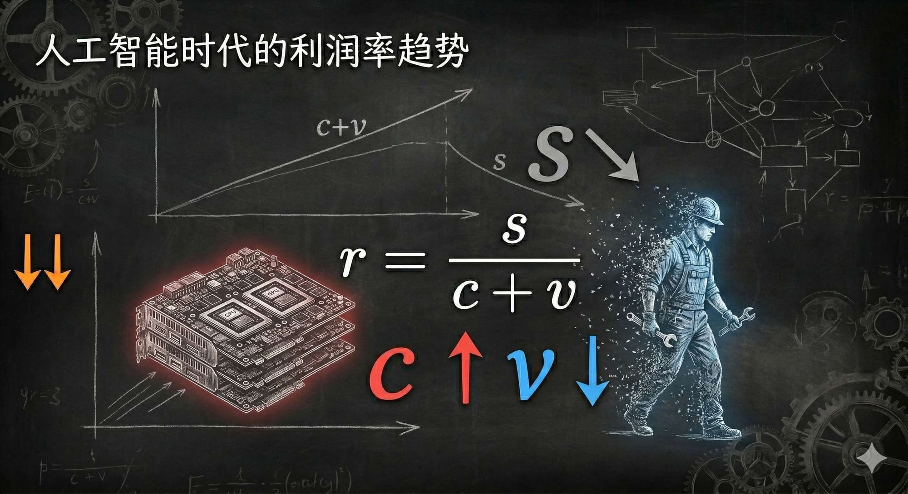
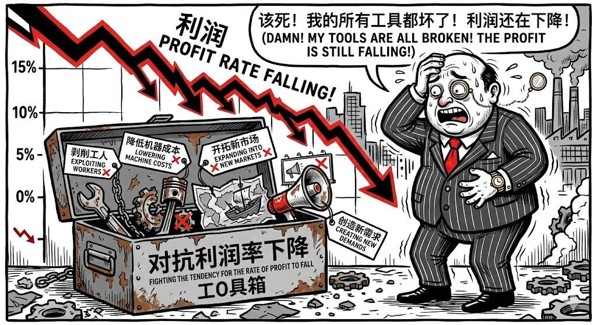
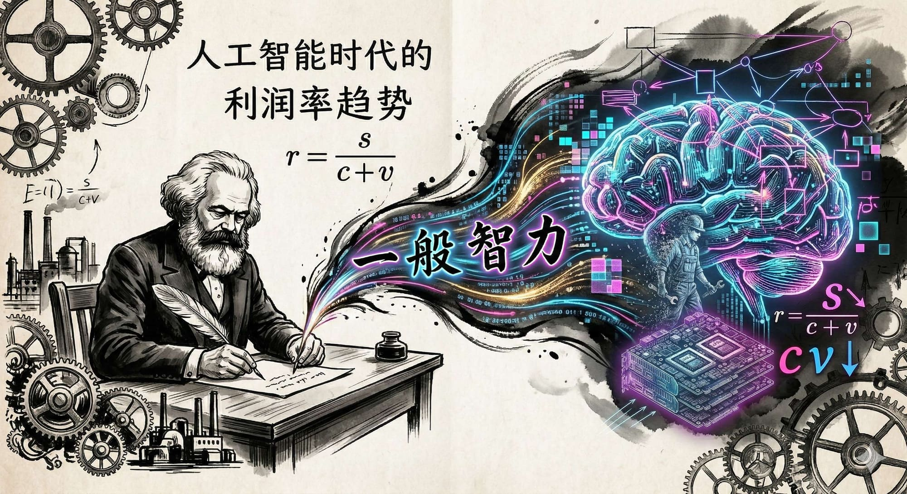
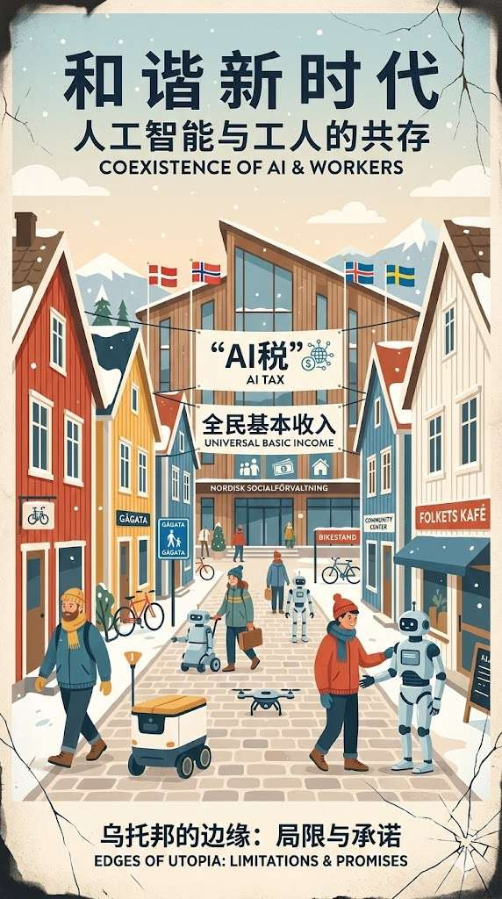
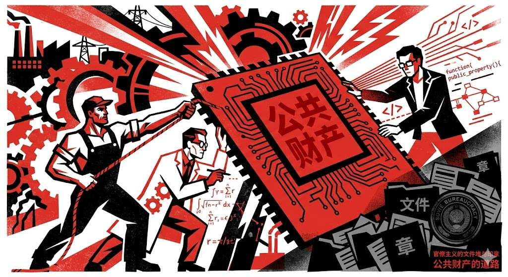

《AI大收割：人类智慧的最后一次“圈地运动”》系列 · 第七篇（终篇）

写一篇两千字的说明，人得忙几个小时，模型几秒钟就能吐出一稿。设想两篇都经核对，读者拿到哪一篇，都能把手上的事办成。那么，省下的几个小时归谁？是作者可以早点回家，是编辑部能多接几单，还是模型服务商从每一单里多收一笔钱？秒表给不出答案。

本系列从标注工人的劳动一路谈到开源模型和公共算力，为的是看清这件事：**知识不必从书架上消失，从知识中取得收益的能力却可以集中到少数人手里。** 到了终篇，最有诱惑力的讲法，是说机器既然能替代活劳动，迟早会让利润消失，替我们结束这场圈地。恰恰不能把希望押在这里。即使利润丰厚，甚至正因为利润丰厚，谁拥有机器、谁能给它定规矩，都已经是今天要争的事。

## 一、同样有用的两篇文章，证明了什么？

它们证明的是：在这个用途上，两种办法都能交付读者需要的东西。这叫使用价值。它们没有证明“慢的那篇价值高，快的那篇价值低”，更没有证明劳动时间从此失效。在马克思的价值分析里，起尺度作用的是在通常生产条件、平均熟练程度和劳动强度下，生产同类商品所需的**社会必要劳动时间**，不是哪位作者这回碰巧花了多久。

如果借助模型写作和核校成了这个行当交付同类说明的通常办法，过去几个小时的手写工时，就未必还能全部算作社会必要的耗费。反过来，如果机器几秒写完，却得让编辑花半天核对，也不能只按下“生成”键到屏幕出字的时间算交付成本。这里要分清的是交付物、通行工艺以及藏到别处的劳动，不是哪篇更像“人写的”。至于售价，独家资料、品牌或一个非用不可的入口都可能让两份有同样用处的说明卖出不同价钱。

马克思在《政治经济学批判大纲》的机器论片段里谈“一般智力”：社会积累的知识可以物化为机器，直接改变人们生产财富的能力。写作的例子有助于理解这层张力：读者能用到的东西可以更多，直接写字的时间可以更少。**财富增加与单位商品耗费的劳动减少并不矛盾。** 模型究竟让谁有条件享受这份财富，才是从“一般智力”通向所有制问题的那一步。

## 二、工资资本占比减半，利润率会怎样？

先在马克思的简化模型里算一遍：$c$ 是预付在设备、原材料等上面的不变资本，$v$ 是预付在劳动力上的可变资本，$s$ 是劳动者在补偿劳动力价值之外创造的剩余价值。为方便比较，设同一计量单位、同一生产期，资本周转一次。在这个口径下，利润率可以写成：

$$
\frac{s}{c+v}=\frac{s}{v}\times\frac{v}{c+v}
$$

看右边两个因子。后一个是工资资本在预付资本中的份额；前一个是剩余价值率。**知道一个因子变小，还不知道乘积往哪边走。**

拿两本假账来验算。第一本：$c=80$，$v=20$，$s=20$。100份预付资本里，工资占20份，利润率是20%。第二本：$c=90$，$v=10$，$s=30$。同样预付100份，工资份额减半，利润率却升到30%。两本账中新创造的价值 $v+s$ 都是40份，变化的是它在工资和剩余价值之间的分割。这个反例不是说企业部署AI以后必定能压低工资，而是说明：**工资支出不是活劳动总量，工资份额尤其不是。**

把条件推到极端，倒是能得到一个明确结论。设整个经济而非一家写作公司都几乎不再使用创造新价值的活劳动：连设备制造、供电、检修和核校也算进来，没有把劳动挪到别的行业或国境以外。在同一价值尺度、相同期间下，若活劳动创造的新价值总量趋近于零，作为其中一部分的剩余价值也趋近于零；若预付资本仍保持在正的下限之上，上式中的总体利润率才会趋零。这是这个理论的**极限情景**。从一家公司少发几份工资，到全社会几乎不再有活劳动，中间隔着的正是需要证明的事。

## 三、怎样知道现实在往哪边走

若要把“趋零”变成关于现实趋势的判断，至少得把三本账对起来。

- **劳动账**：在同一经济体、同一组年份里看各行业就业人数和工时总量，不只看每篇稿子或每件产品的用时。编辑岗位减少时，外包核校、上游设备和服务岗位的工时有没有增加？若劳动转到境外，本国工时下降就不能当成全球劳动消失。工时还只是线索，不会直接告诉我们劳动强度和其中有多少形成了新价值。
- **资本与分配账**：把劳动报酬、经营盈余、资本存量与周转放在可比口径下，说明折旧怎样处理、个体经营者的劳动收入怎样区分。利润额增加不等于利润率增加，几家平台利润率提高也不等于全经济利润率提高。国民账户中的工资、盈余是估算的起点，并不天然就是公式中的 $v$ 和 $s$。要把变化归到AI，还得与行业周期、外包和价格变化等其他解释作比较。
- **购买力账**：受到替代的人能不能转岗，收入变了多少，同一篮生活必需品的价格又变了多少？按收入组看可支配收入和实际消费，才知道谁失去了购买力。信贷、转移支付、投资和公共采购也会影响销售，不能拿一个家庭丢了工资直接推出全社会产品卖不出去。

我仍然愿意问：“AI能替你生产，但能替你消费吗？”这句话有力的地方在于，劳动者往往也正是顾客；它提醒我们盯着**收入落到了谁手里**，不是宣布需求已经崩溃。没有这些总账，我不能断言全社会的利润率朝哪个方向走。但这并不妨碍我们追问，眼前这份自动化收益究竟可以怎样分。

## 四、五条路，放在同一件事上比

设想一套把公共课程做成可检索字幕的服务。做得好，听障学习者能读到原本听不到的课；老师能少做一遍转录；机器认错的术语仍要有人逐句改正。下面五种安排都能用同一套识别技术。不妨每次都问：**机器是谁的，排队规则是谁定的，校对者和学生遇到问题能找谁？**

### 第一条：数字封建主义——入口由平台说了算

若学校、老师和学生都离不开一家平台，连已做好的字幕也难以迁走，平台就不只卖一种服务。它可以决定免费课程排多久、谁可以导出资料、下一轮按什么价格续用。即使校对者贡献了大量订正，也不因此获得报酬议价权或使用模型的权利。我用“数字封建主义”形容这种依附，并不是说市场已经消失；要害在于，对方只须改一张价目表，你却很难换一条路。

### 第二条：在私有制内改良——把一部分收益分回来

平台仍由投资者控制，但社会可以用税收补贴基础服务，或者把自动化收益的一部分用作基本收入。对刚丢了转录工作的人，收入保障不是小事；学校也可能因此付得起字幕费用。不过，收到补贴不等于有权决定下一版模型先支持哪种语言。要判断改良走了多远，就把这两件事分开看：**分到多少钱，参与了什么决定。**

### 第三条：中国路径——公共投资能否改变准入条件

这是前一篇留下的问题。国家投资基础设施、规定公共服务目标，同时让企业竞标运营，干预就不只发生在利润分完之后，也发生在“建什么、交给谁用”之前。设若公共算力优先留给无障碍课程，学校不必同广告客户竞价，公共目标就改变了资源去向。反过来，若资助名额按营收或配套出资分配，最缺钱的学校可能压根进不了门。中国路径值得观察的不是一块“公共”招牌，而是申请资格、实际使用名额、采购合同里的劳动条件，以及落选者有没有申诉渠道。

### 第四条：全面公有化或社会化——机器归公共，队由谁排？

若模型和机房都由社会共同出资持有，可以把字幕当作基础教育服务，而不要求每节课都赚钱。但两所学校同时等着上线，算力只够一家先用，公有产权不会自己排出先后。学习者与校对者能否参与排期？经费不足能否公开，纠错的工时是否列入预算？如果只有管理者能回答，所有者虽然换了，使用者和劳动者未必多了发言权。数据的公共治理也不等于不经同意就把师生的录音向所有人公开。

### 第五条：数字公地——使用者能否一起维护、必要时带走

另一种办法是学校、教师、学习者和技术维护者结成合作组织，共享有权使用的模型和术语表，共筹算力，自己选人管理预算。它与全面公有化的差别不在“更免费”，而在遇到分歧时，参与者可以表决、替换维护者，也可以依约带走自己的课程和共同成果，另作安排。难处一样实在：服务器要付电费，字幕要有人校。若机房始终免费借自一家平台，又只能靠少数志愿者熬夜改错，这片公地的独立和公平就没有账面上那么大。

## 五、同一个社会，甚至同一节课，可以同时走几条路

设想学校花公共经费买了企业的算力，采用社区维护的术语表，再把字幕锁进只能订阅的平台。问“这节课到底姓公姓私”，很难得到一个不别扭的答案；沿着课程逐段问却很清楚：钱是公共出的，知识是大家修的，最后一道门的钥匙还在平台手里。若合同改成允许学校带走字幕，同时给校对者支付报酬，所有制的大名字可能一个没变，老师、学生和劳动者手上已经多了切实的选择。

这五条路因此不是五个国家的座次，更不是技术成熟度的五级台阶。提高收入保障、建设公共算力、支持数字公地可以同时进行，也可能互相抵消。我更愿意用一个朴素的尺度判断它们：原来只能接受安排的人，如今有没有权改规则，有没有条件说“不”，省下来的劳动有没有变成他自己可以支配的时间？

系列开始时问，AI是资本主义的巅峰还是掘墓人？绕了一圈，我的回答是：**历史不是自动扶梯。** 模型能在几秒内生成同样有用的一页纸，却不能决定省下的几个小时属于谁。要让共同创造知识的人也有权决定怎样使用它，靠的不是等利润率走到零，而是从机房的产权、工人的合同和学生面前的那道门，一件一件地改。
