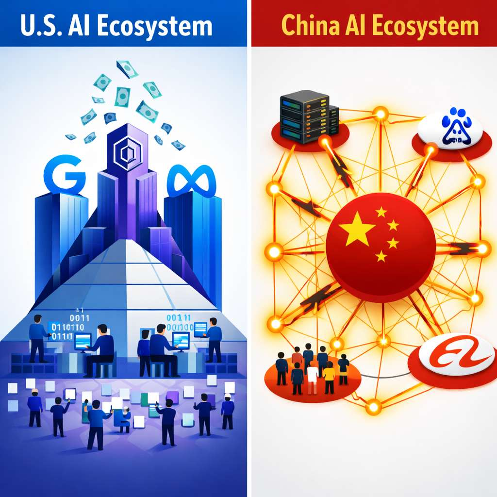
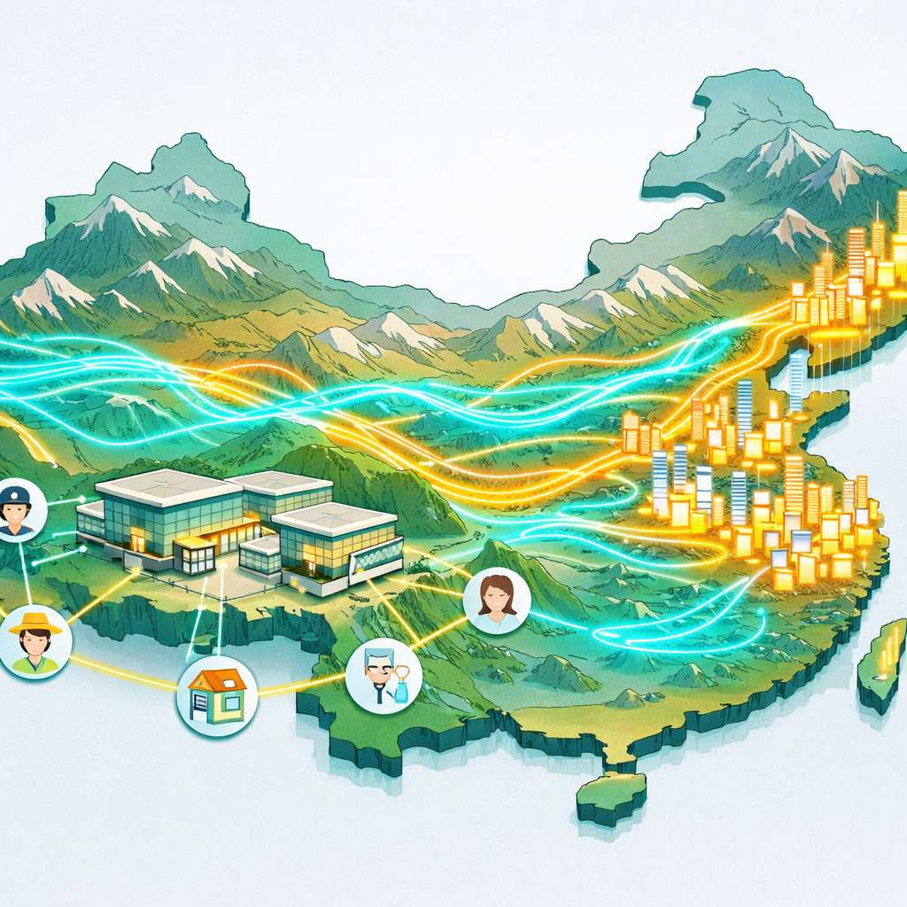
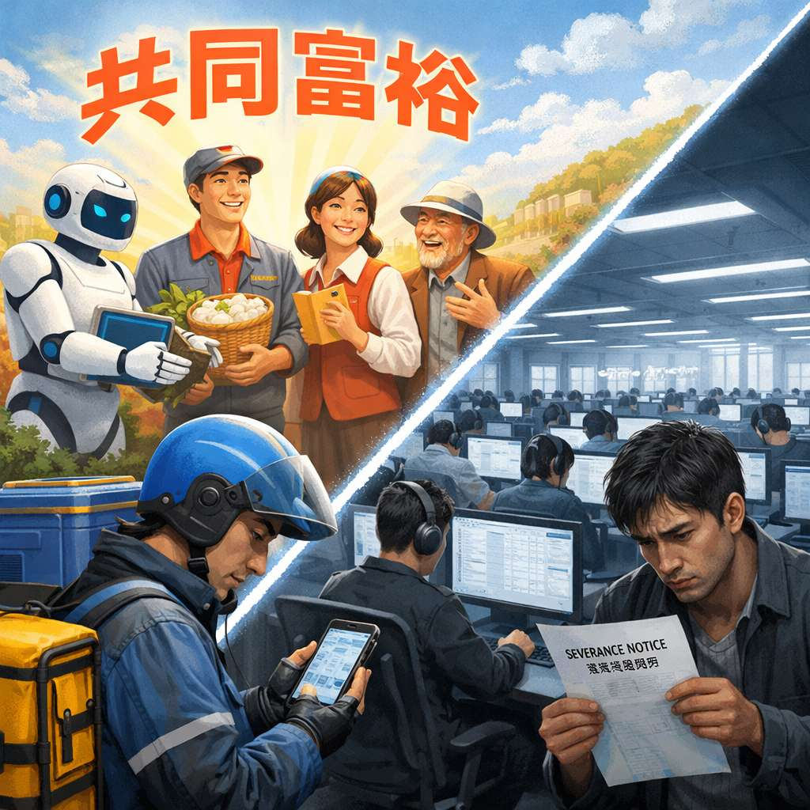
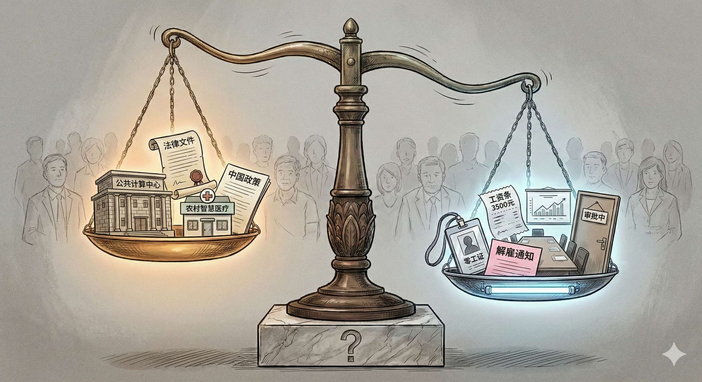

《AI大收割：人类智慧的最后一次"圈地运动"》系列 · 第六篇

**当一个马克思主义执政党遇到AI**

## 一、为什么不能绕开中国？

### 1.1 一个不应有的理论盲区

讨论AI的出路时，人们会谈到全民基本收入、数据公地、合作社。还有一条路，不妨从一座算力中心问起：国家出资建了机器，是不是就等于大家都能用？

中国明确以马克思主义为指导思想，又以产业政策介入AI发展。无论你最终如何评价这种实践，都值得把政策承诺和实际使用者放在一起看。

### 1.2 本文的方法论声明

我们要做的是：用前五篇文章建立的马克思主义分析工具，检验中国在AI领域的实践。我们会看它在哪些方面展现了不同于纯粹资本主义的特征，在哪些方面面临内在的矛盾和张力，以及这些张力可能走向何方。

让事实和理论逻辑自己说话。

## 二、结构性差异：中国的AI发展与美国有什么不同？

### 2.1 全景对比

比较时最容易犯一个错：拿一国的利润去向，对照另一国的政策愿望。下面这张表不给两国打分；选定同一年、同类项目后，两栏才有可比的答案。

| 要检验的事 | 看美国项目时 | 看中国项目时 |
|---|---|---|
| 谁有资格用算力 | 查中心公布的申请、收费条件 | 查中心公布的申请、收费条件 |
| 机器实际给了谁 | 查获配机构类型和机时 | 查获配机构类型和机时 |
| 谁分到节省下来的钱和时间 | 看企业账目、工资和工时怎样变 | 看企业账目、工资和工时怎样变 |

制度差别可能就藏在同一道题的不同答案里，而不在表头里。

### 2.2 差异的层次

我们可以把这些差异分为三个层次：

**制度层面的差异：** 公有制经济的存在、国家对经济的深度介入能力——这些是制度性的，不是政策选择的问题，而是体制结构的问题。

**政策层面的差异：** 数据立法、产业政策、反垄断行动——这些可以在不改变体制的情况下被调整，是政策选择的结果。

**话语层面的差异：** "共同富裕"、"科技向善"、"以人为本"——这些是政策文本的表述，需要检验它们是否被真正落实。

只有在三个层次上都能验证差异的实质性，我们才能说这是一条真正不同的路。

---

## 三、国家怎样约束资本？

### 3.1 具体实例

2020年11月蚂蚁集团上市暂缓，2021年滴滴接受网络安全审查、阿里巴巴受到反垄断处罚。这是平台企业受到干预的例子，不是AI红利已经重新分配的例子。

要同美国比较，还得看同一时期、同类案件用了什么执法手段，决定是否得到执行。单凭这几个中国案例，不能说类似干预在另一国不可能发生。

### 3.2 马克思视角的分析

从马克思主义的角度来看，这些事件的意义是什么？

我们前面五篇文章诊断的核心问题之一是：AI的生产资料——算力、数据、模型——被高度集中在少数私人资本手中，而且在纯粹的市场经济体制下，这种集中趋势几乎无法被逆转。

中国的实践展示了一种可能性：一个国家有能力限制甚至重新配置科技资本的权力结构。

这不是说中国已经做到了AI生产资料的社会化。能够约束一家平台，并不直接回答标注工人分到了什么。

**然而，有能力做和真正去做之间，隔着巨大的距离。** 约束科技巨头的能力是一回事，运用这种能力来推动AI的社会化、确保AI红利惠及全民——这是另一回事。

### 3.3 与前面分析的对接

第五篇区分了两件事：可以下载模型权重，不等于能够支配训练它的算力。

中国模式提供了一种非市场手段约束资本的可能性。国家可以通过行政手段和法律手段，限制科技巨头的垄断行为，甚至直接介入算力和数据的分配。

但这是否意味着前五篇诊断的问题在中国有解？这需要更细致的分析。

---

## 四、公共算力基础设施——回应第四篇的核心问题

### 4.1 "东数西算"与国家级智算中心

2022年，中国正式启动了"东数西算"工程——将东部的数据计算需求引导到西部，在全国布局8个国家算力枢纽节点和10个国家数据中心集群。

与此同时，多个城市建设了国家级智能计算中心（智算中心），面向企业、研究机构和开发者提供AI算力服务。

**这代表了一种将算力从纯粹的私有商品转变为公共基础设施的尝试。**

### 4.2 为什么这一点特别重要？

让我们回顾第四篇的区分：知识还可以供人阅读，把它大规模加工成随问随答的服务，却要用到相当的算力。

如果算力成为公共基础设施——像电网、公路、自来水系统一样由国家建设和运营——那么"炼化知识"的能力就不再是少数私人资本的特权。中小企业、研究机构、甚至个人开发者，都有可能获得足够的算力来训练和部署AI模型。

**这直接触及了AI时代"生产资料私有制"的核心。** 如果说AI的核心生产资料是算力，那么算力的公共化就是在某种程度上实现生产资料的社会化。

### 4.3 现实与理想的差距

设想一位没有单位背书的研究者去申请机时。第一关不是机器有多少，而是申请表上有没有他能勾的身份。即便能申请，最低购买量、适配费用和排队时间也会影响他最后能不能用上机器。

要判断一座中心是否普惠，得把它**同一轮**的申请细则和分配结果并排看：谁能报，谁来定配额，获配者各是哪类机构，实际用了多少机时？一份建设公告回答不了后半截。没有这一对材料，我不把“公共”二字算成中小团队已经受益的证据。

---

## 五、数据治理——回应第三篇的问题

### 5.1 中国的数据立法

中国数据治理可以从三份不同对象的规范看起：

**《数据安全法》（2021年）：** 建立数据分类分级保护制度。

**《个人信息保护法》（2021年）：** 对个人数据的收集、使用、存储和跨境传输做出了详细规定。

**《生成式人工智能服务管理暂行办法》（2023年）：** 面向境内公众提供生成式人工智能服务时，训练数据等应有合法来源。

在制度框架上，这些法律提供了一种可能性：将数据视为需要受到公共利益约束的资源，而不是任由企业自由攫取的原材料。

### 5.2 与"数字劳动"分析的对接

第三篇问的是：当用户创作被用作训练材料时，用户能否决定用途，又能否分享收益？个人信息保护回答的是其中一部分，不涵盖所有作品及其报酬。

中国的数据立法是否改变了这个结构？

**先分清适用范围。** 《个人信息保护法》针对个人信息的处理。同意是合法依据之一，不是唯一依据；例如为订立、履行个人作为一方当事人的合同所必需，与另行征求同意不是一回事。

实践中的问题更具体：服务功能确实需要哪些信息？哪些是可选用途？如果可选用途和基本功能被捆在一个按钮上，用户点了“同意”，未必就有了真正的选择。

### 5.3 一个更尖锐的问题

还有一个需要直面的问题：**即使数据的管理者由企业换成公共机构，普通用户获得了哪些新的决定权？**

对于普通用户来说，无论数据的控制者是私人企业还是国家机构，只要用户自身缺乏对数据的真正控制权，结构性的不对等就依然存在。

### 5.4 数据公地的可能性

从积极的角度来看，中国体制确实比纯粹的市场经济体制更有条件建设某种形式的"数据公地"——由公共机构管理、面向社会开放的数据基础设施。

**国家的统筹能力是制度优势：** 它可以打破企业之间的数据孤岛，推动数据的社会化利用。

**但制度风险同样显著：** 公地可能变成"官地"——由政府机构控制、服务于行政目标而非公共利益的数据系统。数据公地的关键不仅在于"由谁建设"，更在于"谁来治理"——是自上而下的行政管理，还是有公民参与的民主治理？

---

## 六、共同富裕与AI红利分配

### 6.1 政策目标与AI的结合

"共同富裕"是中国政府近年来反复强调的核心政策目标。如果将这一目标与AI的发展结合起来，其逻辑链条是：

**AI大幅提高了生产力 → AI产生的经济收益不应完全归资本所有 → 通过再分配机制让AI红利惠及全民**

这个逻辑与西方讨论的"AI税+UBI"有相似之处，但也有重要差异。

**相似点：** 都承认AI可能加剧不平等，都主张某种形式的再分配。

**差异：** 中国框架中，国家不仅是"再分配者"（通过税收和转移支付），还可以是"生产的组织者"（通过国有资本参与AI产业、通过产业政策引导AI发展方向）。这意味着中国至少在理论上可以在"初次分配"环节就介入——不只是事后分蛋糕，而是在做蛋糕的过程中就影响谁能分到多少。

### 6.2 从哪一环介入？

如果公共投资附有培训、开放服务或劳动保障条件，影响分配的时点就在拨款时，而不只在征税后。反过来，基金也可能只考核投资回报。要辨认是哪一种，得看投资条件和钱最后怎样使用。

### 6.3 现实检验

但政策目标和现实之间可能存在巨大的鸿沟。让我们用一些可观察的指标来检验：

**岗位变了以后：** 假如一家客服中心采用AI，是减员、调岗，还是缩短了工时？要比较上线前后的用工记录和培训安排，不能从能自动答复多少问题推出失业人数。

**新增收益的去向：** 节省的成本是降价、涨薪、再投资还是分红？企业总利润也不等于AI业务的新增收益。没有同一时期、同一口径的账目，不能说两国的分配已经相同或相反。

---

## 七、必须直面的深层张力

### 7.1 张力一：市场竞争逻辑与社会主义目标的内在矛盾

对需要收回投资的AI企业来说，压低数据加工成本是竞争中的一个诱因。具体到一家企业，用了谁的数据、由谁标注、工钱怎么定，都得看实际安排。

我想追问的是：**国家保留干预权，是否足以改变企业平时与劳动者谈条件的方式？**

**还是说，只要市场竞争存在，剥削结构就必然在日常运作中被再生产出来？** 国家可以在某些关键时刻进行干预——比如2021年的科技整顿——但在干预之间的漫长日常中，资本逻辑依然在运转。

**这就像一个水坝：国家偶尔打开闸门调节水位，但水在闸门之间依然按照地心引力向下流。资本逻辑就是那个"地心引力"——只要市场竞争的基本框架存在，它就会自动运作。**

### 7.2 张力二：国家是劳动者的代表，还是另一种资本运营者？

在马克思主义的经典理论中，社会主义国家是无产阶级的国家——它代表劳动者的利益，约束和逐步消除资本的权力。

但现实远比理论复杂。

**地方政府与科技企业的共生关系：** 地方政府对GDP增长和就业创造有强烈的需求。科技企业是GDP和就业的重要来源。这种共生关系可能使地方政府在企业利益和劳动者利益发生冲突时偏向前者。一个具体的例子：当地方政府引进AI企业建设产业园时，它更关心的是投资规模和就业数量，还是工人的劳动条件和收入水平？

**国有资本的角色：** 中国的国有资本深度参与了AI投资。国有风险投资基金、国有企业的AI研发投入——这些都是"国有资本"。但国有资本本身也需要追求投资回报。当国有资本投资AI企业时，它的行为逻辑与私人资本有本质区别吗？

**国际竞争的压力：** 中美科技竞争迫使国家将AI的战略价值置于突出位置。在这种压力下，国家可能优先考虑AI的技术突破和产业竞争力，而将分配正义的优先级降低。

### 7.3 张力三：AI能力的双面性

同一种AI能力，在不同的应用场景下可以产生截然不同的社会效果。

| 同一种能力 | 正面潜力 | 风险面 |
|------------|----------|--------|
| 国家对数据的控制 | 防止私人资本垄断数据 | 可以成为监控工具 |
| 国家对AI企业的约束 | 纠正市场失灵 | 可以服务于非经济目的 |
| 国家主导的AI战略 | 确保AI服务公共利益 | 可以优先服务于国家权力本身 |
| AI在公共服务中的应用 | 提升教育和医疗效率 | 可以加深对公民行为的管理 |

这种双面性不是中国独有的——任何国家的AI治理都面临类似的问题。但在中国的语境中，由于国家权力的强度更大，双面性的两面也都被放大了。

我们需要正视这种双面性，而不是选择性地只看一面。

### 7.4 张力四：国际竞争的压力

中美科技竞争是影响中国AI发展方向的最重要外部因素之一。

在"赶超"压力下：

- AI发展的优先级可能被赋予安全和战略维度，而非社会福利维度
- 资源可能集中到少数头部企业和国家项目中，而非分散到更广泛的社会
- 对效率和速度的追求可能压倒对公平和参与的关注
- 国际技术封锁（如芯片出口限制）可能导致资源更加集中

**一个更根本的问题浮现了：在全球资本主义竞争的压力下，任何国家——无论其内部制度如何——是否都不得不遵循某种资本积累的逻辑？** 如果中国不在AI领域快速积累"技术资本"，它就可能在国际竞争中落后——而这种积累过程本身就包含了对劳动的压榨和对公平的牺牲。

这不是一个可以轻易回答的问题。

---

## 八、一个关键的理论问题：AI是否为社会主义提供了物质基础？

### 8.1 马克思的前提

马克思从未主张社会主义可以在贫穷的基础上建成。恰恰相反，他反复强调：**社会主义需要生产力的高度发达。** 只有当物质财富极大丰富、劳动不再是人们为了生存不得不忍受的痛苦时，"各尽所能、按需分配"的理想才有实现的物质条件。

### 8.2 AI对社会主义的理论意义

如果认真对待马克思的这个前提，AI的出现具有重大的理论意义：

**AI极大提高生产效率：** 如果AI能够承担大部分的生产性劳动，那么物质财富的极大丰富就不再只是一个遥远的愿景——它在技术上正在变得可能。

**AI优化资源配置：** 社会主义经济面临的经典难题之一是信息问题——中央计划者如何获取和处理分散在整个经济体中的信息？AI的强大数据处理和模式识别能力，为这个问题提供了新的技术解法。

**AI替代大量劳动：** 如果AI可以替代大部分必要劳动，那么人类就可以将更多时间用于"自由发展"——创造性活动、社交、教育、艺术、科学探索。这正是马克思在《大纲》中描绘的理想状态。

马克思在《大纲》中写道：

> *"真正的财富是所有个人的发达的生产力。那时，财富的尺度决不再是劳动时间，而是可以自由支配的时间。"*

AI让这个理想比以往任何时候都更接近技术上的可行性。

### 8.3 但技术不自动带来解放

然而，我们必须同时坚持马克思的另一个核心洞察：**技术不自动决定社会形态。**

AI可以用来解放人类——如果它被用来减少必要劳动时间、提供免费的公共服务、帮助每个人实现自由发展。

AI也可以用来压迫人类——如果它被用来替代工人而不提供保障、监控公民行为、将财富集中到更少的人手中。

同一种技术，在不同的生产关系下产生截然不同的结果。蒸汽机可以驱动工厂的血汗车间，也可以驱动公共铁路系统。**关键永远是：谁控制技术？为了谁的利益？**

这回到了马克思最根本的问题——**生产关系**。

### 8.4 中国的独特位置

如果我们接受上面的分析，中国就处于一个理论上非常独特的位置。

它同时具备两个条件：

1. **正在高速发展AI**——生产力条件正在成熟
2. **拥有社会主义的制度框架**——至少在制度层面，具备将生产力发展转化为社会解放的可能性

这使得中国处于一个历史性的交汇点：AI提供了社会主义所需要的物质基础，而社会主义的制度框架（如果被认真执行的话）提供了将AI导向公共利益的制度可能。

**但——这是一个巨大的"但是"——这两个条件是否在实践中真正结合？** 还是说它们各走各的路——AI发展遵循资本逻辑，社会主义框架停留在意识形态层面？

---

## 九、检验标准：如何判断中国方案是否真正走出了不同的路？

### 9.1 目前的初步观察

放在一起看，图景是混合的。能指认的是公共算力建设和数据立法；它们给改变分配提供了工具，但不是改变已经发生的证明。

**我最想看到的三份结果：** 一座公共算力中心按使用者类型公布的实际机时，一家采用AI的企业在转岗前后的工资与工时，以及一次制定分配规则时使用者提出的意见最后改动了哪一条。三者分别回答：谁在用，谁受益，谁说了算。
- AI发展方向的决策过程缺乏广泛的公众参与

### 9.2 一个开放的结论

**中国模式处于一个动态的、未完成的、充满张力的进程中。** 它展现了一些不同于纯粹资本主义的制度特征——国家对资本的约束能力、公共基础设施建设、分配正义的政策目标。但这些特征与市场竞争的日常逻辑之间存在深刻的张力，而这种张力的解决方向尚未明朗。

它既不是已经实现的社会主义答案，也不能被简单否定为"换了名字的资本主义"。它的走向取决于上述张力如何在实践中被解决。

---

## 十、本篇结论

中国模式是当今世界在AI问题上最重要的现实参照。它展示了一种不同于西方纯粹资本主义的制度可能性：国家保留对AI资本的约束能力，推动公共算力基础设施建设，在数据治理和收益分配上具备制度空间。这些特征使它至少在理论上有条件回应前五篇诊断的核心问题。

但这个可能性能否真正实现，取决于一个根本性的检验：**在市场竞争的日常逻辑与社会主义的长远目标之间，在国家权力的效率与人民利益的真正优先之间，中国能否找到一条可持续的平衡之路。**

AI为社会主义提供了前所未有的物质基础，但物质基础从来不自动转化为社会解放——这中间需要的是正确的生产关系和真正的制度选择。

**这不仅是中国的问题，更是整个人类在AI时代面临的根本问题：当机器可以完成大部分劳动时，我们要建设一个怎样的社会？**

---

**上一篇：** [第五篇：AI开源为何没有打破垄断](03-AI大收割05-AI开源为何没有打破垄断.md)

**下一篇：** [第七篇：AI时代的五条道路](01-AI大收割07-AI时代的五条道路.md)

