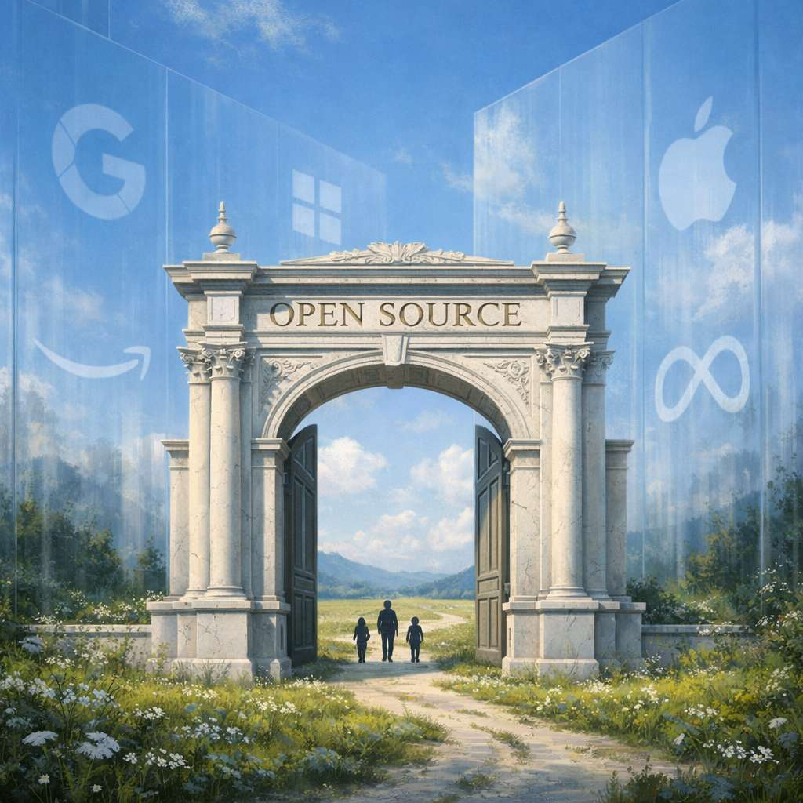
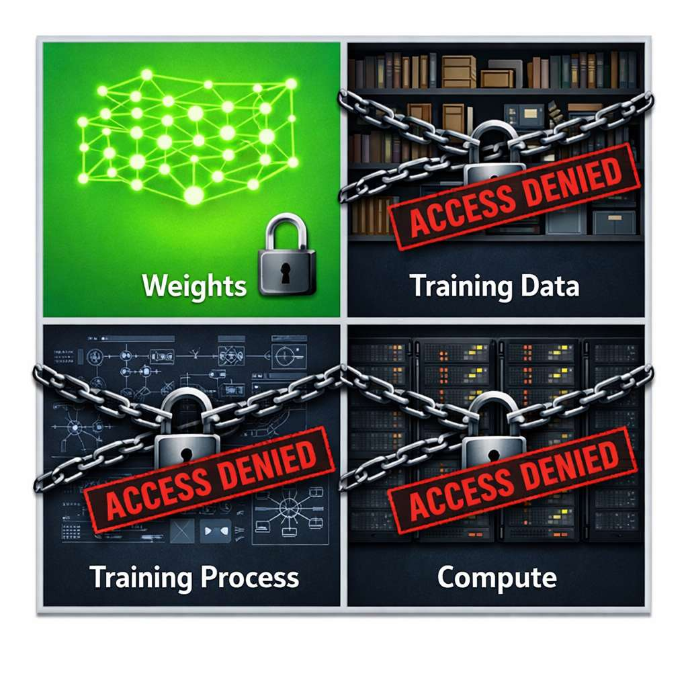
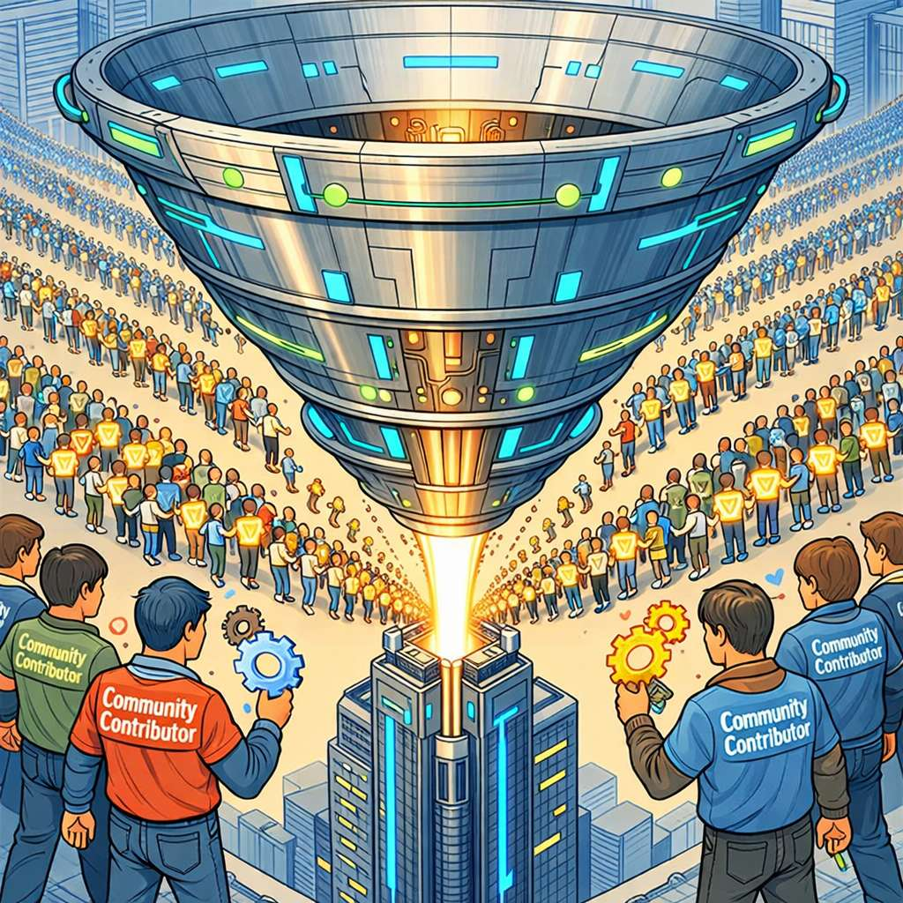
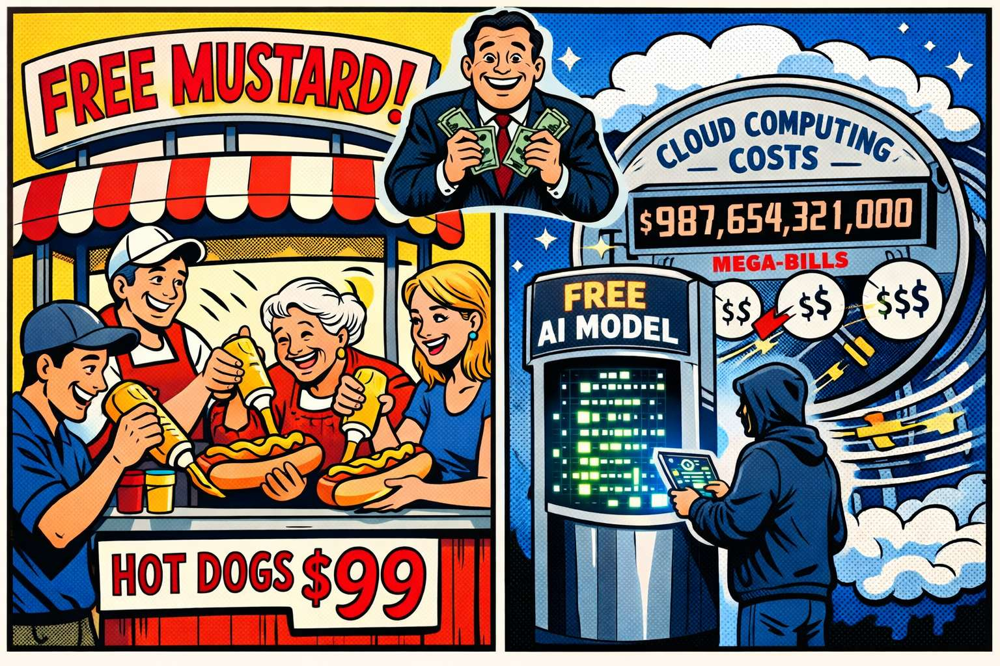
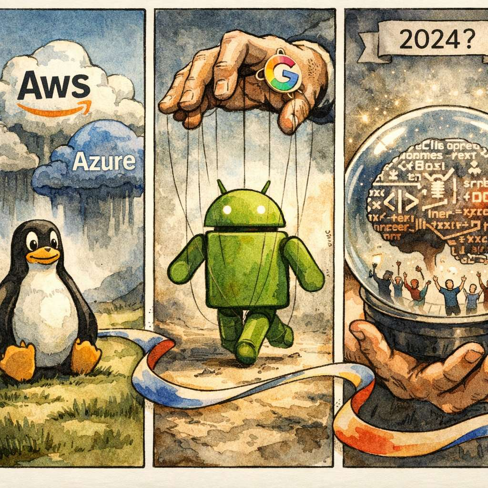
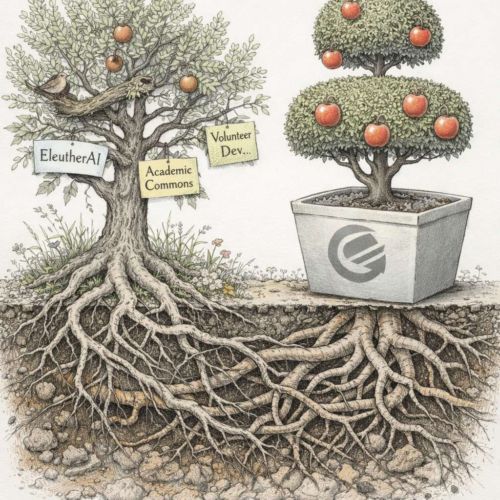

## 一、一个朴素的疑问

在前面几篇文章中，我们论证了AI背后的多层价值攫取体系，以及人类集体知识如何被系统性地私有化。面对这些论证，许多人会提出一个看似致命的反驳：

一个常见的反问是：既然开发者已经能下载一些模型的权重，在本地运行甚至继续微调，怎么还能说知识被私有化了？

这个反驳看起来很有道理。开源运动，在其最初的精神中，确实代表了一种崇高的理念：知识应该自由流通，代码应该向所有人开放，技术进步应该惠及全人类。

但事情真的这么简单吗？

让我们仔细拆解这个问题。“开放”可以说的是文件能不能拿到、许可让不让你改，也可以说的是你有没有条件从头做一遍。这不是同一把尺。

---

## 二、首先看清事实：什么被"开源"了？

### 模型的四个组成部分

要理解AI领域的"开源"到底意味着什么，我们首先需要分解一个大语言模型的四个核心组成部分：

1. **模型权重（Model Weights）：** 训练完成后的模型参数——这就是那个可以"回答问题"的AI系统本身。
2. **训练数据（Training Data）：** 用来训练模型的海量文本数据集。
3. **训练过程（Training Process）：** 训练方法论、超参数设置、数据清洗策略、对齐技术、评估方法等。
4. **训练算力（Compute）：** 执行训练所需的GPU集群和计算基础设施。

现在，让我们看看所谓的"开源"AI模型到底开放了什么。

### "开源"的实际内容

不妨拿一个公开权重的版本作检查：发布页提供了权重文件吗？随该版本附的许可证允许修改、再分发、商用吗？数据清单、处理代码、训练记录又公开到哪一步？不能只凭一个模型家族的名字替各版回答。

下载训练好的参数已经很有用，不只是看一眼演示。只要许可允许、硬件合适，你可以离线运行，也可以拿自己的材料微调。可这仍不等于拿到了原始训练资料，或取得了任意用途的授权。

### 餐厅类比

想象你去了一家高级餐厅。厨师做完菜后，慷慨地端到你面前让你免费品尝。你可以评价这道菜，甚至可以在上面撒点盐调味。

但是：
- 食谱？不给你。
- 食材的供应链？不告诉你。
- 厨房的设备？你用不了。
- 厨师的培训方法？那是商业机密。

如果只端出菜，这和交出食谱就不一样。反过来，即使食谱完全公开，厨房也不因为租金昂贵就使食谱变成秘密。**公开什么是一个问题，谁负担得起重做一遍是另一个。**

### 波音设计图纸类比

或者用一个更极端的类比：假设波音公司"开源"了787飞机的设计图纸。你可以在网上自由下载这些图纸。但是——你能造出一架787吗？

图纸公开，并不替你备好材料、厂房和工程团队。但不能因此说图纸没公开。对应到模型：从零预训练要重走数据和算力那条长路；拿已有权重改一道“菜”，却可以省去其中许多工序。

---

## 三、企业开放模型可能得到什么？

下面算五笔可能的账。它们解释的是为什么开放与商业利益可以并存，不是任何一家企业的内部决策记录。

### 第一笔：给收费服务添一个替代品

如果用户能在本地运行合用的模型，一部分按次付费的调用就有了替代品。不过，部署和维护也有成本，省掉订阅费不等于每个团队都会搬走。

### 第二笔：分享社区改进

开发者可能为了自己的语言或行业做微调，公开测试结果。其他开发者能用，发布基础模型的公司也可能受益；究竟哪些改进被吸收，还得看具体版本。

这里和第二篇的“数字劳动”有一个相通的问题：成果流向了谁？也有一个区别：贡献者可以自己使用改过的模型，或在许可范围内把它交给别人。企业受益不能反过来证明贡献者受骗了。

### 第三笔：让互补业务更值钱

在科技行业，有一个经典的商业策略叫做"商品化互补品"（commoditize your complement）。

逻辑是这样的：如果你的利润来自于产品A，那么你应该尽量让产品B变成免费的——前提是A和B是互补品，人们通常一起购买它们。

一个生动的比喻：如果你是一家热狗店老板，你应该让芥末酱免费。因为免费的芥末酱会增加热狗的销量，而你的利润来自热狗。

在AI领域：
- 对Meta来说，"热狗"是它的社交媒体平台和广告业务，"芥末酱"是大语言模型
- 对Google来说，"热狗"是搜索广告和云服务，"芥末酱"是AI模型
- 免费的“芥末酱”可能促进核心业务，也可能只给开发者省下一笔开销

再往前想一步：如果许多应用都按同一模型的接口开发，围绕它提供云服务、技术支持和定制的人就多了一门生意。但谁有定价权，还得看用户能否换一家服务、换一套模型。

### 第四笔：在监管讨论中占据有利位置

公开权重可以成为公司回应公众质疑的理由。它确实方便独立测试，却不能替代对数据来源或市场集中度的审查。能否影响监管决定，是另一个需要证据的问题。

### 第五笔：吸引愿意公开工作的研究者

对希望发表论文、分享代码的人，一家公司让不让研究成果公开，会影响这份工作的吸引力。这既可能符合公司的利益，也可以符合研究者本人的愿望。

---

## 四、开源打破垄断了吗？——一个反直觉的答案

直觉告诉我们：开源应该打破垄断。如果模型权重是公开的，任何人都可以使用，垄断怎么可能持续？

但现实给出了一个反直觉的答案。

### 同一份权重，两种算力账

运行已有模型、用少量行业数据做参数高效微调、从头预训练，不能共用一张报价单。尤其是预训练，除正式训练的机器时间，还可能有数据整理、试验和失败重跑的开销；不说明算了哪几项，报一个总价并没有多大意义。

能下载权重的团队，不一定有能力从头训练前沿模型；但它也不必先建“钢铁厂”，才有资格用现成的钢铁造东西。开放降低了某些创造的门槛，没有抹平所有门槛。

### 中小公司的依附加深

对小公司，现成的基础模型是一个真机会。代价是，如果应用深度依赖某种架构，日后换模型就要重新适配。开放能减少对单一收费接口的依赖，也可能带来另一种依赖；要看团队能不能迁移。

### 历史的教训

这不是第一次发生。

**Linux的故事：** 内核可以开放，建立在它上面的云服务仍然可以收费。**Android的故事：** 开放的系统代码与附带的应用商店、平台服务并不是同一件东西。

AI也值得这样分层看：应用层的选择多了，基础设施层的选择未必跟着多起来。

---

## 五、真正的社区开源与资本驱动的"开源"

### 两种截然不同的力量

在AI开源领域，存在着两种性质截然不同的力量：

**第一种：真正的社区开源。** 这些项目由理念驱动，旨在让AI技术成为公共品。

- **EleutherAI：** 一个由志愿者组成的去中心化研究团体，致力于开发真正开放的大语言模型。他们不仅开放模型权重，还开放训练数据和训练过程。
- **学术界的开放传统：** 大学和研究机构长期以来秉持知识共享的理念，发表论文、公开代码、分享数据集。
- **Hugging Face社区：** 虽然Hugging Face本身是一家公司，但它构建的平台催生了大量社区驱动的开源项目。
- **各种小型开源项目：** 全球有无数独立开发者和小团队在做真正的开源AI工作。

**第二种：企业主导的开放。** 公司和社区可能用到同一份成果，但不一定对下一版的训练方向有同样的决定权。

### 结构性劣势

真正的社区开源力量是存在的，而且它们做出了重要的贡献。但它们面临着巨大的结构性劣势：

- **资源：** 训练要持续支付机器和人员费用，能否得到长期资助，影响社区能够承担哪些任务。
- **影响力：** 能发布权重和能让自己的做法成为行业标准，不是一回事。

### 被定义的"开放"

如果公共讨论只问“权重能不能下载”，“开放”就容易成了品牌标签。比争一个名号更有用的，是继续问：能改吗？能带走吗？数据和方法开放到了哪一步？

---

## 六、马克思的视角

### 两种力量的本质

如果我们用马克思的理论来审视AI开源领域的这两种力量，可以得到一个非常清晰的分析：

**真正的社区开源 = 生产力社会化趋势的表现。**

马克思指出，随着生产力的发展，生产过程必然趋向社会化——越来越多的人参与协作，知识和技术越来越成为社会共同财富。真正的开源社区正是这种趋势的具体表现：全球的开发者自发协作，共享知识，共同推进技术进步。这是人类合作本能和知识共享精神在数字时代的展现。

**资本驱动的"开源" = 资本对社会化趋势的收编和利用。**

资本从来不是铁板一块地反对一切社会化。它的策略更加灵活——**当社会化趋势对资本有利时，资本会主动推动社会化，并将其纳入自身的积累逻辑。**

当开放能够带动互补业务时，公司不必放弃商业利益就能分享技术。这是一个可能的激励，不是对某次发布动机的定论。

### 基本矛盾的具体展开

两种力量之间的矛盾——真正的社区开源与资本驱动的"开源"——实质上就是马克思所说的**生产力社会化与生产资料私有制之间的基本矛盾**在AI领域的具体展开。

生产力的社会化要求知识、技术、算力成为社会共有的财富。但生产资料的私有制意味着算力被少数公司垄断、数据被企业圈占、模型的核心训练过程是商业机密。

开源运动试图调和这个矛盾——在不改变所有制的前提下，通过共享来抵消私有化的负面影响。但正如我们所看到的，在资本主义条件下，**即使"开放"也可以被资本逻辑吸收为积累手段。**

这不是说开源运动毫无意义。它确实扩大了技术的可及性，培养了大量的AI人才，促进了知识的传播。但它不能从根本上改变权力结构。只要算力的所有权、数据的控制权、以及AI发展方向的决定权仍然掌握在少数资本手中，开源就只能是在这个权力结构内部的有限抵抗——而且这种抵抗随时可能被收编。

### 一个冷静的结论

回到最初的疑问："开源不就意味着知识没有被私有化吗？"

我们现在可以给出一个明确的回答：

**不。开放权重扩大了使用和改进模型的机会，却不自动分散算力、数据和基础研发的控制权。哪一层更开放、哪一层仍然集中，要分别判断。**

那么，如果只靠开放权重不能解决问题，是否存在一种不同的制度安排？

让我们把目光转向东方。

---

_上一篇：[第四篇：知识私有化与提取能力垄断](04-AI大收割04-知识私有化与提取能力垄断.md)_

_下一篇：[第六篇：中国道路与AI治理](02-AI大收割06-中国道路与AI治理.md)_

