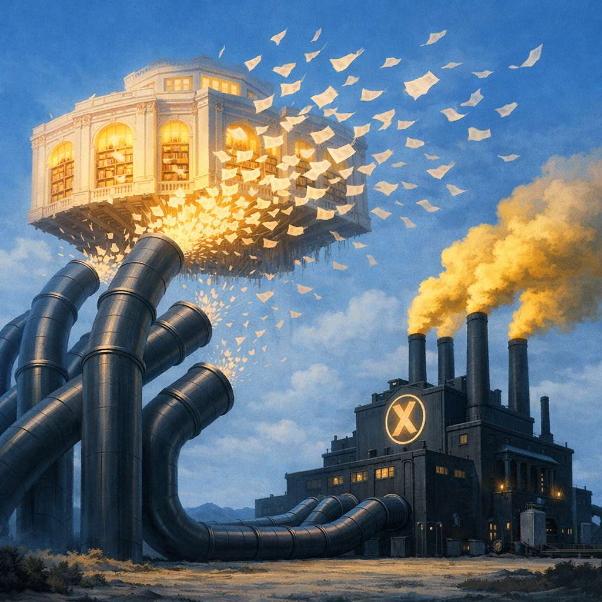
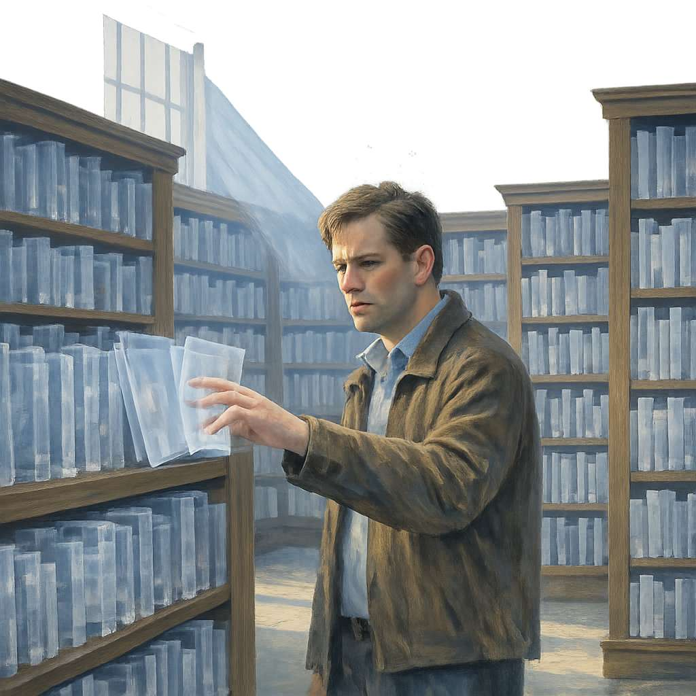
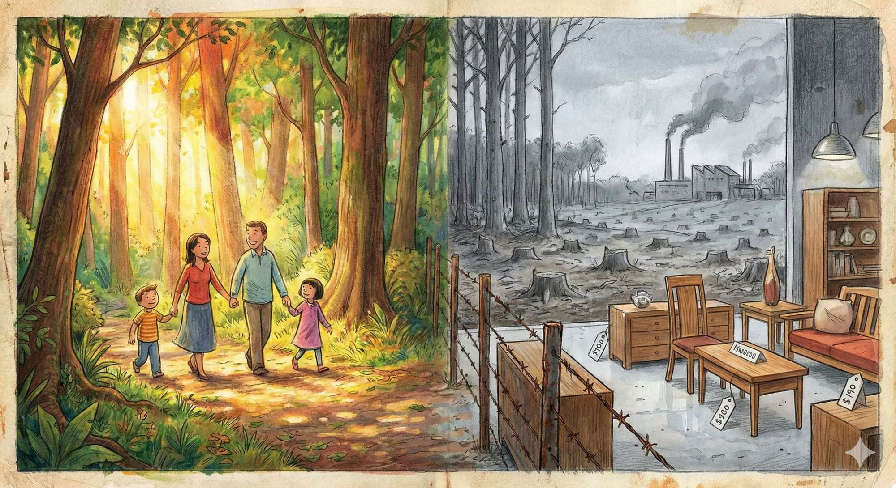
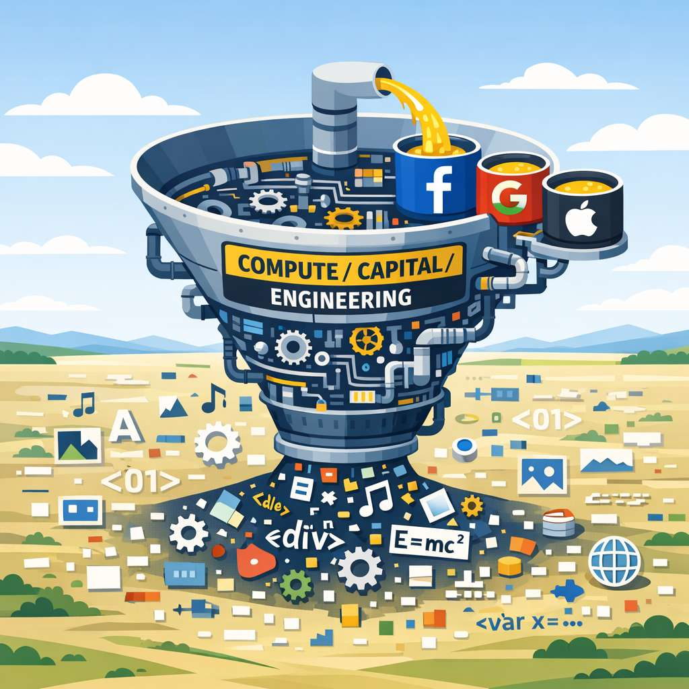
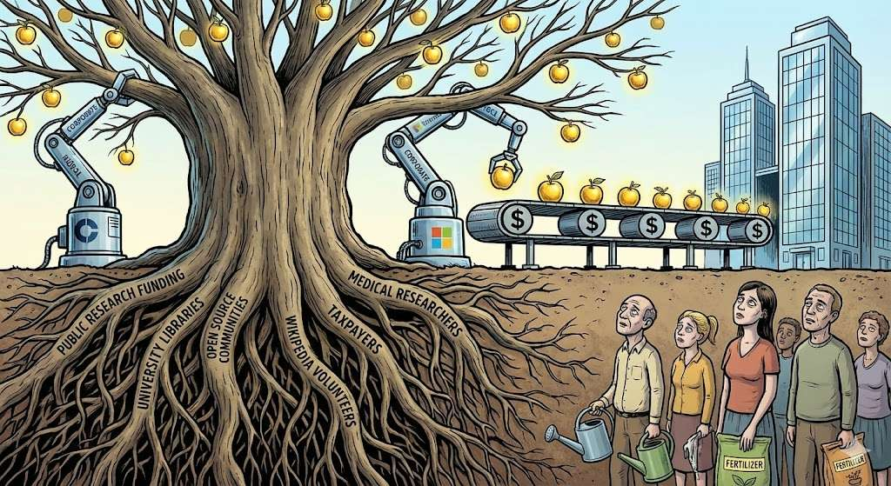
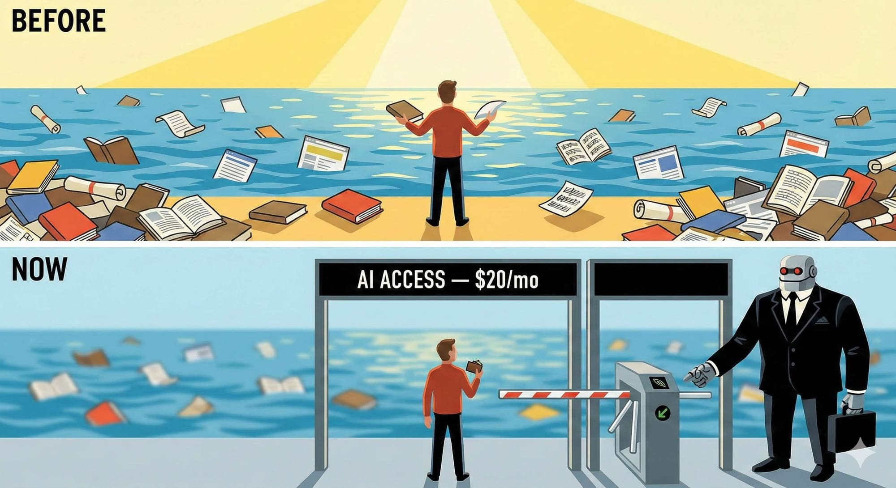
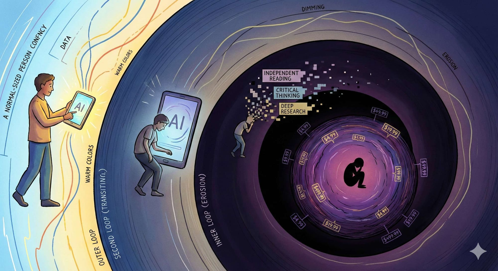
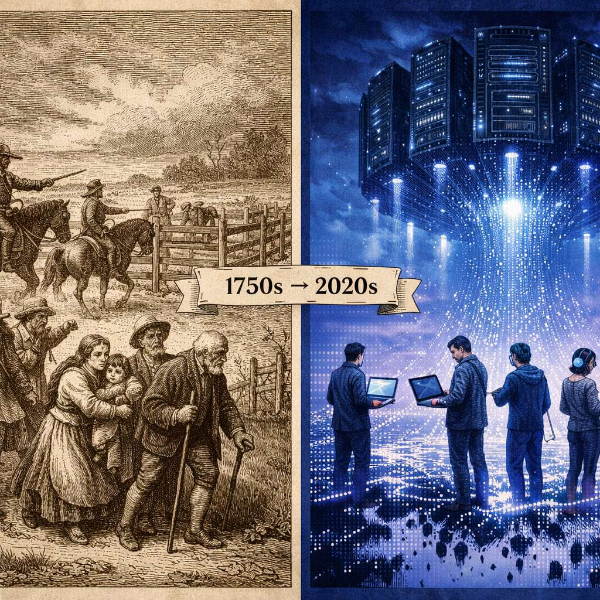
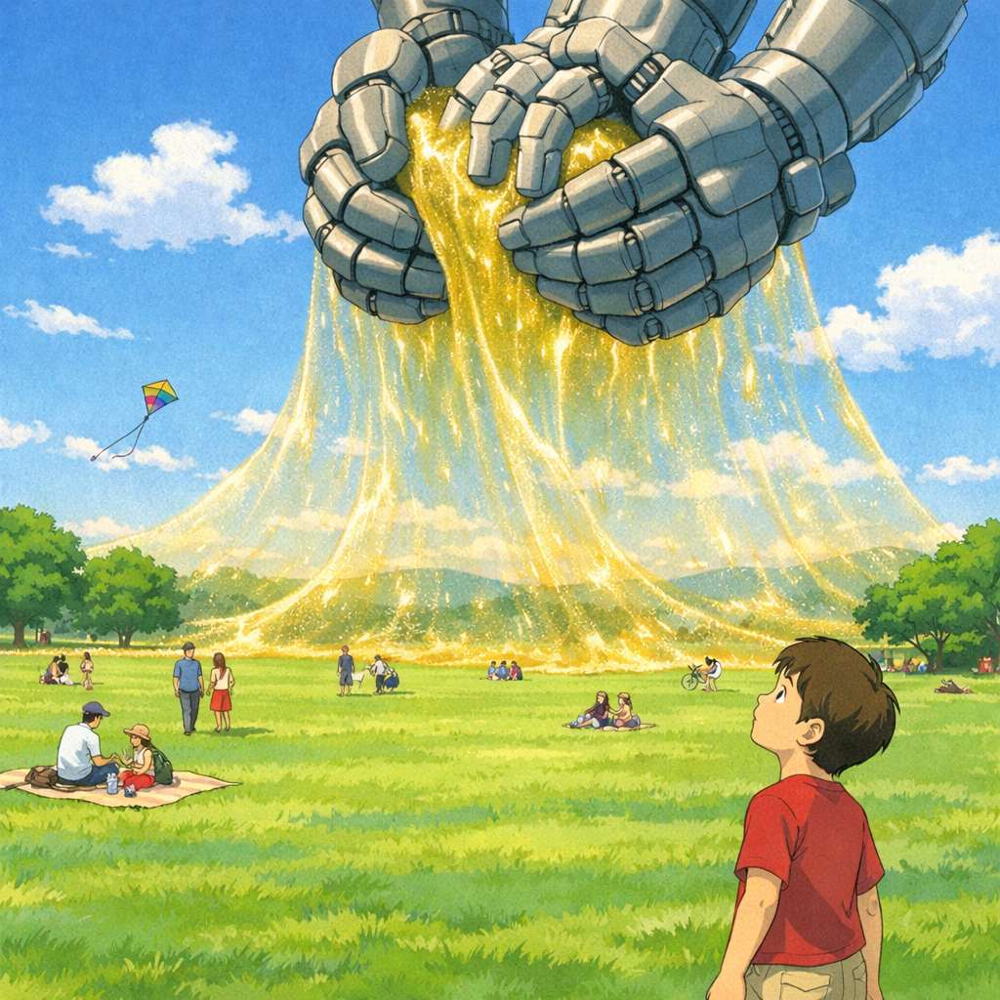

---

## 一、一个有力的反驳

如果你把前面几篇文章的论点分享给一个理性的、有独立思考能力的朋友，他很可能会提出这样一个反驳：

"你说AI公司把人类的知识'私有化'了，但这不对啊。莎士比亚的作品你仍然可以去图书馆借来读。Wikipedia仍然对所有人免费开放。GitHub上的开源代码没有人删除。AI公司训练完模型之后，互联网上的知识一个字也没有少。

所以，'知识被私有化了'这个说法站得住脚吗？知识明明还在那里，谁都可以用。"

这个反驳是有力的。它抓住了一个直觉上的合理性：如果一个东西被拿走了，它就不应该还在原来的地方。知识还在，怎么能说它被"私有化"了呢？

如果我们的理论不能回应这个反驳，它就是脆弱的。

所以，让我们认真面对它。

---

## 二、真正被私有化的不是知识本身

### 森林类比在哪里失灵？

树被砍去做成家具，森林里就少了一棵树。我借走莎士比亚的一个句子，却不妨碍你明天也读它。木材的故事不能解释这里的分配问题。得换个问法：不占有原书的人，能不能靠控制读者常用的入口收费？

### 关键区分：被私有化的是"从知识中提取价值的能力"

知识还在互联网上，任何人都可以阅读。但AI公司做的事情不是"拿走"知识，而是：

1. 从海量公共知识中**提取**了模式、结构和关联
2. 将这些提取物"炼化"进了一个私有的模型中
3. 用这个模型来提供收费服务
4. 由此产生的利润归私人所有

**真正被私有化的不是知识本身，而是"从知识中提取价值的能力"。**

### 转化环节为什么容易集中

知识是公开的。但要把公开的知识转化为一个能"回答任何问题"的AI系统，你需要：

- **算力：** 从头训练和运行一次查询，用的不是同一笔资源。
- **工程团队：** 清洗材料、训练、评测和持续维护，都需要人。
- **资本：** 需要先负担这些开销，再等服务有收入。谁能等得起，谁就多了一种选择。

这解释了大规模训练为什么容易集中，并不证明从知识中获取价值的方式已被谁独占。

---

## 三、四种私有化的真实形态

让我们更精确地分析，在AI时代，"知识的私有化"到底以什么具体形态出现。

### 1. 生产能力的私有化

**核心：** 大规模加工和提供模型服务的能力，可以比原始材料集中得多。

人类的公共知识一直都在那里——科学论文、教科书、百科全书。但在AI出现之前，这些知识需要通过人类的学习和劳动来转化为生产力。一个工程师要花四年大学和若干年工作经验来把教科书上的知识转化为解决实际问题的能力。

AI使部分工作有了另一条路径：人们可以直接使用模型提供的翻译或代码草稿。这条路径的经营者可以决定服务条件；它没有取代工程师自己学、自己做的能力。

### 2. 价值的私有化

**核心：** 公开知识衍生出的服务可以有私人收入。

设想一家企业把公开发表的医学论文组织成收费检索服务。读者付的是少翻几百页的便利费，并没有因此买下论文本身。收费能告诉我们谁收到了这笔钱，却不能告诉我们作者是否收过授权费、研究者是否也从工具受益，更不能把通用聊天订阅当作一款医疗产品的账目。

### 3. 中介渠道的私有化

**核心：** AI日益成为人与知识之间的收费中介。

这是最隐蔽、但可能影响最深远的一种私有化形态。我们将在下一节详细展开。

### 4. 功能性贬值

**核心：** 知识还在，某些任务的报价却可能下降。

假如客户只要能看懂的日语初稿，机器翻译可能压低这项委托的报价。译者的日语没有消失，要求核对合同歧义的委托也没有因此变成同一项工作。要看贬值，得看是哪种技能、在哪种交易里。

---

## 四、最隐蔽的私有化：知识获取的中介化

### 过去：人直接获取知识

在AI出现之前，人与知识的关系是相对直接的。你想了解什么，你去：

- 读一本书
- 查一篇论文
- 搜索引擎输入关键词，浏览多个网页，自己综合信息
- 向一位专家请教
- 去图书馆查阅资料

在这个过程中，**你是主动的知识获取者**。你需要付出时间和精力，但你与知识之间没有一个强制性的收费中介。搜索引擎虽然也是一种中介，但它的功能是帮你找到原始信息源——你最终还是在直接阅读原始内容。

### 现在和未来：AI成为知识中介

但AI正在改变这个结构。越来越多的人不再去读原始文献、不再浏览多个网页——他们直接问AI。

"帮我总结一下量子力学的基本原理。"

"分析一下2024年中国的宏观经济走势。"

"这段代码有什么bug？"

AI给出了流畅的、看起来权威的回答。用户满意了。但在这个过程中，一个根本性的变化发生了：**AI成为了人与知识之间的中介。**

如果这个入口是收费产品，公司就可以给便利定价；若用户还有方便的替代入口，这种定价权也有边界。

### 自来水公司类比

想象一下，如果某天，一家公司控制了一个地区所有的自来水供应。水——这种自然资源——仍然存在于河流和地下水中。但这家公司垄断了净化和输送水的基础设施。你理论上可以自己去河边打水，但这既不方便也不安全。于是你不得不从这家公司购买自来水服务。

水是公共的，但获取干净水的渠道被私有化了。

这里可比的是渠道，不是水的所有权。知识服务如果也发展到很难更换供应者的地步，才接近故事里的独家供水；集中并不等于已垄断。

### 一个自我强化的闭环

更令人担忧的是，这个过程可能形成一个**自我强化的闭环**：

1. AI变得越来越好用 → 越来越多的人依赖AI获取知识
2. 人们直接获取知识的能力（阅读长文、独立研究、批判性思维）因为缺少练习而衰退
3. 衰退后的人更加依赖AI → AI中介的不可替代性增强
4. AI公司的定价权和控制力因此增强

最终结果可能是：人类虽然仍然"拥有"知识——图书馆还在，论文还可以查到——但**大多数人已经丧失了不通过AI中介来获取和利用知识的能力**。

这就像说：你仍然拥有"自己去河边打水"的权利，但你已经不知道怎么打了，也不知道哪条河是安全的。你完全依赖自来水公司。

---

## 五、理论定性：这是哪种"私有化"？

### 为什么经典"原始积累"不够精确

马克思用"原始积累"（primitive accumulation）来描述资本主义形成过程中对公共资源的暴力剥夺——最典型的例子是英国的圈地运动。农民被暴力驱赶出公共牧场，土地被围起来变成了私有财产。

用"原始积累"来类比AI对知识的圈占，有一定的道理——两者都涉及对公共资源的私有化。但这个类比也有不够精确的地方：

**在圈地运动中，土地确实被"拿走"了——农民不能再进入被围起来的牧场。但在AI的情况下，知识并没有被"拿走"——你仍然可以去读莎士比亚。**

所以，如果我们说这是一种"原始积累"，我们需要指明它的特殊性：**被积累的不是知识本身，而是从知识中提取价值的能力。**

### Harvey的"剥夺性积累"

David Harvey（大卫·哈维）提出的"剥夺性积累"（accumulation by dispossession）概念可能更为合适。

Harvey指出，原始积累不是一个一次性的历史事件，而是资本主义持续进行的过程。在当代，它表现为：私有化公共服务、掠夺自然资源、知识产权的扩张性保护、金融投机等。

关键在于：**剥夺不一定意味着物理上的"拿走"。它可以表现为价值的转移——即使资源名义上还在原处。**

把这个概念借来问AI，值得查的是：新服务的收入归谁？原作者是否少了一种谋生的办法？不能把模型公司的市值当作从原作里搬走的等额价值。

### 马克思的"实际包摄"

还有一个马克思自己的概念可以帮助我们理解这个过程：**实际包摄**（real subsumption）。

马克思区分了资本对劳动的两种控制方式：

- **形式包摄**（formal subsumption）：资本从外部控制劳动过程——工人还在用自己的传统方式劳动，只不过产品被资本家拿走了。
- **实际包摄**（real subsumption）：资本从内部改造了劳动过程本身——劳动方式按照资本的需要被重新设计，工人成为了机器体系的附属。

在AI与知识的关系中，我们可以看到类似的"实际包摄"：**资本不需要法律上拥有你的知识，只需要控制知识生产和获取的过程本身。**

若企业控制了读者不得不经过的环节，它就能影响知识怎样呈现、以什么价格呈现。要害在“不得不”：还能不能方便地绕过去？这是判断中介权力的检验，而不是已经成立的前提。

---

## 六、这意味着什么？

### 名义与实质的分裂

让我们直面这个结论：

**知识在名义上仍然属于全人类。你仍然可以去图书馆，仍然可以浏览Wikipedia，仍然可以阅读开源代码。没有人阻止你这么做。**

**真正可能集中的，是把知识加工成便利服务并据此收费的能力。** 这种集中可以带来依赖，但不是原书消失，也不是所有知识收益已经易手。

### "公地悲剧"还是"公地被盗"？

在经济学中有一个经典概念叫"公地悲剧"（tragedy of the commons）：当一种资源是共有的，每个人都有动力过度使用它，最终导致资源耗竭。

但人类知识面临的不是"公地悲剧"——知识不会因为被使用而耗竭。一个人读了莎士比亚，不会让莎士比亚对其他人变得不可用。

所以，关键不在于少读了一份就少了一份，而在于：如果获取便利的渠道越来越少，谁能给这份便利开价？又有谁能说不？

### 过渡到下一篇

分析至此，一个自然的疑问浮现了：**那么，开源运动能否扭转这一趋势？**

公开模型权重，确实让更多人可以自己运行工具。这是不是也分散了加工知识的能力？

事情并没有这么简单。

---

_上一篇：[第三篇：数字劳动理论与AI剥削边界](05-AI大收割03-数字劳动理论与AI剥削边界.md)_

_下一篇：[第五篇：AI开源为何没有打破垄断](03-AI大收割05-AI开源为何没有打破垄断.md)_

