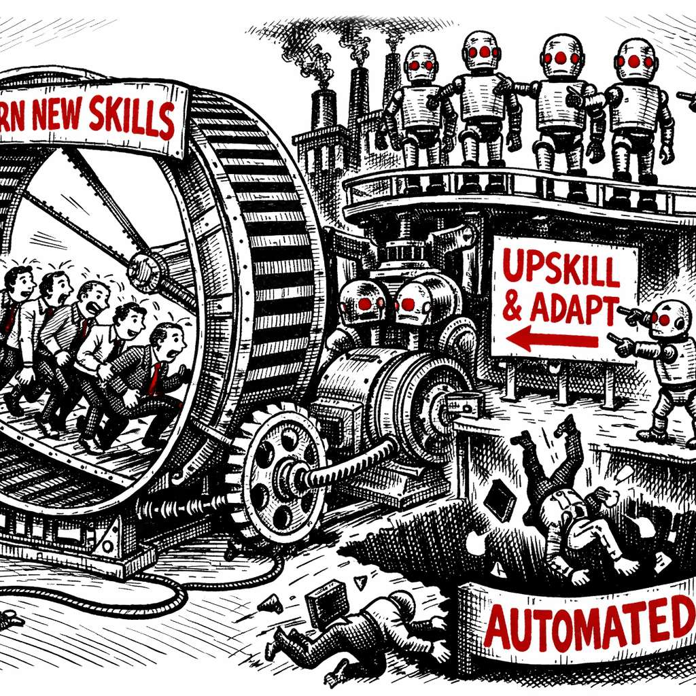
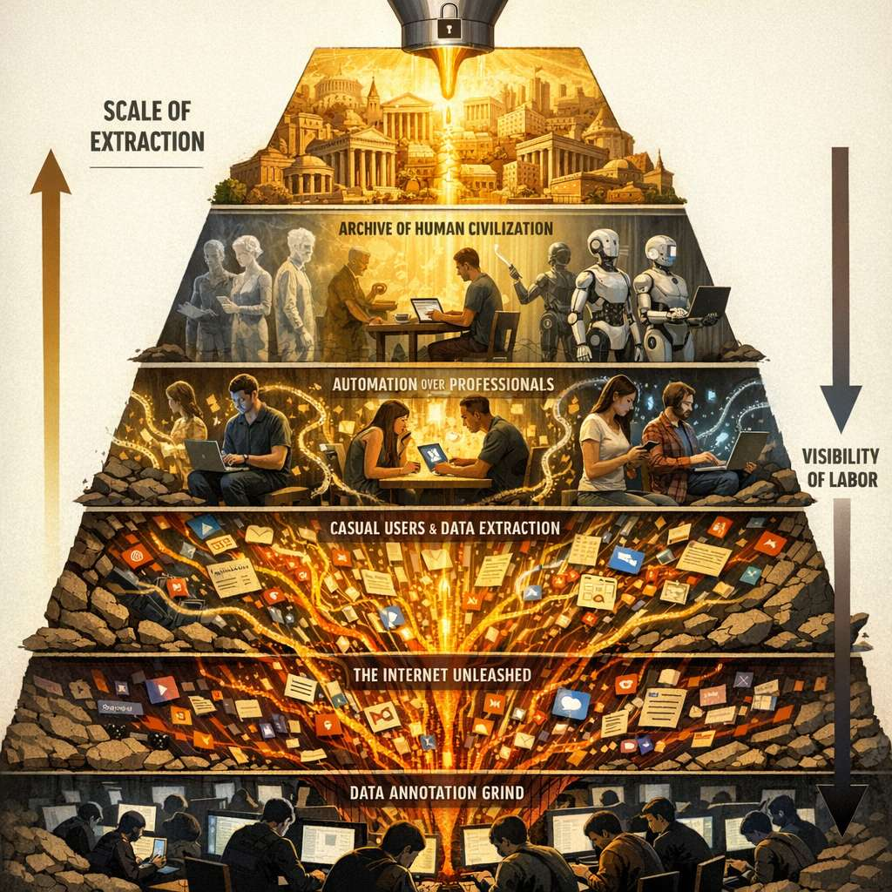
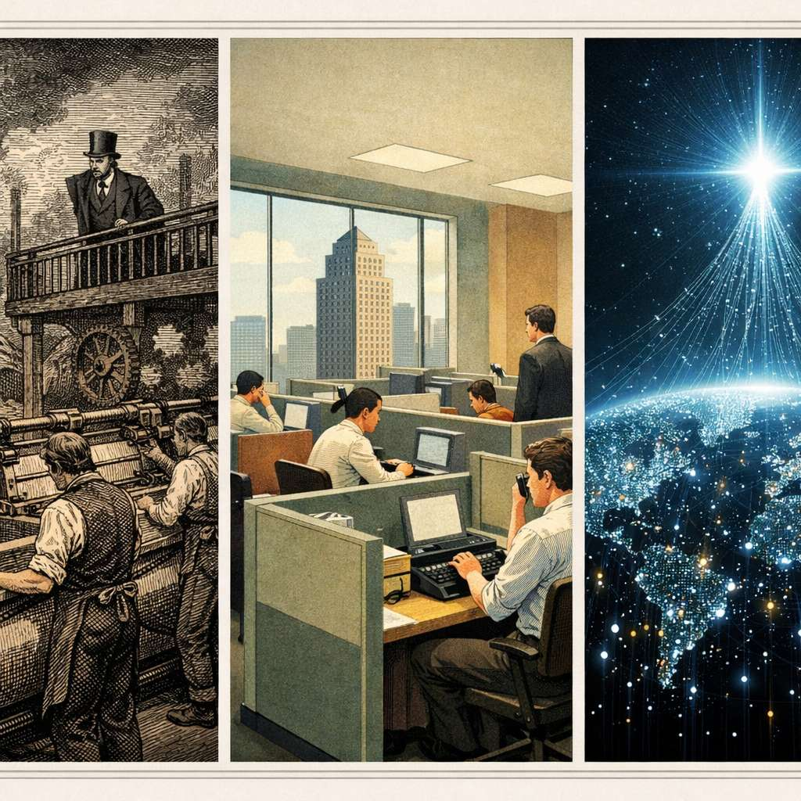
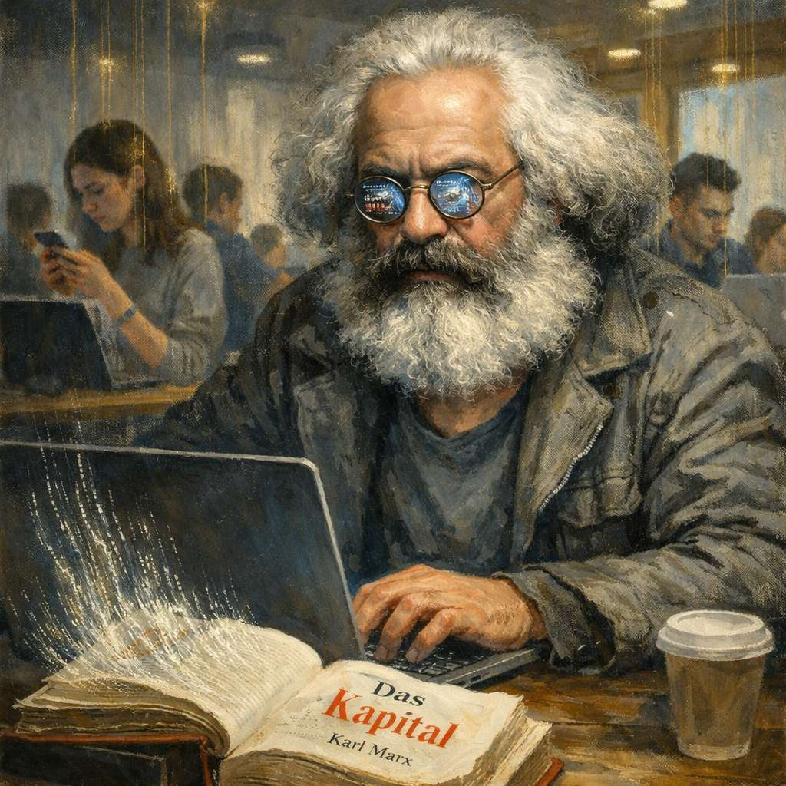
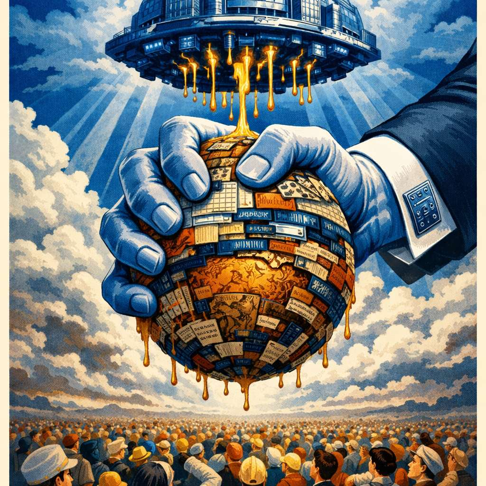

## 一、AI不是从天上掉下来的

当你打开ChatGPT，输入一个问题，几秒钟之内就收到一段流畅、精准、甚至富有洞见的回答——你会觉得这是一种近乎魔法的体验。科技公司也乐于维持这种叙事：AI是天才工程师们在硅谷的实验室里创造出来的奇迹，是人类智慧的结晶。

但这是一个被精心编织的故事。

一段流畅回答的背后，可能有受雇标注文本的人、有为别的读者写过文章的人，也有早在机器出现前就把经验记下来的前人。他们和这台机器究竟是什么关系？

从有工资单可看的劳动开始，一层层往外走。越往外，“谁替谁打工”这个问法就越不够用。

---

## 二、第一层：数据标注工人——最底层的血汗劳动

### 隐形的流水线

在AI产业光鲜的外表下，有一个庞大的、几乎完全不可见的劳动群体。

他们在肯尼亚的内罗毕、菲律宾的马尼拉、委内瑞拉的加拉加斯、印度的海得拉巴，坐在拥挤的办公室里，盯着电脑屏幕，日复一日地做着同样的工作：给图片打标签、判断文本的情感倾向、标注语句中的实体关系、为AI的回答打分评级。

这些人就是**数据标注工人**。

2023年《时代》对肯尼亚一个外包项目的调查，报道了为OpenAI相关任务标注有害文本的工人，报道所涉工人的到手时薪不到2美元。有受访者描述，读过的内容下班后还会反复浮现。他们对能获得的心理支持也有异议。这里说的是这个项目的待遇和受访者的经历，不是给整个国家的标注员下诊断。

### RLHF训练师：教AI说话的隐形工人

在大语言模型的训练过程中，有一个关键环节叫做RLHF（基于人类反馈的强化学习）。简单来说，就是让人类评估员对AI生成的多个回答进行排序和评分，然后用这些评分来优化模型的行为。

一次评分很短，却有人得花时间辨别：是答案说得顺，还是它真的答对了？模型后来卖多少钱，并不能直接折算出这一条评分值多少钱。

### 理论定性：最经典的剩余价值剥削

这一层的劳动关系最容易用马克思的经典理论来分析。数据标注工人和RLHF训练师是**雇佣劳动者**——他们出卖自己的劳动力，获得工资，而他们的劳动创造的价值远远超过他们的报酬。差额——剩余价值——被资本家无偿占有。

不仅如此，这里还叠加了一个马克思时代就已存在的结构：**全球南方的超级剥削。** 资本利用国际劳动力市场的不平等，将最底层的劳动外包给全球南方国家，在那里劳动力价格最低、劳动保护最弱。这不是什么新鲜事——它是殖民时代以来全球分工体系的延续，只不过现在的产品从棉花和糖变成了数据标注。

---

## 三、第二层：互联网内容创作者——不知情的训练师

### 你的文字正在被"消化"

你知道大语言模型是怎么学会说话的吗？

模型可以从大量网络文本中学习。百科条目、问答、代码和博客都是可能的材料；某篇文章是否实际入训，要看具体数据集和模型。

### 为分享而写，是否也同意了训练？

这些内容是谁创造的？

是数以百万计的互联网用户——一个在知乎上写了两万字长文分析三国历史的历史爱好者，一个在GitHub上维护开源项目十几年的程序员，一个在Wikipedia上默默编辑词条的志愿者，一个在个人博客上分享育儿经验的全职妈妈。

一个程序员可能希望别人复用代码，一个博主可能只想把经验留给新手父母。公开可读、作品采用的许可、作者知道哪些后续用途，是三件不同的事。

### 事后的无力

训练清单若不公开，创作者就很难知道自己的作品是否在其中，更别说判断用的是什么版本、依据哪种授权。

2023年开始，一些创作者群体开始发起抗议和诉讼。纽约时报起诉了OpenAI，一批视觉艺术家对Stability AI提起了集体诉讼。但这些法律行动面临着巨大的困难：现行的知识产权法框架在面对AI训练数据使用这种全新情况时显得力不从心。

### 理论定性：无偿的数字劳动

即使一篇作品确实被用于训练，它的作者也没有因此成为训练方的雇员。若使用未经授权或收益分配不公，要讨论的是这种不公具体落在哪里，不能把一切贡献直接换算成工资差额。

我们需要引入新的理论工具来分析这种现象。这正是第三篇的任务——我们将详细讨论"数字劳动"理论的可能性和局限性。

---

## 四、第三层：AI产品用户——消费即劳动

### 点一次“踩”算不算工作？

你点“踩”时提供了一条偏好信号；你追问时也可能只是在办自己的事。服务是否记录这些行为，记录是为运行、质量评估还是训练，不能由按钮的样子推出来。

要判断一次对话的用途，得看使用当时的具体产品、账户类型、设置和条款。能接收反馈，不等于每一条聊天都进了下一代模型。

### "产消合一"的极致

社会学家阿尔文·托夫勒在1980年提出了"产消合一"（prosumer）的概念：消费者同时也是生产者。在AI时代，这个概念被推到了极致。

传统的消费行为是单向的——你付钱，获得商品或服务。但AI时代的消费行为是双向的——你获得了AI服务，同时你的使用行为本身就在为AI公司创造新的价值。

问题在于：这个双向过程中的价值交换是否对等？

用户可以同时得到工具的便利、提供有用的反馈。能否拒绝额外使用而保留基本服务，比猜测一条反馈值多少订阅费，更能说明双方的地位。

### 最隐蔽的价值转移

这一层的价值攫取是最隐蔽的，因为它完全嵌入在"使用产品"这个看似自然的行为中。没有人会觉得自己在"工作"——你只是在问ChatGPT一个问题而已。

但正是这种隐蔽性，使得这种价值攫取几乎不可能被抵抗。你可以选择不当数据标注工人（虽然在缺乏其他就业机会的地方这种"选择"也是虚假的），你可以选择不在知乎上写长文——但你能选择不使用AI吗？当AI渗透到工作、教育、医疗、社交的每一个方面时，不使用AI就等于自我边缘化。

---

## 五、第四层：被AI替代的劳动者——培训了自己的替代者

### 历史上最具讽刺性的剥削形态

现在，让我们来看一个更加残酷的层次。

想象一个翻译。她从业十五年，积累了丰富的经验，翻译了大量的文学作品和商业文档。她的翻译作品被发布在互联网上，成为了翻译类大语言模型的训练数据。然后，这个模型学会了翻译——学得足够好，好到她的客户决定不再雇佣她，转而使用AI翻译。

**她用自己十五年的劳动成果，亲手培训了自己的替代者。**

这是一个思想实验，不是一位译者的采访。要把故事写成纪实，必须两头都能对上：哪份译作进了哪个模型，哪个客户又因为采用这个模型停掉了她的委托。平台上的订单涨跌不能把这两头连起来。

### 双重剥夺

设例中有两笔不同的损失：过去的译作被无偿使用，未来的委托又没了。一位译者完全可能只遇到后者；作品被用于训练的人也可能没有失去客户。正因如此，两笔账才值得分开问。

### 结构性的讽刺

“学会使用新工具”可能让人接到新的工作，但它没有回答旧作的使用条件该由谁谈。这不是同一项技能可以补上的差额。

这不是一个可以通过个人努力解决的问题。它是一个结构性的问题。

---

## 六、第五层：人类文明本身——几千年的知识积累被一次性"吞噬"

### 最宏大的"圈地运动"

现在我们来到了这个价值攫取体系的最高层——也是最令人震撼的一层。

AI的训练材料除了当代网页，还可能涉及这些长期积累的作品：

- 人类几千年积累的书籍——从古希腊哲学到现代物理学
- 数百年的科学论文——记录了人类对自然规律的艰辛探索
- 全球的文学遗产——小说、诗歌、戏剧、散文
- 艺术和文化作品——被转化为文本描述或图像数据
- 法律文献、医学文献、工程手册——人类实践经验的结晶
- 各种语言的语法和表达方式——人类文明多样性的载体

古典作品中有些早已进入公共领域；现代译本、注本和新研究的权利状况不能据此一概而论。

但"合法"不等于"正当"。

想想看：柏拉图的《理想国》、牛顿的《自然哲学的数学原理》、李白的诗、曹雪芹的《红楼梦》——这些作品属于全人类。它们是我们共同的知识遗产。任何人都可以阅读它们、学习它们、被它们启发。

把公共领域的作品加工成收费服务，并不让原作从图书馆消失。值得问的是谁能持续经营这个新入口，又是谁决定读者要付多少。

### 一次性还是持续性？

一次训练可以处理大量已有材料；更新语料、维护服务和重新训练却是持续的工作。这和一块土地从此只归一个主人不同。

即使作品中的语言模式成为私有模型的参数，莎士比亚的作品仍然独立存在。围绕它形成的，是另一种可能收费的服务。

---

## 七、全景图：一个前所未有的全球价值攫取体系

现在，让我们退后一步，看看这五层结构叠加在一起的全景图。

### 五层结构的叠加效应

| 层次 | 参与者 | 要查的是哪种关系？ |
|---|---|---|
| 第一层 | 标注工人 | 谁雇用、谁发工资、劳动条件如何？ |
| 第二层 | 内容创作者 | 哪篇作品被使用，依据什么许可？ |
| 第三层 | 产品用户 | 反馈去了哪里，是否可以拒绝？ |
| 第四层 | 工作受影响的人 | 哪项委托被替代，是否与本人作品入训有关？ |
| 第五层 | 历代知识贡献者 | 原作仍在，谁控制新形成的收费入口？ |

从工资单走到图书馆里的古书，能找到的证据也变了。工人可以找雇主谈待遇，作者可以追问一篇作品的授权；到了公共领域的作品，问题却成了谁有条件经营利用它们的设施。

### 为什么这比传统工厂剥削更隐蔽也更系统

在马克思的时代，剥削的结构相对简单：工人进入工厂，资本家获取剩余价值。工人知道自己在被剥削（虽然他可能不用这个词），因为他看得到自己的劳动产品和自己的工资之间的差距。

但AI时代的价值攫取体系有三个关键特征使其更加隐蔽：

**第一，劳动的分散性。** 价值的创造分散在全球数十亿人的日常活动中，没有人能看到全貌。

**第二，劳动的非自觉性。** 大多数贡献者并不认为自己在"劳动"——他们在聊天、在浏览、在分享生活。劳动被嵌入在生活本身之中。

**第三，价值链条的断裂。** 从你写一篇知乎回答到这篇回答被纳入训练数据，再到模型被训练出来并商业化——这个价值链条是断裂的、不透明的。你永远无法追踪自己的"贡献"在最终产品中占了多大比例。

### 离开工资单以后

工厂的比喻照亮了第一层：有人购买劳动力，有人领取工资。走到后面几层，比喻就该停一停了。一个译者丢了委托、一位读者按了“踩”、一本古书被收录，不是三张看不见的工资单。

真正贯穿这张图的，不是人人都受同一种剥削，而是许多不同的人有所贡献，却未必都有决定成果怎样使用的权力。

---

_上一篇：[第一篇：人类集体智慧如何被私有化](07-AI大收割01-人类集体智慧如何被私有化.md)_

_下一篇：[第三篇：数字劳动理论与AI剥削边界](05-AI大收割03-数字劳动理论与AI剥削边界.md)_

