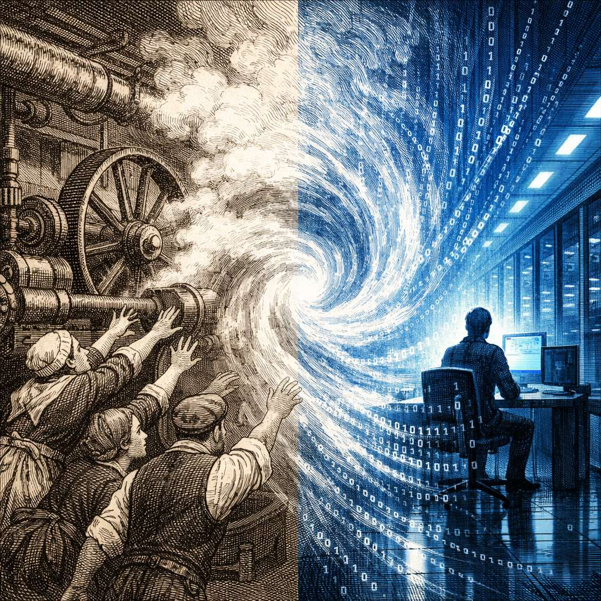
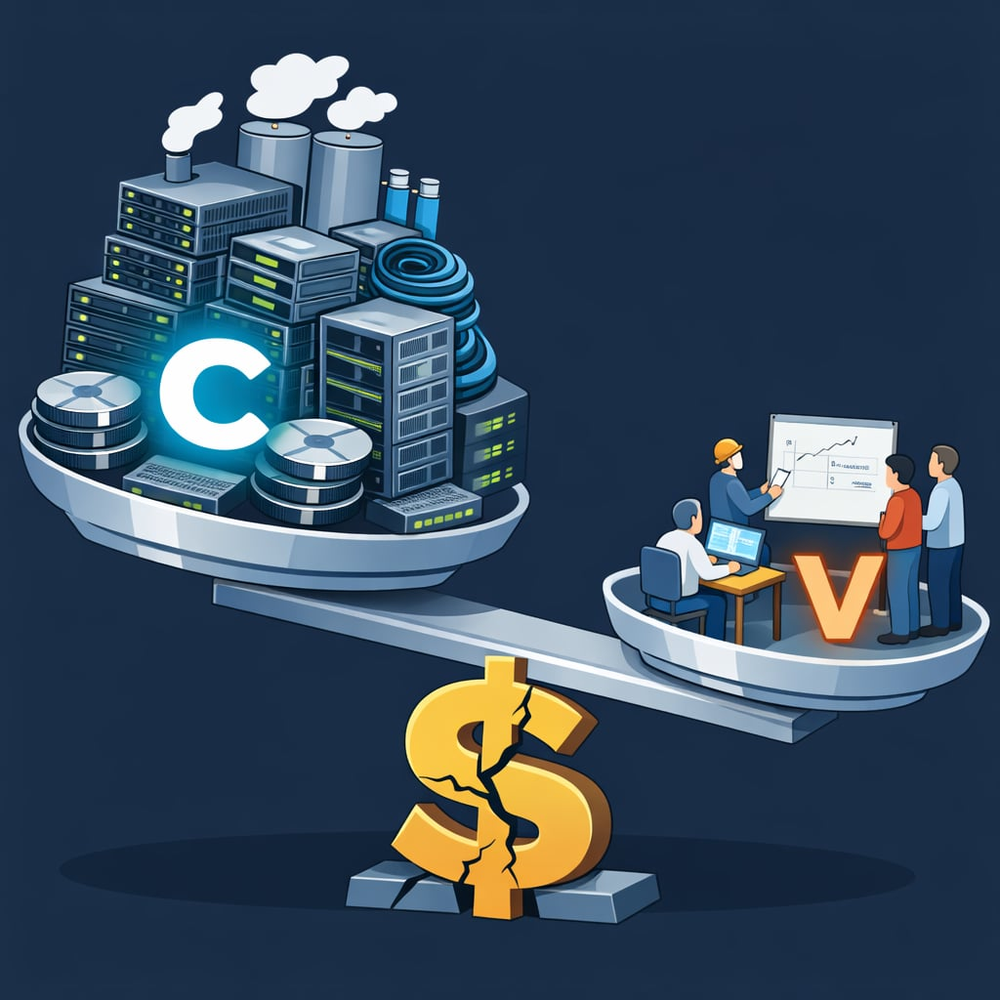

*当人类的集体智慧被炼化为私有资产，我们正在见证什么？*

## 一、从一个直觉出发

你可能有过这样一种模糊的不安。

当你发现自己越来越离不开聊天框，换一家服务就得重新适应价格、功能和使用条件，你心里也许隐约觉得，什么东西不太对。

不必拿一家公司的市值去和一国一年的GDP比大小。前者是一个时点的估值，后者是一段时间的产出。真正切身的问题是：**机器替我省下来的时间，由谁决定怎么用？**

但如果我们把目光从这些公司的财报上移开，把视野拉远，我们能否看到一些更深层的、结构性的原因？

这不仅仅是"几家公司太有钱了"这么简单的故事。我想提出一个也许更具雄心的命题作为这个系列文章的起点——

**AI的发展，是资本主义生产方式发展到极致的产物。它既是这种生产方式的巅峰成就，也可能是它的掘墓人。**

这个命题听起来或许有些大。接下来的七篇文章，就是对它的逐步展开和论证。而在展开之前，我们需要先回答一个问题：为什么要用马克思来分析AI？

## 二、为什么要用马克思来分析AI？

### 机器、劳动与资本的三角关系

在所有的经济学家和社会理论家中，马克思对"机器"这个主题投入的关注是最深入的。他不仅关心机器能生产什么，更关心一个根本性的问题：**机器在资本主义社会中，到底是谁的工具，为谁服务？**

在《资本论》第一卷的"机器与大工业"一章中，马克思详细分析了蒸汽机和自动化纺织机如何改变了工人与资本家之间的关系。他的核心洞察可以概括为一句话：**在资本主义条件下，机器不是用来减轻工人负担的，而是用来增加资本家利润的。**

机器的引入使得个别工人变得可替代，从而削弱了劳动者的谈判地位。它使劳动过程变得更加可控，使资本家可以雇佣更廉价的劳动力（包括当时的女工和童工），并延长和加强劳动强度。机器表面上是中性的技术进步，实际上是资本用来强化自身权力的武器。

### 蒸汽机与AI：历史的回响

当我们今天谈论AI，这个分析框架依然惊人地适用。

纺织机器曾把一些手工工序交给机器。今天，AI也可以接下一份白领工作里的某些工序，比如先写出一封回信的草稿。这封信写得快了，究竟是让人早点下班、一天多回几十封，还是让岗位减少？

这几种结果并不等价。任务被替代不是一个职业消失，更不是全社会净失业的统计。两段历史最值得对照的，是谁有权重新安排工作，又是谁分到节省下来的时间。

### 用“一般智力”读今天的机器

在《政治经济学批判大纲》（通常简称《大纲》）关于机器的讨论里，马克思写道：

> "固定资本的发展表明，一般社会知识已经在多大程度上变成了直接的生产力，从而社会生活过程的条件本身在多大程度上受到一般智力的控制并按照这种智力得到改造。"

我读这段话，想到的不是马克思预言了某种聊天软件，而是他把目光从单台机器移到凝结在机器中的社会知识。借这个概念看AI，可以追问：许多人积累的知识成了生产手段以后，谁能支配它？

至于这会怎样影响劳动时间作为财富尺度的问题，是我想在第七篇继续推演的，不是引文本身对今天给了答案。

### 为什么还要问所有权

只问效率和就业，会漏掉一个问题：即使总产出增加，节省的时间和新增收入由谁支配？这不是说经济学不能研究分配，而是说先把所有权当成不变前提，就很难看清还能怎样安排它。

这些问题，恰恰是马克思的理论工具箱最擅长处理的。

## 三、本系列的理论工具箱

在正式展开分析之前，我需要简要介绍几个核心概念。我会尽量避免学术化的语言，只聚焦于这些概念对AI问题的解释力。

### 不变资本与可变资本

在马克思的分析中，资本家的投入分为两部分：

- **不变资本（c）**：花在生产资料上的钱——厂房、机器、原材料。这部分资本在生产过程中只是将自己的价值转移到产品中，不会创造新价值。
- **可变资本（v）**：花在购买劳动力上的钱——工人的工资。只有这部分资本能创造新价值，因为工人的劳动能生产出超过其工资的价值。

在AI时代，英伟达的GPU集群、数据中心的电力、训练数据的获取——这些都是不变资本。而数据标注工人、AI工程师的工资——这些是可变资本。AI的发展趋势是不变资本不断膨胀，可变资本不断萎缩——这将带来深远的后果。

### 剩余价值

工人一天工作8小时，其中4小时的劳动产出足以覆盖他的工资（必要劳动），另外4小时的劳动产出则被资本家无偿占有（剩余劳动）。这4小时创造的价值就是**剩余价值**。

剩余价值是利润的源泉。关键在于：**只有活的人类劳动才能创造剩余价值。** 机器（包括AI）本身不创造新价值，它只是转移自身的价值。

### 资本有机构成与利润率

**资本有机构成**是不变资本与可变资本的比率（c/v）。随着技术进步，资本家投入越来越多的机器（c上升），雇佣相对更少的工人（v下降），有机构成不断提高。

利润率 = 剩余价值 / 总资本投入 = s/(c+v)

如果c不断增加而v（以及由v产生的s）不断减少，利润率就有下降的趋势。这就是马克思著名的"利润率趋向下降规律"。

AI是这个趋势的极端案例：天文数字的算力投入（c），极少数的人类劳动者（v）。

### 原始积累

马克思用"原始积累"来描述资本主义诞生过程中的暴力掠夺：英国的圈地运动将农民从公共土地上驱赶出去，把公地变成了私人牧场。这不是通过市场竞争，而是通过赤裸裸的剥夺来完成资本积累的。

在AI时代，我们是否正在见证一种新形式的"圈地运动"——只不过这次被圈占的不是土地，而是人类的知识公地？

### 一般智力

如前所述，这是马克思在《大纲》中提出的概念，指人类社会积累的全部科学知识和生产经验。当一般智力被物化为机器，直接成为生产力时，以个体劳动时间衡量价值的方式就失去了意义。

按本文的读法，AI是社会知识物化的一种当代形式，不是第一台体现集体智慧的机器。

## 四、全文路线图

有了这些理论工具，我们可以勾勒出整个系列的分析路径。

### AI作为"机器替代劳动"趋势的历史巅峰

从蒸汽机到电力，从流水线到计算机，资本主义的历史就是一部用机器替代人类劳动的历史。但过去的每一次技术革命，替代的都只是一部分劳动——体力劳动、重复性劳动、特定的技能型劳动。

这一次，草拟、翻译和分类之类的脑力任务也进入了自动化的范围。一个职业里还有什么要靠人判断，不能从一次演示就定论。

### AI背后的全球价值攫取体系

数据标注的工资、创作者的作品、使用者的反馈和历史积累下来的知识，进入模型生产的方式并不相同。第二篇和第三篇要追的正是这些不同的关系。

### AI将资本主义内在矛盾推向临界点

不妨把假设推远一步：如果大规模自动化挤掉了有报酬的劳动，节省的收入又没有以别的方式流回劳动者手里，产品将卖给谁？这是要检验的张力，不是已经观察到的终局。

### 后续文章的展开方向

- [第二篇：AI背后的五层价值攫取](06-AI大收割02-AI背后的五层价值攫取.md)
- [第三篇：数字劳动理论与AI剥削边界](05-AI大收割03-数字劳动理论与AI剥削边界.md)
- [第四篇：知识私有化与提取能力垄断](04-AI大收割04-知识私有化与提取能力垄断.md)
- [第五篇：AI开源为何没有打破垄断](03-AI大收割05-AI开源为何没有打破垄断.md)
- [第六篇：中国道路与AI治理](02-AI大收割06-中国道路与AI治理.md)
- [第七篇：AI时代的五条道路](01-AI大收割07-AI时代的五条道路.md)

## 五、一个需要修正的命题

在结束这篇引论之前，我需要做一个重要的理论澄清。

### 初始命题的合理内核

本文开头提出的命题——"AI的发展是资本主义发展到极致的产物"——在大方向上是成立的。AI确实代表了资本用机器替代劳动、用技术集中权力的历史趋势的巅峰。

### 为什么不能说"AI剥削了剩余价值"

但我们必须在语言上保持严谨。在马克思的理论框架中，**剥削的主体是资本，不是机器。** AI本身不会剥削任何人。是掌握AI的资本——那些科技公司、它们背后的股东和投资者——在利用AI来提取剩余价值、占有公共知识、替代劳动者。

把AI本身说成是"剥削者"，就像把蒸汽机说成是剥削者一样，混淆了工具和使用工具的人。同一种AI技术，在不同的社会制度下可以产生完全不同的效果——它可以是少数人聚敛财富的利器，也可以是全社会共享的公共基础设施。

### 修正后的命题框架

因此，我将本系列文章的核心命题修正为：

> **AI既是资本逻辑的巅峰展开，又是这一逻辑的自我否定。**
>
> AI可能使资本更容易调用集体知识、控制劳动过程；但如果它排挤了大量活劳动，也会给依赖活劳动的增殖方式提出难题。
>
> AI是资本主义最强大的武器，但这个武器最终可能反噬资本主义自身。

这个修正后的命题不是一个可以在引论中就完全证明的结论。它需要在后续六篇文章中逐步展开和论证。

**第一步，让我们先来看看：到底是谁的劳动，在喂养着AI这个庞然大物？**

*下一篇：[谁的劳动喂养了AI？——五层价值攫取体系](06-AI大收割02-AI背后的五层价值攫取.md)*

