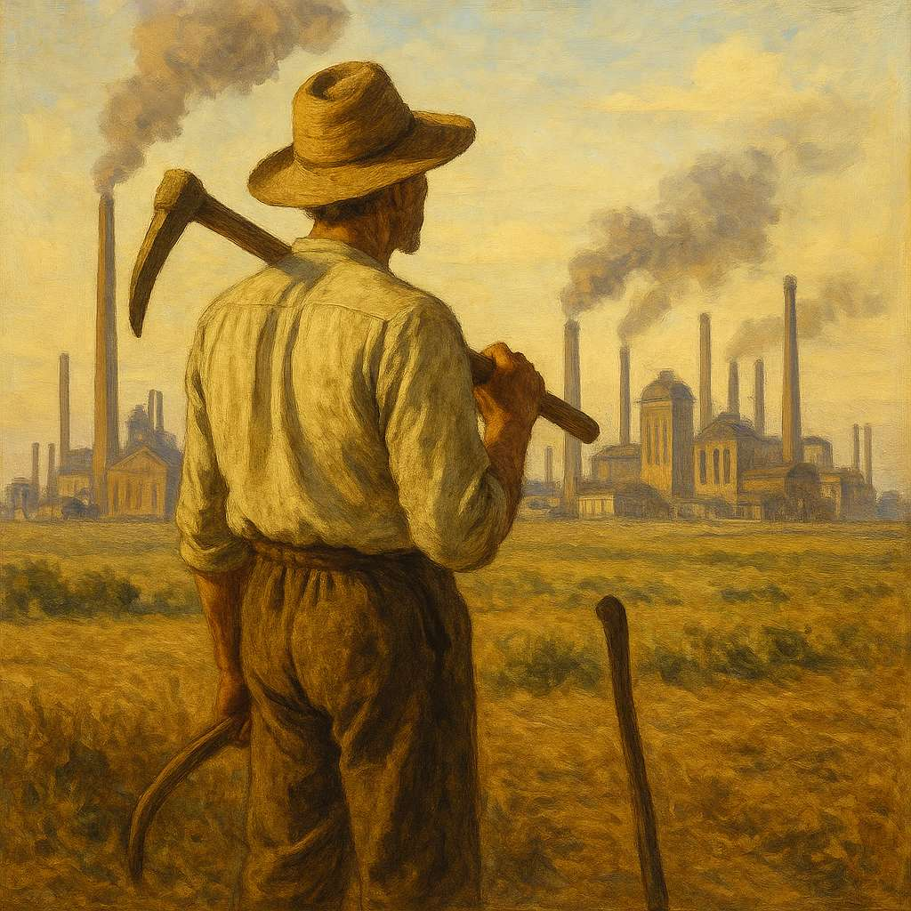
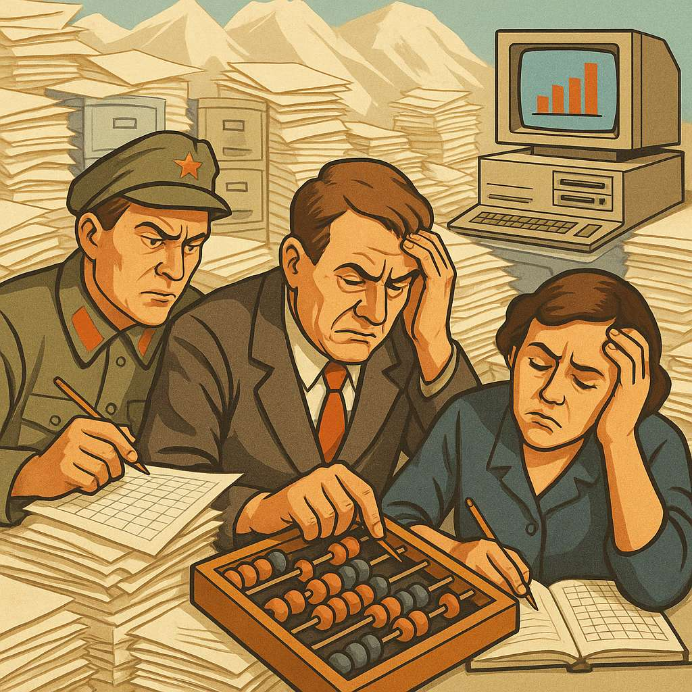
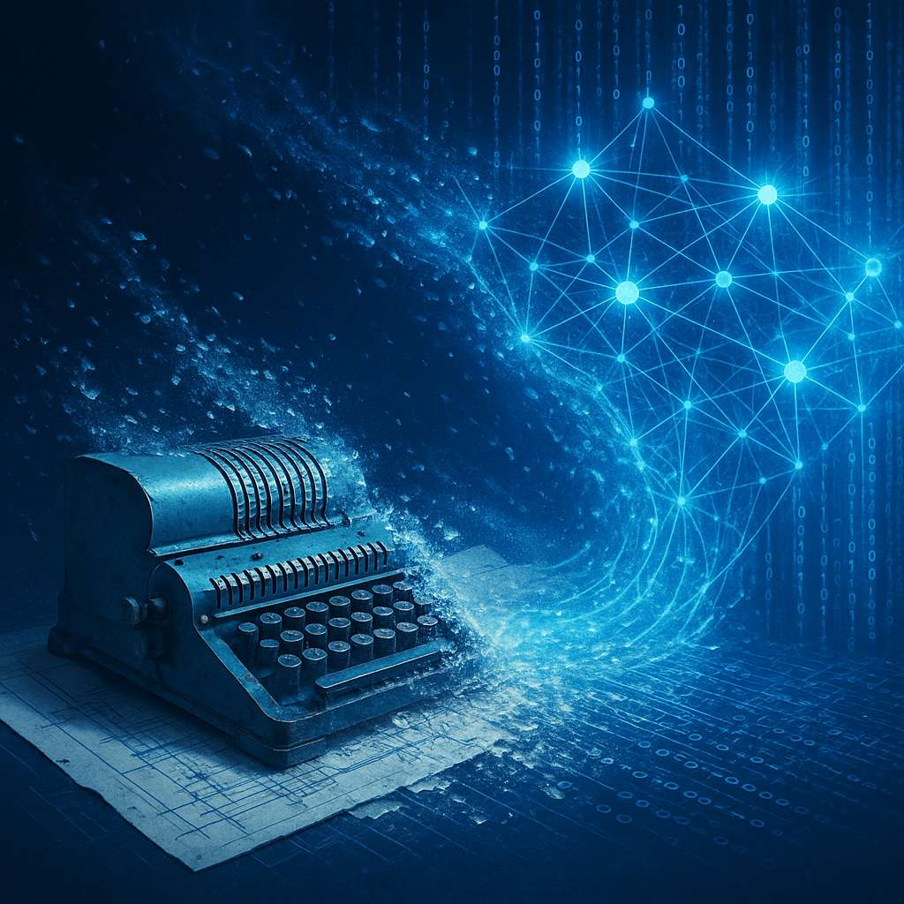
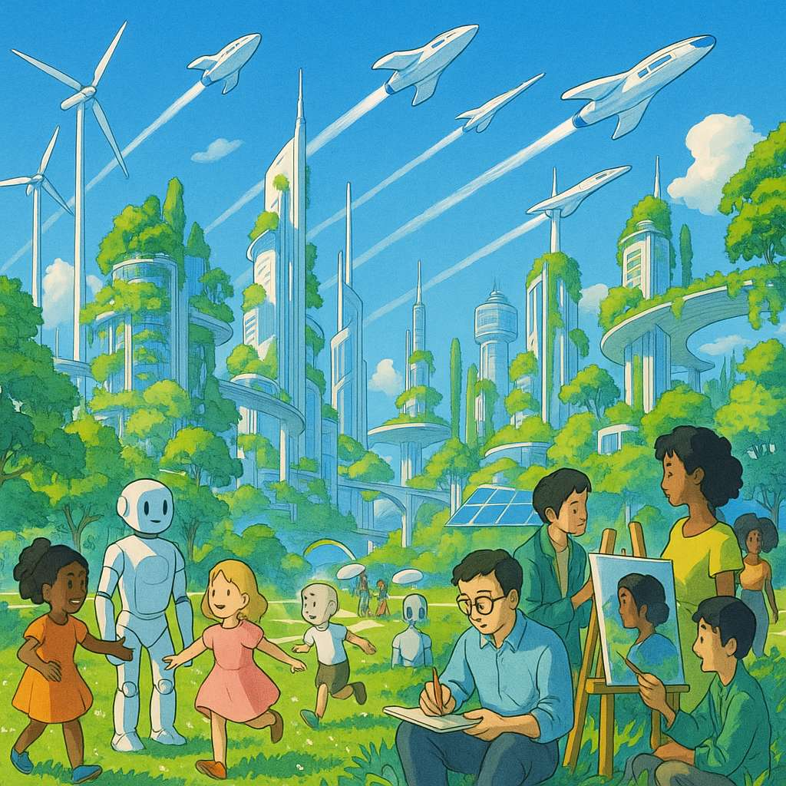
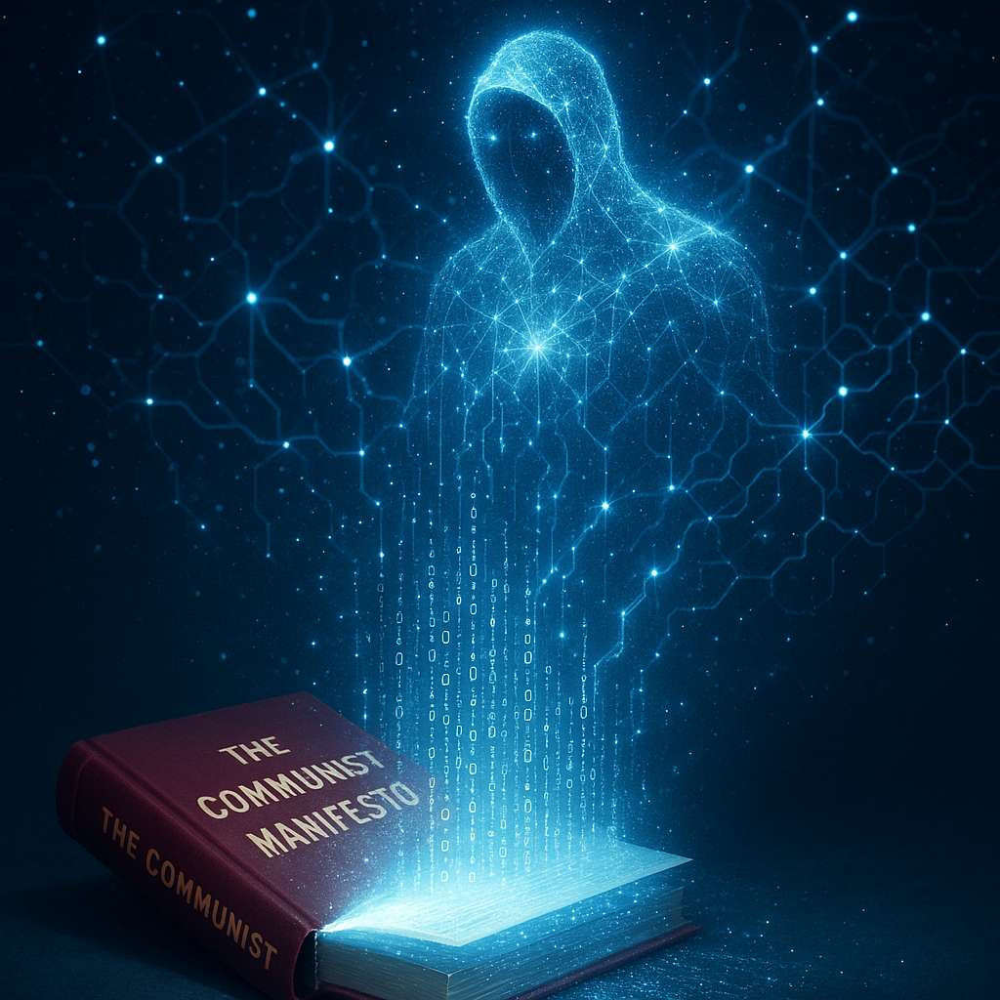
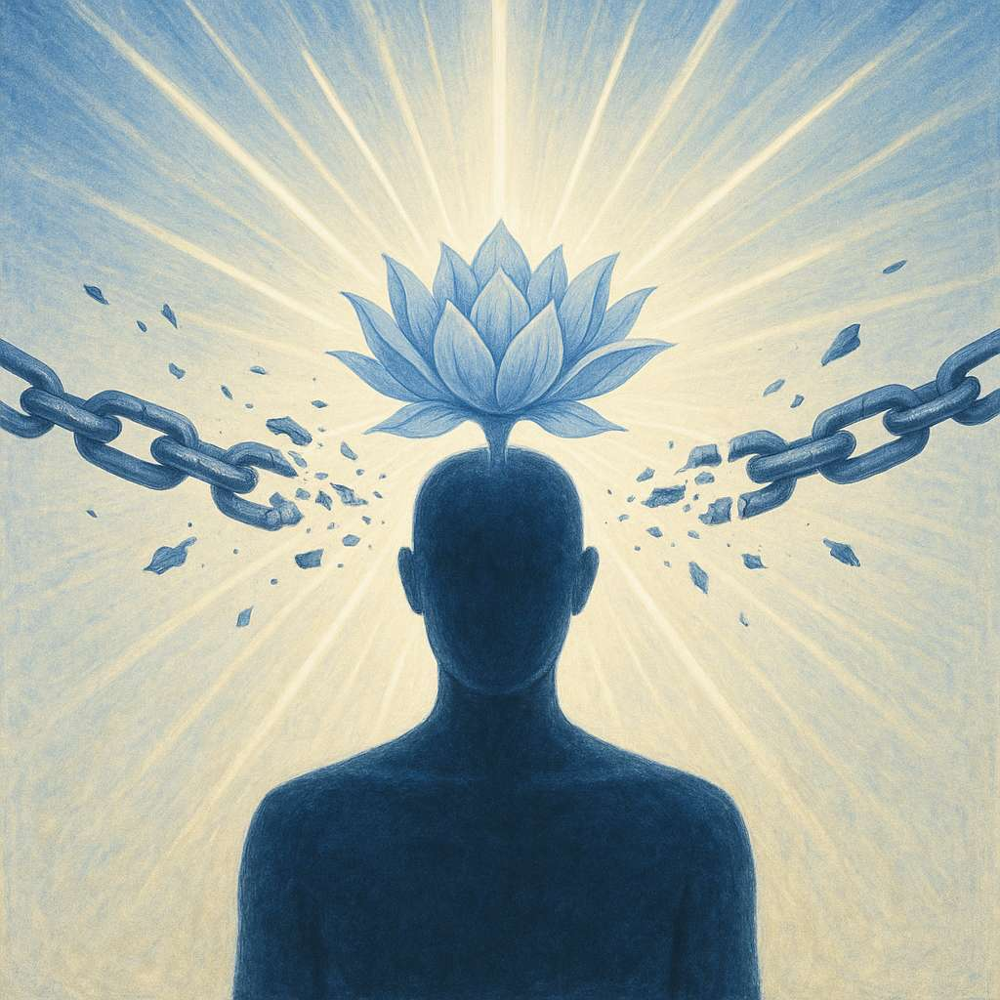
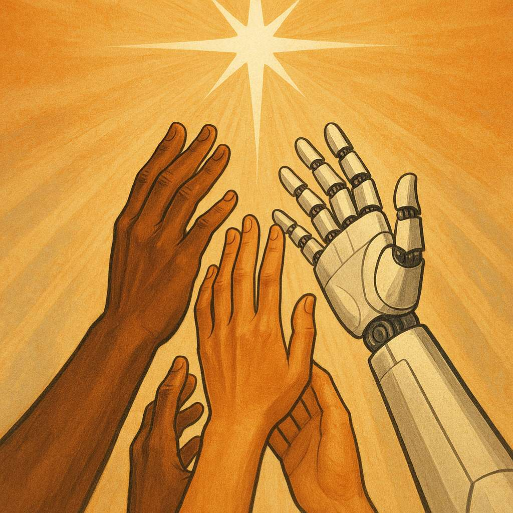

在上一篇文章中，我们分析了AI发展的两种可能未来。

一种是恐惧的未来：AI替代人类劳动，大规模失业席卷全球，财富极端集中，消费崩溃，社会撕裂——这是当前主流叙事所描绘的景象。

另一种是解放的未来：AI承担繁重劳动，人类从生存压力中解放，基本需求得到保障，每个人都能自由发展自己——这是很少被认真讨论的可能性。

我们揭示了这两种未来背后的本质：**恐惧的未来是资本主义逻辑的延续，解放的未来是共产主义愿景的实现。**

但这里有一个绕不开的问题：

**如果共产主义这么好，为什么历史上的社会主义实践没有成功？苏联解体了，东欧剧变了，这是不是说明共产主义只是一个美好却不切实际的乌托邦？**

这篇文章要回答的正是这个问题。我们将看到：以前做不到的事情，在AI时代，可能真的可以做到了。

---

## 第四部分：为什么以前不行

如果共产主义这么好，为什么历史上的社会主义实践没有完全实现这个愿景？苏联解体了，东欧剧变了，中国也进行了市场化改革。这是不是说明共产主义只是一个美好但不切实际的乌托邦？

这是一个必须诚实面对的问题。

### 生产力条件不足

马克思明确指出，共产主义需要建立在高度发达的生产力基础上。只有当社会能够生产出足够满足所有人需求的物质财富时，"按需分配"才是可能的。

但历史吊诡的是，20世纪的社会主义革命大多发生在相对落后的国家——俄国、中国、越南、古巴。这些国家在革命前都是农业社会，工业基础薄弱，物质极度匮乏。

在这种情况下，"按需分配"只能是一个遥远的目标，首要任务是快速工业化、建立起现代生产体系。

苏联和中国在建国初期面临的首要问题是：**东西不够**。在东西不够的情况下，不可能按需分配，只能优先保障基本生存、优先发展重工业和国防。

这种"先发展生产力，再考虑分配"的逻辑是合理的。但问题是，在这个过程中，很多共产主义的原则被暂时搁置了，而"暂时"往往会变成"永久"。

### 信息处理能力不足

计划经济面临一个巨大的技术难题：**如何知道每个人需要什么？如何在全社会范围内高效配置资源？**

在市场经济中，这个问题由价格机制解决。当某种商品短缺时，价格上涨，激励更多生产；当商品过剩时，价格下降，抑制生产。价格信号传递了海量的信息，引导资源配置。

计划经济需要用另一种方式解决这个问题。苏联建立了国家计划委员会（Gosplan），试图用人工方式收集信息、制定计划、指导生产。

但在当时的技术条件下，这几乎是不可能完成的任务。苏联有数百万种商品，每一种都需要确定生产多少、运往哪里、分配给谁。这需要处理的信息量是天文数字，人脑和纸笔根本应付不来。

结果是：计划赶不上变化，供需错配严重，效率低下。商店里挤满了没人买的东西，而人们真正需要的东西却买不到。这种体验让很多社会主义国家的人民对计划经济失去了信心。

经济学家哈耶克曾用"知识问题"批评计划经济：社会中的知识是分散的，存在于无数个体的头脑中，没有任何中央机构能够掌握所有这些信息。因此，中央计划必然是低效的。

在当时的技术条件下，这个批评是有力的。

### 外部压力

社会主义国家不是在真空中建设的，而是面临着巨大的外部压力。

冷战时期，美国和西方国家对社会主义阵营进行全面遏制：经济封锁、技术禁运、军事包围、意识形态渗透。社会主义国家不得不将大量资源投入军事和国防，无法优先发展民生。

苏联把GDP的20-25%用于军费（美国只有5-7%），这极大地拖累了民用经济的发展。如果没有军备竞赛，苏联人民的生活水平本可以高得多。

这种被包围的状态，也导致社会主义国家内部高度紧张，安全压力优先于其他一切考虑。

### 意识形态和文化的惯性

几百年的资本主义发展，塑造了一套深入人心的价值观：个人奋斗、物质成功、消费享乐、竞争意识……这些观念不会因为政权更迭就立刻改变。

社会主义国家的人民，虽然生活在新的制度下，但头脑中仍然残留着旧社会的观念。他们仍然会用物质财富衡量成功，仍然会在缺乏外部激励时缺乏动力，仍然会羡慕西方社会的物质丰富。

建设"社会主义新人"、培养新的价值观和生活方式，是一个漫长的过程。而在西方消费主义文化的持续渗透下，这个过程变得更加困难。

苏联和东欧的垮台，很大程度上就是因为人们向往西方的物质生活。他们看到西方超市里琳琅满目的商品，对比自己商店里的匮乏，觉得资本主义就是比社会主义好。

他们没有看到的是：西方的物质丰富建立在对第三世界的剥削之上，建立在环境破坏之上，建立在巨大的贫富差距之上，建立在精神的空虚之上。

### 历史局限，而非理念错误

以上这些因素，都是历史条件的局限，而不是共产主义理念本身的错误。

社会主义实践遇到的问题，大多可以追溯到客观条件的不足：生产力不够发达，技术手段不够先进，外部环境不够友好，历史时间不够长。

如果条件改变了呢？如果生产力已经高度发达、技术手段已经足够先进、我们有足够的时间来培育新的文化呢？

这就是我们今天面临的情况。

---

## 第五部分：为什么现在可以

今天的情况已经根本不同了。以前阻碍社会主义实践的那些障碍，正在一个个被移除。

### 生产力已经足够发达

中国是人类有史以来最强的工业国，是全球唯一拥有联合国产业分类中全部工业门类的国家。从钢铁、煤炭、电力，到汽车、手机、电脑，到高铁、5G、人工智能，中国都有完整的产业链和强大的生产能力。

很多领域，中国的产能占全球一半以上。中国生产了全球50%以上的钢铁、60%以上的水泥、70%以上的光伏板、80%以上的空调……

今天中国的问题不是"东西不够"。虽然在高端领域仍有短板，但满足十四亿人基本生活需求的生产能力绑绑有余。低端产能过剩、商品积压、消费不振——这些现象恰恰说明，生产力已经足够满足所有人的基本需求，真正的问题在于分配机制和产业结构，而不是总体生产力不足。

AI将使生产效率再上一个台阶。机器人可以24小时工作，不需要休息，不会犯错。当AI和机器人承担了大部分物质生产，人类社会将进入一个真正"物质丰裕"的时代。

在这个时代，"按需分配"不再是生产力问题，而纯粹是分配问题、制度问题、意识形态问题。

### AI解决了信息处理问题

这是最关键的变化，也是AI带来的最具革命性意义的改变。

以前计划经济最大的困难是信息处理。计划者无法知道每个人需要什么，无法实时调整生产和分配。结果是供需错配、效率低下。

现在，AI改变了一切。

**大规模数据采集**：智能手机、物联网设备、线上交易……每时每刻都在产生海量数据。我们对每个人的消费习惯、生活需求的了解，达到了前所未有的精细程度。

**强大的处理能力**：现代计算机可以处理以前根本不可想象的数据量。阿里巴巴的推荐系统每天处理数万亿次请求，为数亿用户提供个性化推荐。

**智能算法**：机器学习可以从数据中发现规律，预测需求，优化配置。这种能力已经被电商平台广泛使用——只不过是用来卖货和推送广告。

同样的技术，完全可以用于"按需分配"：

- 精准识别每个人的真实需求
- 在全社会范围内优化资源配置
- 实时调整生产和分配计划
- 实现"规模化满足个性化需求"

哈耶克当年的批评——中央计划者无法掌握分散的知识——在AI时代不再成立。AI可以实时收集和处理这些分散的信息，比任何人类机构都做得更好。

这是技术带来的根本性变化。以前做不到的事情，现在可以做到了。

### 全球化提供了参照和反思

今天的中国人见过了世界，知道什么是好的生活，也看到了资本主义的问题。

过去几十年，中国深度融入全球化，无数中国人出国留学、工作、旅游。我们近距离观察了发达资本主义国家，既看到了它们的物质丰裕，也看到了它们的社会问题：无家可归的流浪汉、药物滥用的底层、难以负担的医疗、分裂的政治、空心化的社区……

与此同时，资本主义自身的危机越来越明显：2008年金融危机差点摧毁全球经济；贫富差距持续扩大，社会撕裂加剧；气候危机威胁人类存亡；新冠疫情暴露了西方公共卫生体系的脆弱……

"历史的终结"论调已经没有多少人相信了。越来越多的人开始思考：也许资本主义不是唯一的选择？也许还有另一条路？

### 中国的独特优势

作为一个社会主义国家，中国有实践另一条道路的独特条件：

**政治优势**：中国有集中力量办大事的制度优势，可以进行全国范围的统筹规划，可以推动涉及全社会的制度变革。这是西方分散的政治体制做不到的。

**经济基础**：中国有全球最完整的工业体系和最强大的生产能力，物质基础雄厚。

**技术储备**：中国在人工智能、大数据、5G等领域处于世界前列，有实现智能化社会管理的技术能力。

**文化传统**：中国文化传统中有强调集体、强调和谐、强调节制的元素，与共产主义理念有内在的亲和性。

**历史使命**：作为共产党领导的社会主义国家，探索共产主义道路本就是中国的历史使命。

这些条件在历史上从未如此完备地汇聚在一起。

### 重新思考发展动力

以前有一个担忧：没有物质激励，人还会有发展动力吗？社会还会进步吗？

AI改变了这个问题的性质。

当AI可以完成大部分"必要但枯燥"的劳动，人类社会不再需要依赖"不愿意工作但不得不工作"的人。那些真正想创造、想探索、想服务的人，他们的动力不需要物质激励来激发。

而且，当基本需求被保障，人们反而可能更有创造力。创造力需要安全感和余暇。一个每天为房贷焦虑、为失业恐惧的人，很难有精力去做真正有创造性的事情。当这些压力消除，创造力反而可能释放出来。

看看开源软件社区、科学研究界、艺术创作领域，大量的创造是不依赖物质激励的。人类有内在的创造冲动，只是被现有的社会制度压抑了。

更重要的是，面向宇宙的探索本身就是巨大的动力来源。当人类不再为了眼前的生存而互相倾轧，集体的目光可以投向更远的地方。太阳系、银河系、宇宙深处——这些才是真正值得人类去征服的星辰大海。相比于这些宏伟的目标，今天人们为之争斗的那些东西显得多么渺小？

---

## 第六部分：两条路，一个选择

让我们回到开头的问题。

AI正在以超乎想象的速度发展。它将彻底改变人类社会，这一点已经没有悬念。悬念在于：改变的方向是什么？

我们现在能够清晰地看到两条路：

**资本主义路径**：

AI被少数人（科技巨头的股东）垄断，其创造的财富归少数人所有。大规模失业席卷全球，大多数人失去收入来源。为了维持消费，人们被迫举债，或者依靠微薄的救济金生存。社会分裂为拥有AI的极少数富人和失去一切的大多数人。

为了维持这个系统的运转，欲望制造的机器全力开动。AI被用来更精准地操纵人们的心理，让人们在没有钱的情况下仍然渴望消费。人们陷入债务和焦虑的深渊，成为算法的奴隶。

社会矛盾激化，暴力冲突增加，政治极端化。人类内耗于自我毁灭的斗争中，无法应对真正的挑战（气候危机、AI风险）。

**共产主义路径**：

AI属于全体人民，其创造的财富用于保障所有人的基本需求。物质生产由AI和机器人完成，人类从繁重劳动中解放出来。

"按需分配"成为现实——不是按欲望分配，而是按真实需求分配。当人们不再被消费主义轰炸，他们发现真正需要的东西其实不多，而这些东西，都可以得到保障。

人从生存压力中解放，可以自由地发展自己、探索世界、创造价值。劳动从强制变为自愿，从痛苦变为享受。每个人都有机会发现自己的天赋，实现自己的价值。

人类团结一致，共同面对真正的挑战：探索宇宙、理解意识、延长寿命、创造更高级的文明。

这两条路通向截然不同的未来。而我们正站在分岔口上。

那些对AI充满恐惧的人，他们的恐惧是真实的——在资本主义框架下，那些可怕的预言很可能成真。

但他们没有看到另一种可能。他们被困在"资本主义是唯一选择"的思维牢笼里，无法想象另一个世界。

**打破这个牢笼，是我们这代人的任务。**

---

## 结语：技术已经准备好了，现在轮到思想准备好了

1848年，马克思和恩格斯在《共产党宣言》中写道："一个幽灵，共产主义的幽灵，在欧洲游荡。"

那时候，共产主义还只是一个理念、一个愿景、一个对未来的设想。实现它需要等待生产力的发展、技术的进步、历史条件的成熟。

一百七十多年过去了。这个幽灵并没有消失。它在20世纪化作席卷全球的革命浪潮，改变了数十亿人的命运。它经历了挫折、失败、反思，但从未真正死去。

现在，在AI时代，它以新的面貌重新出现。

这一次，条件比以往任何时候都更加成熟：

- 生产力已经足够发达，物质丰裕不再是问题
- AI解决了信息处理难题，精准匹配需求成为可能
- 资本主义的危机越来越深重，越来越多人在寻找替代方案
- 人类面临共同挑战（气候危机、AI风险），呼唤全球性的合作与规划

AI不是威胁，而是机遇。它第一次在物质层面为人类的真正解放提供了条件。问题只在于：我们能否抓住这个机遇？我们能否建立与这种新生产力相适应的新生产关系？

技术已经准备好了。生产力已经准备好了。

**现在，轮到人的思想准备好了。**

转变思想不是一件容易的事。几百年的资本主义意识形态塑造了我们的思维方式，让我们觉得竞争是自然的、消费是幸福的、资本主义是永恒的。打破这些成见需要努力，需要学习，需要反思。

但历史已经证明：人类有能力改变自己的命运。奴隶制曾经看起来是永恒的，但它被废除了。封建制曾经看起来是永恒的，但它被推翻了。资本主义也不是永恒的——它有开始，就会有结束。

我们有幸生活在这个时代。这是见证和参与人类历史转折的时代。选择权在我们每一个人手中。

未来不是注定的。它是我们创造的。

