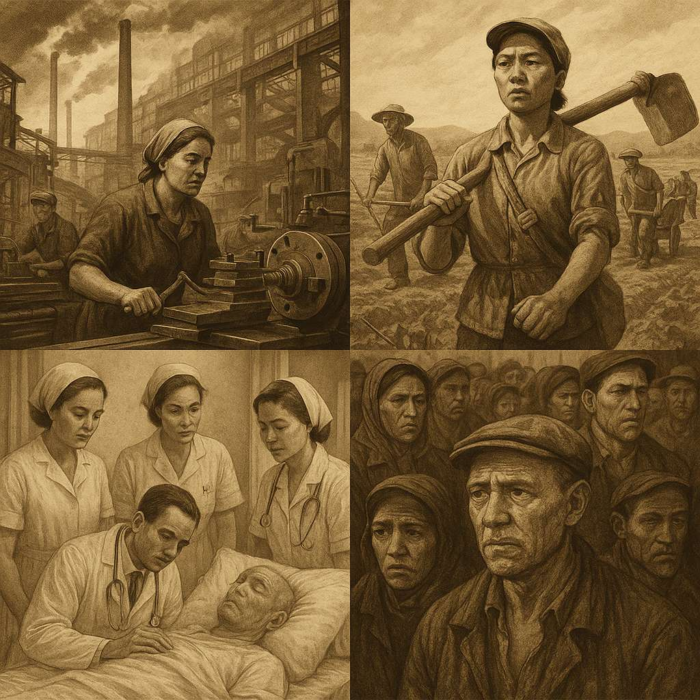
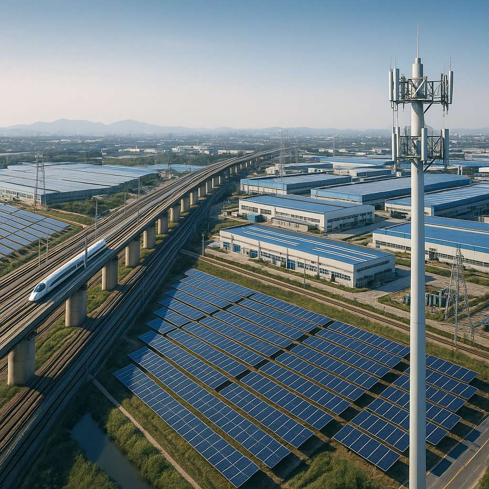

一班末班车晚上十点准时开走。十点十分才交班的工人，一整年都不会在这趟车上留下刷卡记录。假如调度中心买来一台更快的计算机，把这一整年的记录重新算一遍，那几个人会出现在屏幕上吗？

这正是我想在AI时代重新谈“按需分配”的理由。我们可以花更少的时间比较许多种排班，原来嫌麻烦、不肯为少数人重算的方案，现在值得拿出来算。可要是把“没人买过”读成“没人需要”，再多算力也只会让旧班表坐得更稳。**技术改变了核算不同安排的代价，并没有接过决定为谁安排生产的权力。**

## 一张车票上没有写的事

过去关于计划的争论，有个难题不能轻易打发：需要和生产条件分散在许多人手里。司机知道哪一站步行换乘要多久，夜班工人知道交接不能早退，调度员知道另一条线的末班时间。没人天生就握着这三份知识。把历史上社会主义实践遇到的困难统统算在计算机不够快的账上，跟拿当年的困难断言今天什么都不能试，同样省事，也同样没有解释力。

电商推荐是个有用的对照。根据买过什么预测下次会买什么，预测得准，商店就有理由采用它。可一个人没付过夜间打车的钱，可能是他根本不出门，也可能是每天都得走回来，实在打不起车。同一串零交易，两种截然不同的日子。要安排公共服务，第一步不是拿更多人的交易记录来猜，而是给那位步行回家的人一个说话的地方。

不妨让调度员在厂门口也征集需要，不只问现有乘客。要问的很少：最早几点能到站，是到终点就到家，还是必须接另一班车？愿意在站点当面登记的人，不该因为没装应用就被排除。回答可以用来做当天的班表，并不要求一辈子跟踪谁几点回家。这一步增加的不是运算速度，是从前没有机会表达的知识。

## 一辆车，两张都算得出来的班表

算一道小题。下面的人数和时刻都是设定，不是某地的调查。设现有一辆车，座位够用，只开一趟，从厂门到终点走20分钟。原来22:00发车，12人能坐上：8人到终点就到家，另4人必须在那里换乘22:30的末班车。厂里还有8名晚下班的工人，走到车站最早是22:15，也都住在终点附近。票价和路线不变。

维持原表，12人能坐车回家，晚下班的8人坐不上。改成22:15发车，22:35才到终点，原来须换乘的4人回不了家，但其余16人都能回去。**“能坐车回家的人更多了”和“有人失去了唯一的接驳”可以同时为真。** 报告上只写从12人升到16人，恰好把最需要说明的四个人抹掉了。

这点算术不需要AI。把题目放大到许多条线路、不同交班日和临时绕行，模型才可能帮上忙：用客流预测标出容易错过的接驳，由排班程序在车辆、司机工时和换乘时间的限制下逐一比较，再把几张可行班表交给人选。它也可以得出一个不讨喜却有价值的结果：在现有一趟车和固定末班时间下，没有任何发车时刻能兼顾这两拨人。因为要接到晚班职工，不能早于22:15；要赶上22:30的换乘，哪怕不计步行换站台，也不能晚于22:10。

这时再谈生产力，就不抽象了。工厂能造多少钢铁、车库里一共有多少辆车，都不能回答今晚能否多开一班。缺的是这个时段、这条线上一辆能出勤的车和一名有偿当班的司机。先问另一条线能否协调末班；若改动又会断掉别处的接驳，就把代价摆出来，讨论值不值得为这八个人加钱。不要在预算不动时承诺所有人都坐得上，也别把司机无偿加班算作技术节约。

## 谁来判哪张班表合格

假如运营方只考核送达总人数，22:15的方案胜出。假如乘客、司机与出资方共同定下“改善夜班出行，但不得取消原乘客最后一次换乘”，同一份计算反而淘汰了它。这不是两台电脑谁出错了。**能算出取舍是一种能力，有权让谁承担取舍的代价是另一回事。**

规则也得经得起纠正。比如另找到了不会断接驳的方案，先请换乘的人和司机按真实步行时间复核，再在有人负责兜底接送的前提下短期试行。拿相同班次的原表作对照，不只数上车人次，也分开记两拨人有多少完成了全程、有人是否因赶不上干脆没来、司机多干了几小时，兜底花了多少钱。站点和电话都要能报错，由调度负责人答复、改表。若仍有人丢了原来的唯一接驳，便恢复原表重议；若普通调度员用简单班表做得一样好，就不必为模型另付钱。能承认没有改好，比把一切投诉记成“异常值”更接近按需办事。

## 两种未来，差在那张表归谁改

第一种未来里，模型、运行数据和服务入口由少数所有者控制；如果出资人只按可收取的车费考核运营，排班会优先照顾有能力付费的一侧。节约下来的调度成本可以变成利润，剩下的人则要自己承担更长的路、更贵的车。这是我担心的资本集中路径。它不需要一场科幻式的大失业才会发生：只要没买票的人连提出异议的资格也没有，分配就已经开始了。

另一种未来是我愿意认真谈的共产主义愿景：生产工具由社会共同掌握，节省的劳动不只是所有者账上的收益，而可以变成每个人可支配的时间。放在这班车上，它可以是把节约款用来补贴夜间接驳，也可以是用来缩短司机的轮班。两种用途都可能有道理，钱却不能花两遍。把预算和备选方案向乘客、司机公开，让他们有权决定优先序、核查兑现情况，才有办法说清“共同掌握”多出来的究竟是哪一种权利。仅仅把调度室的牌子换成“公有”，乘客仍然没处改表，也达不到这个愿景。

一条公交线不等于一种社会制度。它之所以值得拿来谈，是因为两种未来在这里问的是同一件可以查的事：**技术替谁省下了劳动，省下的时间又归了谁？** 这也关系到人的创造力。一个为房贷和失业发愁、难以挤出精力做自己想做的事的人，不会因为多听几句“拥抱AI”就变得自由。但如果下班后不必再走一段长路，他今晚倒真有一段时间可以自己作主。

过去做不到的协调，有些今天也许能做；容量、时间和利益冲突，不会因此消失。说共产主义重新成为一个现实问题，不是宣布机器已经能替全社会识别“真正需要”，而是说：既然一部分协调劳动有望省下来，我们就得公开讨论，能不能让人按需要取得一些基本服务，而不先看他有多少支付能力。它允许试，允许比较，也允许那几位被落下的乘客说：你们这次没做到。

倘若一切关于技术解放的许诺，最后都没给十点十分才交班的人留一个发言的位置，那班末班车照样会在他眼前开走。谁有权把它叫回来，才是问题。

