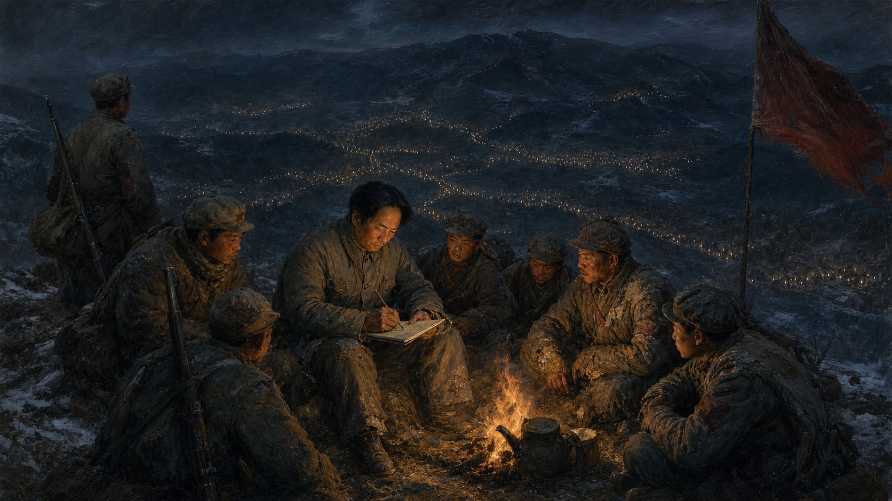
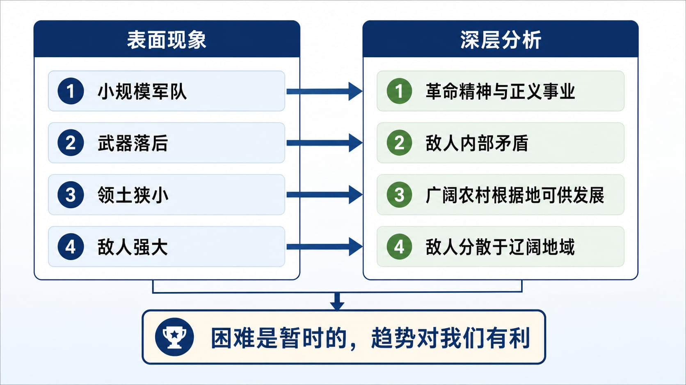
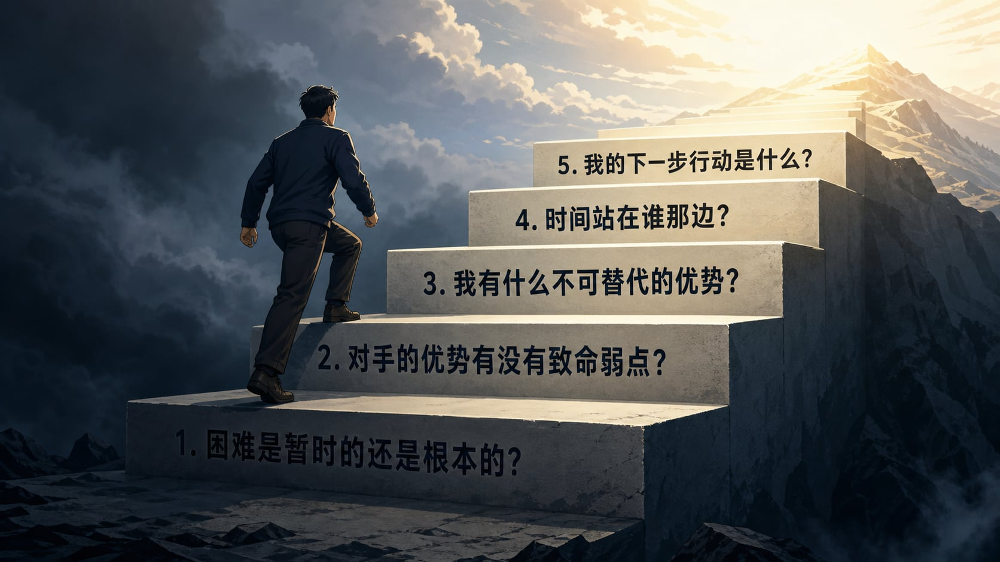
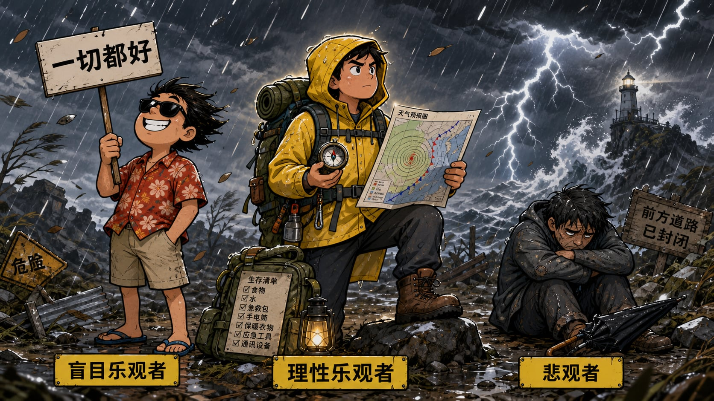

# AI时代的毛选阅读指南（七）

## 困境突围：《星星之火，可以燎原》的理性乐观主义

> **本篇解决的问题：** 当你处于人生低谷——职业瓶颈、创业困境、团队溃散、前途迷茫——如何在至暗时刻保持清醒的判断力？如何区分"盲目乐观"和"理性乐观"？

---


### 一、你有没有问过自己这个问题

在你的职业生涯中，有没有某个时刻，你问过自己——

> **"我还能撑多久？"**

也许是创业三年不盈利，钱快烧完了。
也许是在公司做了五年，升不上去也看不到出路。
也许是团队骨干接连离职，项目进展停滞。
也许是整个行业在下行，你的经验和技能似乎在贬值。
也许是35岁了，被裁了，重新找工作处处碰壁。

在这些时刻，你身边会出现两种声音——

**悲观派：** "算了吧，认命吧，这个行业/岗位没前途了。"

**鸡汤派：** "加油！相信自己！只要努力就一定能成功！"

**两种声音都没用。** 悲观派让你放弃，鸡汤派让你盲目。

你真正需要的，是**理性乐观**——用冷静的分析告诉自己：**困境是暂时的还是根本的？时间站在你这边吗？**

这正是毛泽东在1930年做的事。

---

### 二、背景还原：最绝望的时刻




**时间：** 1930年1月5日

**地点：** 福建古田

毛泽东在[1930 年 1 月 5 日的回信](https://www.marxists.org/chinese/reference-books/ccp-1921-1949/06/052.htm)中答复林彪对时局的疑问。此时红四军已转战赣南、闽西，不能把背景定格在井冈山。信针对的是对革命前途的悲观估计；“红旗到底打得多久”的疑问说的是当时一种情绪，不宜当成林彪来信的逐字引语。

---

### 三、毛泽东没有喊口号——他做了分析




这篇文章最了不起的地方，不是它给出了乐观的结论，而是**它给出结论的方式**。

我把信里的分析读成三步。下面的小标题，是为今天的读者分的，不是原信的提纲：

#### 第一步：困难是暂时的还是根本的？

毛泽东指出：红军当前的困难是真实的，但这些困难是**暂时的、可以克服的**：

```
困难一：人少枪少
  → 但我们的人有信仰、有纪律、愿意牺牲
  → 国民党的军队人多但军心涣散、内部派系林立

困难二：地盘小
  → 但农村广阔，可以发展
  → 敌人在城市强，在农村弱

困难三：敌人强大
  → 但"强大"是表面的，敌人内部充满矛盾：
    · 蒋介石和各地军阀之间有利益冲突
    · 国民党内部派系斗争不断
    · 帝国主义列强之间也有矛盾
```

**关键判断：** 我方的困难是"暂时的"（可以通过努力改变），敌方的优势是"表面的"（内部有致命的结构性弱点）。

#### 第二步：时间站在谁那边？

这是整个分析中最精彩的部分。毛泽东论证了一个关键判断：

> **随着时间推移，敌人的优势会递减，我方的优势会递增。**

```
敌方趋势（递减）：
  → 战线越拉越长，兵力分散
  → 内部矛盾会随着时间激化
  → 帝国主义的支持不可持续
  → 失去民心的趋势不可逆转

我方趋势（递增）：
  → 根据地可以一步步扩大
  → 农民的觉悟和组织程度在提高
  → 每一次斗争都在积累经验和人才
  → "星星之火"会越烧越大，因为干柴遍地
```

#### 第三步：得出结论

> **"星星之火，可以燎原。"**

注意这个结论的表述方式。不是说"火一定会燃起来"，而是说**"星星之火有可能成为燎原之势"——前提是你做对了事情**。

这不是盲目乐观，而是**有条件的乐观**：如果我们正确分析形势、做出正确决策、持续积累力量，那么趋势是对我们有利的。

---

### 四、提取方法论：困境分析的五步框架




回到自己的难题，我把前面的读法改成五个问题：

```
困境分析五步法：

① 困难是暂时的还是根本的？
   → 暂时的困难：可以通过努力、时间、策略调整来克服
   → 根本的困难：赛道本身没有前景，或者你的核心劣势无法弥补
   → 如果是暂时的，继续干；如果是根本的，及时转向

② 对手/困难的优势有没有致命弱点？
   → 任何看起来强大的对手都有内部矛盾和结构性弱点
   → 找到它，你就找到了突破口
   → 不要被对手的"总体实力"吓住，要看他的"薄弱环节"

③ 我有什么不可替代的优势？
   → 不要跟对手比"总体实力"（你一定比不过）
   → 找到你独特的、对手短期内无法复制的东西
   → 可能是速度、可能是对细分市场的理解、
     可能是团队的凝聚力、可能是某项独特的能力

④ 时间站在谁那边？
   → 随着时间推移，你的处境是在改善还是恶化？
   → 你的优势是在积累还是在消耗？
   → 对手的弱点是在暴露还是在修补？
   → 如果时间站在你这边——持久战，耐心积累
   → 如果时间不站在你这边——需要改变策略或加速行动

⑤ 基于以上分析，我的下一步行动是什么？
   → 不是"等待翻盘"，而是"主动积累力量"
   → 找到当前阶段最应该做的一件事
   → 每一个小胜利都是在为"燎原"积累火种
```

---

### 五、现代案例对照


#### 案例一：个人职业困境

**场景：** 35岁，被裁员。行业在收缩，简历投出去石沉大海。

**鸡汤式回应：** "加油！你这么优秀一定能找到好工作的！"

**毛泽东式分析：**

```
① 困难是暂时的还是根本的？
   → 整个行业在收缩——这可能是根本性的
   → 但你10年积累的行业认知和管理经验不会消失
   → 你的技能在这个行业里价值下降，但在相邻行业可能是稀缺的
   → 先请相邻行业的前同事拿一个真实岗位对照：哪些经验用得上，哪些必须从头学？再判断个人困境是不是暂时的。

② 对手的"优势"有没有弱点？
   → 不按年龄给人排座次。拿出一次你处理过的复杂交付，让用人方指出，它跟新岗位的难点究竟像不像。

③ 你的不可替代优势是什么？
   → 10年的行业深度认知
   → 踩过的坑和积累的人脉
   → 带过团队的管理经验
   → 能在不确定性中做判断

④ 时间站在你这边吗？
   → 如果你只是等同一个行业的同类岗位→ 时间不站在你这边
   → 如果你主动向相邻领域/更高层次迁移→ 你的积累会随时间增值
   → 你需要的是"转化"，不是"等待"

⑤ 下一步行动
   → 不是海投简历，而是花两周做一次"调查研究"
   → 找5个在相邻行业做转型的前同事聊聊
   → 明确自己的核心技能在哪些新场景中有价值
   → 然后集中力量突破一个方向
```

#### 案例二：创业困境

**场景：** 创业两年，产品有了，但增长停滞。资金还够撑半年。竞品拿到了大额融资。

**毛泽东式分析：**

```
① 困难是暂时的还是根本的？
   → 增长停滞——是产品方向错了（根本性），还是获客方式没找对（暂时性）？
   → 需要先做调查：跟现有用户深聊，跟流失用户聊，看数据

② 竞品强大，但有没有弱点？
   → 竞品拿了大额融资——但大融资意味着高增长压力
   → 他们可能在"烧钱换增长"，这个模式不可持续
   → 他们做的是大而全的产品，在某个细分场景可能不如你深

③ 你的不可替代优势？
   → 对这个细分领域的深度理解
   → 团队的灵活性和决策速度
   → 早期用户的高忠诚度

④ 时间站在谁那边？
   → 如果竞品的"烧钱换增长"不可持续→ 他们的优势会递减
   → 如果你能找到可持续的获客方式→ 你的优势会递增
   → 关键变量：你能不能在资金耗尽前找到增长引擎

⑤ 下一步
   → 不要模仿竞品的打法（你没那么多钱）
   → 集中力量在最有优势的细分场景做到极致
   → 先活下来，再图发展——"战略防御阶段"
```

#### 案例三：团队管理困境

**场景：** 你刚接手一个士气低落的团队。前任领导留下的烂摊子，骨干走了两个，剩下的人消极怠工。

**毛泽东式分析：**

```
① 困难是暂时的还是根本的？
   → 骨干流失——如果是因为前任领导的问题，那这个困难是暂时的
   → 如果是因为业务本身没前途，那是根本的
   → 先跟留下来的人聊聊，了解他们为什么没走（这些人就是你的"火种"）

② 团队的"劣势"中有没有隐藏的优势？
   → 士气低落→但期望值也低→你做出任何改善都会被放大
   → 前任留下烂摊子→但这也意味着你的起点很低→任何进步都是你的功劳
   → "谷底"是最好的起跑线

③ 你的不可替代优势？
   → 你是新人→没有历史包袱，可以推动改变
   → 你带着新视角→能看到团队内部人看不到的问题

④ 时间站在你这边吗？
   → 如果你能在前三个月做出一两个小胜利→团队会开始相信你
   → 信任是滚雪球的——一个小胜利带来信心，信心带来更好的表现
   → 时间站在你这边，前提是你能找到"第一个小胜利"

⑤ 下一步
   → 前两周：密集一对一沟通，做调查
   → 第三周：找到一个"低难度、高可见性"的问题，集中力量解决它
   → 第四周：用这个小胜利鼓舞团队
   → 这就是你的"星星之火"
```

---

### 六、"理性乐观"vs."盲目乐观"vs."悲观"




最后，我要明确区分三种态度：

```
盲目乐观：
  → "一切都会好的！"
  → 不分析原因，不看客观条件，纯靠信念
  → 对应毛泽东批评的"速胜论"
  → 后果：一厢情愿，不做准备，遇到困难就崩溃

悲观主义：
  → "没希望了，算了吧。"
  → 只看困难，不看有利条件，放弃分析
  → 对应毛泽东批评的"亡国论"/"红旗到底能打多久"
  → 后果：自我放弃，错过转机

理性乐观：
  → "困难是真实的，但趋势对我们有利——前提是我们做对几件关键的事。"
  → 承认困难，但通过分析发现有利条件和发展趋势
  → 乐观是建立在分析基础上的，不是建立在感觉上的
  → 毛泽东的态度：既不盲目也不悲观，而是用分析得出乐观
```

**理性乐观的核心公式：**

> 承认困难的真实性 + 分析有利条件 + 判断趋势方向 + 制定行动计划 = 有根据的信心

毛泽东在文章最后写的那段话，堪称"理性乐观"的最佳注脚：

> "它是站在海岸遥望海中已经看得见桅杆尖头了的一只航船，它是立于高山之巅远看东方已见光芒四射喷薄欲出的一轮朝日，它是躁动于母腹中的快要成熟了的一个婴儿。"

——这不是空洞的"加油"。这是在告诉你：**我已经通过分析看到了趋势，这个趋势正在一步步变成现实。不是"可能会来"，而是"已经在来的路上"。**

---

### 本篇练习

**练习：困境分析**

想一个你当前面临的困境（职业瓶颈、项目停滞、个人发展迷茫——什么都行），用毛泽东的五步框架做一次分析：

```
① 这个困难是暂时的还是根本的？
  → 暂时的：______________________
  → 根本的：______________________
  → 你的判断：____________________

② 对手/困难的优势有没有致命弱点？
  → 表面优势：____________________
  → 内在弱点：____________________

③ 你有什么不可替代的优势？
  → ______________________________

④ 时间站在谁那边？
  → ______________________________

⑤ 你的下一步行动是什么？
  → ______________________________
```

写完后问自己：做完这个分析，你对这个困境的判断跟之前有什么不同？

---

**本文要点回顾：**

1. 在困境中，盲目乐观和悲观都没用——你需要的是理性乐观
2. 理性乐观的基础是分析，不是信念
3. 我把回信带来的启发整理成五问：困难是否暂时？优势有无条件？我能凭什么？时间改变什么？下一步试什么？
4. "星星之火可以燎原"不是盲目的信心，而是基于对趋势的判断
5. "谷底"恰恰是最好的起点——期望值低、改善空间大、任何进步都可见

---

*下一篇：《论持久战——长期主义者的战略手册》*

*本文是"AI时代的毛选阅读指南"系列第7篇，共12篇。*
