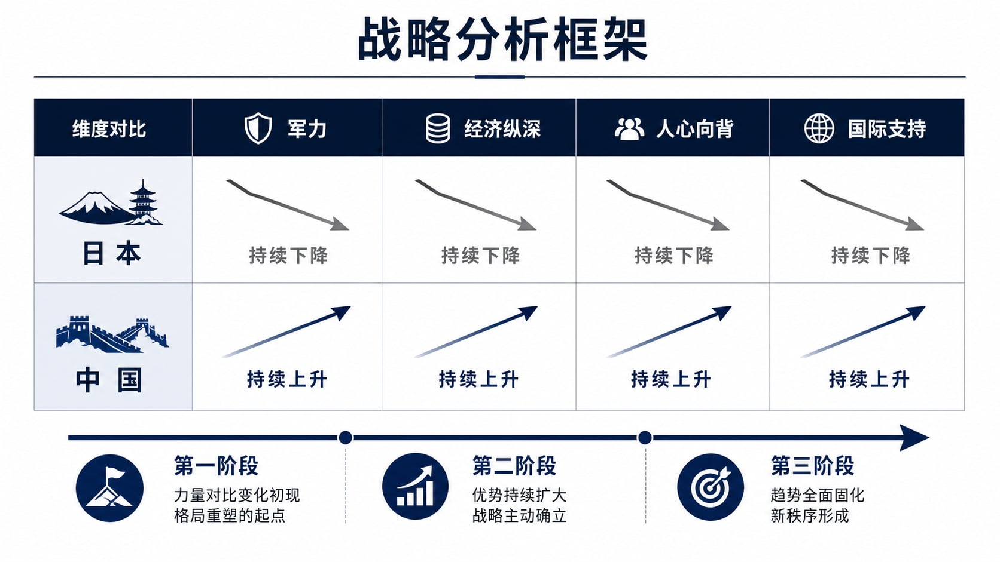
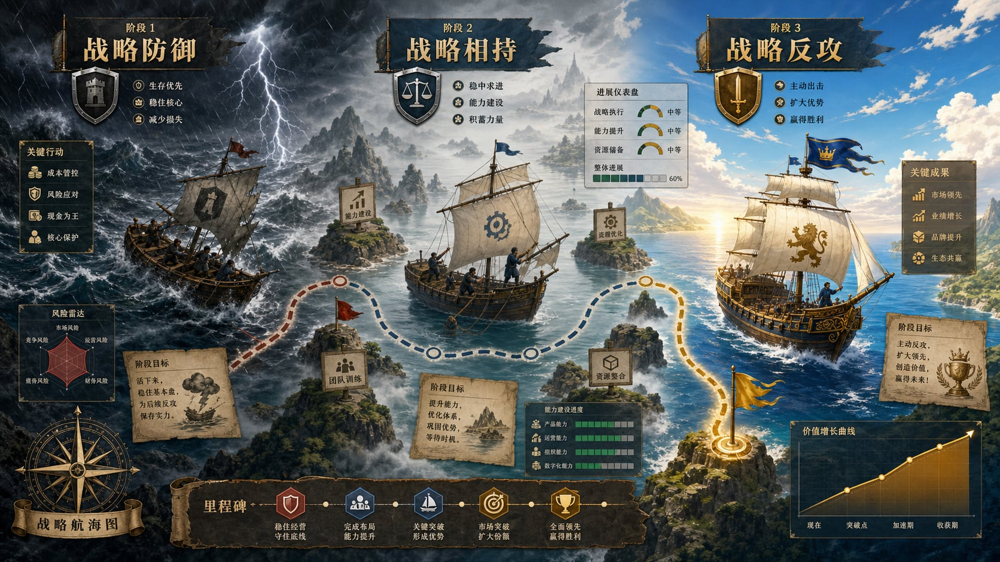
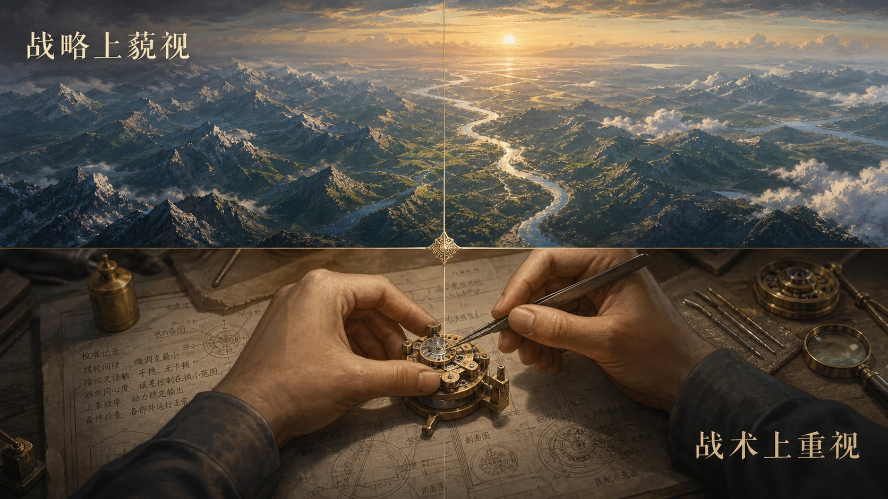
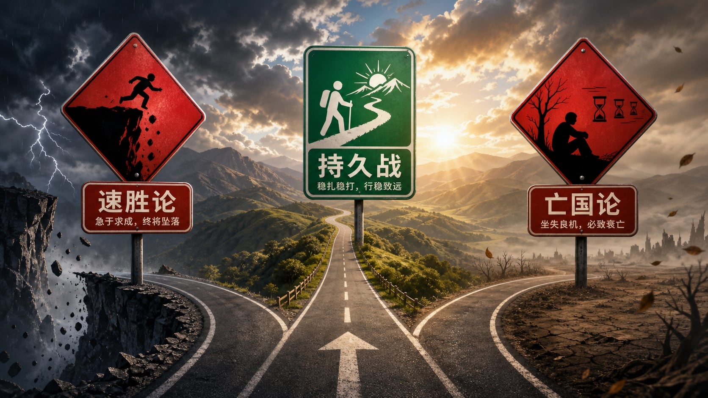

# AI时代的毛选阅读指南（八）

## 论持久战：长期主义者的战略手册

> **本篇解决的问题：** 面对一场"打不赢也输不起"的持久竞争——行业寒冬、职业长跑、创业马拉松——如何做出正确的阶段性战略规划？如何避免"速胜论"和"亡国论"两个陷阱？

---


### 一、全文5万字，精华一句话

《论持久战》是毛选中最长的文章之一，约5万字，写于1938年5月。全面抗战刚进行了10个月。

当时中国社会弥漫着两种极端的情绪——

**"亡国论"：** 日本太强了，中国打不过，迟早要亡国。

**"速胜论"：** 国际社会会介入的，中国很快就能赢。

**毛泽东两个都反驳。** 他用了5万字的篇幅，做了一件事——

> **不是告诉你结论（我们会赢），而是展示推导过程（为什么会赢、怎么赢、分几步赢）。**

如果把精华压缩成一句话：

> **在明确"时间站在我方"的前提下，规划不同阶段的战略重点，集中力量于每个阶段的关键任务，耐心等待力量对比的逆转。**

---

### 二、毛泽东的分析框架：你可以直接拿来用的战略思维




毛泽东的分析过程可以拆解为四个步骤。**这四步构成了一个通用的战略分析框架：**

#### Step 1：重新定义问题

大多数人问的是："我们会不会赢？"

毛泽东问的是：**"这场战争的性质和规律是什么？"**

这个区别至关重要。如果你问"会不会赢"，答案只有"会"和"不会"，你除了乐观或悲观之外无事可做。但如果你问"规律是什么"，你就可以找到行动策略。

**现代应用：**

不要问"我们公司能不能活下去"——这个问题无法指导行动。
要问"这场竞争的规律是什么？它会经历哪些阶段？每个阶段的关键变量是什么？"

不要问"我能不能在35岁前做到总监"——这个问题只制造焦虑。
要问"从我的现状到目标之间，需要经历哪些阶段？每个阶段需要积累什么？"

#### Step 2：全面对比分析（辩证法的展示）

毛泽东分析了中日双方的四对核心矛盾：

```
┌─────────────┬──────────────────┬──────────────────┐
│ 维度         │ 日本              │ 中国              │
├─────────────┼──────────────────┼──────────────────┤
│ 军事力量     │ 强（武器先进、     │ 弱（装备落后、     │
│             │ 训练有素）         │ 训练不足）         │
├─────────────┼──────────────────┼──────────────────┤
│ 经济纵深     │ 小（国土小、       │ 大（国土广阔、     │
│             │ 资源匮乏）         │ 人口众多）         │
├─────────────┼──────────────────┼──────────────────┤
│ 人心向背     │ 失道（侵略战争、   │ 得道（正义战争、   │
│             │ 国内反战情绪）     │ 全民抗战意志）     │
├─────────────┼──────────────────┼──────────────────┤
│ 国际支持     │ 寡助（法西斯阵营   │ 多助（国际反法西斯 │
│             │ 日益孤立）         │ 阵营支持）         │
└─────────────┴──────────────────┴──────────────────┘
```

**关键洞察：毛泽东不是简单地说"日本强中国弱"，而是指出——**

> **强中有弱，弱中有强。每一个维度都要做辩证分析。**

日本军事力量强——**但**资源有限，打不了持久战。
中国军事力量弱——**但**人口多、纵深大，消耗得起。
日本短期优势大——**但**它是侵略者，在道义上必然越来越孤立。
中国短期劣势大——**但**它是保卫者，民众的抗战意志会越来越强。

**现代应用：**

分析竞争对手时，不要简单地说"他们比我们强"。要做辩证分析：

```
他们的优势中隐藏着什么弱点？
  → 大公司的资源多→但决策慢、内部协调成本高
  → 对手融了很多钱→但这也意味着高增长压力和投资人的干预

你的劣势中隐藏着什么优势？
  → 你的团队小→但决策快、执行敏捷
  → 你的市场份额小→但包袱轻、可以做任何方向的尝试
```

#### Step 3：动态推演——时间会改变什么

这是整篇文章最核心的思维：**不做静态对比，做动态推演。**

```
随着时间推移：

日本的军事优势 → 递减
  → 战线拉长，兵力分散
  → 资源消耗，后勤困难
  → 国内反战情绪上升

中国的军事劣势 → 递减
  → 经验积累，战斗力提升
  → 武器逐步改善
  → 民众觉醒，参军人数增加

日本的经济弱点 → 暴露
  → 长期战争消耗国力
  → 资源依赖进口，受国际制约

中国的经济优势 → 发挥
  → 广阔的纵深提供回旋空间
  → 农村经济可以支撑持久战

结论：力量对比会随时间逐渐逆转。
```

**现代应用：**

做任何长期规划时，不要只看"现在谁强谁弱"，要问：

> **三年后、五年后，力量对比会怎么变？**

```
你的积累是可以复利增长的吗？
  → 如果你选的方向有"越做越强"的特点（网络效应、知识壁垒、品牌积累）
  → 那时间站在你这边

对手的优势是可持续的吗？
  → 如果对手的优势依赖外部资源（融资、政策红利、渠道垄断）
  → 那他的优势可能是递减的
```

#### Step 4：阶段划分——不同阶段做不同的事

基于以上分析，毛泽东得出了著名的"三阶段论"：

```
第一阶段：战略防御
  → 敌强我弱，以保存力量为主
  → 不硬拼，以空间换时间
  → 关键任务：活下来，积蓄力量

第二阶段：战略相持
  → 这是最关键、最漫长的阶段
  → 力量对比在这个阶段逐渐逆转
  → 关键任务：稳定发展，等待时机

第三阶段：战略反攻
  → 力量对比已经逆转
  → 关键任务：抓住时机，全力出击
```

**核心洞察：每个阶段的战略重点完全不同。**

在防御阶段做进攻的事——冒进。
在相持阶段急于决战——操之过急。
在反攻阶段还在防守——错失良机。

**你必须准确判断自己处于哪个阶段，然后做那个阶段该做的事。**

---

### 三、现代场景完整应用




#### 场景一：个人职业的"持久战"

**如果你正处于职业转型期——**

```
第一阶段：战略防御（前6个月）
  → 目标：不是"找到理想工作"，而是"先活下来"
  → 接受过渡性的工作机会，保证收入
  → 不要急着"All in"一个新方向
  → 关键任务：调查新赛道、建立初步认知、保存经济实力

第二阶段：战略相持（6个月-2年）
  → 目标：在新方向上积累不可替代的能力
  → 在过渡性工作中寻找跟目标方向的交集
  → 每周投入固定时间学习和实践新领域
  → 关键任务：能力建设 + 人脉积累 + 小范围验证

第三阶段：战略反攻（时机成熟时）
  → 你的新能力已经达到可以变现的临界点
  → 你的人脉和作品已经可以证明你的价值
  → 主动出击：跳槽/创业/转型到目标方向
  → 关键任务：抓住时机，快速行动
```

**反面教材：**
- 速胜论——裸辞后All in一个自己完全不了解的新方向
- 亡国论——觉得"太晚了""年龄大了""来不及了"，直接放弃

#### 场景二：创业的"持久战"

**如果你的创业公司面对巨头竞争——**

```
第一阶段：战略防御
  → 不跟巨头正面竞争
  → 找到巨头看不上或顾不到的细分市场
  → 用最小的成本验证产品-市场匹配
  → 关键任务：活下来，找到PMF

第二阶段：战略相持
  → 在细分市场站稳脚跟
  → 深耕核心用户，建立忠诚度和口碑
  → 打磨产品、积累数据、培养团队
  → 关键任务：把"一厘米宽"做到"一公里深"

第三阶段：战略反攻
  → 细分市场的成功已经形成可复制的模式
  → 团队、资金、产品都达到了扩张条件
  → 开始向相邻市场扩展
  → 关键任务：快速扩张，建立规模优势
```

**这跟克里斯坦森的"颠覆式创新"本质上是同一个结构——只不过毛泽东用军事语言讲，克里斯坦森用商学院语言讲。毛泽东早了57年。**

#### 场景三：管理者的"持久战"

**如果你刚上任，面对一个"烂摊子"——**

```
第一阶段：战略防御（前3个月）
  → 不急着改革，先做调查
  → 稳住现有团队，防止进一步流失
  → 找到1-2个快速可见的小胜利
  → 关键任务：建立信任，摸清情况

第二阶段：战略相持（3-12个月）
  → 开始推动关键变革
  → 培养核心骨干
  → 建立团队的基本制度和文化
  → 关键任务：系统性地提升团队战斗力

第三阶段：战略反攻（12个月后）
  → 团队已经形成战斗力
  → 拿出标杆项目和业绩证明
  → 争取更多资源和发展空间
  → 关键任务：扩大战果，建立影响力
```

---

### 四、"战略上藐视，战术上重视"




毛泽东有一个著名的说法：

> **"战略上藐视敌人，战术上重视敌人。"**

这不是矛盾的。这是两个不同层次的态度：

**战略上藐视：** 从长远来看，相信自己最终能赢。这给你信心和定力——不会因为短期的困难而动摇方向。

**战术上重视：** 在每一个具体的行动中，极其认真、极其谨慎。不轻敌，不冒进，每一步都做到位。

**翻译成现代语言：**

> 对大方向要有信心（不要因为一个季度的数据不好就质疑整个战略），
> 对每一步执行要认真（不要因为"反正我们会赢"就马虎对待每一个细节）。

**常见的错误：**

```
错误一：战略上也重视（过度焦虑）
  → 整天担心"万一失败了怎么办"
  → 结果每次做决策都瞻前顾后，错过机会

错误二：战术上也藐视（盲目自信）
  → "反正长期来看我们一定赢"
  → 结果每一步都不认真，一步步丧失优势

正确做法：
  → 对长期保持坚定信心
  → 对每一个短期任务保持极度认真
  → 这两者不矛盾，反而互相支撑
```

---

### 五、最容易犯的两个错误




#### 错误一：速胜论——"一把梭哈翻盘"

表现：
- "我们只要做好这一个产品就能上市"
- "只要拿下这个客户就能翻盘"
- "只要学会这个技能就能升职"
- "只要这一次创业成功就能财务自由"

本质：**不愿意接受"这是一场持久战"的现实，幻想通过一次性的努力实现跨越式的成功。**

毛泽东的批评：

> 速胜论者"看问题仅看到一面""不能全面地看问题"。

他们只看到有利条件，不看不利条件；只看到可能性，不看实现条件。结果就是：期望过高→投入过大→失败后信心崩溃。

**对治方法：** 承认这是一场持久战，做好分阶段规划。每个阶段有每个阶段的任务，不要试图跳过任何一个阶段。

#### 错误二：亡国论——"太难了，算了"

表现：
- "这个行业没前途了"
- "我这个年龄已经不可能转型了"
- "巨头进来了我们肯定完了"
- "经济下行，什么都没有机会了"

本质：**只看到困难，看不到困难中的有利因素和变化趋势。**

毛泽东的批评：

> 亡国论者"看到敌之强大就生出恐惧""不去分析敌人强大中包含着弱点"。

**对治方法：** 用上一篇学的"困境分析五步法"做一次完整的分析。你会发现：绝大多数"绝望"的处境，在仔细分析后都包含着希望的种子。

---

### 六、持久战思维的核心心法

最后，我把《论持久战》的核心方法论压缩为几条可以随时调取的心法：

```
心法一：分清"快变量"和"慢变量"
  → 快变量：短期内可以改变的（策略、战术、资源分配）
  → 慢变量：需要长期积累才能改变的（能力、品牌、信任）
  → 持久战的胜负取决于慢变量
  → 每天的工作应该同时服务于快变量（短期结果）和慢变量（长期积累）

心法二：不要在防御阶段做反攻的事
  → 你还没站稳脚跟，不要急着扩张
  → 你的产品还没验证，不要急着推广
  → 你的团队还没建好，不要急着打硬仗
  → 每个阶段有每个阶段的任务

心法三：相持阶段是决胜阶段
  → 大多数人在相持阶段放弃了——因为"看不到进展"
  → 但相持阶段正是力量对比悄悄逆转的阶段
  → 坚持在相持阶段做正确的事（积累、打磨、等待），就是最大的竞争力

心法四：战略耐心 + 战术进取
  → 战略上：不急，相信时间复利
  → 战术上：每一天都在做有积累效应的事
  → "慢就是快"不是鸡汤，而是持久战的数学

心法五：等待转折点
  → 力量对比不是线性变化的
  → 到了某个临界点，会出现"质变"
  → 你的任务不是"制造"转折点，而是持续积累直到转折点自然出现
  → 但当转折点出现时，你必须立刻识别并抓住它
```

---

### 本篇练习

**练习：为你的"持久战"做一份战略规划**

选一个你正在经历的长期挑战（职业发展、创业、团队建设、技能提升），用持久战思维做一个三阶段规划：

```
我面对的"持久战"是什么？
_________________________________

当前阶段判断：我处于（ ）阶段
  □ 战略防御：还在生存和立足阶段
  □ 战略相持：已经站稳但还在积累
  □ 战略反攻：力量已经足够，可以出击

当前阶段的关键任务是什么？
_________________________________

我不应该在当前阶段做的事（急于求成的冲动）是什么？
_________________________________

从当前阶段到下一阶段，我需要积累什么？
_________________________________

我怎么知道下一个阶段到了？（转折点的标志是什么？）
_________________________________
```

---

**本文要点回顾：**

1. 持久战思维的核心：重新定义问题 → 辩证对比分析 → 动态推演趋势 → 阶段划分
2. 三个阶段的不同任务：防御（活下来）→ 相持（积蓄力量）→ 反攻（全力出击）
3. 战略上藐视（有长期信心），战术上重视（短期极度认真）
4. 两个致命错误：速胜论（急于求成）和亡国论（放弃希望）
5. 相持阶段是决胜阶段——大多数人在这个阶段放弃，坚持下来的就是赢家

---

*下一篇：《弱者的兵法——以小博大的生存智慧》*

*本文是"AI时代的毛选阅读指南"系列第8篇，共12篇。*
