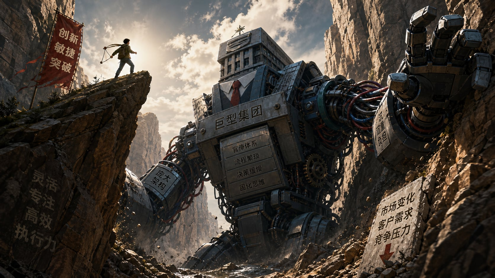
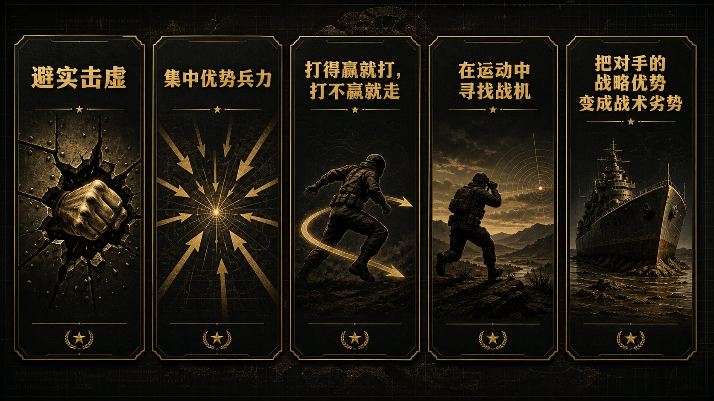
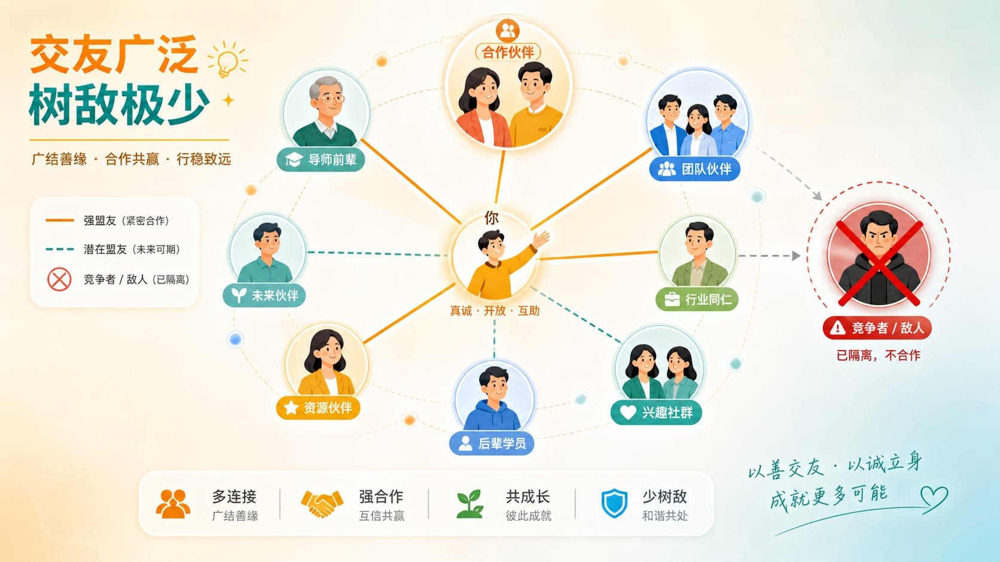
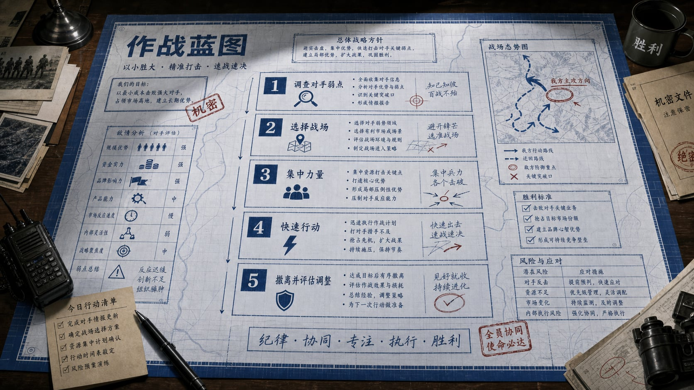

# AI时代的毛选阅读指南（九）

## 弱者的兵法：以小博大的生存智慧

> **本篇解决的问题：** 当你面对比你强大得多的对手——大公司、强竞品、资深前辈、体制性障碍——弱者有没有系统性的赢法？

---




### 一、弱者不是没有赢法——而是赢法完全不同

在你的职场或商业经历中，你大概率遇到过这些场景：

- 你的部门很小，要跟公司里最强势的部门争资源
- 你的团队刚起步，要跟成熟团队竞争一个项目机会
- 你的公司是初创，市场上有资金充裕的大玩家
- 你是新人，在一群经验丰富的前辈中争取被看见

在这些场景中，如果你试图跟强者"正面对决"——

同样的赛道比规模，同样的维度比资源，同样的节奏比耐力——

**你注定会输。**

但这不意味着你没有赢的可能。毛泽东用整个军事生涯证明了一件事：

> **弱者可以赢，但弱者的赢法和强者的赢法完全不同。**

这篇文章的核心来源是《抗日游击战争的战略问题》和《中国革命战争的战略问题》，我把它们的核心方法论合并提取，给你一套"弱者兵法"。

---

### 二、毛泽东总结的弱者核心原则




从毛泽东的军事著作中，可以提炼出弱者博弈的五条核心原则：

#### 原则一：避实击虚——不在对手强的地方跟他拼

> "我们的战略是'以一当十'，我们的战术是'以十当一'。"

意思是：从全局看，我方的总兵力远少于敌方（以一当十）。但在每一次具体战斗中，我要在选定的点上集中绝对优势的兵力（以十当一）。

**不是"处处弱"，而是"在大多数地方示弱，在一个关键点上绝对强"。**

**现代应用：**

```
错误做法：
  你的创业公司有10个人、100万预算
  你的竞品有1000人、1个亿预算
  你模仿竞品做同样的产品、投同样的渠道、打同样的市场
  → 必死

正确做法：
  找到竞品顾不到或看不上的一个细分场景
  把你的全部10个人、100万预算都投到这个场景
  在这一个点上，你的投入密度比竞品高10倍
  → 在这一个点上，你是"以十当一"
```

#### 原则二：集中优势兵力打歼灭战

> "集中兵力看来容易，实行颇难。人人皆知以多胜少是最好的办法，然而很多人不能做，相反地每每分散兵力。"

毛泽东指出一个反直觉的现象：所有人都知道"集中力量"是正确的，但大多数人在实际操作中总是分散兵力。

**为什么？**

因为"分散"让人感觉安全。每个方向都布一点兵力，"万一那个方向有机会呢？"

但毛泽东说：**分散兵力的结果是每个方向都不够强，处处被动。不如把力量集中到一个点，一次打透。**

**现代应用：**

```
职场新人版：
  不要同时学10个技能（每个都学一点但每个都不精）
  选一个最有杠杆效应的技能，三个月内做到团队前三
  → 这就是你的"歼灭战"

创业者版：
  不要同时做5个产品功能（每个都半成品）
  选一个最核心的功能做到极致
  → 用一个功能打穿一个市场

管理者版：
  不要同时推5个变革（每个都推不动）
  选一个最关键的变革集中力量突破
  → 一个变革的成功会带动其他变革
```

#### 原则三：打得赢就打，打不赢就走

> "打得赢就打，打不赢就走，这就是今天我们的运动战的通俗解释。"

弱者最大的优势之一是**灵活性**。你没有大公司那种"面子"问题和"沉没成本"包袱。

**打得赢就打：** 当你发现一个对手薄弱的点，立刻集中力量进攻。

**打不赢就走：** 当你发现这个方向行不通，立刻撤退，不恋战。不要因为"已经投了这么多"就继续死磕。

**现代应用：**

```
产品经理版：
  一个功能方向验证了两周没有正反馈？→ 果断放弃，换方向
  不要因为"已经做了两周"就继续投入（沉没成本谬误）

职业发展版：
  一个岗位做了一年发现完全不适合？→ 尽早调整
  不要因为"已经做了一年"就在错误的方向上继续消耗

创业者版：
  一个赛道做了半年看不到希望？→ 快速pivot
  不要因为"跟投资人说的就是做这个"就硬撑
  
灵活性是弱者最重要的资产，不要放弃它。
```

#### 原则四：在运动中寻找战机

> "运动战，就是正规兵团在长距离和大区域里进行的、以歼灭敌人有生力量为主要目标的作战形式。"

弱者不能被动等待。如果你固守一个位置等着对手来打你，你的弱势会被放大到最大。

**你需要保持运动——不断尝试、不断调整、在运动中发现对手的漏洞。**

毛泽东指挥的红军为什么总能赢？不是因为兵多，而是因为**比对手运动得快**。当对手还在调集兵力的时候，红军已经完成了包围和歼灭。

**现代应用：**

```
弱者的优势不是"比对手强"，而是"比对手快"。

快速迭代：你一周出一个版本，大公司一个月出一个版本
  → 你的学习速度比他快4倍

快速决策：你今天发现问题今天就调整，大公司要层层审批
  → 你的反应速度比他快

快速转向：一个方向不对，你下周就能换方向
  大公司要开三次会、做两轮评审、走一遍流程
  → 你的灵活性比他高
```

#### 原则五：把对手的战略优势变成战术劣势

> "敌人虽强，但是要分散兵力守很多地方。"

大公司看起来资源多——但它需要同时照顾100个业务线、10000个客户、50个市场。它的资源分散在大量的"必须守"的地方。

在你选定的那一个点上，它能调动的资源可能并不比你多。

**毛泽东的军事策略核心之一：利用敌人"战线太长"的弱点。** 敌人占了太多地方，每个地方都要守，结果每个地方的兵力都不够。而红军没有"要守的地方"，可以把全部力量集中到一个点。

**现代应用：**

```
大公司的"战略优势"（规模大）= "战术劣势"（分散）

→ 你做垂直市场，他做通用市场
  他为了服务100个行业做了100个"还行"的功能
  你为了服务1个行业做了1个"极致"的功能
  → 在这1个行业里，你比他强

→ 你做深度服务，他做标准化产品
  他为了服务百万用户只能提供标准化服务
  你为了服务1000个核心用户提供深度定制
  → 在服务深度上，你比他强

→ 你做本地化，他做全国化
  他为了覆盖全国市场无法在每个区域都做深
  你只做一个区域但做到极致
  → 在这个区域里，你比他强
```

---

### 三、统一战线——弱者的第二个武器




毛泽东的"弱者战法"不只有军事维度，还有一个同样重要的维度——**统一战线**。

> **"把朋友搞得多多的，把敌人搞得少少的。"**

作为弱者，你最不应该做的事情就是**树敌太多**。你需要尽可能多的盟友——哪怕这些盟友跟你并不完全一致。

核心方法论：

```
① 明确主要矛盾——谁是你最大的对手/最大的障碍？
② 围绕主要矛盾重新划分敌友
   → 跟你有同一个敌人的人，都可以成为盟友
   → "敌人的敌人就是朋友"
③ 对不同盟友采取不同策略
   → 核心盟友：深度合作
   → 一般盟友：互相借力
   → 潜在盟友：消除误解，争取中立或合作
④ 孤立真正的对手——让他陷入"寡助"的处境
```

**现代应用：**

```
创业者版：
  你的对手是行业巨头
  → 跟其他中小公司结盟（联合采购、联合推广、技术共享）
  → 跟巨头的上游供应商合作（他们可能也对巨头的压价不满）
  → 跟行业协会、媒体建立关系（让自己被看见）
  → 结果：巨头面对的不是一个小公司，而是一个小生态

职场个人版：
  你是新人，资源和话语权都不多
  → 不要试图单打独斗
  → 找到跟你利益一致的同事（你们的成功是互相增强的）
  → 找到愿意帮你的前辈（用你的执行力换取他的指导和背书）
  → 主动帮助别人（在你需要帮助时，他们会回报你）
  → 结果：你的影响力远超你的职级
```

---

### 四、弱者最大的敌人不是强者——是自己


读完上面的原则，你可能会问：这些道理看起来都很清楚，为什么大多数弱者还是输了？

**因为弱者最大的敌人不是强者，而是自己的心态。**

弱者最容易犯的三个致命错误：

**错误一：模仿强者**

```
弱者看到强者成功，就去学强者的做法。
但强者的做法是基于强者的资源、位置和条件设计的。
弱者学了强者的打法，就像穿了一套不合身的铠甲——
不但不能保护你，反而让你行动不便。

正确做法：学强者的"思维方式"，不学强者的"具体动作"。
```

**错误二：处处防守**

```
弱者因为怕输，所以处处设防、不敢冒险。
结果是每个方向都投一点资源，但每个方向都不够强。
这恰恰是毛泽东最反对的"分散兵力"。

正确做法：敢于放弃大多数方向，在一个方向上压上全部赌注。
弱者最不能犯的错误就是"分散"——你本来就少，再一分散就什么都做不成。
```

**错误三：心态上"认输"**

```
还没打就觉得"我肯定赢不了"。
不是因为分析后觉得没希望，而是被对手的体量吓住了。

毛泽东说："一切反动派都是纸老虎。"
这不是盲目自信，而是一种战略判断——
任何看起来不可战胜的对手，都有内部矛盾和结构性弱点。
你需要的不是跟他比体量，而是找到他的弱点。
```

---

### 五、一个完整的"弱者攻略"




把所有原则整合在一起，形成一个完整的"弱者攻略"：

```
弱者攻略七步法：

第一步：侦察——调查对手的弱点
  → 不看对手有多强，看对手哪里弱
  → 他的资源在哪里分散？他顾不到的是什么？
  → 他内部有什么矛盾？他的用户有什么不满？

第二步：选择战场——找到你能赢的地方
  → 不在对手强的地方打（你赢不了）
  → 找一个对手弱、你有优势的细分领域
  → 这个领域要小到对手看不上，大到你能活下来

第三步：集中力量——All in 一个点
  → 把你所有的资源投到这一个点上
  → 在这一个点上形成压倒性优势
  → 宁可在其他地方"裸奔"，也不能在关键点上兵力不足

第四步：快速行动——比对手快
  → 速度是弱者最大的武器
  → 快速决策、快速执行、快速迭代
  → 当对手开始反应时，你已经建立了优势

第五步：建立根据地——巩固成果
  → 在你选定的细分领域做深做透
  → 建立壁垒：用户忠诚度、专业知识、口碑
  → 让对手即使想进来也进不来

第六步：扩大联盟——团结可以团结的力量
  → 找到跟你有共同利益的伙伴
  → 形成小生态，增强整体实力
  → 让对手面对的不是你一个人

第七步：等待时机——在运动中寻找决战机会
  → 不急于全面对决
  → 持续积累，等待力量对比逆转
  → 当时机到来时，果断出击
```

---

### 本篇练习

**练习：画你的"弱者攻略"**

选一个你面对"强敌"的场景（职场竞争、商业竞争、技能追赶都可以），回答以下问题：

```
① 你的"对手"是谁？他的优势是什么？
   ___________________________________

② 他的优势中隐藏着什么弱点？
   ___________________________________

③ 你能赢的"战场"（细分领域/具体方向）在哪里？
   ___________________________________

④ 你打算把力量集中在哪一个点上？
   ___________________________________

⑤ 你能比对手"快"在哪里？
   ___________________________________

⑥ 谁可以成为你的盟友？
   ___________________________________
```

---

**本文要点回顾：**

1. 弱者有赢法，但弱者的赢法跟强者完全不同——不能模仿强者
2. 弱者五原则：避实击虚、集中兵力、打得赢就打打不赢就走、在运动中找战机、把对手的优势变成劣势
3. 统一战线是弱者的第二武器——把朋友搞得多多的，把敌人搞得少少的
4. 弱者最大的敌人是自己：模仿强者、处处防守、心态认输
5. 弱者最大的优势是灵活性和速度——不要放弃它们

---

*下一篇：《领导力的底层代码——群众路线与组织方法》*

*本文是"AI时代的毛选阅读指南"系列第9篇，共12篇。*
