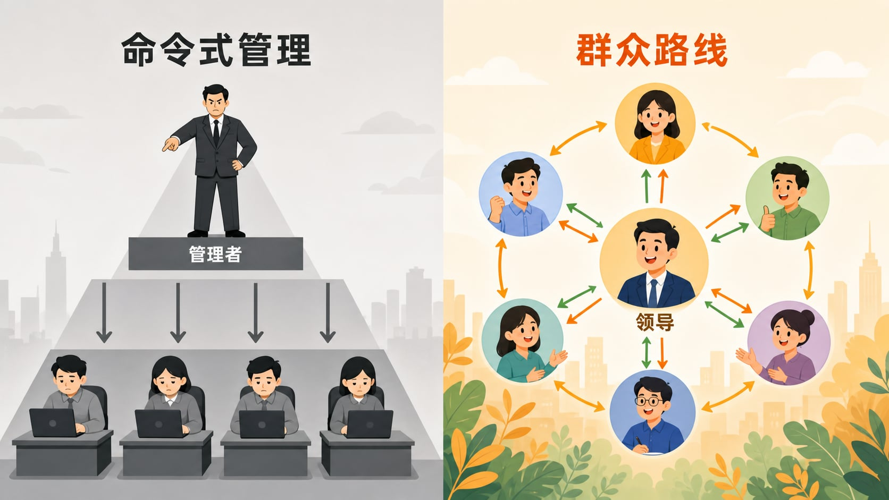
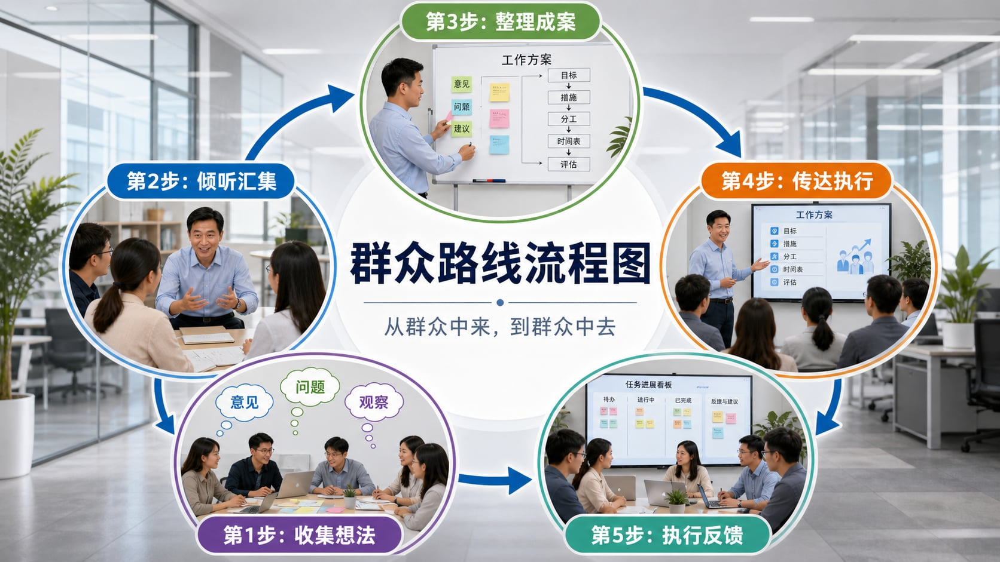
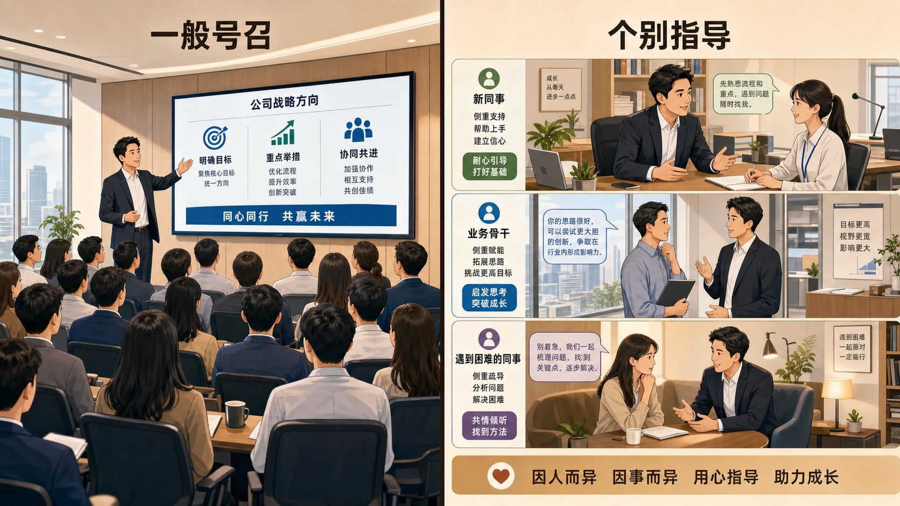
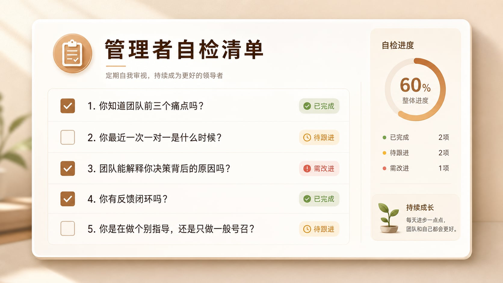
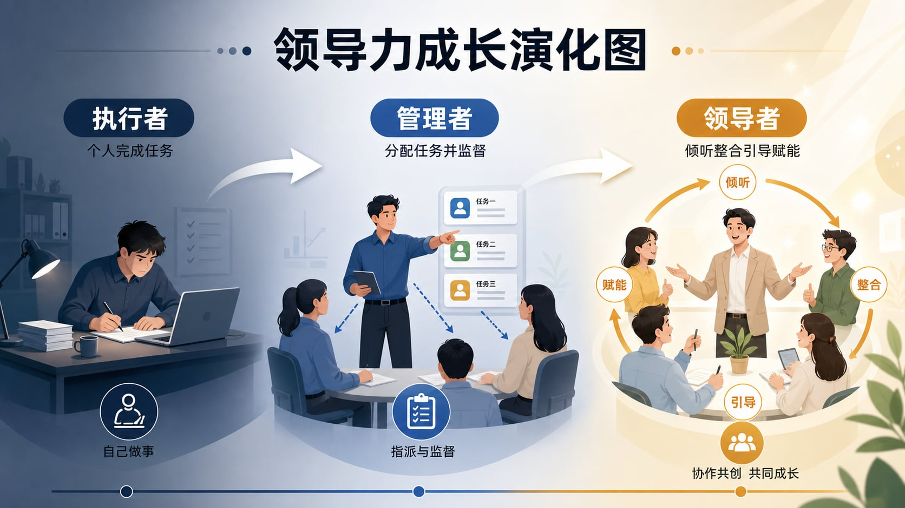

# AI时代的毛选阅读指南（十）

## 领导力的底层代码：群众路线与组织方法

> **本篇解决的问题：** 为什么你布置的任务总是打折执行？为什么你的团队"缺乏主动性"？为什么你的管理越来越累、越来越像"保姆"？问题可能不在团队，在你的领导方法。

---




### 一、你可能正在犯毛泽东批评过的错误

先做个自测——

**作为管理者，你是否经常有以下感受：**

```
□ "我说了很多遍，他们就是不执行到位"
□ "什么事情都要我盯着，他们自己不会想"
□ "我觉得方向已经很清楚了，为什么他们总是做偏"
□ "下属不主动汇报，我不问就不说"
□ "我在的时候还行，我不在他们就散了"
```

如果你打了3个以上的勾，你可能犯了毛泽东批评过的两种领导错误之一：

**错误一：命令主义** ——只会从上往下发指令，不关心下面的人怎么想、怎么做、遇到什么困难。

**错误二：尾巴主义** ——完全跟着团队走，不做整合和判断，失去了领导者的方向引导作用。

毛泽东在《关于领导方法的若干问题》中，给出了一个两者之间的正确答案——

> **"从群众中来，到群众中去。"**

这不是一句空洞的口号。它是一个**极其具体的管理方法论**。

---

### 二、"从群众中来，到群众中去"到底是什么意思




原文是这样说的：

> "将群众的意见（分散的无系统的意见）集中起来（经过研究，化为集中的系统的意见），又到群众中去作宣传解释，化为群众的意见，使群众坚持下去，见之于行动，并在群众行动中考验这些意见是否正确。然后再从群众中集中起来，再到群众中坚持下去。如此无限循环，一次比一次地更正确、更生动、更丰富。"

我逐层拆解——

#### 第一步："从群众中来"——收集一线信息

```
一线的人有大量零散的信息、感受、意见：
  → 客户上周投诉了什么
  → 某个流程在哪一步总是卡壳
  → 团队里谁最近状态不好
  → 市场上出现了什么新动向
  
这些信息是"分散的、无系统的"——
每个人看到的只是局部，谁也看不到全貌。
```

**管理者的第一项工作：** 建立收集这些信息的机制。

不是等下属汇报（他们不会主动说，或者只说你想听的），而是主动去收集：
- 定期一对一沟通
- 现场走动管理
- 匿名反馈渠道
- 观察行为而不只是听汇报

#### 第二步："集中起来"——整合和判断

```
领导者的核心价值不是"想方案"，
而是"把一线的碎片化信息整合成系统化的判断和方案"。

具体操作：
  → 把收集到的信息分类归纳
  → 找出高频问题和共性模式
  → 区分"症状"和"根因"
  → 结合你的经验和战略判断，形成方案
```

**关键点：** 这一步才是领导者不可替代的地方。一线员工有信息但没有全局视角，领导者有全局视角可以做整合。

**常见错误：**
- 没有收集信息就自己拍脑袋做方案（命令主义）
- 收集了信息但不做加工，直接照搬下属的意见（尾巴主义）

#### 第三步："到群众中去"——传达、解释、执行

```
把整合后的方案拿回去，但不是"发个邮件通知就完了"。

而是：
  → 向团队解释"为什么"这么决定（让人理解逻辑，而不只是服从命令）
  → 听取执行层面的反馈（他们知道哪些地方落不了地）
  → 根据反馈做微调
  → 然后推动执行
```

**关键点：** 毛泽东特别强调"作宣传解释"——不是简单地下命令，而是**让执行的人理解为什么要这么做**。

人只有理解了"为什么"，才能在执行中发挥主动性。否则就只是机械执行，遇到意外情况就傻眼。

#### 第四步："在行动中考验"——验证和修正

```
方案在执行中会遇到新的问题和情况。
这些新信息再次"从群众中来"，
领导者再次"集中起来"做修正，
然后再"到群众中去"推动新一轮执行。

如此循环往复，一次比一次更准确。
```

**如果你觉得这套流程很眼熟——你的直觉是对的。**

这本质上就是：

| 毛泽东的术语 | 现代管理术语 |
|:---:|:---:|
| 从群众中来 | 用户调研 / 一线反馈收集 |
| 集中起来 | 数据分析 / 方案整合 |
| 到群众中去 | 方案宣导 / Sprint计划会 |
| 在行动中考验 | 迭代验证 / Sprint回顾 |
| 循环往复 | 敏捷迭代 / PDCA循环 |

这张表只对照反馈发生的环节。群众意见怎样集中是政治与组织问题，敏捷关注软件协作，PDCA是改进工作的循环；不能因为都要听取反馈，就把三者说成同一理论。

---

### 三、第二个模型："一般号召与个别指导相结合"




在同一篇文章中，毛泽东提出了第二个领导方法模型：

> "任何工作任务，如果没有一般的普遍的号召，就不能动员广大群众行动起来。但如果仅仅限于一般号召，而领导人员没有具体地直接地从若干组织将所号召的工作深入实施，突破一点，取得经验，然后利用这种经验去指导其他单位，就不能考验自己提出的一般号召是否正确，也不能充实一般号召的内容，就有使一般号召归于落空的危险。"

翻译成现代语言：

**一般号召 =** 给全团队一个统一的方向和目标（OKR、季度目标、战略方向）

**个别指导 =** 针对具体的人/具体的项目，深入跟进，提供有针对性的指导

**两者缺一不可：**

```
只有一般号召，没有个别指导：
  → 你在全员会上讲了一个很激动人心的季度目标
  → 发了一封很详细的邮件
  → 然后呢？每个人回到座位上该干嘛干嘛
  → 一般号召 = 正确的废话

只有个别指导，没有一般号召：
  → 你每天忙于逐个解决下属的具体问题
  → 但团队没有统一的方向感
  → 每个人都在做自己理解的事
  → 个别指导 = 救火队长

正确做法：
  → 先做一般号召（统一方向和标准）
  → 然后选1-2个关键项目/关键人深入跟进（个别指导）
  → 在个别指导中验证一般号召是否可行
  → 用个别指导的成果反馈修正一般号召
  → 再推广到全团队
```

**实操举例：**

你是销售总监，要推一个新的客户管理流程。

```
一般号召：在全员会上讲清楚新流程的目标、标准和时间表

个别指导：选一个你最信任的小组做试点
  → 亲自跟进这个小组的执行过程
  → 发现流程中哪些环节设计得不合理
  → 帮这个小组解决执行中的具体问题
  → 总结试点经验

用试点经验完善流程后，再推广到全部团队

比起“发个通知就让所有人执行”，试点多给了你一次机会：让真正填表的人指出哪一栏根本填不了。
```

---

### 四、"关心群众生活"——领导力的情感基座


毛泽东在另一篇文章《关心群众生活，注意工作方法》中，提出了一个经常被忽视但极其重要的观点：

> "我们应该深刻地注意群众生活的问题，从土地、劳动问题，到柴米油盐问题……一切这些群众生活上的问题，都应该把它提到自己的议事日程上。"

翻译成管理语言：

> **你想让人跟你走？先解决他们的实际问题。不要画大饼，先解决柴米油盐。**

**"柴米油盐"在职场中是什么？**

```
不是空洞的"我们的愿景是改变世界"
而是具体的：
  → 他的绩效考核标准是否公平清晰？
  → 他是否有成长空间和学习机会？
  → 他的工作量是否合理？
  → 他跟谁配合有困难？障碍在哪里？
  → 他最近加班太多是因为什么？能解决吗？
  → 他遇到的技术难题你能不能帮他找到资源？
```

毛泽东的逻辑是：

> **你帮群众解决了他们最关心的具体问题，群众就会真心拥护你、跟你走。**
>
> **你只会喊口号不解决实际问题，群众表面服从、内心疏远。**

对管理者来说：

> 你帮下属解决了他最头疼的具体问题，他就会信任你、为你全力以赴。
>
> 你只会画饼和施压，他表面服从、内心已经在投简历了。

---

### 五、管理者的自我检查清单




基于这两篇文章的方法论，我给管理者一个自我检查清单：

**关于"从群众中来"：**
```
□ 我有固定的机制收集一线信息吗？（不只是看周报）
□ 我多久做一次一对一沟通？（不是绩效面谈，而是真正的了解）
□ 我知道每个下属当前最大的工作障碍是什么吗？
□ 我最后一次去一线现场是什么时候？
□ 我收集到的信息有没有做过结构化分析？
```

**关于"到群众中去"：**
```
□ 我布置任务时，有没有解释"为什么"？
□ 我的团队能不能用自己的话复述我们的目标和策略？
□ 执行中遇到问题时，他们会主动来找我吗？（如果不会，说明沟通不畅）
□ 我有没有根据执行反馈调整过方案？
```

**关于"一般号召与个别指导"：**
```
□ 我的团队有没有清晰统一的方向感？
□ 在推新事项时，我有没有先在小范围试点？
□ 我有没有亲自深入跟进过至少一个具体项目？
□ 我是在"指方向"还是只在"救火"？
```

**关于"关心群众生活"：**
```
□ 我知道每个下属的职业期望吗？
□ 我最近帮下属解决过什么具体的问题？
□ 团队里有没有人"一直很安静"？（沉默往往是最危险的信号）
□ 我是不是只在要结果的时候才找他们？
```

---

### 六、从"管理者"到"领导者"的跨越




毛泽东的领导方法论揭示了一个重要的跨越：

**管理者** 是"布置任务→监督执行→考核结果"的人。

**领导者** 是"收集信息→整合判断→传达方向→推动执行→收集反馈→修正方向→循环"的人。

```
管理者的心智模型：
  "我想好了方案，你们执行。"
  → 信息单向流动，从上到下

领导者的心智模型：
  "我从你们那里了解情况，整合成方案，
   你们执行中发现新问题告诉我，我修正方案。"
  → 信息双向循环流动

管理者的价值：分配资源、监督进度
领导者的价值：整合信息、做出判断、赋能团队
```

**在AI时代，"分配任务和监督进度"这种管理工作会被AI大量替代。但"从一线收集复杂信息→做出综合判断→让人心甘情愿跟你走"——这是AI做不了的。**

这正是毛泽东"群众路线"的价值：它教的不是管理技巧，而是**领导力的底层操作系统**。

---

### 本篇练习

**练习：群众路线诊断**

本周做以下三件事：

**1. 一次"从群众中来"的调查（30分钟）**
找你团队中的一个成员做一次深度一对一。不谈工作进度，问以下问题：
- 你现在工作中最头疼的一件事是什么？
- 你觉得我们团队效率最低的环节在哪里？
- 如果你是我，你会改变什么？

**2. 一次"个别指导"的试点（本周内）**
选一个你最近布置的任务，不是发完指令就走开，而是亲自跟进执行过程：
- 观察执行中遇到了什么障碍
- 帮助解决一个具体的障碍
- 记录你发现的跟你预期不一致的地方

**3. 一次"关心群众生活"的行动**
帮你的一个下属解决一个他一直想解决但没资源/没权限解决的具体问题。

做完后反思：这三件事让你对自己的团队有了什么新的了解？

---

**本文要点回顾：**

1. "从群众中来，到群众中去"是一个完整的管理循环：收集→整合→传达→执行→反馈→修正
2. "一般号召与个别指导相结合"：既要有统一方向，也要有深入跟进
3. "关心群众生活"：想让人跟你走，先解决他们的具体问题
4. 命令主义（只发指令）和尾巴主义（只跟随）都是错误的领导方式
5. 领导者的核心价值不是"想方案"，而是"整合一线信息做出判断"

---

*下一篇：《实践论——知行合一的认识论操作系统》*

*本文是"AI时代的毛选阅读指南"系列第10篇，共12篇。*
