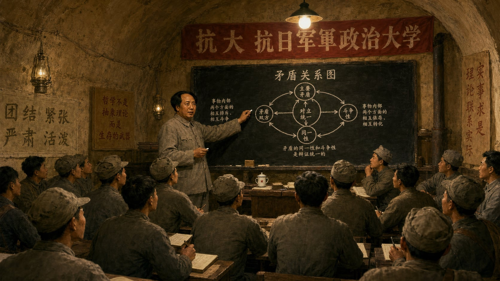
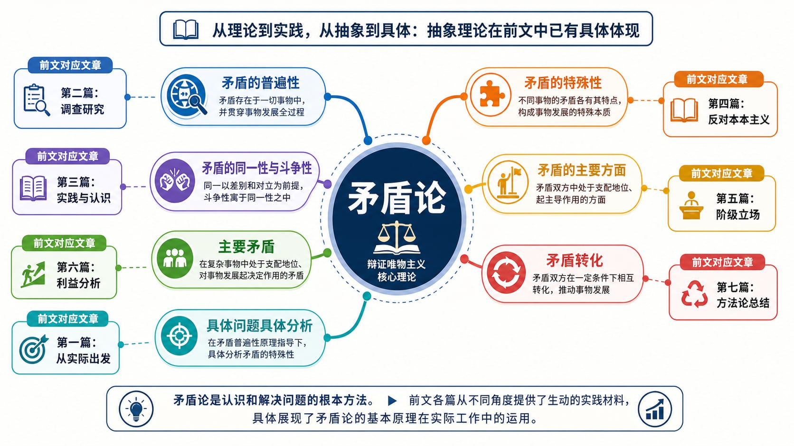
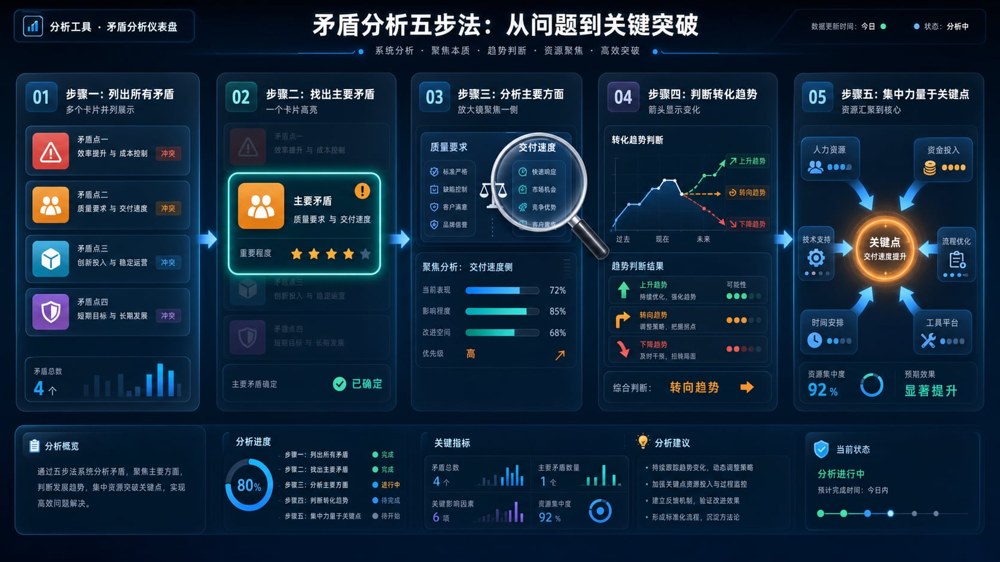
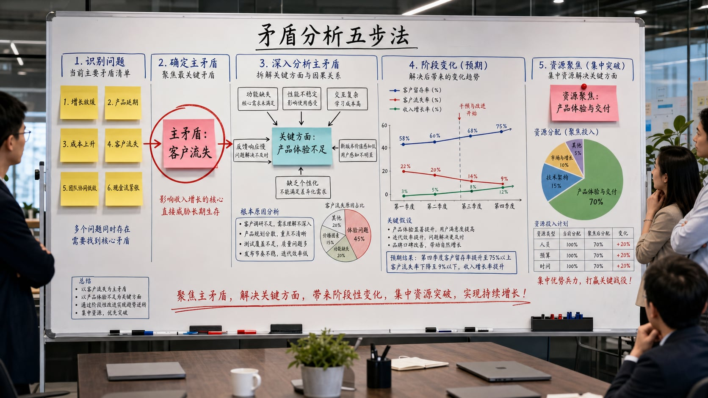
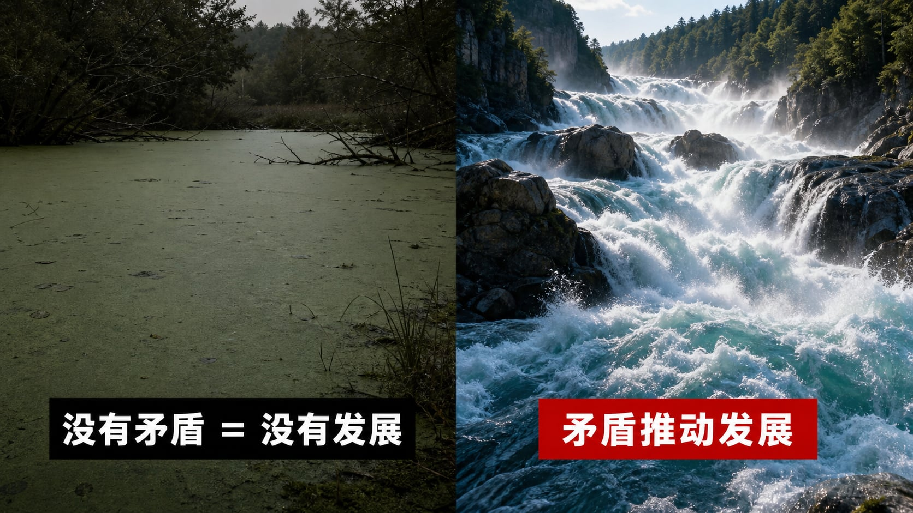
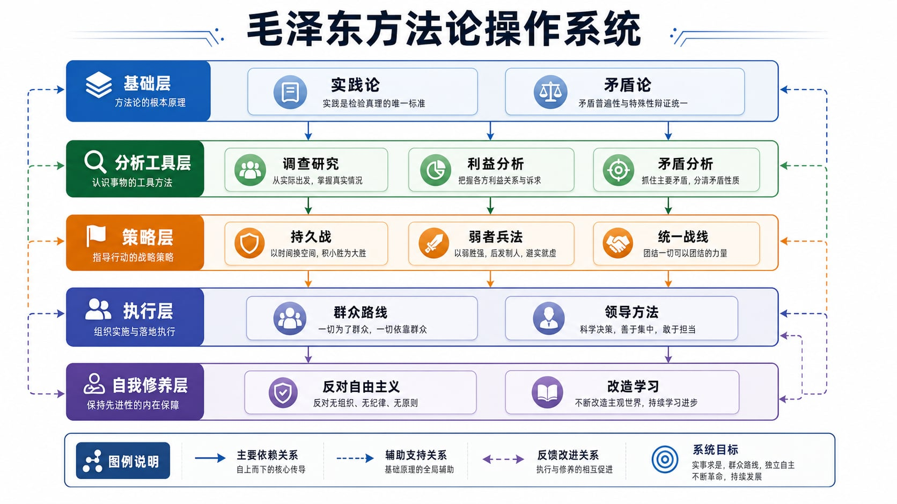
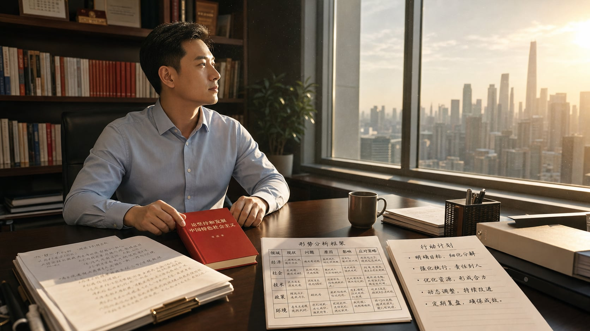

# AI时代的毛选阅读指南（十二）

## 矛盾论：复杂世界的终极分析框架

> **本篇解决的问题：** 面对一团乱麻的复杂局面——十个问题同时压过来、多方利益互相纠缠、变化快得让人无法看清——有没有一个通用的方法，帮你找到那根"提起来就能理顺一切"的线头？

---


### 一、如果你只能从毛选中学一样东西

如果整个毛选浓缩成一个最核心的思维工具，那就是——

**抓主要矛盾。**

你同时面对10个问题。资源有限，精力有限，时间有限。你不可能同时解决所有问题。

**怎么办？**

大多数人的做法是：哪个问题最紧急就先处理哪个。结果就是永远在"救火"——今天灭了这边的火，明天那边又着了。

毛泽东教的做法完全不同：

> **找到那个主要矛盾——解决了它，其他七八个问题会连带松动甚至自动消失。**

这就是《矛盾论》的核心价值。它不是教你"辩证法"这种听起来很玄的东西，而是教你**在复杂局面中找到那个最关键的突破口**。

---

### 二、背景说明




《矛盾论》写于1937年8月，是毛泽东在延安抗日军政大学的哲学讲座。

**写这篇文章的目的：** 批判党内两种错误思维——

1. **教条主义者**：拿着理论当公式套，不管具体情况（矛盾的普遍性和特殊性不分）
2. **经验主义者**：只看局部不看全局，抓不住主要矛盾

**《矛盾论》是毛选中最难的一篇**——概念密集、逻辑多层嵌套、高度抽象。

但我在前面的文章中已经做了大量铺垫。现在让我们回过头来看——**你在前10篇中学到的每一个方法论，其实都是《矛盾论》某个概念的具体应用。**

---

### 三、《矛盾论》的核心概念——用你已经学过的例子来讲




#### 概念一：矛盾的普遍性——矛盾无处不在

> "矛盾存在于一切事物的发展过程中，矛盾贯串于每一事物的发展过程的始终。"

翻译：**任何事物内部都有矛盾，任何发展过程中都有矛盾。没有矛盾就没有发展。**

```
你的公司里一定同时存在：
  → 增长与成本控制的矛盾
  → 创新与稳定的矛盾
  → 个人发展与组织需要的矛盾
  → 短期利润与长期投入的矛盾
  → 部门利益与公司利益的矛盾

这些矛盾不是"问题"——它们是正常的。
如果一个组织"没有任何矛盾"，说明它已经停止发展了。
```

**你在前面哪篇文章中见过这个概念？**

第7篇（困境突围）——我们分析了你面对的困境中存在的多重矛盾。困境本身就是矛盾的集中爆发。

#### 概念二：矛盾的特殊性——具体问题具体分析

> "不同质的矛盾，只有用不同质的方法才能解决。"

翻译：**每个矛盾都有自己的特点，不能用一个通用方案解决所有问题。**

这就是毛泽东反对"本本主义"的哲学根据——

苏联革命的矛盾跟中国革命的矛盾不一样，所以不能照搬苏联的方法。

你的公司的矛盾跟别人公司的矛盾不一样，所以不能照搬"最佳实践"。

**你在前面哪篇文章中见过这个概念？**

第4篇（反对本本主义）——我们讲了为什么照搬别人的方法论是错误的。因为矛盾有特殊性，你必须分析你自己的具体情况。

#### 概念三：主要矛盾与次要矛盾

> "在复杂的事物的发展过程中，有许多的矛盾存在，其中必有一种是主要的，由于它的存在和发展，规定或影响着其他矛盾的存在和发展。"

翻译：**在你面对的一堆问题中，有一个是核心问题。解决了它，其他问题会连带缓解。**

这是毛选中**最有实用价值的概念**，没有之一。

**你在前面哪篇文章中见过这个概念？**

第8篇（论持久战）——毛泽东分析中日矛盾时，判断了战争每个阶段的主要矛盾是什么，据此制定了不同阶段的战略。

**现代应用：**

```
你的创业公司同时面临10个问题：
  产品不完善、团队不稳定、资金紧张、
  竞争激烈、市场不明朗、获客成本高、
  技术债多、管理混乱……

问自己：如果只能解决一个问题，解决了它其他问题会松动的，是哪个？

如果是"产品没有找到市场需求匹配"→ 
  那其他问题（团队不稳、获客难、竞争压力）都是这个问题的"症状"
  → 集中力量解决这一个问题

如果是"团队核心骨干流失"→ 
  那产品迭代慢、质量下降、管理混乱都是后果
  → 先稳住核心人才

主要矛盾找对了，你的所有资源才不会被浪费。
```

#### 概念四：矛盾的主要方面与次要方面

> "矛盾着的两方面中，必有一方面是主要的，他方面是次要的。其主要的方面，即所谓矛盾起主导作用的方面。事物的性质，主要地是由取得支配地位的矛盾的主要方面所规定的。"

翻译：**找到了主要矛盾后，还要判断在这个矛盾中，决定性的因素在哪一方。**

```
例：你跟竞品之间的核心矛盾是"产品体验差距"

矛盾的两个方面：
  → 你的产品体验 vs 竞品的产品体验

矛盾的主要方面是什么？
  → 如果问题主要在于"你的产品做得不够好"
    → 答案是改进你自己的产品（主要方面在你这边）
  → 如果问题主要在于"竞品做了一个你完全没有的创新功能"
    → 答案是调整竞争策略（主要方面在对方那边）

判断"主要方面"在哪边，决定了你的行动方向。
```

#### 概念五：矛盾的转化——强弱会互换

> "矛盾着的各方面，不能孤立地存在。假如没有和它作对的矛盾的一方，它自己这一方就失去了存在的条件。……在一定条件之下，矛盾着的东西可以互相转化。"

翻译：**今天的优势可能变成明天的劣势，今天的劣势可能变成明天的优势——关键看条件变化。**

**你在前面哪篇文章中见过这个概念？**

第7篇（星星之火）和第8篇（论持久战）——敌人的军事优势随着战争持续会转化为劣势（战线拉长、资源耗尽），我方的劣势会逐渐转化为优势（力量积累、民心凝聚）。

**现代应用：**

```
大公司的优势（规模大、资源多）在某些条件下会转化为劣势：
  → 船大难掉头
  → 内部协调成本高
  → 创新被官僚主义扼杀

小公司的劣势（规模小、资源少）在某些条件下会转化为优势：
  → 灵活、快速
  → 决策高效
  → 更贴近用户

转化的条件是什么？→ 市场环境的变化、技术的突破、用户需求的迁移

你的任务不是被动等待转化发生，
而是主动创造有利于转化的条件。
```

---

### 四、把矛盾论变成你的分析工具




从《矛盾论》中提取一个你可以立刻使用的分析工具：

```
矛盾分析五步法：

第一步：列出所有矛盾
  → 面对一个复杂局面，先把所有的矛盾/问题/冲突列出来
  → 不要遗漏，也不要试图在这一步就做判断
  → 例：产品vs需求、团队vs目标、成本vs质量、短期vs长期……

第二步：判断主要矛盾
  → 在所有矛盾中，哪一个是"牵一发动全身"的？
  → 判断标准：解决了它，其他矛盾会连带缓解
  → 如果你不确定，问自己：
    "如果只能解决一个问题，解决哪个产生的连锁效应最大？"

第三步：分析主要矛盾的主要方面
  → 在主要矛盾内部，决定性的因素在哪一边？
  → 你应该把力量投向哪个方向？
  → 例：团队效率低——是"人不行"还是"制度不行"？
    判断主要方面在哪边，决定你是换人还是改制度。

第四步：判断转化趋势
  → 随着时间推移，这个矛盾会如何演变？
  → 主要方面和次要方面有没有可能互换？
  → 需要什么条件才能促成有利的转化？

第五步：集中力量于关键点
  → 基于以上分析，把你的资源和精力集中投向
    主要矛盾的主要方面
  → 不分散，不平均用力
  → 定期重新评估——主要矛盾可能会变
```

---

### 五、一个完整案例




**场景：** 你是一家100人的SaaS公司的COO。公司同时面临以下问题：

1. 客户留存率下降（从85%降到72%）
2. 销售团队士气低落
3. 产品技术债严重，新功能开发速度很慢
4. 竞品拿到了大额融资，开始抢客户
5. 几个核心工程师想离职
6. 现金流只够撑8个月

**不用矛盾分析法的做法：**

同时处理所有问题——加强销售激励、紧急修技术债、给工程师加薪、降成本节流、做营销活动对抗竞品……

结果：每个方向都投了一点资源，但每个方向都不够。半年后，问题一个也没解决，公司更加疲惫。

**用矛盾分析法：**

```
第一步：列出所有矛盾
  ① 客户留存 vs 客户期望（留存率下降）
  ② 销售能力 vs 业绩目标（团队士气低）
  ③ 技术现状 vs 产品需求（技术债严重）
  ④ 我方资源 vs 竞品资源（竞品融资）
  ⑤ 人才留存 vs 人才市场（核心工程师想走）
  ⑥ 支出 vs 收入（现金流紧张）

第二步：判断主要矛盾
  分析因果关系：
  → 客户为什么流失？→ 因为产品迭代慢，功能跟不上需求
  → 产品为什么迭代慢？→ 因为技术债严重
  → 为什么工程师想走？→ 因为被技术债折磨，没有成就感
  → 销售为什么士气低？→ 因为产品竞争力下降，卖不动
  → 现金流为什么紧张？→ 因为客户流失，收入下降

  主要矛盾 → "技术现状 vs 产品需求"（技术债）
  → 解决了技术债，产品迭代加速 → 客户留存改善 → 收入稳定
    → 销售有信心 → 工程师有成就感不想走

第三步：主要矛盾的主要方面
  技术债的主要方面在哪里？
  → 不是所有技术债都同样重要
  → 调查后发现：80%的开发延迟来自于三个核心模块的历史代码
  → 主要方面：这三个模块的重构
  → 不需要全面重构（太贵太慢），集中力量攻这三个模块

第四步：转化趋势
  → 如果三个核心模块重构完成（预计3个月）
  → 产品迭代速度可以提升2-3倍
  → 竞品虽然资金多，但他们的产品也有技术债
  → 时间站在我们这边：谁先解决技术瓶颈谁先加速

第五步：行动方案
  → 接下来3个月，公司的资源优先级：
    #1 三个核心模块重构（调集最强的工程师）
    #2 稳住核心工程师（解决了技术债问题本身就是最好的留人措施）
    #3 销售短期降低目标、维持现有客户为主
    #4 其他问题暂时"忍耐"——次要矛盾等主要矛盾解决后再处理
```

**这就是矛盾论在现代企业管理中的完整应用。**

---

### 六、矛盾论的一个深层洞察：矛盾是好事




大多数人视矛盾为"问题"，避之不及。

但毛泽东说：

> **"没有矛盾就没有世界。"**

矛盾不是需要消除的东西——**矛盾是发展的动力**。

```
没有"产品不够好"的矛盾 → 产品不会进步
没有"团队能力不足"的矛盾 → 团队不会成长
没有"竞争压力"的矛盾 → 组织不会创新
没有"认知局限"的矛盾 → 个人不会突破
```

**你不应该追求"没有矛盾"的状态——那意味着停滞。**

你应该追求的是：**识别矛盾、抓住主要矛盾、在解决矛盾的过程中推动发展。**

旧的主要矛盾解决了，新的主要矛盾会出现——这是正常的。每解决一次主要矛盾，你就上一个台阶。

---

### 七、12篇回顾：你学到了一整套操作系统




到这里，12篇文章全部写完。让我们回顾一下你学到了什么——

```
┌────────────────── 毛泽东方法论操作系统 ──────────────────┐
│                                                        │
│  哲学基础（底层操作系统）：                               │
│    实践论 → 在做中学，在学中做，螺旋上升                  │
│    矛盾论 → 抓主要矛盾，具体问题具体分析                  │
│                                                        │
│  认知方法（怎么看清问题）：                               │
│    调查研究法 → 没有调查就没有发言权                      │
│    利益分析法 → 从利益出发理解每个人的行为                 │
│    困境分析法 → 困难是暂时的还是根本的？时间站在谁那边？    │
│                                                        │
│  战略方法（怎么做出判断）：                               │
│    持久战思维 → 阶段划分，每个阶段做该做的事               │
│    弱者兵法 → 避实击虚，集中力量打歼灭战                  │
│    统一战线 → 团结多数，孤立少数                          │
│                                                        │
│  领导方法（怎么带动团队）：                               │
│    群众路线 → 从一线来，到一线去，循环迭代                 │
│    一般号召与个别指导 → 方向+落地并重                     │
│    关心群众生活 → 解决具体问题而非喊口号                   │
│                                                        │
│  自我修养（怎么要求自己）：                               │
│    反对自由主义 → 对自己有原则性                          │
│    反对本本主义 → 不照搬，要结合实际                      │
│    改造学习 → 学以致用，反对教条                          │
│                                                        │
│  核心精神（一句话总结）：                                 │
│    实事求是，知行合一。                                   │
│                                                        │
└────────────────────────────────────────────────────────┘
```

---

### 八、最后的话




读完这12篇文章，你可能会有一个感受——

> "原来这些我在现代管理学、商学院、畅销书里看到的概念，毛泽东早就用大白话讲清楚了。"

是的。但更重要的不是"毛泽东讲过了"，而是——

**他不仅讲了，而且验证了。**

精益创业是硅谷创业者用十几年验证的方法论。
矛盾论是毛泽东用二十多年的革命战争验证的方法论。

前者的验证环境是商业竞争。
后者的验证环境是**生死之战**。

**在极端环境下被验证的方法论，在普通环境下只会更有效。**

但记住——读毛选本身也要遵守毛泽东教的规矩：

> **理论不是教条。你读的每一个概念，都必须在你自己的实际中验证和调整。**

如果你读完12篇文章，能说出所有概念但从来没用过——那你恰恰犯了毛泽东最反对的错误："本本主义"。

如果你读完后觉得"毛泽东说的一切都是对的，直接照搬就行"——那你犯了另一个他反对的错误："教条主义"。

**正确的做法是：**

> 用毛泽东教你的方法来读毛泽东——
>
> 从你的实际出发，
> 学一个用一个，
> 用了之后看效果，
> 有效的继续用，无效的修正，
> 在实践中形成你自己的方法论。

**这本身就是《实践论》。**

**而你在应用这些方法的过程中发现：有些方法在你的场景中需要调整，有些概念需要结合你的行业特点重新翻译——这就是《矛盾论》中说的"矛盾的特殊性"。**

**你看，这套操作系统是自洽的。**

---

### 终篇练习

**练习一：** 回到你在第2篇中写下的那个"让你感到困难的具体问题"。现在用矛盾分析五步法重新分析一次：

```
这个问题中包含哪些矛盾？
主要矛盾是什么？
主要矛盾的主要方面在哪边？
这个矛盾的转化趋势是什么？
你应该把力量集中在哪个点上？
```

对比你第2篇时的分析——你对这个问题的理解发生了什么变化？

**练习二：** 从这12篇文章中选出对你最有用的3个思维工具，本月各用一次。在月底回顾：哪个最有效？哪个需要调整？

---

**本文要点回顾：**

1. 矛盾论的核心价值：在复杂局面中找到主要矛盾——抓住它，一切可解
2. 矛盾的普遍性（到处存在）与特殊性（具体问题具体分析）
3. 主要矛盾与次要矛盾：集中力量解决核心问题
4. 矛盾的转化：优劣势可以互换，关键看条件变化
5. 矛盾不是需要消除的问题，而是推动发展的动力
6. 12篇文章构成了一个完整的"思维操作系统"：认知方法→战略方法→领导方法→自我修养，底层是实践论和矛盾论

---

**全系列总结：**

> 毛泽东教给我们的最根本的一件事是什么？
>
> **一切从实际出发。理论是工具，不是教条。你读毛选的方式，本身就应该是毛泽东所主张的方式——不是背诵他的话，而是用他的方法去分析你自己的问题。**

---

*本文是"AI时代的毛选阅读指南"系列第12篇（终篇），共12篇。*

*全系列完。*
