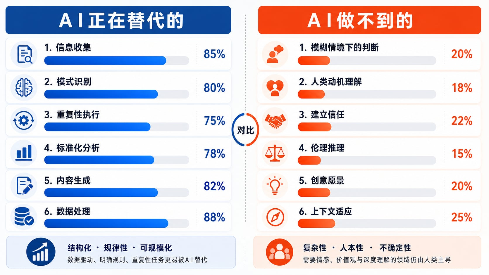
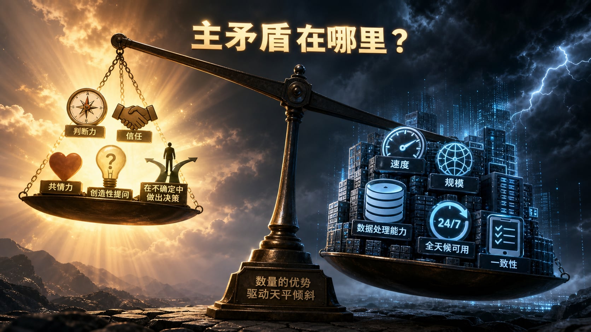
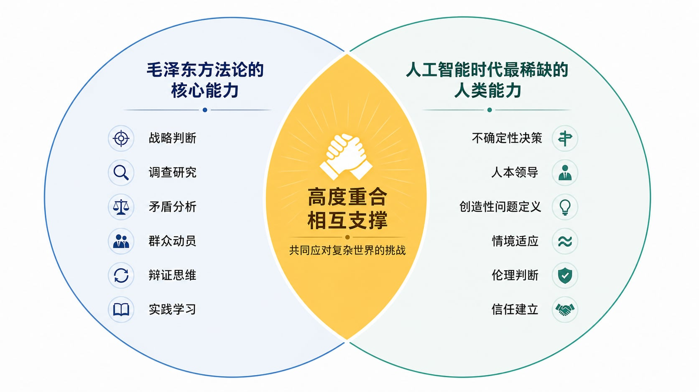
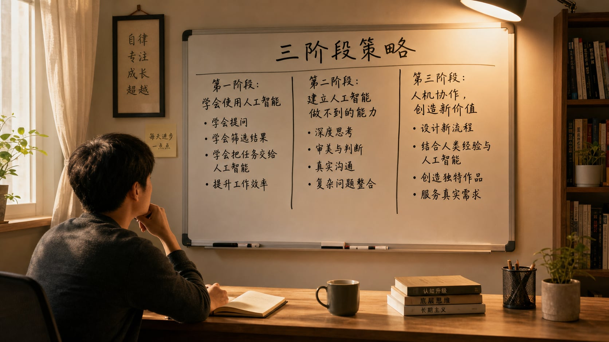
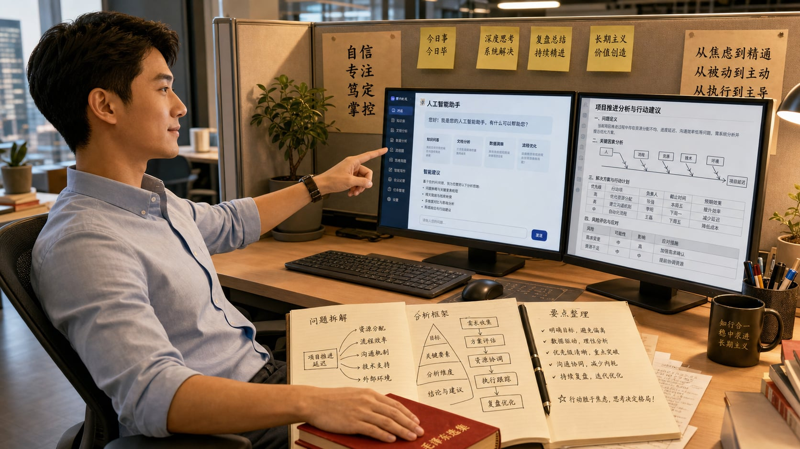

# AI时代的毛选阅读指南（后记）

## 当AI能做一切的时候，你还剩下什么

> **写在系列完结之后：** 12篇文章读完了，毛选的方法论你已经拿到了。但还有一个问题悬在空中——AI正在以超出所有人预期的速度进化。当AI真的能做"几乎一切"的时候，你作为一个人，到底还剩下什么？

---


### 一、先回头看一眼我们走过的路

12篇文章，我们从毛选中提取了一整套思维操作系统。

让我用最短的话把它串一遍——

**你面对一个复杂局面。**

第一步，你不急着行动，而是**调查**——亲自到一线了解实际情况，找不同立场的人聊，收集具体事实而不是抽象感受（第4、5篇）。

第二步，你做**利益分析**——每个相关方的利益是什么？他们会支持还是反对？谁是可以争取的中间力量？（第6篇）

第三步，你做**矛盾分析**——这一堆问题里，主要矛盾是哪个？解决了它，其他问题会不会连带松动？矛盾的主要方面在哪边？（第12篇）

第四步，你判断**趋势**——困难是暂时的还是根本的？时间站在谁那边？力量对比会怎么变化？（第7、8篇）

第五步，你制定**战略**——当前处于哪个阶段？这个阶段的关键任务是什么？要集中力量打哪个点？（第8、9篇）

第六步，你**组织行动**——从一线收集信息，整合成方案，传达给团队，推动执行，收集反馈，修正方案，循环迭代（第10篇）。

第七步，你在做的过程中不断**实践→认识→再实践→再认识**，螺旋上升（第11篇）。

同时，你对自己有要求——不和稀泥、不本本主义、不得过且过（第3篇）。

**这套系统的底层只有四个字：实事求是。**

从实际出发，在实践中检验，具体问题具体分析，永不教条。

好。现在让我们把目光从毛选移开，看向窗外。

窗外是2024年——不，也许你读到这篇文章时已经是2025、2026年了。AI的能力又上了一个台阶。

**那个悬而未决的问题回来了：AI时代，你怎么办？**

---

### 二、一个诚实的判断：AI会替代什么




我不打算给你灌鸡汤，说"AI永远替代不了人"。那不诚实。

**让我用毛泽东教的方法——实事求是——来分析这个问题。**

AI正在快速替代的能力：

```
信息收集和整理 → AI已经做得比人好
模式识别和分类 → AI已经做得比人好
重复性执行 → AI已经做得比人好
标准化写作 → AI正在接近人的水平
数据分析和可视化 → AI已经做得比人好
代码编写 → AI正在快速接近人的水平
翻译 → AI已经在很多场景下超过普通译者
```

如果你的核心竞争力建立在上面这些能力上——**你确实应该焦虑**。不是危言耸听，是实事求是。

可下面几件事，即使模型明天比今天答得好，也不能替你向同事交代。

项目延期时，它能列出几套排期。谁知道有位同事刚接下照护家人的担子，谁去问他愿不愿调班？团队该牺牲范围还是推迟交付，谁去跟客户谈？漏了一个关键信息，它可以重算；承诺落空，客户找的还是你。

这是两条线：分析工具的能力会变，知道谁受影响、让对方有机会说话、为拍板负责，是工作关系里的义务。

---

### 三、用矛盾论分析AI时代的主要矛盾




如果我们用这个系列学到的方法来分析——

**AI时代，职场人的主要矛盾是什么？**

不是"人 vs. AI"——这个框架是错的。AI不是你的敌人，它是一个工具。你不会说"我的主要矛盾是跟Excel的矛盾"。

**主要矛盾是：大多数人的能力结构 vs. AI时代的能力需求。**

展开来说：

```
过去几十年，职场的能力需求是：
  → 掌握信息（你知道别人不知道的东西 = 竞争优势）
  → 熟练执行（你比别人做得快做得好 = 竞争优势）
  → 积累经验（你比别人见得多 = 竞争优势）

这三项能力正在被AI快速抹平。

AI时代，职场的能力需求变成了：
  → 判断力（在信息不完整时做出正确决策）
  → 整合力（把多维度的信息综合成一个决策）
  → 驱动力（让人愿意跟你走、为你全力以赴）
  → 适应力（面对新局面快速调整策略）
  → 提问力（问出正确的问题比得到正确的答案更重要）
```

**矛盾的主要方面在哪边？**

在你这边。AI的进化你控制不了，但你的能力升级你可以控制。

**所以——AI时代的生存策略，本质上是一次个人能力结构的"战略转型"。**

---

### 四、毛泽东的方法论为什么恰好是AI时代的解药




现在你可能理解了为什么我选择在"AI时代"这个大背景下写毛选阅读指南。

不是为了蹭热点。而是因为——

我看重的是几种得有人负责的功夫。《矛盾论》让你问哪个分歧会牵动全局；调查研究让你去找不在输入材料里的人；《实践论》催你回来看，上次拍板之后究竟怎样了。

可以请工具帮你列假设。可你得能对受到影响的人说：**这是我作的决定，我为什么这样选，错了我打算怎么改。**

这就是为什么一本90年前的书，在AI时代反而变得更加重要。

---

### 五、AI时代的个人生存指南：用毛泽东的方法给自己做一次战略规划




让我用这个系列中学到的方法论，帮你做一次面对AI时代的"个人持久战"规划——

#### 第一步：判断你的主要矛盾

问自己：

> 在AI时代，我当前最大的瓶颈是什么？

```
可能的答案：
A. 我还不会用AI → 主要矛盾是"技能缺口"
B. 我会用AI但不知道用在哪里 → 主要矛盾是"判断力不足"
C. 我的工作内容80%可以被AI替代 → 主要矛盾是"能力结构过时"
D. 我的行业正在被AI颠覆 → 主要矛盾是"赛道选择"
```

不同的主要矛盾，需要完全不同的应对策略。先判断清楚，再行动。

#### 第二步：用"持久战"思维做阶段规划

```
第一阶段：战略防御——学会"用"AI（当下）
  
  → 不要恐惧AI，也不要忽视AI
  → 把AI变成你的"超级助手"：
    · 用AI加速信息收集和整理
    · 用AI辅助写作和分析
    · 用AI处理重复性工作，释放你的时间
  → 关键任务：让AI帮你做"执行"，你专注于"判断"
  → 这个阶段的目标：效率提升，但不改变能力结构

第二阶段：战略相持——练习需要你负责的能力（6-24个月）

  → 这是决胜阶段
  → 有意识地培养AI替代不了的五种能力：

    判断力：
      刻意练习在信息不完整时做决策
      每次做判断后记录理由，事后复盘对错
      学习矛盾分析法，训练"抓主要矛盾"的能力

    调查力：
      养成"亲自去一线"的习惯
      不要满足于二手信息和AI的分析
      定期做用户/客户/同事的深度访谈

    领导力：
      学会"从群众中来，到群众中去"的管理方法
      练习让人理解"为什么"而不只是"做什么"
       建立信任，出了差错让别人知道该找谁

    整合力：
      刻意练习把多个维度的信息综合成一个判断
      不要只做"垂直深入"，要练习"水平连接"
      培养在不同领域之间建立类比和联系的能力

    提问力：
      AI擅长回答问题，但不擅长提出问题
      而一个好问题的价值远超一百个好答案
      练习：面对一个复杂局面，先不想答案，
      而是花10分钟列出所有应该被问的问题

  → 这个阶段的目标：完成能力结构的转型

第三阶段：战略反攻——人机协作，创造新价值（长期）

  → 当你既能熟练使用AI又能为工作结果负责时
  → 你就进入了一个"1+1>2"的状态：
    · AI帮你处理信息、起草方案、分析数据
    · 你负责判断方向、驱动团队、做出决策
    · 你的一个人 = 过去一个小团队的产出
  → 这个阶段的目标：成为"AI时代的领导者"
    而不是"被AI淘汰的执行者"
```

#### 第三步：用"弱者兵法"应对转型期

转型期你是"弱者"——你在新领域还没有积累，但旧领域的价值在下降。

```
避实击虚：不要跟AI比它擅长的（信息处理、模式识别）
         而是在AI不擅长的领域（判断、领导、创造）建立优势

集中力量：不要同时学10个AI工具
         选一个跟你工作最相关的，用到极致

打得赢就打：一个方向试了两周没有正反馈？果断换方向
           转型期最重要的是速度和灵活性

在运动中找战机：AI领域变化极快
              保持学习和关注，在变化中发现属于你的机会
```

---

### 六、一个更深层的问题：AI时代，什么值得你去做


我想在最后说一些超出"方法论"和"生存策略"之外的话。

AI时代最深层的挑战，不是"我怎么不被淘汰"。

而是——

> **当机器可以做几乎一切的时候，我做什么才是有意义的？**

这个问题毛泽东也回答过。在《为人民服务》中，他引用了司马迁的话：

> "人固有一死，或重于泰山，或轻于鸿毛。"

然后他给出了一个判断标准：

> **"为人民利益而死，就比泰山还重。"**

把它翻译成不那么沉重的版本：

> **你做的事情有没有真正帮到别人？有没有解决一个真实的问题？有没有让某个人的处境变得更好？**

AI可以生成1000篇文章、写100段代码、分析10000条数据。但它做这些事情的时候，没有"意义感"。它不关心这些文章有没有帮到谁，这段代码有没有解决一个真实的痛点。

**而你可以关心。**

在AI时代，**"关心"本身就是一种不可替代的能力。**

- 关心你的用户真正需要什么（而不是数据报表上显示什么）
- 关心你的团队成员过得怎么样（而不是KPI完成了多少）
- 关心你做的事情有没有真正创造价值（而不是有没有看起来高效）
- 关心你这个人有没有在成长（而不是有没有跟上AI的速度）

毛泽东说的"关心群众生活"，在AI时代有了一层新的含义——

> **在一个一切都可以被自动化的时代，"对人的关心"变成了最稀缺的资源。**

效率的洪流里仍肯问一句“我的工作到底帮到了谁”，这比猜模型下一次会不会追上来，更值得当成方向。

---

### 七、写在最后




12篇文章加上这篇后记，我们一起走过了一段不短的路。

回想第1篇开头，我问你：

> "AI越强大，你越焦虑。你有没有发现？"

现在你手里有了一套完整的工具。但工具没有用，被使用了才有用。

**让我用毛泽东教的方法论给你最后一个提醒：**

如果你读完这13篇文章，觉得"很有道理"，然后收藏起来再也不看——

你就犯了毛泽东最反对的那种错误："读了很多书，但生活没有任何改变。"

如果你把这13篇文章里的方法论当成"真理"照搬到你的工作中——

你就犯了另一个他反对的错误："本本主义。"

**正确的做法是什么？毛泽东已经教你了：**

```
选一个方法 → 在你自己的场景中试一次 → 
看效果 → 有效的保留 → 无效的修正 → 
再试 → 再看 → 再调整 → 
循环往复 → 形成你自己的方法论
```

实践→认识→再实践→再认识。

你不需要变成毛泽东。你只需要用他的方法，变成**更好的你自己**。

---

这个系列写到这里就结束了。

但你的实践刚刚开始。

> **毛泽东说："世界是你们的，也是我们的，但是归根结底是你们的。"**
>
> AI时代也是一样——它是AI的，也是你的，但归根结底，取决于你怎么应对。

---

**后记要点回顾：**

1. AI能帮你分析，不替你承担决策后果
2. 从会用工具走到能判断问题，还得听受影响者的反馈
3. 把判断、调查、领导、整合和提问放回具体工作去练
4. 转型的落点是协作，而不是划一条模型永远跨不过的线
5. 在一切都可以自动化的时代，"对人的关心"变成了最稀缺的资源
6. 读毛选的最终目的不是记住毛泽东的话，而是用他的方法形成你自己的方法论

---

*本文是"AI时代的毛选阅读指南"系列后记。*

*全系列完。感谢你的阅读和实践。*
