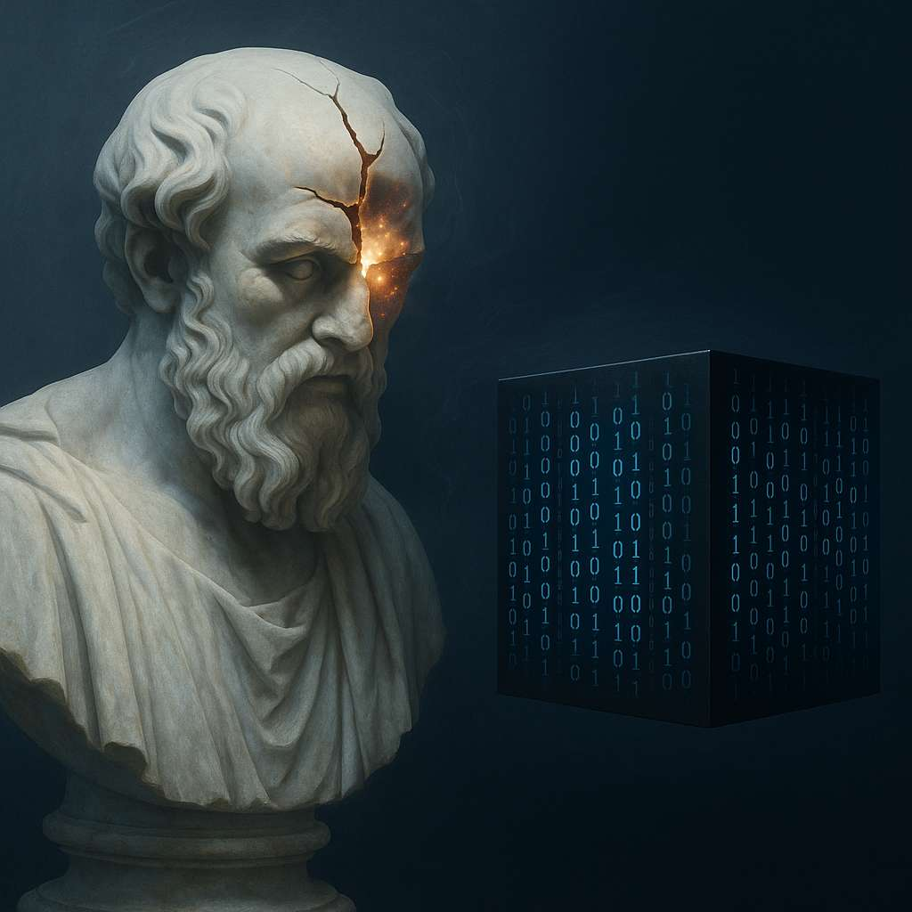
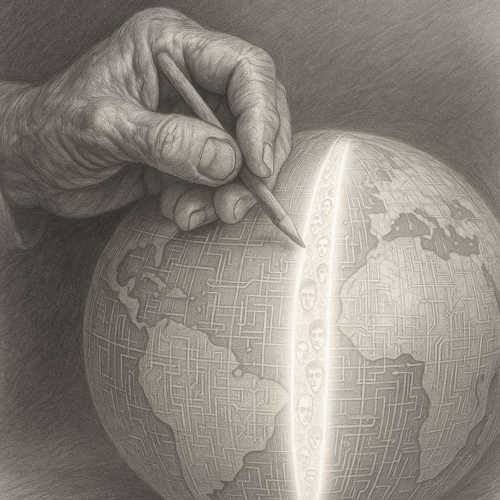

我们正身处一个深刻变革的时代。人工智能（AI）的浪潮以雷霆万钧之势席卷而来，重塑着经济结构、社会形态乃至我们对“智能”本身的定义。它承诺了一个效率极大提升、生产力空前解放的未来，机器智能正日益精湛地承担起曾经专属于人类的、海量的计算、分析与模式识别任务。

然而，在这场由算法驱动的革命中心，一个核心的悖论正悄然浮现，并日益彰彰其重要性：当机器的“计算能力”趋于无穷时，人类心智中那些无法被量化的维度——智慧、伦理判断、批判性探究与意义创造——其价值非但没有被削弱，反而被推上了前所未有的战略高地。

技术的飞速演进，如同一面棱镜，不仅折射出我们文明的成就，更迫使我们直面一个根本性的问题：**在一个答案可以被轻易生成、方案可以被瞬间优化的世界里，我们该如何定义“价值”？** 当解决问题的“术”日益被自动化时，提出正确问题、定义发展目标的“道”，便成为最稀缺的资源。

算法的无处不在，正以前所未有的力度将我们推向一个哲学性的十字路口，这不仅是在追问“何为人之为人的根本”，更是在召唤一种能够为整个文明确定航向的、强大的心智能力。

本篇文章，作为系列探讨的开篇，旨在为这一宏大的时代命题搭建一个层层递进的分析框架。我们将首先系统性地论证，**为何人工智能的崛起，恰恰为以人文科学（文科）为代表的人类精神活动，创造了前所未有的“价值风口”**。我们将剖析，当机器承担了“如何做”的执行任务后，人类的重心必然转向“为何如此”的价值判断与目标设定，而这正是人文精神的核心领域。

然而，**在确认了这一历史性机遇之后，我们必须立即清醒地面对一个严峻的现实障碍**：当前的人文社科领域，在很大程度上是否有能力承担起这一重任？一个深刻的隐忧在于其内在的“思想自主性”的缺失。当许多研究范式与分析工具仍需“仰人鼻息”，无法摆脱对特定（通常是源于西方的）理论框架的路径依赖时，它又如何能为一个独特的、伟大的文明实践提供原创性的理论指导？这种思想上的“水土不服”，正是导致其无法有效发挥价值、甚至陷入理论困境的根本原因。

**正是基于对这一困境的诊断，我们的探讨将自然而然地引向第二个核心议题：什么才是实现“思想独立自主”的破局之道？** 在此，我们将对马克思主义哲学这一思想资源进行一次深刻的“再发现”。

此举并非是出于政治口号式的宣讲，而是将其视为一个关键的、能够从根本上重塑我们分析视角与理论根基的强大思想工具。我们将严谨地剖析，为何这一诞生于对资本主义深刻批判、并强调与本土实践相结合的理论体系，恰恰是破解前述“思想藩篱”、构建中国自主知识体系、从而激活人文科学真正潜能的**核心解药**。

因此，贯穿本系列文章的逻辑脉络清晰而坚定：从AI时代凸显的“价值需求”出发，我们认识到人文科学的“时代使命”；紧接着，我们直面其因缺乏“思想自主”而导致的“现实困境”；最终，我们寻找到以马克思主义哲学为内核、旨在重建这种自主性的“根本路径”。

整个论证最终汇集于一个核心结论：终极的、AI永远无法胜任的工作，在于构建全新的意义框架与目标体系。而这项伟大的智识工程，**其前提，是必须拥有一套自主、自洽、自信的思想武器。**

这不仅是一场关于学科重要性的辩论，更是一场关乎文明未来的深刻反思。它召唤我们重新激活那些沉睡在哲学、历史、文学和艺术中的古老智慧，并用它们来驾驭眼前这个由数据和算法驱动的崭新世界。

这趟思想的远航，始于这样一个基本认知：当机器负责计算时，人类必须专注于思考。而如何思考得更深刻、更具批判性、更富创造力——简而言之，如何实现思想的独立自主——正是人文精神在当务之急下，为我们提供的唯一航图，也是确保我们在未来能够保有精神自由的终极保障。

