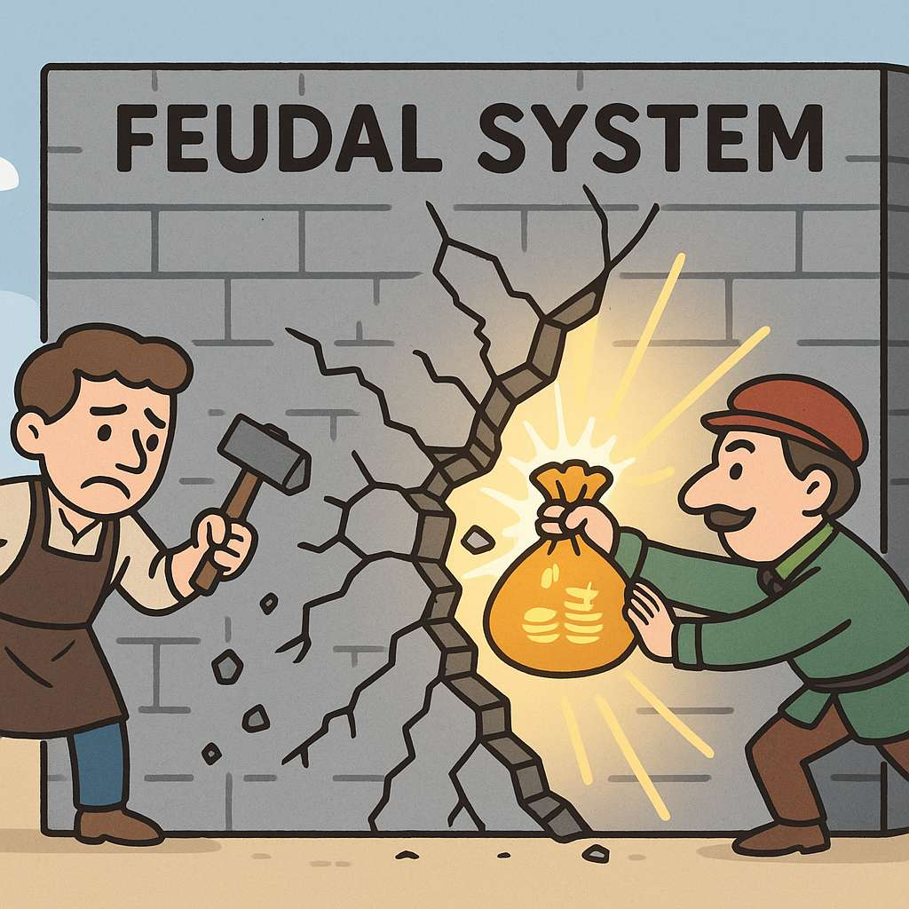
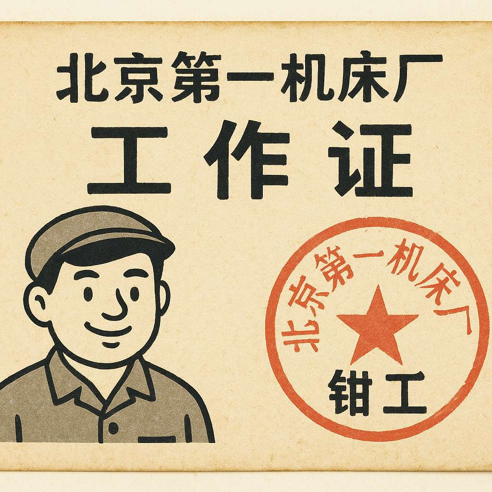
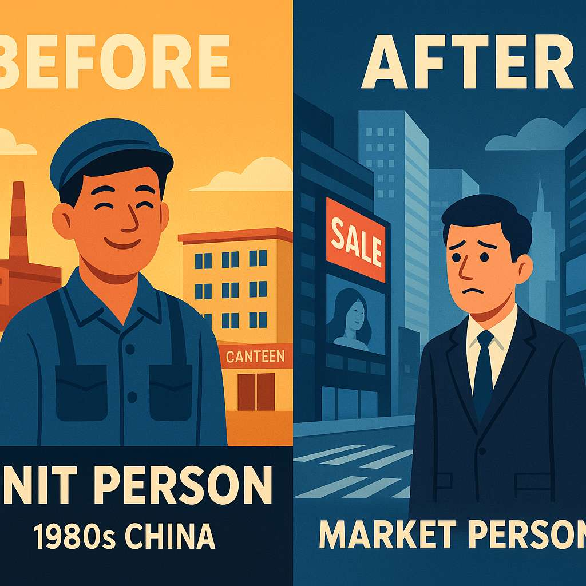

> 每个原理都有其出现的世纪。例如，与权威原理相适应的是十一世纪，与个人主义原理相适应的是十八世纪。……因而不是原理属于世纪，而是世纪属于原理。
> —— 卡尔·马克思，《哲学的贫困》

在上一篇文章中，我们揭示了一个惊人的事实：**我们习以为常的“独立个人”，并非天然存在，而是在近代欧洲，经由宗教改革和哲学启蒙两场思想革命才被“发明”出来的。**我们见证了“个人主义”这颗思想种子的诞生。

但这留下了一个更根本的疑问：为什么是那个时代？为什么“个人主义”的原理，偏偏在十八世纪左右的欧洲大行其道，并最终成为了我们这个时代的“常识”？难道仅仅因为几位天才思想家的雄辩，就足以颠覆千年的传统吗？

马克思用一句极其精辟的话给出了答案：“**不是原理属于世纪，而是世纪属于原理**”。

这句话是什么意思？它就像一位高明的医生告诉你：你发烧（思想、原理），不是病因，而是你体内有炎症（社会现实、生产方式）的**症状**。想要理解发烧，不能只研究体温计，必须去检查身体的哪个器官出了问题。**思想是时代的症状，而不是病因。**

那么，就让我们拿起历史的听诊器和X光机，去探寻十八世纪欧洲社会内部，究竟发生了怎样剧烈的“结构性病变”，从而催生了“个人主义”这场席卷全球的“高烧”。

## 一场“角色扮演游戏”的规则剧变

为了理解这场变革，让我们再次回到那个我们已经熟悉的比喻：**将欧洲中世纪的封建社会想象成一款规则极其严格的大型多人在线角色扮演游戏（MMORPG）。**

:::block-1
**游戏名称：《封建荣耀》**

*   **角色创建：** 你无法自由选择角色。你的阶级（僧侣、贵族、平民）是**出生时就锁定的**。一个农奴的儿子，大概率一辈子是农奴。这就像一个账号，其“种族”和“天赋”是天生的，无法更改。
*   **职业系统：** 如果你是平民，你想当个铁匠，你必须加入“铁匠行会”。这个公会规定了你学什么手艺、生产什么样式的犁、卖多少钱。你不是自由的工匠，你是“XX行会的成员”。你的生活和技能发展，都被公会牢牢绑定。你想创新？对不起，破坏了规矩，要被踢出公会。
*   **经济系统：** 游戏里最重要的资源是“土地”，但它不开放交易，被贵族世袭占有，就像“绑定装备”。你生产的东西，主要是为了满足你所在领地（一个有限的服务器）里领主和邻居的需求，而不是为了在全服市场上自由买卖、积累财富。生产的目的是为了**使用**，而不是为了**交换**。
*   **核心玩法：** **忠诚与依附。** 你对你的领主、你的行会、你的教会保持忠诚，他们则为你提供庇护。这是一种伦理性的、人身依附的关系。在这个游戏里，没有“独狼玩家”（独立的个人），你永远是某个团队的一员。
:::

这个游戏稳定运行了一千多年。但到了中世纪晚期，有两个“高阶玩家”开始觉得这套规则太束缚了，他们想要“开新服”。

## 两位“破壁者”的相遇：资本与劳动的出走

**第一位破壁者：渴望自由的“手工业劳动者”**

他是一位在行会里学到了顶级手艺的工匠。按照老规矩，他得熬很多年，看师傅脸色，才能勉强当个师傅。但他觉得自己的手艺完全可以独立门户，去生产市场上更受欢迎的新产品，赚更多的钱。行会森严的等级和刻板的规定，就像一件越来越紧的束身衣，让他无法呼吸。他的内心独白是：“**我只想靠我自己的手艺，自由地劳动！**” 他渴望的是一种“劳动的自由”。

**第二位破壁者：渴望增殖的“商人”**

他通过远洋贸易和商业投机，积累了大量的货币（游戏金币）。但在《封建荣耀》这套规则里，光有金币没用。他买不到土地，也无法获得与贵族同等的社会地位。他的金币无法“生出”更多的金币，只能用于个人奢侈消费，就像一个满级玩家却发现游戏里没有可投资的“产业”。他感到无比压抑，他的内心独白是：“**我只想让我的钱（动产）自由地流动和增殖，打破土地（不动产）的垄断！**” 他渴望的是一种“资本的自由”。

历史的奇妙之处就在于，这两位心怀不满的“破壁者”，在城市这个新兴的舞台上相遇了。他们的需求一拍即合：

:::block-1
**商人对工匠说：** “别在行会里受气了，我出钱，买下作坊和工具，你来我这里干活。你不用再听师傅的，你听我的。我付你工资，你为我生产。我们一起去市场上大干一场！”
:::

这个看似简单的合作，却开启了一个全新的时代。一种全新的生产关系——**资本主义**——诞生了。它像一个病毒，迅速侵蚀着《封建荣耀》的旧规则。

## 新世界的诞生：从“伦理关系”到“契约关系”

让我们看看这个“新服务器”的规则有什么不同：

*   **主人变了：** 作坊的主人不再是德高望重的老师傅，而是出钱的“资本家”（商人）。生产的目的不再是为了维护家族荣誉、服务老主顾，而是为了在市场上销售，实现**货币的增殖**（赚取剩余价值）。用今天的话说，生产的KPI不再是“用户满意度”，而是“利润率”。
*   **关系变了：** 工匠与作坊主人之间，不再是半人身依附的“师徒关系”（师傅包吃包住，教你手艺，你为他服务多年），而是一种全新的“**雇佣关系**”。资本家购买工匠的劳动力，工匠出卖自己的劳动力换取工资。这是一种赤裸裸的、基于金钱的**契约关系**。没有了温情脉脉的伦理面纱，一切都是买卖。

正是在这种全新的“雇佣关系”中，**现代意义上的“个人”被真正地、在经济上“制造”了出来。**

*   **劳动者**必须是“独立的个人”。因为他需要拥有对自己劳动力的所有权，才能自由地在市场上将其出售。他不再隶属于行会或某个主人，他是“自由”的——但也“自由”地一无所有，除了自己的劳动力。
*   **资本家**也必须是“独立的个人”。他拥有对生产资料的所有权，可以自由地在市场上购买劳动力，组织生产，并承担风险。

他们都是“抽象的个人”，在市场这个巨大的交换平台上，通过一纸契约相遇。他们之间的纽带，不再是血缘、忠诚或信仰，而是冷冰冰的**工资（wage）**。

至此，我们终于看清了“个人主义原理”得以扎根的深层土壤。正是资本主义生产方式的崛起，它像一台巨大的离心机，将人们从旧有的、各种各样的共同体（家族、行会、教区）中被无情地“甩”了出来，让他们变成了孤立的、原子化的、在市场上漂泊的“个人”。**思想上的革命，最终是由这场经济基础的革命所驱动和完成的。那些关于个人自由、理性、权利的思想，为这套全新的经济系统提供了完美的“道德许可证”和“法律外衣”。**

## 中国的镜子：从“单位人”到“市场人”

这段欧洲历史，对我们中国人来说，或许有些遥远。但幸运的是，我们亲身经历了一场极为相似的社会转型，这为我们理解“个人”的来历提供了一面绝佳的镜子。

回想计划经济时代，那时的中国人，很少有“独立的个人”这个概念。你的身份是什么？不是一串身份证号码，而是一张**工作证**。你属于哪个“单位”——是北京第一机床厂的工人，还是大寨人民公社的社员。

:::block-1
**那时的“个人”，是一个“单位人”。**

*   **生活全包：** 单位有食堂、有宿舍、有子弟学校、有医务室，甚至有澡堂和电影院。你的生老病死，单位都替你考虑到了。
*   **前途由组织安排：** 三大件（自行车、缝纫机、手表）要排队等单位的票。结婚分房，要看你的工龄和表现。退休时，会有锣鼓队欢送你，给你挂上大红花，送上“光荣退休”的镜框。
*   **关系是伦理性的：** 你对工厂有“感恩之心”，讲究“以厂为家”。车间主任不仅是你的领导，还可能介入调解你的家庭矛盾。这是一种“大家长式”的关怀与控制。
:::

然后，改革开放的浪潮来了。市场经济的大门打开，我们每个人，都从那个温暖又束缚的“单位”共同体中，被“抛”了出来。我们成了“市场人”。

我们获得了前所未有的自由，可以自由选择职业，自由流动。但同时，我们也必须独自面对市场的一切风险：失业、竞争、内卷。我们与公司的关系，变成了雇佣与被雇佣的契约关系。**我们不再期待单位分房，而是计算着自己的工资能否还得起房贷。**

我们，终于成为了费尔巴哈和马克思所讨论的那种“**抽象的个人**”。

**“抽象”在哪里？在于市场这只无形的手，会“抽象”掉我们身上许多“无用”的个性。**它不关心你的喜怒哀乐、你的艺术情怀、你的生命理想。它只关心一个核心指标：**你的劳动力能带来多大的效益？你的技能在市场上的价格是多少？** 在招聘网站上，你被简化成了一份份简历——学历、工作经验、技能证书。你被“抽象”成了一个可计算、可交换的“人力资源”。

## 结语：戴着镣铐的“自由”舞者

现在，我们可以完整地回答最初的问题了。

**“个人主义”的兴起，表面上看是思想家们的伟大创造，但其根源，在于资本主义生产方式的确立。是这套全新的经济引擎，需要大量“自由的”、“独立的”劳动力作为燃料，才将“个人”从历史的后台推向了前台，并让“个人主义”成为了一个时代的“主旋律”。**

**不是原理创造了世纪，而是崛起的资本主义世纪，呼唤并最终确立了个人主义的原理。**

当然，“经济基础呼唤个人主义”是一个历史趋势判断，不是一个可以套用到任何地方的公式。日本、韩国等东亚经济体在过去几十年里同样经历了资本主义化和雇佣关系的普及，但集体主义在它们社会文化中的分量，明显没有被同一套逻辑“抽象”掉。这提示我们：市场经济确实需要“自由的个人”作为劳动力和资本的载体，但一个社会最终长出多浓烈的个人主义文化，还要看它自身的宗教传统、政治制度这些中介变量在起作用。经济基础提供的是压力和可能性，不是一份写死了结果的说明书。

理解了这一点，我们再看待“个人”与“自由”，或许会多一分清醒。**我们确实获得了前所未有的个体自由，但这种自由，从一开始就与市场的逻辑、资本的规则深刻地绑定在一起。**我们就像在一个被规则限定的舞台上自由舞蹈的舞者，看似自由，却始终无法挣脱脚下那片由生产关系铺就的地板。

看清这张“历史的X光片”，不是为了否定个人的价值，而是为了**让我们更深刻地理解我们自身的处境，理解我们所拥有的自由的边界，以及它那沉甸甸的历史来历。**这是一种清醒，也是一种力量。

