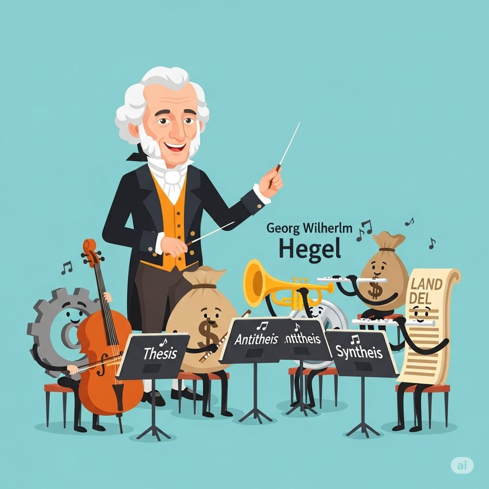
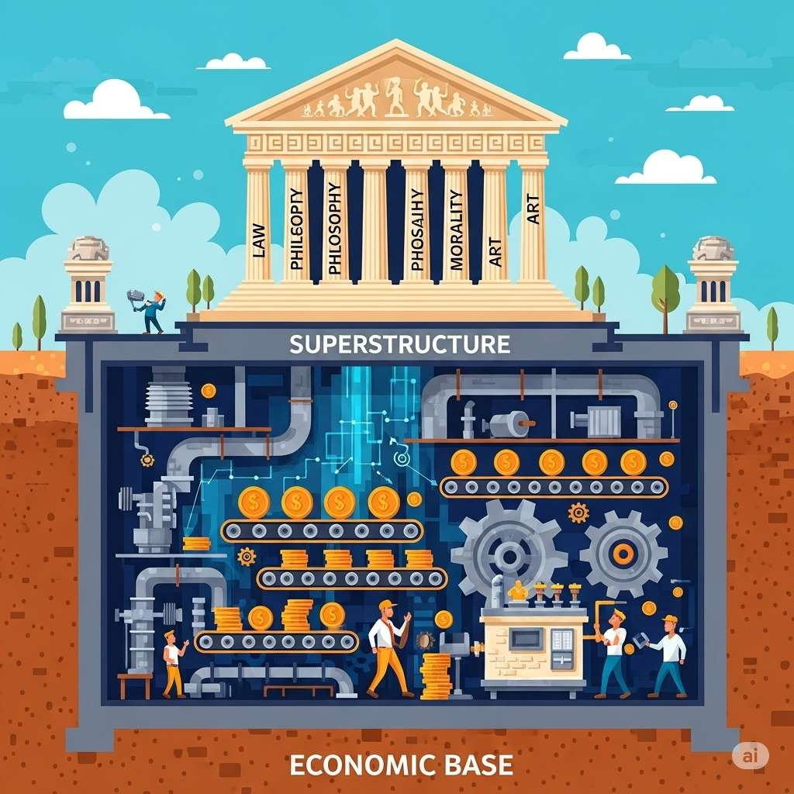
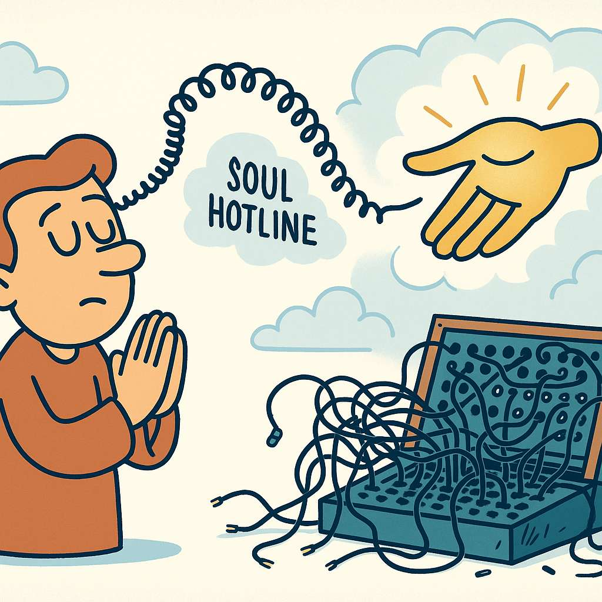
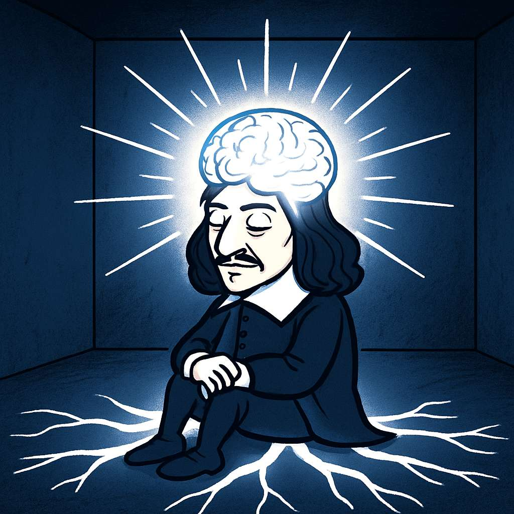

> “我，是一个独立的个人。”

这句话，恐怕是我们这个时代最不言自明、最根深蒂固的信条。它像是我们思想系统的底层代码，是我们做出一切人生选择——从职业规划到伴侣关系——的绝对前提。我们为“做自己”而骄傲，为“个人自由”而抗争，我们深信，宏大的社会，不过是无数个像我们这样的独立“个人”通过自愿的交往和契约，像搭乐高积木一样搭建起来的。

先有积木（个人），再有城堡（社会）。这个逻辑，听起来天经地义，无懈可击。

但今天，我们要对这个“天经地义”发起一场思想探险。马克思在《关于费尔巴哈的提纲》中一句看似不经意的话，却精准地戳穿了这个我们习以为常的观念。他说，费尔巴哈所分析的那个“抽象的个人”，实际上“属于一定的社会形式”。

这句话的潜台词是：**我们所以为的、作为历史起点的“个人”，根本不是起点，而是一个终点；它不是原因，而是一个被精心制造出来的结果。**

那么，这个我们无比珍视的“个人”，究竟是如何被“制造”出来的？让我们一起回到历史的后台，看一看这场伟大的思想魔术是如何上演的。

## 拆解神话：渔夫与猎人的“田园牧歌” 

首先，让我们打破一个被近代哲学反复讲述的“创世神话”。

这个神话故事通常是这样开头的：在人类历史的黎明，有一个孤独的渔夫，他擅长打渔；还有一个孤独的猎人，他擅长打猎。有一天，他们相遇了，渔夫想尝尝肉味，猎人想吃点鱼鲜，于是他们进行了交换。这个“独立的个人”之间的“自愿交换”，被设定为人类社会和经济的起点。

这幅画面充满了理性的、田园诗般的美感。它如此简洁有力，以至于成了我们理解社会起源的默认模板。但马克思一针见血地指出：这纯属虚构。这不是历史的真实起点，而是将近代资本主义社会的人际交往方式，粗暴地投射到了古代，是一种“时代错乱”的想象。它就像是看着摩天大楼，然后想象远古人类的第一个住所也是用钢筋水泥建造的，完全无视了从洞穴、茅草屋到砖瓦房的漫长演进。

**真实的人类历史起点，根本没有这种“原子化”的个人。无论是东方还是西方，人类最初的形态都是共同体**。你不是一个“独立的猎人”，你是“猛虎部落的猎人”；你不是一个“独立的渔夫”，你是“河狸宗族的渔夫”。你的身份、你的生存、你的荣耀，都与你的共同体（家族、宗族、部落）死死地捆绑在一起。你不是一块独立的乐高积木，你是一棵大树上的枝丫，一旦脱离树干，立刻就会枯萎。

想想“光宗耀祖”这个说法：一个人获得功名，荣耀却不只属于他自己。这里要紧的不是把族长和县官排个高下，而是看清个人的行动怎样牵动着一张血缘和乡里的网。

那么，究竟发生了什么，让我们从“大树的枝丫”变成了“独立的积木”？这需要两场惊天动地的思想革命，它们像两把巨剪，剪断了个人与共同体之间的那些“脐带”。

## 思想革命（上）：挣脱“精神枷锁”的宗教改革

第一场变化，从十六世纪初德意志部分地区的信仰生活说起。对一个不识拉丁文的信徒，最熟悉的也许不是书桌上一部自己逐页研读的《圣经》，而是礼拜中的诵读、讲道、图像和仪式。这和“普通人被禁止读经”可不是同一回事。

教会在解释经文、主持圣礼和地方政治中都有权威，但不同地区、不同年代的关系不一样。也不能从某次加冕中教会的角色，推出欧洲每个国王都要教皇亲自加冕。真正值得问的是：如果信仰的根据能由信徒本人领会，中介的权威会发生什么变化？

路德正是在围绕赎罪券的争论中提出《九十五条论纲》。把救赎同金钱交易联系起来的问题，迫使人追问：人究竟凭什么得救？

他的核心思想——“因信称义”——可以用一个现代比喻来解释：

:::block-1
**“上帝在我们每个人的心中都安装了一部‘灵魂热线’，它是一条专线，无需通过教会这个昂贵又信号不佳的总机来转接。只要我们内心有虔诚的信仰（拨通正确的号码），我们就能直接与上帝通话。圣经是上帝写给每个人的信，我们每个人都有权亲自阅读和理解它，而不是等着别人念给我们听。”**
:::

这条“热线”的比喻，强调的是个人信仰不必由金钱或身份来担保。它没有让教会共同体消失，却为“我自己相信什么”赋予了不同的分量。这里讲的是近代个人观念的一条来路，不是说此前的欧洲人没有内心生活。

## 思想革命（下）：用“理性”为自我奠基的启蒙运动 

如果说宗教改革是在“内心”和“信仰”的维度上发现了个人，那么紧随其后的哲学启蒙运动，则是在“外部”和“理性”的维度上，为这个新生的“个人”提供了坚实的基座，并为他装上了一双可以探索世界的“眼睛”。

这场运动的旗手，是法国哲学家勒内·笛卡尔。他进行了一场史无前例的思想实验，其彻底程度不亚于路德。

想象一下，你电脑里的操作系统、所有软件、所有文件，都是别人预装的（传统、权威、教会教条）。你从小到大，都生活在这个被设定好的系统里，你甚至都不知道哪些是核心系统，哪些是垃圾软件。笛卡尔做的事情是：格式化硬盘，重装系统。

他像一个终极的“清理大师”，把所有外界灌输给他的知识和观念都视作可能含有病毒的“预装软件”，统统丢进回收站。**他要寻找一个绝对可靠、无法被删除的“系统内核文件”，以此为基础，重建整个知识大厦。**这个过程是痛苦而孤独的，他把自己关在屋子里，与世隔绝，进行一场纯粹的精神远征。

最终，他找到了。当他在怀疑一切的时候——怀疑上帝是否存在，怀疑世界是否真实，甚至怀疑自己的身体是否存在——他发现，“我正在怀疑”这件事本身，是无法被怀疑的。而“怀疑”是一种思考。于是，他得出了那句流传后世的结论：

:::block-1
**“我思，故我在。”（Cogito, ergo sum）**
:::

这句话的革命性在于，它宣称，“我”的存在，不再需要任何外在权威的担保。不需要上帝的恩典，不需要教会的证明，也不需要国王的册封。“我”存在的唯一、也是最可靠的基石，就是“我”自己的理性思考能力。“我”成为了自己存在的出发点和最终的法官。这就像是在一片虚无中，用思想为自己牢牢地打下了一根桩。

从笛卡尔开始，一场声势浩大的启蒙运动席卷欧洲。哲学家们高举“理性”的火炬，宣称每个个人都拥有运用自身理性的能力，去认识世界、判断是非、建立道德。康德更是将启蒙运动的口号总结为：“要有勇气运用你自己的理智！” 这句话就像在对每个人说：“别再当一个思想上的未成年人，依赖别人的指引了。站起来，自己思考！”

至此，一个完整的近代“个人”形象被塑造完成了：**他内有独立的信仰（新教），外有自主的理性（启蒙哲学）。他既是精神的主人，也是思想的主人。** 这种“个人主义”的原理，成为了近代西方文明的基石，并最终演化为我们今天所熟知的“人权”、“自由”、“个人奋斗”等核心价值观。

## 结语：思想的种子与现实的土壤

回顾这段波澜壮阔的思想史，我们仿佛看清了思想魔术的后台操作。**我们今天所珍视的“个人”，这个看似理所当然、亘古不变的存在，实际上是在欧洲近代特定的历史时期，通过宗教和哲学两场深刻的思想革命，才被一步步“建构”和“发明”出来的。**

它首先是一种原理，一种观念，一种全新的看待世界和自我的方式。

但故事到这里，只讲了一半。一个更深刻的问题浮出水面：**为什么恰恰是在那个时代，这两场高举“个人主义”大旗的思想运动能够获得如此巨大的成功？为什么“权威的原理”衰落了，“个人的原理”兴起了？仅仅是因为路德和笛卡尔比前人更聪明吗？**

思想的种子，需要现实的土壤才能生根发芽，长成参天大树。如果说我们已经看到了“个人主义”这颗种子的基因图谱，那么，下一步，我们必须深入地底，去考察那片孕育了它的、名为“现实”的土壤。就像一场大雨（思想运动），只有落在干涸龟裂的土地上（社会需求），才能被迅速吸收，汇成江河。

**怎样的社会经济变革，让“个人”变得如此重要？** 接着读[《个人主义不是天性：它为何在近代欧洲胜出》](个人主义不是天性：它为何在近代欧洲胜出.md)，看看工匠和商人各自需要哪一种自由。

