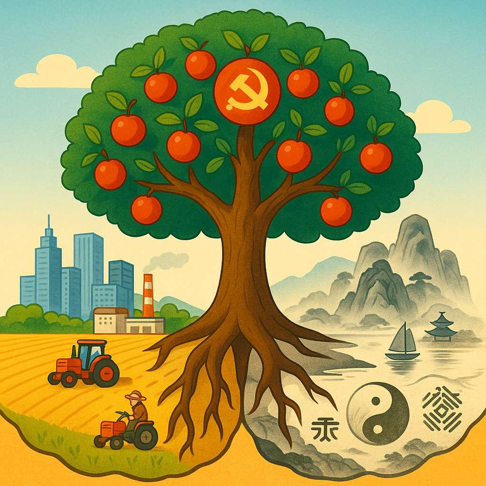

## **引言：一个核心悖论**

一门课可以是必修课，一种方法却不会因为出现在课表上，就自动出现在研究现场。这是我想谈的悖论：我们怎样知道马克思主义究竟被当作应用工具，还是只在论文开头出现了一次？

2016年关于哲学社会科学工作的讨论，提出过马克思主义在一些领域被边缘化、空泛化、标签化的问题。这是指明一个值得查的现象，不是一份测出了整个学界应用率的统计表。

本文旨在深入探究这一思想围城的成因、表现及其深远影响，并论证其**根本出路在于一场深刻的“思想自主”运动，即通过构建真正属于中国自身的哲学社会科学自主知识体系**，让马克思主义从一座被供奉的“圣殿”真正回归其作为认识世界、改造世界的强大思想武器的本来面目。

## **坚固的堡垒：作为官方信条的马克思主义**

在中国，马克思主义的指导地位并非一句空洞的政治口号，而是通过一系列高度制度化的安排，被确立为国家政治和社会生活的“魂”。

首先，**其至高地位由国家根本大法《宪法》所确立**。《宪法》序言明确规定了马克思列宁主义及其中国化理论成果的指导地位，这使其拥有了不容动摇的法理基础，并从根本上定义了中国哲学社会科学必须以马克思主义为指导的性质。

其次，**教学有明确的制度载体**。高校的思想政治理论课程、马克思主义学院和相关研究项目，使理论有了专门的教学与研究空间。看见这些安排，是在回答“在哪里教”，还没有回答“在哪些研究里真正用上了”。

从组织架构、课程设置到资源投入，这座意识形态的堡垒可谓固若金汤。其目标明确，就是要培养社会主义事业的建设者和接班人，并不断推动作为指导思想的马克思主义理论自身的创新与发展。

课程设了没有，可以查课表；学生和教师有没有用这些概念解释新的现象，却得去读他们做了什么研究。这是两种不同的检验。

## **围城之困：应用理论的“空心化”及其根源**

制度化教学与实际应用为什么可能脱节？这里我想分开看两种诱因：题目怎样选，成果怎样算。

**一、西方学术范式的隐性主导**

改革开放以来，中国哲学社会科学在快速发展的同时，也深刻地受到了西方学术体系的影响。在经济学、社会学、法学等诸多领域，西方主流的理论、概念和研究方法被大量引入。

引进理论可以增加工具，也可能让现成的题目替研究者选好材料。判断是否“削足适履”，要看它遇到解释不了的中国经验时，是修改问题，还是把材料删掉。不能光凭理论来自哪里下判决。

**二、学术评价体系的“指挥棒”效应**

把问题缩到一轮经济学院的晋升考核。假设该轮只给目录中的期刊计分，一个要花三年跟踪工厂用工变化的年轻教师，可能会先问：这项研究投在哪里才算成果？这就是“指挥棒”：甚至不必有人明确反对他的选题，规则也可能改变他花时间的地方。

要把设例变成判断，就得拿出哪所学院、哪几年、哪份晋升规则，再看相应期刊的投稿和录用情况。目录里没有一个刊名，不等于阶级分析类论文投了必被拒；文章没有发表，也可能是没有人腾得出时间去做。

## **走出围城：构建自主知识体系的时代召唤**

面对官方信条与应用理论之间的鸿沟，以及由此带来的思想自主性缺失的严峻挑战，中国正在发起一场深刻的理论自觉运动，**其核心目标是——建构中国自主的知识体系**。这不仅是一项学术任务，更是一项关乎国家发展和民族复兴的重大战略。

“思想独立自主”是对过去被动移植、简单模仿西方理论模式的深刻反思和战略纠偏。**其核心要义在于“立足中国实际，解决中国问题”**。这意味着中国的哲学社会科学研究必须从中国独特的现代化实践中汲取养分，形成能够有效解释“中国奇迹”背后逻辑的“中国理论”。这场理论上的“独立自主”运动，旨在打造融通中外的新概念、新范畴、新表述，构建起具有中国特色、中国风格、中国气派的学科体系、学术体系和话语体系。

要实现这一宏伟目标，**最关键的路径被明确为“两个结合”：即坚持把马克思主义基本原理同中国具体实际相结合，同中华优秀传统文化相结合**。这为弥合马克思主义理论与实践的鸿沟指明了方向。

“**同中国具体实际相结合**”要求马克思主义研究必须走出书斋，直面中国改革发展稳定中的重大理论和实践问题。它要求研究者不能满足于对经典文本的注释，而必须运用辩证唯物主义和历史唯物主义的世界观和方法论，去分析当代中国的社会结构和发展规律。

“**同中华优秀传统文化相结合**”则为马克思主义在中国的发展提供了深厚的文明根基。它认识到，任何外来思想若想在一片土地上生根发芽，就必须与本土的文化基因相融合。中华文化中“天下为公”的社会理想、“民为邦本”的治理思想等，与科学社会主义的价值观存在高度契合性。通过这一结合，马克思主义不仅获得了鲜明的中国特色，也激活了中华优秀传统文化自身的生命力。

## **从“圣经”到“指南”的回归**

我所说的困境，不是已经统计出哪个学科“失声”了，而是课表上的理论和评价表上的成果之间，可能隔着研究者独自承担的时间与代价。

然而，挑战中也孕育着重大的历史机遇。中国正在以前所未有的理论自觉，推动一场旨在实现“思想独立自主”的深刻变革。通过加快构建中国哲学社会科学自主知识体系，特别是坚定不移地走“两个结合”的道路，中国正在努力打破这座思想的围城。**这一努力的最终目标，是让马克思主义实现一次根本性的角色回归：不再仅仅是一部被供奉在殿堂之上的“圣经”，而是重新成为指导实践、解释现实、引领未来的行动“指南”**。

只有当马克思主义的立场、观点和方法被创造性地运用于分析和解决中国自身的重大问题时，它才能真正从被“边缘化”的困境中走出来，重新彰显其作为科学真理的强大力量。

