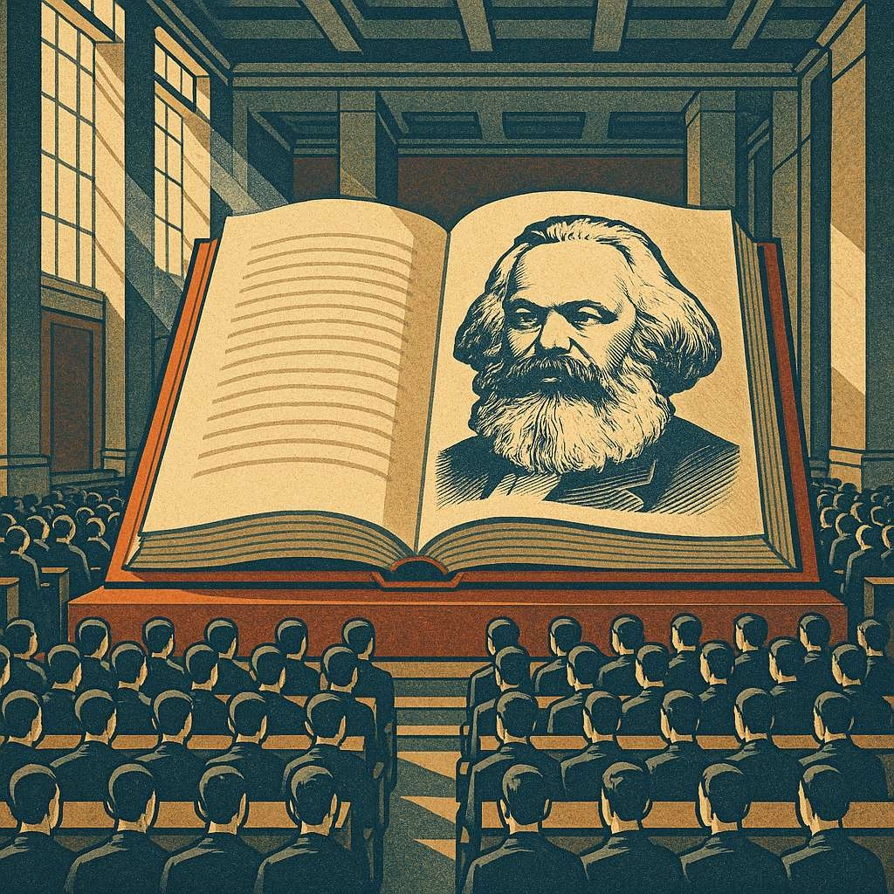
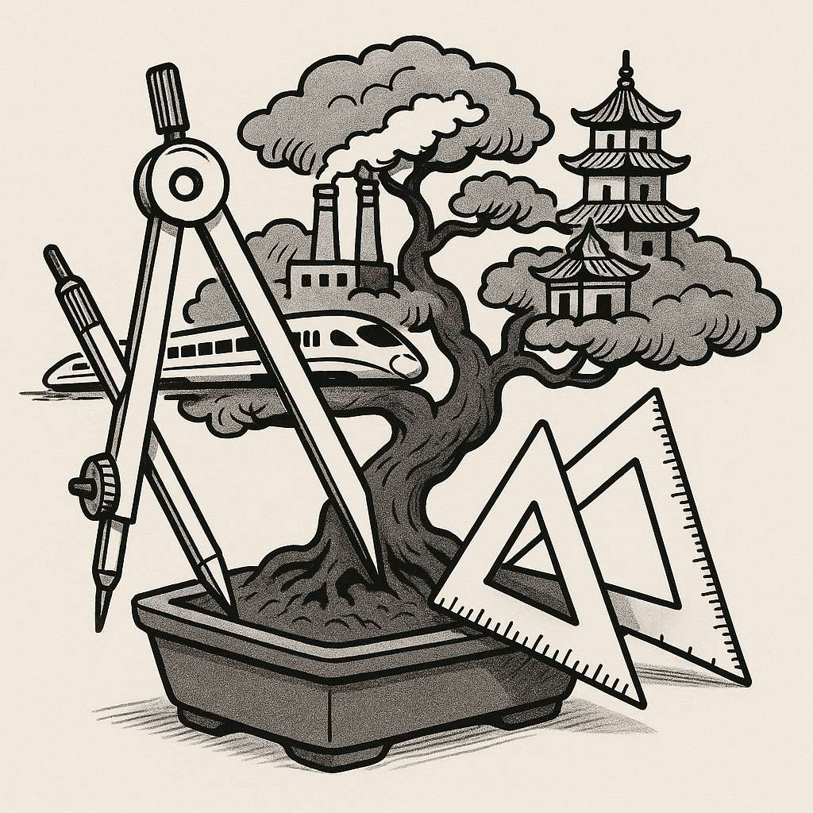

## **引言：一个核心悖论**

当代中国的马克思主义地位呈现出一个深刻的核心悖论：**它既是宪法确立、制度保障的至高官方信条，在现实的学术应用中却又时常被边缘化，形成理论信条与实践应用之间的巨大鸿沟**。

一方面，马克思主义被尊为国家的根本指导思想，构成了从基础教育到最高学术殿堂的必修内容，形成了一座看似坚不可摧的“思想堡垒”。然而，在这座堡垒之外，当需要运用理论工具去剖析中国自身复杂而独特的社会经济现象时，**马克思主义的实际应用却显得异常薄弱，甚至时常处于缺位状态**。

这种官方信条的崇高地位与应用理论的实际贫乏之间的巨大反差，构成了当代中国思想界一个亟待深入剖析的核心矛盾。早在2016年，中国最高领导人就已敏锐地指出，在某些领域，**马克思主义存在被“边缘化、空泛化、标签化”的现象，在一些学科中甚至出现了“失语”“失踪”“失声”的严重问题**。这一论断深刻揭示了理论的“应然”与实践的“实然”之间的巨大张力。

本文旨在深入探究这一思想围城的成因、表现及其深远影响，并论证其**根本出路在于一场深刻的“思想自主”运动，即通过构建真正属于中国自身的哲学社会科学自主知识体系**，让马克思主义从一座被供奉的“圣殿”真正回归其作为认识世界、改造世界的强大思想武器的本来面目。

## **坚固的堡垒：作为官方信条的马克思主义**

在中国，马克思主义的指导地位并非一句空洞的政治口号，而是通过一系列高度制度化的安排，被确立为国家政治和社会生活的“魂”。

首先，**其至高地位由国家根本大法《宪法》所确立**。《宪法》序言明确规定了马克思列宁主义及其中国化理论成果的指导地位，这使其拥有了不容动摇的法理基础，并从根本上定义了中国哲学社会科学必须以马克思主义为指导的性质。

其次，**国家建立了覆盖所有教育阶段的马克思主义理论教育体系**。从小学到大学，思想政治理论课都是贯穿始终的必修课程。在高等教育阶段，所有学生都必须修习“马克思主义基本原理”等一系列核心课程。与此同时，一个庞大的马克思主义研究与教学学术体系也随之建立，各大高校纷纷设立马克思主义学院，国家通过设立重大工程和专项基金，持续投入巨额资金，鼓励相关理论研究。

从组织架构、课程设置到资源投入，这座意识形态的堡垒可谓固若金汤。其目标明确，就是要培养社会主义事业的建设者和接班人，并不断推动作为指导思想的马克思主义理论自身的创新与发展。

然而，正是这座看似坚不可摧的堡垒，其内部与外部世界之间却存在着一条深刻的裂痕。**当理论需要走出课堂、走出教科书，去直面火热而复杂的社会现实时，其作为分析工具的锐度与效能却时常大打折扣**。

## **围城之困：应用理论的“空心化”及其根源**

尽管官方信条的地位至高无上，但在具体的社会科学研究实践中，马克思主义的分析方法和理论框架却远未得到充分应用。这种理论与应用的脱节，即“空心化”现象，其成因是多方面的，但**最核心的根源，在于外部西方学术范式的隐性主导与内部学术评价体系的结构性制约**。

**一、西方学术范式的隐性主导**

改革开放以来，中国哲学社会科学在快速发展的同时，也深刻地受到了西方学术体系的影响。在经济学、社会学、法学等诸多领域，西方主流的理论、概念和研究方法被大量引入。

这种引入在初期极大地促进了中国学术的现代化，但其负面效应也日益凸显。**许多学者在研究中国问题时，不自觉地陷入了“言必称西方”的话语体系**，习惯于运用源自资本主义社会实践的理论框架来分析中国的社会主义实践，其结果往往是削足适履，不仅无法准确解释中国独特的经验，反而常常得出与事实相悖的结论。

这种路径依赖的背后，是一种深刻的理论预设冲突。西方主流社会科学理论，其根本预设是为了描述和优化一个以资本增值为核心逻辑的社会系统。而中国所走的社会主义道路，其根本目标是满足人民需求和实现共同富裕。**用服务于前者的理论工具来衡量和评判后者，是一种根本性的“范畴错误”**，必然导致分析的失效。这使得中国社会科学在某种程度上成为了西方理论的“应用市场”，而非一个自主知识的“生产基地”，从而严重削弱了精神上的独立自主。

**二、学术评价体系的“指挥棒”效应**

与西方学术范式的主导地位相伴相生的，是中国国内的学术评价体系问题。长期以来，**中国的学术评价在很大程度上借鉴了西方的标准，尤其看重在国际核心期刊（通常由西方主导）上发表论文的数量**。这种以量化指标为核心的评价体系，产生了严重的负面导向。

为了在国际期刊上发表文章，中国学者不得不遵循其审稿标准、学术规范和理论偏好。这意味着，他们必须使用西方学术界所熟悉和认可的话语体系与研究方法。而**马克思主义的政治经济学批判、阶级分析方法、历史唯物主义等核心工具，在这一评价体系中往往被视为“不科学”或“意识形态化”的，从而难以获得发表机会**。

这种评价的“指挥棒”效应，迫使大量学者将精力投入到能够快速产出符合西方标准的“规范”论文的研究中，而对那些真正关乎中国根本问题的、需要运用马克思主义立场观点方法进行深入剖析的重大课题则望而却步。久而久之，**马克思主义理论在许多学科中便被“束之高阁”，成为一种仅供宣讲的“教义”，而非用于解决实际问题的“武器”**。这就造成了“失语、失踪、失声”的局面。

## **走出围城：构建自主知识体系的时代召唤**

面对官方信条与应用理论之间的鸿沟，以及由此带来的思想自主性缺失的严峻挑战，中国正在发起一场深刻的理论自觉运动，**其核心目标是——建构中国自主的知识体系**。这不仅是一项学术任务，更是一项关乎国家发展和民族复兴的重大战略。

“思想独立自主”是对过去被动移植、简单模仿西方理论模式的深刻反思和战略纠偏。**其核心要义在于“立足中国实际，解决中国问题”**。这意味着中国的哲学社会科学研究必须从中国独特的现代化实践中汲取养分，形成能够有效解释“中国奇迹”背后逻辑的“中国理论”。这场理论上的“独立自主”运动，旨在打造融通中外的新概念、新范畴、新表述，构建起具有中国特色、中国风格、中国气派的学科体系、学术体系和话语体系。

要实现这一宏伟目标，**最关键的路径被明确为“两个结合”：即坚持把马克思主义基本原理同中国具体实际相结合，同中华优秀传统文化相结合**。这为弥合马克思主义理论与实践的鸿沟指明了方向。

“**同中国具体实际相结合**”要求马克思主义研究必须走出书斋，直面中国改革发展稳定中的重大理论和实践问题。它要求研究者不能满足于对经典文本的注释，而必须运用辩证唯物主义和历史唯物主义的世界观和方法论，去分析当代中国的社会结构和发展规律。

“**同中华优秀传统文化相结合**”则为马克思主义在中国的发展提供了深厚的文明根基。它认识到，任何外来思想若想在一片土地上生根发芽，就必须与本土的文化基因相融合。中华文化中“天下为公”的社会理想、“民为邦本”的治理思想等，与科学社会主义的价值观存在高度契合性。通过这一结合，马克思主义不仅获得了鲜明的中国特色，也激活了中华优秀传统文化自身的生命力。

## **从“圣经”到“指南”的回归**

马克思主义在中国所面临的“思想围城”——即其作为官方信条的崇高地位与作为应用理论的实际贫乏之间的鸿沟——是转型期中国思想界面临的重大挑战。**这一困境的根源，在于长期以来西方学术范式的隐性主导和国内学术评价体系的结构性偏差**，导致了理论与实践的严重脱节。

然而，挑战中也孕育着重大的历史机遇。中国正在以前所未有的理论自觉，推动一场旨在实现“思想独立自主”的深刻变革。通过加快构建中国哲学社会科学自主知识体系，特别是坚定不移地走“两个结合”的道路，中国正在努力打破这座思想的围城。**这一努力的最终目标，是让马克思主义实现一次根本性的角色回归：不再仅仅是一部被供奉在殿堂之上的“圣经”，而是重新成为指导实践、解释现实、引领未来的行动“指南”**。

只有当马克思主义的立场、观点和方法被创造性地运用于分析和解决中国自身的重大问题时，它才能真正从被“边缘化”的困境中走出来，重新彰显其作为科学真理的强大力量。

