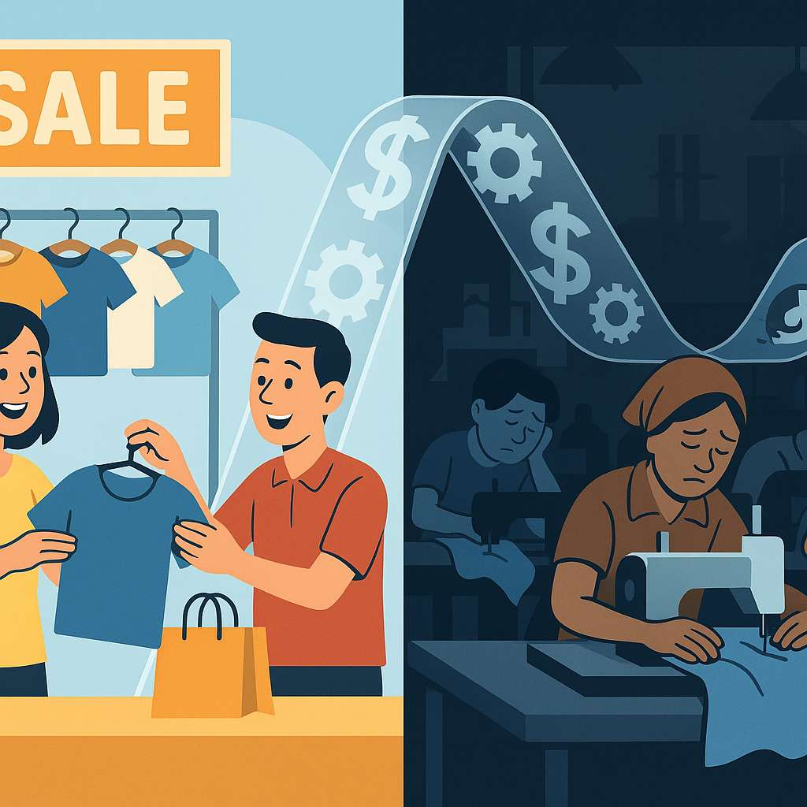
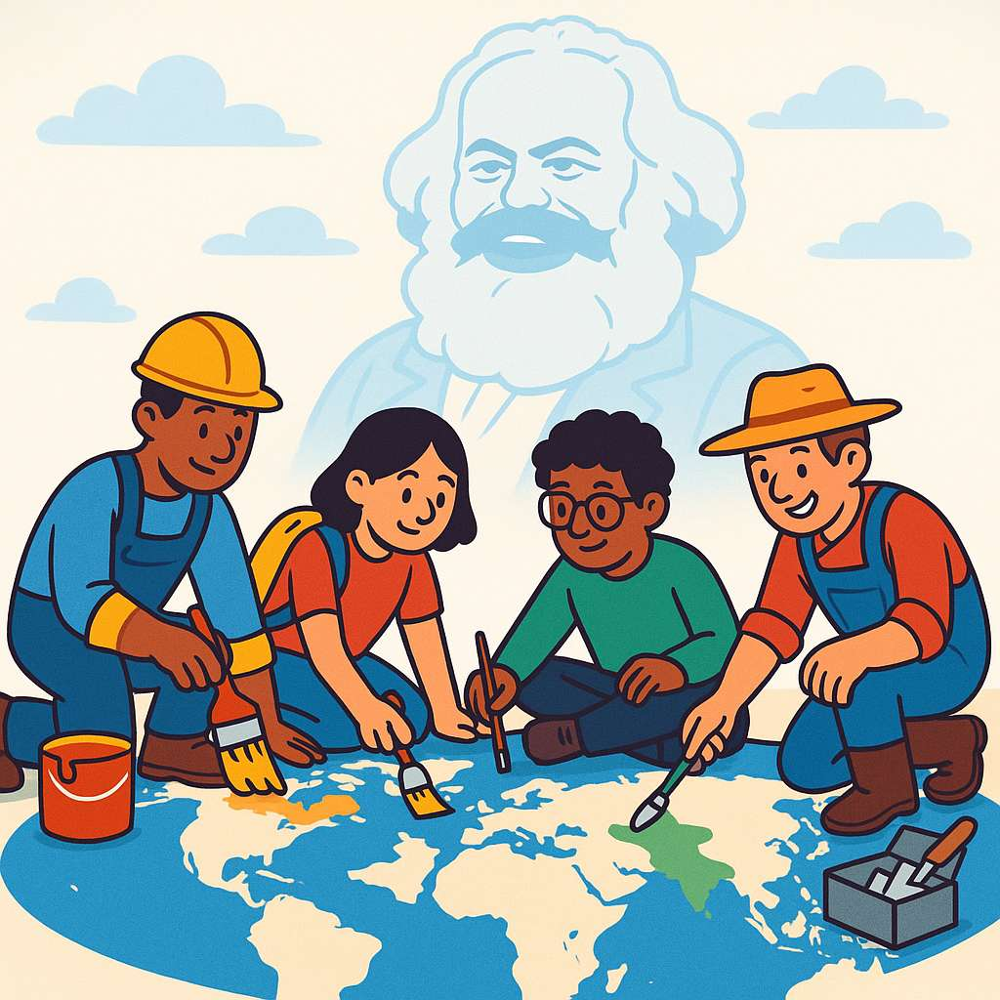

## 导语

你可能觉得马克思是个只存在于历史课本里的名字，他那些关于工厂、阶级和斗争的理论，在今天这个我们刷着TikTok、喝着星巴克，甚至享受着人工智能红利的时代，似乎已经不合时宜了。

毕竟，我们身边没有冒着黑烟的工厂，也没有开着坦克去革命的工人。那么，马克思和他那套听起来“暴力”的理论，是不是真的被时代扫进了博物馆？

恰恰相反。要真正看懂我们这个光怪陆离的21世纪——从你身上穿的快时尚T恤，到一次次席卷全球的金融风暴，再到无处不在的贫富差距——你可能比任何时候都更需要马克思。

但我们需要的不是那个被符号化的马克思，而是一个手持“思想手术刀”的马克思。今天，就让我们重返他的思想手术室，看看他到底打造了一件怎样强大的武器，不仅在19世纪石破天惊，至今依然能精准地解剖我们这个世界的“病情”。

## 第一幕：思想界的一桩“盗窃”案——给幽灵的引擎换上人间的燃料

在马克思年轻时，哲学界的天空完全被一个叫黑格尔的巨人笼罩。黑格尔建立了一座宏伟到极致的思想宫殿，他认为，整个世界的历史，都是一个叫“绝对精神”的超级程序员，在执行自己编写的“辩证法”程序。

这个程序很酷，像一场永不停止的辩论赛：
*   一个**“正题”**（旧制度）出现。
*   必然激发出它的对立面**“反题”**（新势力）。
*   两者冲突、融合，最后升级成一个更高级的**“合题”**（新制度）。

历史，就在这场“正-反-合”的螺旋中不断上升。

年轻的马克思被这个揭示了“矛盾推动发展”的逻辑引擎深深吸引。但他敏锐地发现了这台引擎的致命问题：它只在云端运行，里面跑的全是“观念”和“精神”，是一场没有血肉的皮影戏。

黑格尔的体系虽然在逻辑上完美自洽，但在马克思看来，它完全脱离了物质世界。他看到的是：

:::block-1
**工人们在肮脏潮湿的工厂里，用血汗和生命进行着真实的斗争；资本家和工人在为了几毛钱的工资、几小时的工时进行着真刀真枪的搏斗。这不是“观念”的辩论，这是胃与钱包的战争，是生与死的较量！**
:::

于是，马克思做了一件更彻底的事。他没有推倒黑格尔华丽的宫殿，而是像个思想界的普罗米修斯，悄悄潜入其中，把那台轰鸣的“辩证法”引擎整个偷了出来，将它从天上拖回了泥泞的大地。

他把这台引擎的燃料，从虚无缥缈的“精神”，换成了人类社会最坚硬、最滚烫的东西：**感性的物质实践**——说白了，就是人们为了生存而进行的生产劳动，以及在生产中所结成的社会关系。

通过这次“盗窃”与改造，马克思完成了哲学史上一次深刻的颠倒：
*   **唯心辩证法（头朝下）** 变成了 **唯物辩证法（脚踏实地）**。

辩证法不再是解释幽灵如何思考的逻辑，而变成了一台**解剖现实社会的X光机**。用它一照，法律、道德、宗教、文化这些温情脉脉的“上层建筑”瞬间被穿透，直抵社会最核心的秘密：生产力与生产关系之间的根本矛盾。

### 第二幕：不做黄昏的猫头鹰，要做黎明的探照灯

拥有了这台X光机，马克思重新定义了哲学的使命。这又让他站到了巨人黑格尔的对立面。

黑格尔曾说：“哲学是密涅瓦的猫头鹰，总在黄昏时分才起飞。”意思是，哲学总是“马后炮”，只能在一个时代结束后，才来反思和总结。它永远回望过去，对未来充满无力感。

马克思对此嗤之以鼻。如果哲学只能在悲剧落幕后写一份“验尸报告”，那它对正在苦难中的人有什么用？

:::block-1
**所以，马克思宣称，他的哲学，不要做黄昏时分回望的猫头鹰，而要做一盏敢于在黎明前探路的探照灯！**
:::

它的使命不是凭吊历史的尸体，而是要在现实最黑暗的时刻，用X光（唯物辩证法）的强光，刺破迷雾，照亮那条通往未来的路。

这两种哲学的区别，可以用一个火山比喻来生动说明：

*   **猫头鹰哲学家（黑格尔）**：“等火山喷发完，我再来写一份完美的报告，分析它的地质结构和熔岩成分。”
*   **探照灯哲学家（马克思）**：“我现在就要分析地壳的压力和板块的运动趋势，正是这些正在发生的、内部的对抗性力量，让我能科学地预判：**火山即将在哪里喷发，其规模可能会有多大**。我的目的不是写报告，而是为了提前向山下的居民发出预警！”

看，这就是革命性的区别。马克思的哲学不满足于描述“现象”，而是深入分析“过程”——通过分析资本主义内部固有的、不可调和的矛盾（比如生产的社会化与生产资料的私人占有之间的矛盾），他找到了驱动时代火山必然喷发的内在动力。因此，他的哲学必然指向未来，其终点不是黑格尔式的悲观与无力，而是一声响彻世界的呐喊：“全世界无产者，联合起来！”

## 第三幕：把X光机的功率开到最大

现在，我们回到开头的那个问题。21世纪了，发达国家的工人开着汽车去度假，而不是开坦克去革命。两大阶级的对抗去哪了？马克思的理论是不是真的过时了？

要回答这个问题，我们必须再次拿起马克思的X光机，但这一次，**要将功率开到最大，视野从一个国家，扩大到整个地球。**

当我们这样做时，一幅全新的图像便会浮现：19世纪那种在一国之内积压、随时可能引爆的阶级矛盾，并没有消失，它只是被拉长、拉散到了全球范围。这个过程，就是我们今天所说的“全球化”的另一面：

1.  **矛盾的“产业转移”**

    你在本国商场看到一件物美价廉的T恤，赞叹商业发达。但X光机看到的是：它的棉花可能来自新疆，纺纱在越南，缝制在孟加拉国的血汗工厂。发达国家优雅的店面，与发展中国家拥挤的厂房，通过全球供应链紧紧捆绑。你所在国家的“阶级和谐”，并没有消失，它只是被“外包”出去了。
    

2.  **利润的“跨国攫取”与“购买和平”**

    你看到本国的科技巨头给工程师发着令人羡慕的高薪。但X光机看到的是：这家公司利用技术垄断在全球市场攫取超额利润，它在非洲控制矿产，在东南亚利用廉价劳力，正是用从全球榨取的利润，来支付本国核心员工的高薪，从而“购买”了国内的阶级和平。
    
3.  **危机的“全球转嫁”**

    当发达国家发生金融危机时，它们可以通过其主导的全球货币体系（如美元霸权），向全世界“放水”，让全球人民来为它们的危机买单。

所以，我们今天在一些地方看到的所谓“阶级和谐”，在很大程度上，并非阶级矛盾的“消失”，而是阶级矛盾的**“全球化漂移”**。马克思非但没有过时，反而，只有用他的理论框架，我们才能看穿这个“和平”与“富足”的表象之下，那个更加巨大、更加不平等的全球体系是如何运转的。矛盾没有消失，它只是换了一个尺度重新分布。

## 尾声：一张未完成的诊断书

回到开头的问题，答案已经清楚了：马克思没有给我们留下一张通往乌托邦的精确导航图，那不是他的任务。他留给我们的，是一套强大的、至今依然锐利的分析工具，是一张揭示了我们脚下这片土地“地质构造”的X光片。

这张X光片告诉我们，哪里是坚硬的板块，哪里是脆弱的断层。它告诉我们，我们今天所面临的种种全球性危机——从贫富差距到气候变化，从金融动荡到地缘冲突——都并非孤立的偶然事件，而是深植于我们这个全球体系的内在矛盾之中。

这张诊断书，至今仍未写完，因为历史还在继续。而我们每一个人，都不是冷漠的旁观者：我们既是被这张片子照见的病灶所在，也同时是握着笔、继续往这份诊断书上添加病历、甚至动手开药方的人。看清了这一切之后，那个关于“改变”的问题，便以前所未有的重量和清晰度，重新摆在了我们每一个人的面前。

