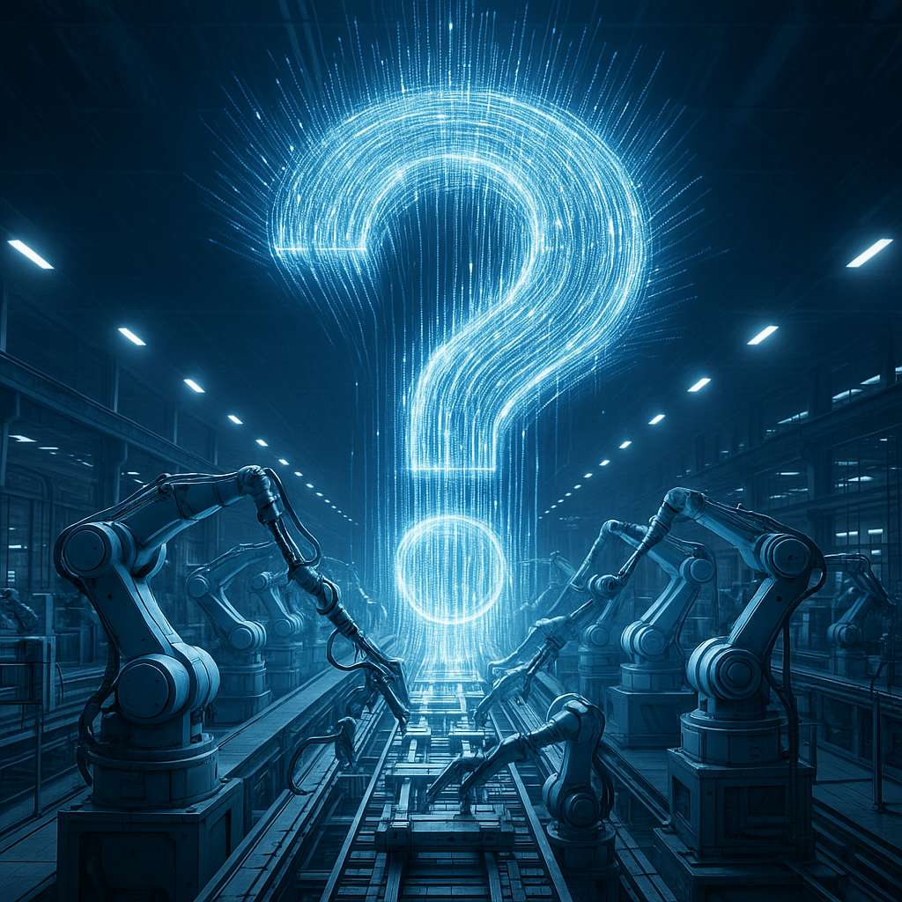
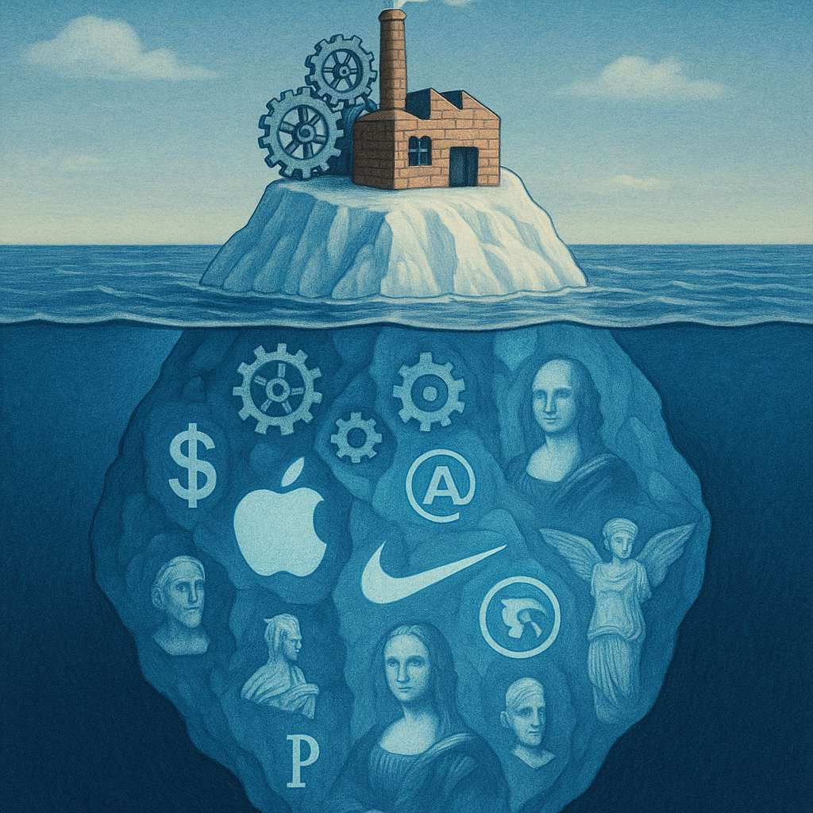
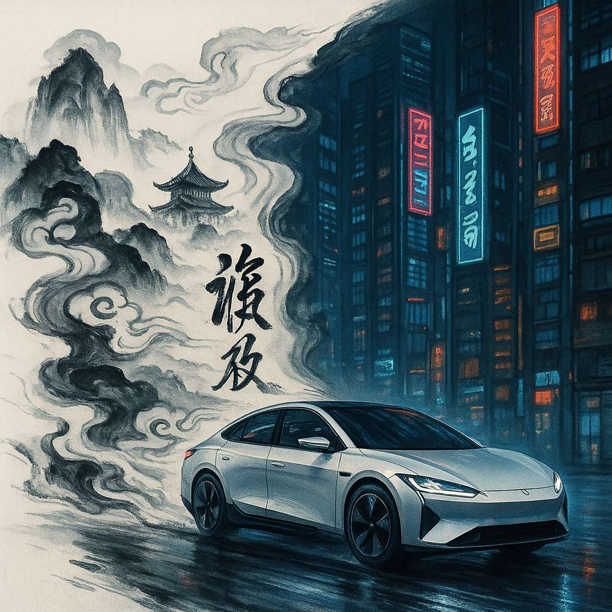
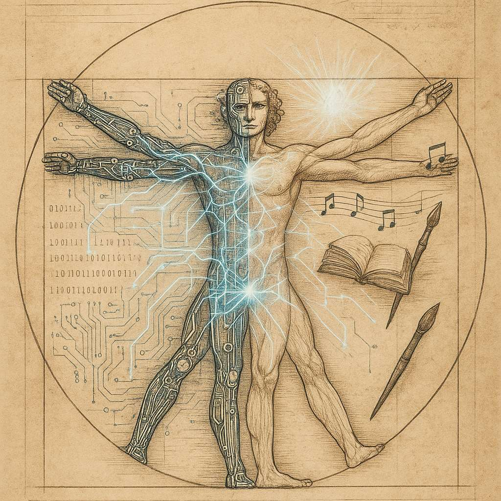

## 从“如何做”到“为何如此”的时代转向

在人工智能（AI）与自动化浪潮席卷全球的背景下，一场深刻的经济价值革命正悄然发生。传统工业时代以大规模物质生产为核心的价值创造模式正在式微，取而代之的是一个由**无形价值**主导的后工业经济新范式。

这场革命的本质，是将经济活动的重心从解决“如何做”（how）的效率问题，转向探究“为何如此”（why）的意义问题。当AI能够以超乎想象的效率完成生产、计算与优化任务时，人类独特的创造力、情感共鸣与意义构建能力，便成为最稀缺、也最昂贵的经济资源。

本文作为系列文章的第二篇，旨在深入剖析这一结构性转变。我们将论证，在AI驱动的经济体中，经济价值的源泉正从有形的物质生产，决定性地转向无形的精神与文化创造。在这一过程中，传统上被视为“软实力”的人文科学，正演变为驱动经济增长与占据全球价值链顶端的“硬通货”。

## 无形经济的崛起：当叙事超越物质

后工业时代最显著的特征是**无形经济（Intangible Economy）** 的崛起。 研发、品牌、设计、知识产权以及文化叙事等无形资产，正逐渐取代厂房、设备等有形资产，成为企业乃至国家核心竞争力的主要来源。 

微软公司就是一个典型的例子：其庞大的股票市值中，厂房和设备等传统资产的价值占比微不足道，绝大部分价值来源于其软件、品牌和知识产权等无形资产。

这一转变彻底重塑了价值构成的逻辑。理工科所擅长的，是优化生产流程、提升产品性能和降低物理成本，这在物质稀缺时代是决定性的。然而，当AI能够大规模接管这些可编码、可优化的任务后，单纯的技术优势将迅速商品化，利润空间随之被压缩。 

此时，竞争的制高点便转移到了人文科学的领域：**赋予商品超越其物理功能的文化与情感价值。**

## **奢侈品与高科技消费品的价值密码**

奢侈品行业为我们提供了一个理解无形价值的绝佳范例。一个爱马仕（Hermès）皮包的物理成本可能仅占其售价的一小部分，其数万甚至数十万元的惊人溢价，源于品牌背后长达百年的历史传承、精湛工艺的故事、名流的加持以及其所代表的社会地位与身份认同。

这套复杂的文化符号系统，正是其价值的核心。 LVMH集团的成功，本质上是其巧妙运用品牌故事营销策略的成功，它将独立的时尚品牌转化为拥有深厚历史和文化底蕴的奢侈品巨头。 这种“文化资本”的注入，是一项典型的人文科学成就，它作用于消费者的情感与心理层面，创造出物理成本无法解释的巨大经济价值。

同样，苹果公司之所以能在激烈的科技市场中维持高额利润，其根本原因不仅在于卓越的技术规格，更在于其成功塑造的品牌叙事——一种关于创新、简约、个性和归属感的文化符号。消费者购买的不仅是一部手机，更是一种身份的认同和生活方式的表达。这种品牌忠诚度，根植于人文层面的情感连接，而非单纯的技术参数对比。

这些案例揭示了AI时代的一个核心经济法则：**当生产与技术本身变得廉价和普及，利润的源泉便转向了那些能够触动人心、引发共鸣的无形元素。** 创造和管理这些无形价值——包括品牌战略、市场营销、文化研究与设计——正是人文科学的核心业务。

## **国家战略的升维：“讲好中国故事”的经济逻辑**

将上述经济逻辑从企业层面提升至国家战略层面，便与“讲好中国故事”的时代要求形成了深刻的共鸣。 在全球化的竞争格局中，一个国家的影响力不仅取决于其经济体量与军事等硬实力，更取决于其文化叙事的感召力，即文化软实力。

### **从“中国制造”到“中国引领”**

中国在新能源汽车、无人机、高铁等领域取得了举世瞩目的技术成就。这些强大的理工科实力，为国家发展提供了坚实的物质基础，可谓之“体”。然而，若缺乏强大的人文叙事作为其“魂”，这些技术产品在全球市场中将主要依赖价格与性能进行竞争。这种竞争模式不仅限制了其价值的上限，也削弱了其文化影响力。

“讲好中国故事”的战略意义，正是在于为中国的硬实力注入文化内核。 这是一项系统性的人文工程，旨在构建一套融通中外的话语和叙事体系，提炼和展示中华文明的精神标识与文化精髓，从而提升中国形象的亲和力与中国话语的说服力。 其最终目标，是将“中国制造”的产品，转化为承载着中国智慧、中国方案和中国价值的文化出口，推动中国在全球价值链中的地位从跟随者向引领者跃升。

例如，当一辆中国制造的电动汽车不仅被视为交通工具，更被理解为中国致力于可持续发展理念、构建人类命运共同体的实践载体时，它的价值便超越了物理性能本身。这种价值升维，需要历史学、哲学、传播学、艺术设计等多个人文领域的深度参与。

### **理工科与人文科学的战略共生**

在此背景下，理工科与人文科学的关系并非“非此即彼”的对立，而是一种**战略性的共生关系**。斯坦福大学等顶尖学府早已认识到交叉融合的重要性，并成立了“以人为本的人工智能研究院”，强调AI需要融入人类智慧的多样性。 清华大学等国内高校也开始推动学科交融，鼓励文科和理工科背景的学生合作。

一个国家的强大，需要理工科锻造出坚实的“骨骼”与“肌肉”，但同样需要人文科学赋予其独特的“灵魂”与“气质”。 如果说理工科决定了一个国家能走多快，那么人文科学则决定了它能走多远，以及它将以怎样的面貌被世界所理解和接受。

因此，中国发展的下一阶段，其关键并非简单地从理工科“转向”人文科学，而是在已有的强大理工科实力之上，深度“融合”人文科学的能力。 这种融合将催生出更高维度的全球竞争力，使得人文科学从过去被视为的辅助性角色，转变为驱动国家发展的核心战略要素。

## **在意义的蓝海中航行**

人工智能时代的经济范式革命，正在将我们从一个关注“生产效率”的世界，带入一个更加关注“意义创造”的世界。 机器正在接管那些可量化、可重复的任务，从而将人类从机械劳动中解放出来，去从事那些真正体现人类价值的活动：创新、共情、批判性思考以及构建宏大的文化叙事。

对于企业而言，这意味着未来的品牌价值将更多地依赖于其文化内涵和故事讲述能力。

对于国家而言，这意味着文化软实力和国际话语权将成为综合国力竞争的关键所在。 在这个由算法驱动的新世界里，解决“如何做”的技术能力固然重要，但定义“为何如此”的人文智慧将拥有最终的定价权。

因此，“超越生产”不仅是对一个经济阶段的描述，更是对未来价值创造方向的战略指引。它要求我们重新审视教育体系、人才培养模式和国家发展战略，将人文科学置于其应有的核心地位。因为在这片由意义、情感和文化构成的广阔蓝海中，蕴藏着后工业、AI驱动经济中最澎湃的增长动力。

