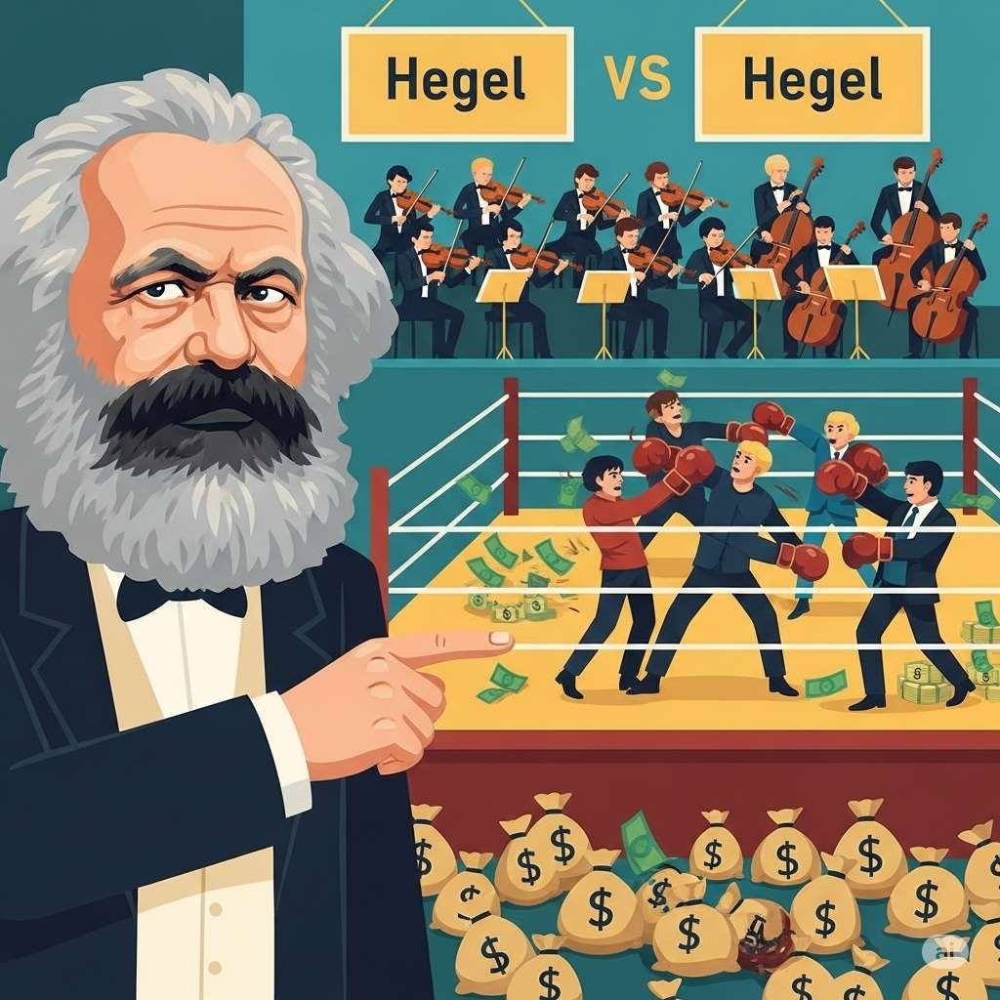
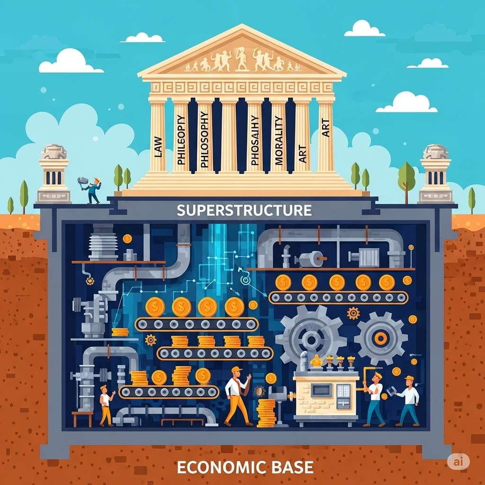

## 引子

“经济基础决定上层建筑”，这句话我们可能从中学课本里就认识了，听起来耳熟能详。但它真正的意思，真的是我们以为的“只要经济搞好了、社会有钱了，法律和文化这些东西自然就变好了”吗？

很可能，我们从一开始就理解错了。

要彻底搞懂这句话，解开这个普遍的误解，我们不能就事论事。我们得把时间倒回去，回到马克思思想的源头，从一位影响了他一生的哲学“老大哥”聊起。

## 故事的开端：哲学“老大哥”黑格尔的理想世界

首先，咱们得聊聊一个叫**黑格尔**的德国大叔。在马克思的时代，他可是哲学界的泰山北斗，绝对的“老大哥”。

黑格尔对世界有个特别乐观、也特别优雅的看法。他认为，人类社会之所以能不断进步，背后有个总导演，这个总导演就是“**理性**”（Reason）。他觉得，就算人与人之间有各种物质利益的冲突，比如你想要这块地，我也想要这块地，但没关系，我们最终可以靠“理性”来思考，坐下来谈，制定出一套所有人都服气的、最合理的规则。历史的全部进程，就是这个“理性”大哥不断成长、最终完美掌控一切的故事。

简单说，在黑格尔眼里，社会就像一首复杂的交响乐，虽然有各种乐器在响，听起来乱糟糟，但最终都会在“理性”这位伟大指挥家的棒下，奏出和谐优美的乐章。

## 马克思登场：拿掉那层“和谐”滤镜

马克思年轻时是黑格尔的铁杆粉丝，也曾深信“理性”就是世界的主宰。但当他走进真实的社会，尤其是在研究经济问题之后，他感觉不对劲了。

他发现，现实世界根本不是一首和谐的交响乐，而更像一个嘈杂、混乱的菜市场，甚至是一个拳击场。决定谁能拿走什么的，根本不是谁的道理讲得更漂亮，而是谁的拳头更硬，谁的嗓门更大。

这里说的“拳头”，不必是真的有人动手。想象两个人坐下来谈雇佣合同：一个有钱等到下个月，另一个今天就得交房租。两个人的签名都是真的，拒签的代价却很不一样。我把这种能够左右对方选择的实际能力叫作**权力**。

## 核心辨析：高大上的“权利(Right)” vs. 赤裸裸的“权力(Power)”

不妨沿着这份合同，把两个词分开：

* **权力（Power）**：手里有厂房、有订单，也有等下去的余地，所以在工资谈判中比对方多几分筹码。
* **权利（Right）**：雇员和雇主都能依法主张某些东西。比如厂房的所有者能决定谁使用设备，劳动者也能要求对方照合同发工资。纸面权利相同，不意味着行使它的条件相同。

从黑格尔的《法哲学原理》谈到马克思，我在这里选的是雇佣和财产权这个切口。问一句“谁能等得起”，有助于看清契约背后的力量，却不是给一切权利下定义。法律既能确认财产带来的支配，也能给弱势一方提供追索的依据。

## 最终图景：“经济基础决定上层建筑”与“历史唯物主义”

现在，我们可以把所有拼图都拼起来了。

**“经济基础决定上层建筑”** 这句话，现在听起来应该清晰多了：

:::block-1
* **经济基础（里子）**：这里要看的不是社会总共有多少钱，而是人在生产中结成怎样的关系：谁占有设备，谁出卖劳动力，谁安排劳动。
* **上层建筑（面子/车身和内饰）**：就是建立在这个基础之上的一切。它包括：
    1.  **政治法律制度**：它确定财产、契约等关系可以怎样主张，也会反过来改变谈判条件。
    2.  **思想意识形态**：它包括**哲学**、宗教、艺术、道德等，负责从思想上论证这套体系的合理性，给它提供理论依据，让大家心安理得地接受。比如，资本主义兴起时，新教伦理和启蒙哲学就为“赚钱光荣”提供了强大的思想武器。
:::

所以，马克思的**哲学革命**就在于，他把**哲学**研究的对象，从天上拉回了地面。传统的哲学（比如黑格尔的法哲学）研究的是那个光鲜的上层建筑，试图用“理性”去解释“权利”。而马克思说，我们要研究的是那个地基，是那个非理性的“权力”本身。

这个研究“权力”如何产生、如何演变、如何决定了整个社会面貌的新哲学，马克思称之为“**历史唯物主义**”。
* **历史**：因为它关注这种“社会权力”在不同历史阶段（奴隶制、封建制、资本主义）的不同形态和演变过程。
* **唯物主义**：因为它坚持认为，这一切的根源是**物质**的生产和交换，而不是什么抽象的“理性”或“精神”。

总而言之，马克思告诉我们，别被社会表面那些关于“理性”“公平”“权利”的华丽辞藻给迷惑了。要想真正看懂这个世界，得像个X光医生，穿透血肉，直视骨架——那个由物质利益和赤裸权力构成的“经济基础”。这，就是历史唯物主义的精髓。

