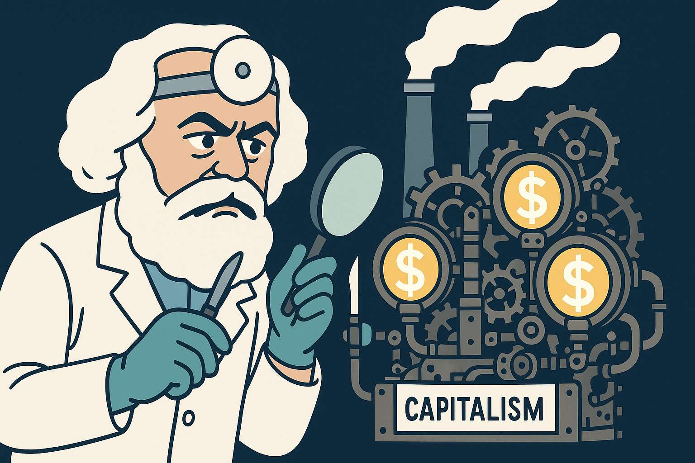
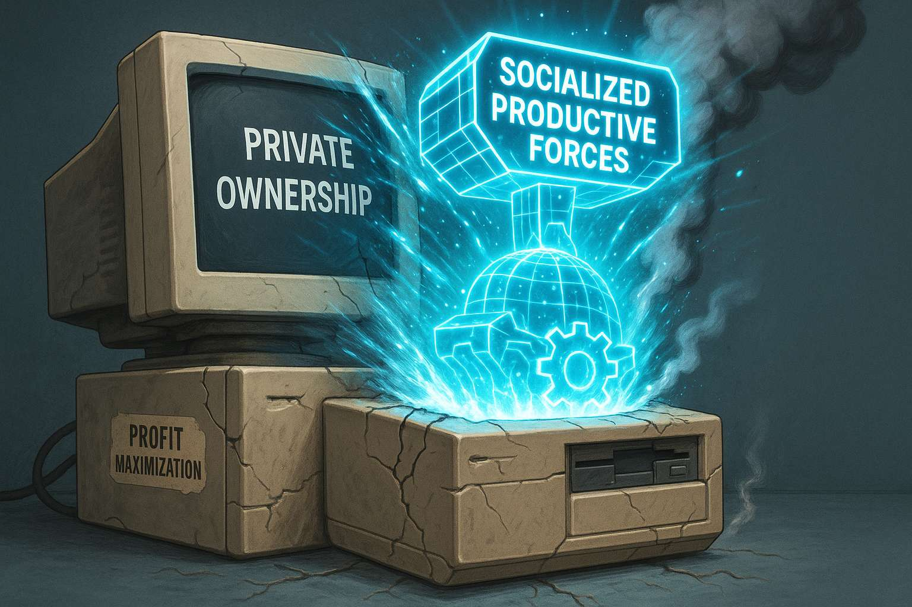

> 人类历史的全部运动，既是这种共产主义的现实的产生活动，也就是共产主义的经验存在的诞生活动。
> ——卡尔·马克思《1844年经济学哲学手稿》

“共产主义”，这个词今天听起来，似乎总带着点遥远而天真的气息。

一提到它，许多人脑海中浮现的，可能是一个“乌托邦”式的画面：财富极大丰富，人人按需分配，没有阶级，没有纷争，世界大同。这听起来很美好，但也正因其过于美好，而显得不切实际。我们内心深处最普遍的那个声音会说：“这怎么可能？这违背人性！没有私有财产，谁还有动力去工作和创新？”

这种怀疑，合情合理。毕竟，人类几千年来关于美好社会的幻想，如过江之鲫，但大多都对现实历史进程毫无影响。它们就像悬在天边的彩虹，可望而不可即。

那么，马克思的“共产主义”，是否也只是这众多乌托邦幻想中，嗓门比较大的那一个？

不。沿着篇首《手稿》的思路，我想换一种问法：与其先画出理想社会，不如看看今天的生产和协作中，已经长出了哪些改变社会关系的条件。

这个论断，把共产主义从“伦理学”的范畴，拽到了“历史科学”的领域。今天，我们就来解剖这个论证过程，看看马克思是如何剖开资本主义的肌体，并从中找到那个名为“共产主义”的、正在茁壮成长的“历史胎儿”的。

## 一个不断升级的游戏引擎 vs. 一台日益过时的旧电脑 

让我们把**生产力**想象成游戏引擎：人掌握的技术、使用的设备，以及许多人协作的本领，都决定了它能跑出什么效果。

那谁催着引擎升级？在竞争中，企业要争取利润，愿意为降低成本、扩大市场而投入。**利润是催促升级的动机，不是引擎本身。**

*   **技术更新**：把新机器用到生产里，同样的人和时间可能做出更多产品。
*   **全球连接**：一部手机可以在一地设计、用多地的零件、在另一地组装。没有这套协作，单凭一台好机器也做不出来。

这个游戏引擎，就是马克思所说的**“生产力” (Productive Forces)** 。它充满活力，日新月异，代表着人类改造自然、创造财富的巨大力量。它天然具有一种**“社会化”** 的属性——它依赖于全球的协作、全人类的知识积累。

然而，这个强大的、不断升级的引擎，却被强制安装在一台日益老化的旧电脑上。

这台旧电脑，就是马克思所说的**“生产资料私有制” (Private Ownership of the Means of Production)** 。

这台电脑的配置是：
*   **内存极小 (私人占有)** ：尽管游戏引擎（生产力）已经发展到需要全球网络和海量数据才能运行，但这台电脑的“所有权”却属于少数“玩家”（资本家）。他们拥有工厂、机器、专利、代码——这些积累起来的劳动。
*   **CPU单核 (个人利益驱动)** ：电脑运行的唯一指令，是服务于这少数玩家的个人利益（利润），而不是让游戏引擎的性能得到最大发挥，去服务全人类。

现在，历史的戏剧性一幕上演了：**新引擎与旧电脑之间的根本矛盾。**

:::block-1
**这就像你试图用一台20年前的奔腾处理器的电脑，去运行最新的、需要顶级显卡和海量内存的3A游戏大作。结果会怎样？卡顿、死机、蓝屏……系统濒临崩溃。不是游戏引擎不好，而是承载它的平台（硬件）已经配不上它了！**
:::

这个矛盾，就是理解马克思全部论证的关键。

## 矛盾的展开：当电脑开始“反抗”引擎

这个“引擎与电脑”的矛盾，具体是如何在现实中展开的呢？

1.  **驾驭能力的丧失（客观层面）**：

    早期的工厂主，或许还能凭一己之力管理自己的几十台织布机。但今天的跨国公司，其背后牵动的全球供应链、尖端科技研发、复杂的金融运作，岂是任何一个资本家个人或家族能够完全驾驭的？他们必须依赖成千上万的科学家、工程师、经理人组成的庞大协作网络。生产的“社会化”性质，已经让“私人”占有和支配变得越来越力不从心，甚至滑稽可笑——就像一个人试图凭手动操作，去独自运维一整座全球数据中心。
    

2.  **占有欲望的荒谬（主观层面）**：

    马克思特别区分了“个人生活用品所有制”和“生产资料私有制”。你有一百双鞋，那只是你的个人爱好。但你拥有一座生产鞋的工厂，那就意味着你占有了“积累起来的劳动”，并获得了支配他人劳动时间的权力。这种对生产资料的无限占有欲，并非来自人的“自然本性”（人的生理需求很有限），而是来自私有制社会赋予的病态价值——占有越多，社会地位越高。
    
    但当生产力发达到一定程度，物质财富极大丰富，许多私人物品可以轻易变成公共品时（比如未来的自动驾驶汽车网络，可能让私人购车变得毫无必要），这种对生产资料的疯狂占有，就显得越来越没有必要和荒谬。

3.  **辩证法的魔力：“反者道之动”**

    最精妙之处在于，**正是这台旧电脑（私有制），为了运行得更好（追求利润），才催生了那个不断升级、最终将撑爆自己的新引擎（社会化生产力）**。
    
    资本主义越是成功，它所创造的生产力就越具有社会化性质，这个内在的矛盾就越尖锐。它在自己的发展中，一步步积累起否定自身的力量。就像老子说的“反者道之动”，一个事物最充分的发展，恰恰是它走向自己反面的开始。

## 历史的时刻表：我们到哪一站了？

读到这里，你可能会问：既然这是必然的，那为什么我们今天还在这里？

《〈政治经济学批判〉序言》里有一句话，谈的是任务和物质条件的关系，不是替后世排好的时刻表：

:::block-1
**“人类始终只提出自己能够解决的任务，因为只要仔细考察就可以发现，任务本身，只有在解决它的物质条件已经存在或者至少是在生成过程中的时候，才会产生。”**
:::

这句话翻译过来就是：**革命不是你想搞，想搞就能搞。**

就像不能奢望一台老旧电脑跑动最新的应用，任务的提出，本身就以“物质条件”的成熟为前提。

在我看来，仅凭今天的技术和协作能力，还不能说按需分配的条件已经成熟。这是我对今天的判断。至于眼前能做什么，不妨回到鞋厂：新机器提高了产量，谁有权决定它换来的是更短的工时，还是更多的订单？

资产阶级社会，是人类“史前时期”的最后一个对抗形式。当它最终被其亲手创造的生产力所扬弃时，“人类社会的史前时期就以这种社会形态而告终”，真正的“人类历史”才刚刚开始。

## 历史的助产士，而非旁观者或冒险家

马克思对共产主义的论证，不是一首浪漫的田园诗，而是一份冷静到近乎残酷的“历史诊断书”。

他告诉我们，不必为资本主义的种种问题感到绝望，因为它自身的“疗法”就隐藏在它的“病情”之中。我们所看到的每一次经济危机、每一次技术失业、每一次贫富差距的拉大，固然带来了痛苦，但从历史的长镜头看，这些都是那台“旧电脑”运行“新引擎”时发出的不堪重负的呻吟。

它让我们摆脱了两种思想的误区：
*   **宿命论的悲观**：“世界就这样了，不会好了，我们无能为力。”
*   **意志论的幻想**：“只要我们有决心，明天就能建立一个完美社会。”

马克思提供的是第三条路：清醒的、基于科学的乐观主义。他让我们懂得，未来不是靠空想“设计”出来的，而是从现实的矛盾中“生长”出来的。我们不是无力的旁观者，也不是盲动的冒险家，我们是历史的助产士——看清胎儿的成长方向，并为它的降生创造条件。

这份工作琐碎而具体：推动一次技术革新，参与一场协作的深化，戳破一个旧有商业模式的谎言。历史不会替我们完成这些，它只提供了完成它们的可能性。

