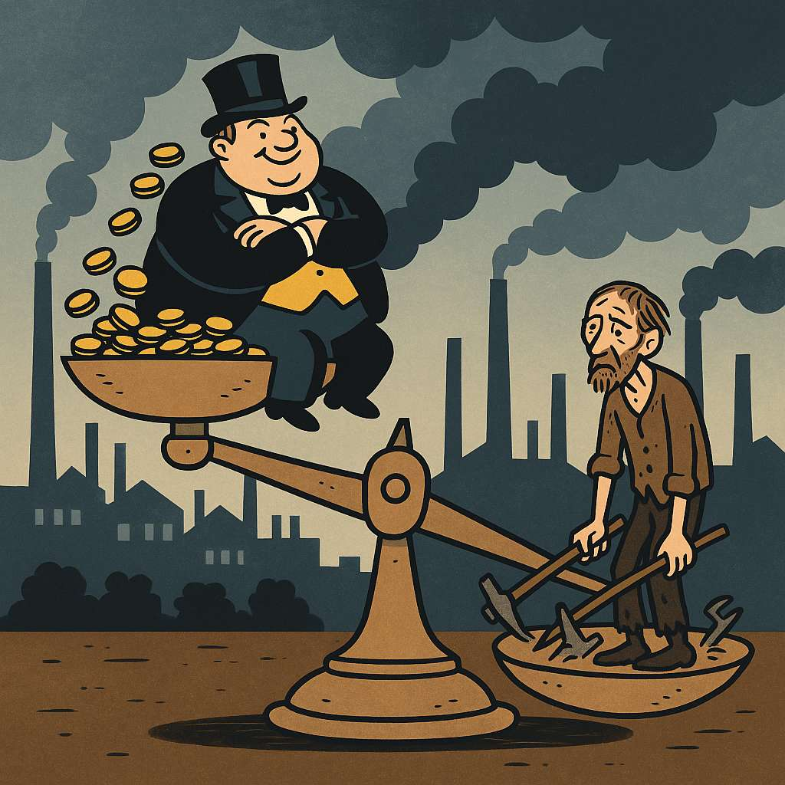
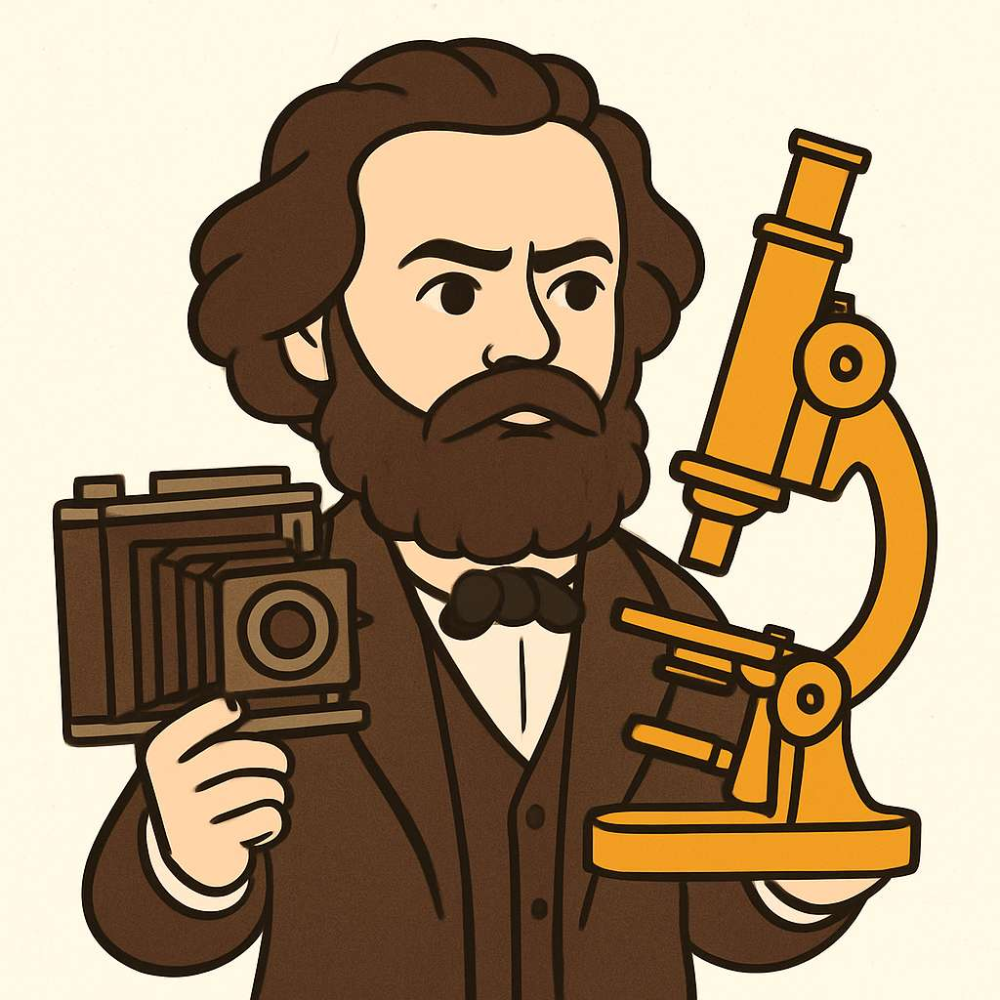

## **引子**

我们习惯将伟大思想归功于天才的灵光一现，但只讲灵光，讲不出他为什么盯上这个问题。下面两个故事，一个关于科学，一个关于哲学，都不妨这样问：时代把什么推到了思想家的眼前？

## **第一幕：从马车的摩擦到伽利略的提问**

我们的第一站，是2300多年前的古希腊。阳光洒在雅典城邦光洁的大理石上，空气中弥漫着橄榄油和智慧辩论的气息。在这里，生活着一位被后世称为“百科全书式学者”的男人——亚里士多德。他可能是那个时代最聪明的大脑，没有之一。他的学问上知天文，下通地理，中间还囊括了逻辑学、政治学、生物学、物理学和伦理学。

让我们把镜头聚焦于他的物理学。亚里士多德提出了一个关于“力”和“运动”的理论，这个理论非常直观，完全符合我们的日常经验。他认为：**力，是维持物体运动的原因。**

这非常符合直观经验。在雅典的石板路上，你用力推马车，马车才走；你一停手，它很快也停下。想让它更快，就必须用更大的力。力，就像是持续不断的“加油”，一旦停止，运动的火焰就会熄灭。它完美地解释了为什么马拉车要不停地跑，为什么帆船需要持续的风。在接下来的近两千年里，它成为了整个欧洲世界解释物体运动的“标准答案”，是颠扑不破的真理。

现在快进到近代早期的意大利。远航的人想知道船到了哪里，研究物体运动的人想知道，同一段运动能不能被反复测量、准确描述。这些问题未必从书斋里来，却会一路追进书斋。

把镜头转向伽利略。怎样从看得见的、总会慢下来的运动，想到日常生活中几乎看不见的情形？

用今天的力学语言重述这个转折：没有合外力，运动状态不变；要改变速度，才需要合外力。这是帮助我们理解惯性的今译，不是伽利略的原话，也不是说他已经写下了后来牛顿力学的完整表述。

回到那辆马车：松开手它会慢下来。如果路面更平，摩擦更小呢？提问的方向变了。商业和航海的需求可以帮助解释为什么精确测量值得投入，却不能替他做这个思想实验，更不能证明运动定律非在此时出现不可。

## **第二幕：费尔巴哈的照相机与马克思的显微镜**

我们的第二站，是19世纪的德意志。这是一个哲学星光璀璨的时代，康德、黑格尔等一系列思想巨匠刚刚走下神坛，但他们的思想余晖依然笼罩着整个欧洲。在这些追光者中，有一位叫路德维希·费尔巴哈的哲学家。他做了一件在当时看来非常“酷”的事情——他试图把被黑格尔捧上天的、虚无缥缈的“绝对精神”拉回地面。

费尔巴哈说，世界的本源不是什么“精神”，而是我们看得见、摸得着的**物质世界**。哲学的出发点，不应该是上帝或者什么神秘的概念，而应该是活生生的、有血有肉的**人**。

这种思想，在当时被称为“直观的唯物主义”。你可以把费尔巴哈想象成一个手持当时最先进照相机的摄影师。**他厌倦了过去那些画天使、画上帝的宗教画，他想做的，就是把镜头对准现实，对准大地，对准人，拍下最真实、最感性的瞬间。**

那么，费尔巴哈的照相机镜头里，出现了一个怎样的“人”呢？是一个**抽象的、单个的人**。这个人，没有身份标签，没有阶级烙印。他不是“张三家的农奴”或“李四镇的铁匠”，他就是“人”——一个拥有爱、感受、思想和欲望的独立个体。费尔巴哈的哲学，充满了对这种普遍“人性”和“人类之爱”的赞美。

听起来很美好，不是吗？但我们必须问出那个“伽利略式”的问题：**为什么在19世纪的德国，会诞生出这样一种以“孤立的、单个的人”为核心的哲学呢？**

要回答这个问题，我们必须再次扮演侦探，考察他所处的社会“土壤”。费尔巴哈生活的时代，正是欧洲封建社会土崩瓦解，**“市民社会”（也就是资产阶级社会）** 全面崛起的时代。

这意味着什么？想象一下中世纪的欧洲，你一出生，你的人生剧本很大程度上就已经被写好了。你是贵族，就与城堡、封地绑定；你是农民，就依附于领主和土地；你是手艺人，就属于你的行会。没有人是孤立的“原子”，每个人都被嵌入在一个个等级森严的“共同体”之中。

但是，资本主义的浪潮来了。它像一台巨大的搅拌机，把这些旧的、牢固的共同体（家族、行会、等级）通通打碎。农民离开土地涌入城市成为工人，小手工业者破产成为雇员。一夜之间，所有人都从旧的集体身份中被“解放”了出来，变成了表面上独立的、自由的、平等的**个人**。每个人都像一颗颗台球，在市场上自由地滚动、碰撞，凭自己的“本事”吃饭。

因此，费尔巴哈的哲学并非凭空发明。他只是举起哲学的照相机，忠实地拍下了他那个时代诞生的“新物种”——那个在市场上自由竞争、脱离了旧共同体、孤零零的“现代人”。他的哲学，是资产阶级时代最精准的一张自拍像。**但照相机只能拍下“表象”，它能拍下一个孤独的路人，却拍不出他为何孤独；它能拍下街角的繁华，却拍不出繁华背后隐藏的逻辑。**

回答这个问题的人，很快就登场了。他的名字，叫卡尔·马克思。

马克思年轻时受过费尔巴哈的影响。他在《莱茵报》时期讨论过林木盗窃法的辩论：同一根枯枝，对于靠捡柴过活的人和主张林木所有权的人，意味着不同的事。

把镜头转到工厂，也会有类似的落差。一边拥有机器，一边得靠出售劳动力谋生。两个人都可以是契约上的自由人，但其中一个人比另一个更能等。“平等”这张照片没有拍出谁能等、谁等不起。

马克思意识到，费尔巴哈的照相机已经不够用了。要理解这个充满矛盾的世界，需要一台能洞穿表象的**显微镜**或**X光机**。不能只看“单个的人”，而必须把他放进社会的“培养皿”中，去观察他与其他人真实的、具体的社会关系。

于是，马克思提出了他革命性的观点：**人，在其现实性上，是一切社会关系的总和。**

他不再问“人是什么”，而是问“**在资本主义这个特定的生产方式下，人与人之间结成了什么样的关系？**”这个问题的转换，是石破天惊的。它意味着，哲学不再满足于对世界的“拍照”，而是要对社会进行“解剖”。马克思的哲学，不再是以那个孤立的、抽象的“人”为起点，而是以那个具体的、在工厂里被剥削的“工人”和在办公室里算计利润的“资本家”之间**现实的、活生生的对抗关系**为起点。

费尔巴哈的哲学，是市民社会初兴之时，对“个人”的浪漫赞歌。而马克思的哲学，则是市民社会内部矛盾激化之后，对“阶级”的冷静解剖。他们两人，都忠实地回应了自己时代提出的问题。

## **尾声**

理解思想与时代的关系，能让我们成为当下现实的清醒分析者。我们应审视身边的一切观念：它为何产生？回应了何种焦虑？又服务于谁的利益？而马克思，这位深刻理解了“思想是时代产儿”的思想家，又是如何用他的理论，去实现对前人、对整个旧世界的革命性突破呢？那，就是我们下一部分要讲述的，关于“改变世界”的故事了。

