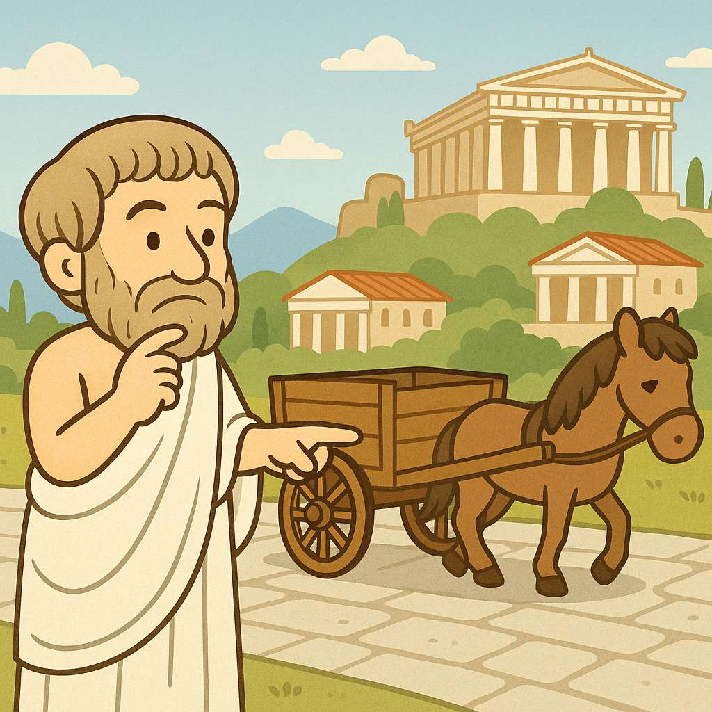
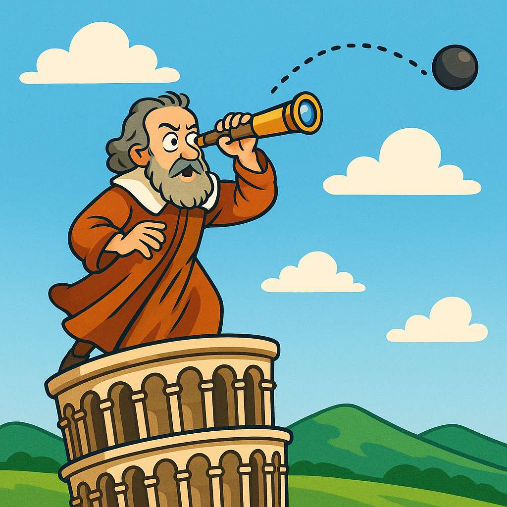
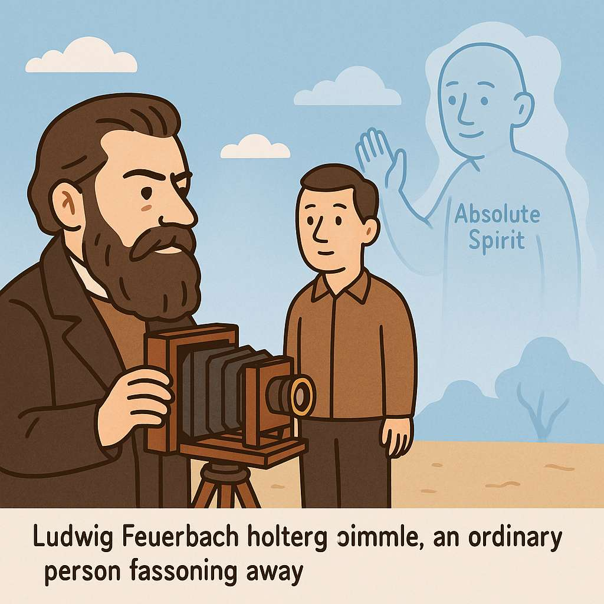
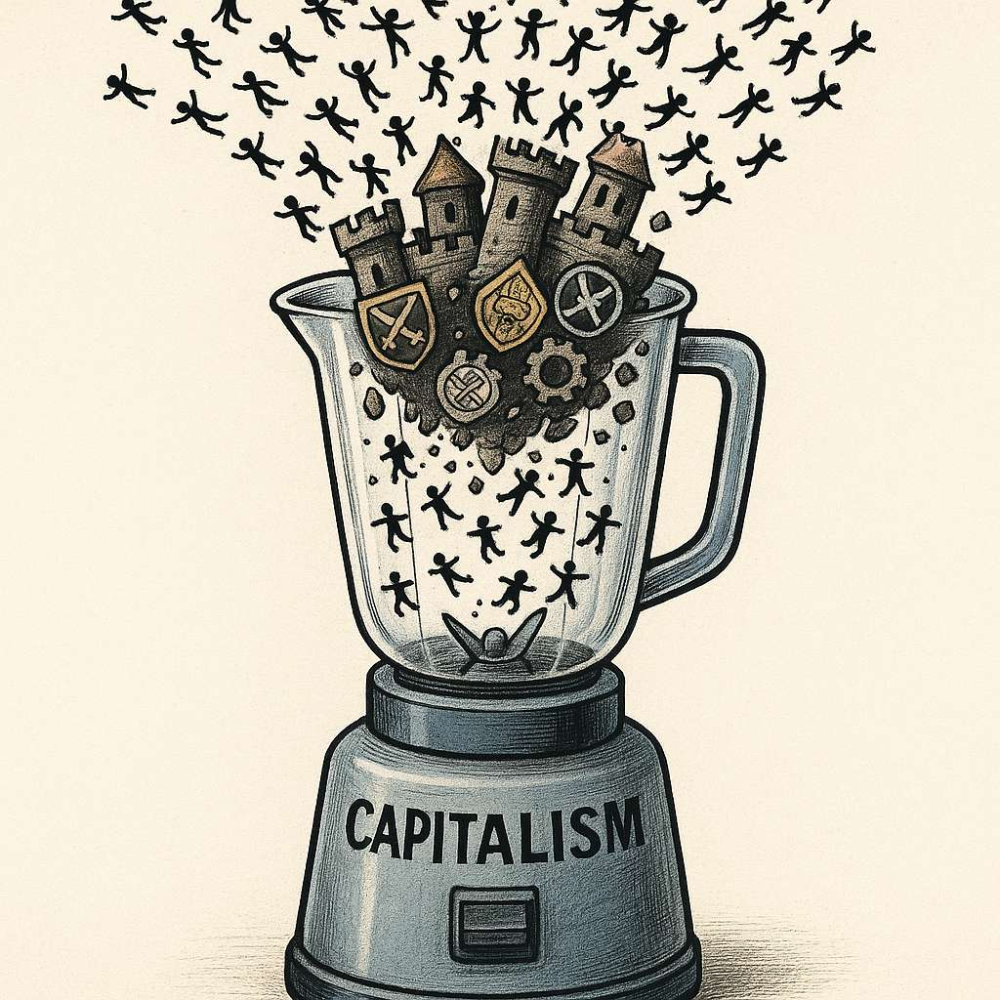

## **引子**

我们习惯将伟大思想归功于天才的灵光一现，但这只是一个迷人的误解。**任何深刻的理论，无论是科学还是哲学，都非凭空发明，而是其所处时代在社会现实的土壤中，发出的一声必然啼哭。**本文将通过两个故事——一个关于科学，一个关于哲学——来揭示，思想史并非天才的断代史，而是一部社会生活变迁的连续剧。

## **第一幕：亚里士多德的马车与伽利略的炮弹**

我们的第一站，是2300多年前的古希腊。阳光洒在雅典城邦光洁的大理石上，空气中弥漫着橄榄油和智慧辩论的气息。在这里，生活着一位被后世称为“百科全书式学者”的男人——亚里士多德。他可能是那个时代最聪明的大脑，没有之一。他的学问上知天文，下通地理，中间还囊括了逻辑学、政治学、生物学、物理学和伦理学。

让我们把镜头聚焦于他的物理学。亚里士多德提出了一个关于“力”和“运动”的理论，这个理论非常直观，完全符合我们的日常经验。他认为：**力，是维持物体运动的原因。**

这非常符合直观经验。在雅典的石板路上，你用力推马车，马车才走；你一停手，它很快也停下。想让它更快，就必须用更大的力。力，就像是持续不断的“加油”，一旦停止，运动的火焰就会熄灭。它完美地解释了为什么马拉车要不停地跑，为什么帆船需要持续的风。在接下来的近两千年里，它成为了整个欧洲世界解释物体运动的“标准答案”，是颠扑不破的真理。

现在，让我们坐上时间机器，快进1800年，来到16世纪的意大利。这是一个与古希腊截然不同的世界。文艺复兴的火焰已经点燃，商业贸易的航船正在以前所未有的规模和速度穿梭于各大洋。在陆地上，过去骑士间的零星决斗，已经被大国间成建制的炮兵阵列所取代。

这带来了一些全新的、亟待解决的“现实问题”。**比如，国王的炮兵司令官们非常苦恼：我怎样才能精确计算出炮弹的落点，好让我一炮轰掉敌人的城墙，而不是打到旁边的农田里？远航的船长们也急需答案：我如何利用天体的运行规律，来为我的船队精确定位，以免在茫茫大海上迷失方向？**

这些问题，用亚里士多德的理论是无法回答的。你总不能派个人跟在炮弹后面一直推着它飞吧？就在这时，一个叫伽利略的意大利人登场了。他通过一系列的思考实验（据说他曾在比萨斜塔上扔下两个铁球，但这更像一个传说），提出了一个颠覆性的，甚至可以说是“反直觉”的观点。

伽利略说：**错了，全错了。力，不是维持物体运动的原因，而是改变物体运动状态（也就是产生‘加速度’）的原因！**

这话什么意思？意思是，一个物体一旦运动起来，如果没有外力（比如摩擦力、空气阻力）来干扰它，它就会永远、永远地以同样的速度直线运动下去。你之所以要不停地推马车，不是为了维持它的运动，而是为了**抵消**地面给它的摩擦力！这个思想，就是后世牛顿第一定律的雏形，它像一道闪电，划破了物理学长达1800年的黑暗。

**那么，为什么被誉为“最强大脑”的亚里士多德，没能想出这个正确的理论？答案并非智力，而在于他们各自所处的时代。** 

亚里士多德生活的古希腊，是一个相对静态、讲究和谐与秩序的农业和手工业社会。他们最常见的运动场景，就是马车、帆船这类需要持续施加动力、并且被巨大摩擦力主导的慢速运动。他的社会，根本**不需要**他去思考“炮弹的轨迹”或者“无摩擦力的真空环境”这种“屠龙之术”。

而伽利略不同，他生活在一个动态的、充满变革与扩张的资本主义萌芽时代。商业、航海和战争，向整个社会提出了一个尖锐的需求：**我们必须精确地理解和预测高速、不受干扰的运动！** 没有方兴未艾的资本主义，没有隆隆作响的加农炮，伽利略的理论即使被想出来，也只会是无人问津的“怪谈”。**亚里士多德的马车，只能产生亚里士多德的物理学；而伽利略的炮弹，则必然会催生出伽利略的运动定律。**

## **第二幕：费尔巴哈的照相机与马克思的显微镜**

我们的第二站，是19世纪的德意志。这是一个哲学星光璀璨的时代，康德、黑格尔等一系列思想巨匠刚刚走下神坛，但他们的思想余晖依然笼罩着整个欧洲。在这些追光者中，有一位叫路德维希·费尔巴哈的哲学家。他做了一件在当时看来非常“酷”的事情——他试图把被黑格尔捧上天的、虚无缥缈的“绝对精神”拉回地面。

费尔巴哈说，世界的本源不是什么“精神”，而是我们看得见、摸得着的**物质世界**。哲学的出发点，不应该是上帝或者什么神秘的概念，而应该是活生生的、有血有肉的**人**。

这种思想，在当时被称为“直观的唯物主义”。你可以把费尔巴哈想象成一个手持当时最先进照相机的摄影师。**他厌倦了过去那些画天使、画上帝的宗教画，他想做的，就是把镜头对准现实，对准大地，对准人，拍下最真实、最感性的瞬间。**

那么，费尔巴哈的照相机镜头里，出现了一个怎样的“人”呢？是一个**抽象的、单个的人**。这个人，没有身份标签，没有阶级烙印。他不是“张三家的农奴”或“李四镇的铁匠”，他就是“人”——一个拥有爱、感受、思想和欲望的独立个体。费尔巴哈的哲学，充满了对这种普遍“人性”和“人类之爱”的赞美。

听起来很美好，不是吗？但我们必须问出那个“伽利略式”的问题：**为什么在19世纪的德国，会诞生出这样一种以“孤立的、单个的人”为核心的哲学呢？**

要回答这个问题，我们必须再次扮演侦探，考察他所处的社会“土壤”。费尔巴哈生活的时代，正是欧洲封建社会土崩瓦解，**“市民社会”（也就是资产阶级社会）** 全面崛起的时代。

这意味着什么？想象一下中世纪的欧洲，你一出生，你的人生剧本很大程度上就已经被写好了。你是贵族，就与城堡、封地绑定；你是农民，就依附于领主和土地；你是手艺人，就属于你的行会。没有人是孤立的“原子”，每个人都被嵌入在一个个等级森严的“共同体”之中。

但是，资本主义的浪潮来了。它像一台巨大的搅拌机，把这些旧的、牢固的共同体（家族、行会、等级）通通打碎。农民离开土地涌入城市成为工人，小手工业者破产成为雇员。一夜之间，所有人都从旧的集体身份中被“解放”了出来，变成了表面上独立的、自由的、平等的**个人**。每个人都像一颗颗台球，在市场上自由地滚动、碰撞，凭自己的“本事”吃饭。

因此，费尔巴哈的哲学并非凭空发明。他只是举起哲学的照相机，忠实地拍下了他那个时代诞生的“新物种”——那个在市场上自由竞争、脱离了旧共同体、孤零零的“现代人”。他的哲学，是资产阶级时代最精准的一张自拍像。**但照相机只能拍下“表象”，它能拍下一个孤独的路人，却拍不出他为何孤独；它能拍下街角的繁华，却拍不出繁华背后隐藏的逻辑。**

回答这个问题的人，很快就登场了。他的名字，叫卡尔·马克思。

马克思年轻时，也曾是费尔巴哈的“铁杆粉丝”。但他所处的环境，让他看到了比费尔巴哈书斋里更广阔、也更残酷的现实。作为《莱茵报》的主编，他深入调查“林木盗窃法”案件，亲眼目睹贫苦的农民仅仅因为在森林里捡拾枯枝，就被国家法律无情地判定为盗窃。他流亡到巴黎和伦敦，一头扎进了资本主义的心脏。

他看到的，不再是费尔巴哈镜头下那个温情脉脉的、普遍的“人”。他看到的是，在工业革命的滚滚浓烟下，一部分人（资产阶级）拥有工厂、机器和资本，而另一部分人（无产阶级）除了自己的劳动力之外一无所有。他看到的是，一个童工在纺织厂里工作16个小时，稚嫩的身体被机器吞噬；而工厂主却在奢华的别墅里，为自己的利润又创新高而举杯庆祝。所谓的“自由”，是对资本家而言剥削工人的自由；所谓的“平等”，是资本与劳动力在市场上进行形式上平等、实质上却天差地别的不平等交换。

马克思意识到，费尔巴哈的照相机已经不够用了。要理解这个充满矛盾的世界，需要一台能洞穿表象的**显微镜**或**X光机**。不能只看“单个的人”，而必须把他放进社会的“培养皿”中，去观察他与其他人真实的、具体的社会关系。

于是，马克思提出了他革命性的观点：**人，在其现实性上，是一切社会关系的总和。**

他不再问“人是什么”，而是问“**在资本主义这个特定的生产方式下，人与人之间结成了什么样的关系？**”这个问题的转换，是石破天惊的。它意味着，哲学不再满足于对世界的“拍照”，而是要对社会进行“解剖”。马克思的哲学，不再是以那个孤立的、抽象的“人”为起点，而是以那个具体的、在工厂里被剥削的“工人”和在办公室里算计利润的“资本家”之间**现实的、活生生的对抗关系**为起点。

费尔巴哈的哲学，是市民社会初兴之时，对“个人”的浪漫赞歌。而马克思的哲学，则是市民社会内部矛盾激化之后，对“阶级”的冷静解剖。他们两人，都忠实地回应了自己时代提出的问题。

## **尾声**

理解思想与时代的关系，能让我们成为当下现实的清醒分析者。我们应审视身边的一切观念：它为何产生？回应了何种焦虑？又服务于谁的利益？而马克思，这位深刻理解了“思想是时代产儿”的思想家，又是如何用他的理论，去实现对前人、对整个旧世界的革命性突破呢？那，就是我们下一部分要讲述的，关于“改变世界”的故事了。

