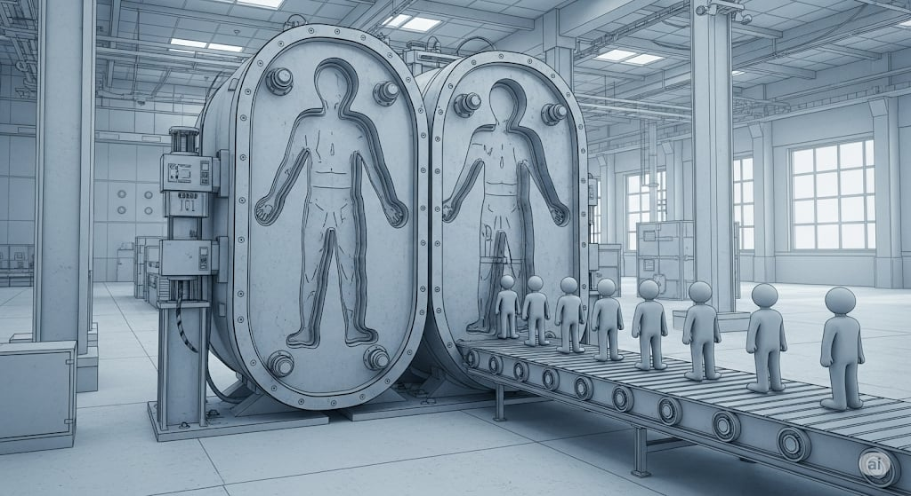
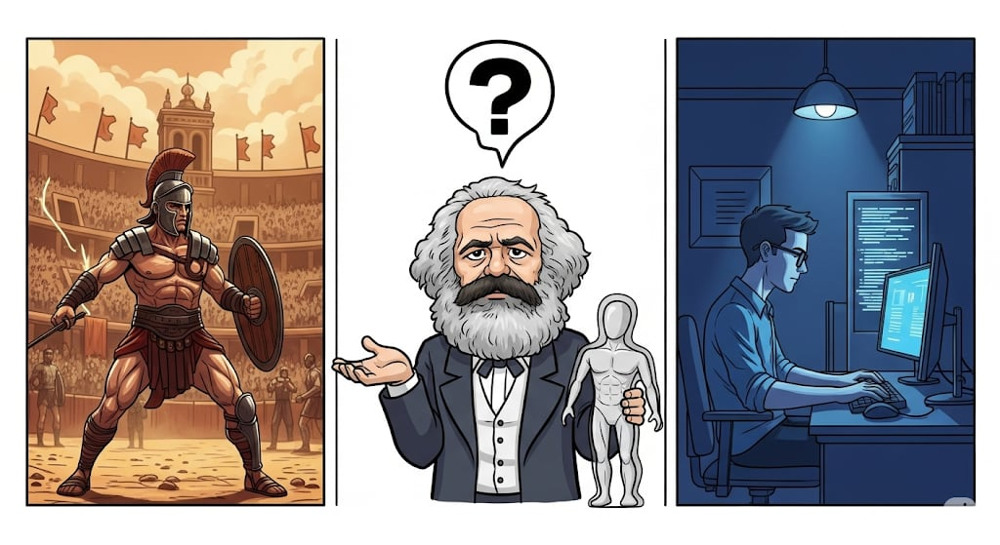
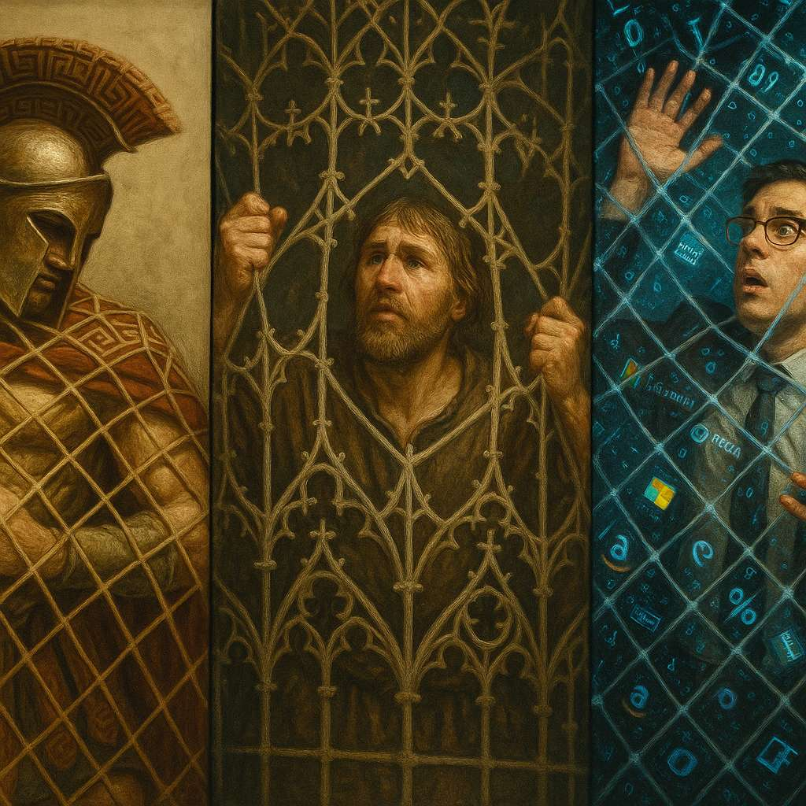
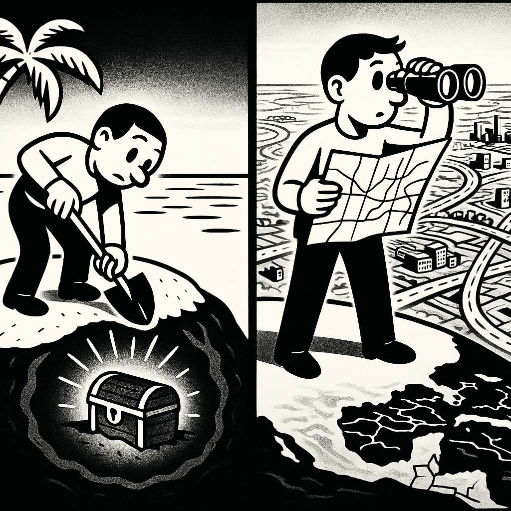

> 人的本质并不是单个人所固有的抽象物。在其现实性上，它是一切社会关系的总和。
> —— 卡尔·马克思

你是否也曾在深夜里，望着天花板，反复拷问自己那个古老而又永恒的问题：“我到底是谁？” 或者，更宏大一点，“人，究竟是什么？”

这个问题，听起来像是哲学家在象牙塔里的专属思辨，离我们的柴米油盐有点遥远。但实际上，它像空气一样无处不在，悄无声息地支配着我们的生活。我们如何看待自我价值，如何处理人际冲突，如何理解社会上的种种现象，其底层逻辑都源于我们对“人是什么”这个问题的默认答案。

在马克思登场之前，德国哲学界的摇滚巨星——路德维希·费尔巴哈，曾给出了一个极具人文关怀、听起来近乎完美的答案。然而，正是这位思想巨擘，却被马克思温和而又坚定地指出：“兄弟，你的方向很棒，但路径走偏了。”

今天，就让我们系好安全带，坐上这场思想的过山车。我们将一同见证，马克思是如何巧妙地拆解一个看似无懈可击的理论，并为我们揭示一个与日常直觉大相径庭的、关于“人”的全新定义。

## 一个浪漫的答案：我们每个人都是失落的“神” 

想象一下19世纪的欧洲，宗教的阴云依然笼罩在人们心头。这时，费尔巴哈横空出世，他干了一件惊天动地的大事——他试图把上帝从高高在上的神坛请回人间。

他是如何做到的呢？他没有用复杂的逻辑推演，而是提出了一个充满诗意与洞见的观点：

:::block-1
**“朋友们，醒醒吧，哪有什么无所不能的上帝！那个我们顶礼膜拜的神，不过是我们人类自己将内心最美好的品质——无限的爱、全能的智慧、永恒的力量——小心翼翼地打包起来，然后像放风筝一样，把它投射到遥远的天际，创造出的一个完美偶像。我们拜的不是神，而是我们自己最理想、最完美的倒影。”**
:::

这个观点在当时堪称思想界的核爆。它就像一束光，刺破了神学的迷雾，告诉世人：人，才是宇宙的中心！我们应该停止对外在神祇的卑微祈求，转而向内求索，找回属于我们自己的“类本质”。

那么，这个听起来有点玄乎的“类本质”究竟是什么？

你可以把它想象成一个**“理想人”的出厂设置或通用模具**。

就像有一个“马”的模具，它规定了马应该有四条腿、长脸、会奔跑等特性，所有符合这个模具的动物都叫马。费尔巴哈相信，同样存在一个普适的“人”的模具。这个模具里刻着爱、理性、社群性等一系列光辉的特质。我们每个人，从出生的那一刻起，就携带着这个模具的基因，它预装在我们的灵魂深处。这，就是我们之所以为人的根本原因，是我们与动物的本质区别。

这个答案是多么振奋人心啊！它赋予了每一个平凡个体以内在的神圣性和无限潜能，听起来充满了人文主义的温暖光辉。它仿佛在说：“别自卑，你就是神，只是暂时忘记了而已。”

然而，马克思，这位以严谨和现实感著称的思想“质检员”，却从这碗温情脉脉的哲学鸡汤里，敏锐地嗅出了一丝不对劲的味道。

## 马克思的追问：你的“模具”从哪里来，又活在哪里？

马克思拿起费尔巴哈那个晶莹剔透的“理想人”模具，没有直接否定它的美好，而是像一位经验丰富的老工匠，提出了几个直击要害的问题：

:::block-1
**“亲爱的老费，我同意人是伟大的。但你说我们每个人心里都预装了一个‘模具’。那么，这个模具究竟从何而来？是上帝偷偷塞给亚当夏娃的吗？还是它就像物理定律一样，天然存在于宇宙之中？更重要的是，为什么这个模具是永恒不变的？它能解释一个古罗马角斗士和一个现代程序员之间的天壤之别吗？”**
:::

这一连串的追问，精准地击中了费尔巴哈理论的阿喀琉斯之踵。

费尔巴哈的“类本质”，本质上是一种**非历史的、抽象的**设定。它就像一个预装好的、版本号为1.0的操作系统，被植入了每一个人类个体之中。在他看来，无论你是生活在黄沙漫天的古埃及法老，还是穿梭于钢筋丛林中的现代白领，你们内心深处那个“人”的核心系统都是完全一样的。历史的变迁、社会环境的差异，都不过是些可以随时更换的外在皮肤和桌面壁纸，不会触及那个恒定的内核。

这种看法，如果仔细推敲，就会发现它与现实严重脱节。这就像说，一个从未见过货币、以物易物的部落成员，和一个在华尔街操盘的金融分析师，他们对“价值”和“交换”的理解是基于同一个“内在模具”。这显然是荒谬的。

马克思深刻地认识到，这种“出厂设置”的说法，因为它忽视了活生生的历史进程和社会现实，最终只能把人看作一个个孤立的、悬浮在时间长河之外的抽象原子。

于是，在经过深思熟虑之后，马克思亮出了他的“王炸”——一个彻底改变游戏规则，将哲学从云端拉回泥土的全新定义。

## 你不是一个孤岛，你是一张鲜活的关系网

马克思掷地有声地宣称：

:::block-1
**别再执着于那个虚无缥缈的、藏在你身体里的“模具”了！要理解人，就必须看他在现实中是如何活着的。人的本质，不是你内在的某个神秘属性，而是你在现实生活中所处身的、编织你、塑造你的“一切社会关系的总和”。**
:::

这句话的威力，在于它把“本质”这个概念，从一个**静态的名词**变成了一个**动态的、关系性的动词**。如果一定要用“模具”这个词，那么费尔巴哈的模具是一个刻好之后就再也不变的死模子；而马克思要说的是：根本没有一个提前刻好、藏在你体内的模子——真正在给你“定型”的，是那张此刻正拉扯着你的关系网，而这张网自己，也在不断被重新浇铸。我们用一个更生动的比喻来彻底拆解它。

  * **你这个人 (You)**：想象自己是一个网络世界里的节点，一个头像。
  * **你的本质 (Your Essence)**：它**不是**构成你头像的那些像素点，而是**从你这个头像出发，连接到其他无数头像的所有关注、@、私信、群聊等线条，以及这些线条共同构成的整个社交网络结构**。

这些千丝万缕的“线条”，就是你的**社会关系**，它们是具体的、可感的、活生生的：

  * **家庭关系**：你是谁的孩子，又是谁的伴侣或父母？这条线决定了你的伦理责任、情感寄托和家庭内部的角色。
  * **经济关系**：你是雇员还是老板？是月月还贷的房奴还是坐享其成的房东？是消费者还是生产者？这条线决定了你在社会财富分配链条中的位置，直接关系到你的饭碗、你的利益，甚至你的焦虑来源。
  * **教育与职业关系**：你在哪所学校毕业？师从何人？身处哪个行业？你的同事和竞争对手是谁？这条线塑造了你的知识体系、专业技能和看待世界的特定视角。
  * **文化与地缘关系**：你讲着特定的方言，吃着家乡的菜肴，遵循着民族的节庆，使用着微信和支付宝……所有这些都将你牢牢地编织在一张巨大的、具有鲜明地域和时代特征的文化网络之中。

现在，请想象一下，如果把这些关系线条一根根全部剪断，会发生什么？一个没有父母、没有朋友、没有工作、没有国籍、没有语言的“你”，还剩下什么？马克思的答案是：什么都不剩，只剩下一个生物学意义上的人。**你之所以是你，之所以拥有独一无二的性格、思想和命运，正是因为你被这些密密麻麻、纵横交错的关系网所定义、所支撑、所塑造。**

## 先有江湖，再有侠客

这个观点最令人震撼的地方，在于它彻底扭转了“个体”与“关系”的因果链条，把我们的日常直觉整个掉了个个儿。

我们的直觉和日常语言都告诉我们：**先有了一个个独立的“我”，然后我们主动去社交、去工作、去恋爱，才建立了各种关系。** 我是因，关系是果。

但马克思却说，这个顺序完全搞反了！**真实的情况是，先有了社会关系这张无边无际、早已存在的大网，然后我们每个人才像一颗颗种子，掉落在这张网的不同位置上，被它捕获、滋养，并最终被塑造成了这张网上一个独一无二的节点。**

  * 在一个纪律严明的斯巴达城邦里，“关系网”的核心是公民与城邦的军事共同体关系。这张网会把一个男孩塑造成一个坚忍、服从、以战死沙场为荣的战士。他的“自我”完全融入在城邦的集体荣誉之中。
  * 在一个等级森严的封建庄园里，“关系网”的核心是领主与农奴之间不可动摇的人身依附关系。这张网塑造出的，是一个认命、虔诚、将领主的意志视为天意的农奴。他的“本质”就是服务于他的主人。
  * 在一个高度竞争的现代商业社会里，“关系网”的核心是复杂的雇佣、竞争、合作与消费关系。这张网塑造了我们这些不断追求效率、渴望个人成功、在“996”与“躺平”之间反复横跳的现代人。

**结论就是：不是我们自由地选择了关系，而是我们一出生，就被抛入了一个由特定关系构成的“江湖”，这个“江湖”的规矩和结构，决定了我们将成为怎样的“侠客”。** 你是谁，你追求什么，你为什么而痛苦，最终的答案，不在于向内挖掘某个神秘的“真我”，而在于向外审视你所处的这张无形的社会关系大网。

## 我们脚下的这片江湖

费尔巴哈的理论，说到底是一个向内寻找的故事：答案就在你心中，只要静下心来向内探索，就能找到那个被遗忘的、完美的“真我”。

马克思的理论，讲的是另一个故事：你的“自我”不是一件需要被“发现”的静态之物，而是在社会互动中不断被塑造、被定义的动态产物。真正值得追问的，不是“我心里到底藏着什么”，而是“我脚下这片江湖，是怎么长成这样的”。

它带来的启示，是根本性的：

如果你对自己的生活现状感到不满，如果你在工作中感到压抑、异化和无力，你不能仅仅依靠冥想、心理咨询或“提升认知”来解决。因为问题的根源，很可能不在于你的“内心”出了什么故障，而在于你所被编织进去的那张关系网本身，可能就是不平等的、有缺陷的、甚至是扭曲的。

**因此，想要真正地理解人、解放人，我们的视野就必须从那个孤立的、抽象的“我”，转向那些塑造了我们的、具体的、历史的社会关系——去审视它、批判它，并在必要的时候，联合他人一起去改变它。**

江湖不是一成不变的，侠客也可以联手改写江湖的规矩。这，才是“人的本质”这堂课留给我们的真问题：不是“我是谁”，而是——我们能不能一起，把这张网重新织过？

