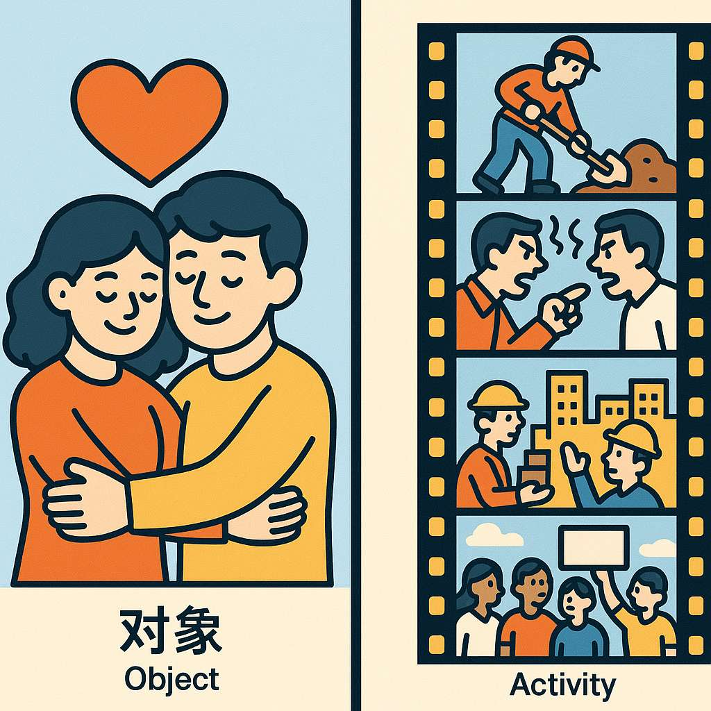

## 引言

在[费尔巴哈的功劳](04-费尔巴哈的功劳：为什么“人类”可以被感觉到.md)一篇，我们为他献上了掌声。他像一位勇敢的哥伦布，把哲学从飘渺的“概念大陆”带回了充满温度的“感性新大陆”。“人类”不是画廊高墙上一幅遥不可及的画像，而是我们能通过爱与需要亲身感觉到的共同体。

这无疑是一次伟大的思想解放。

但是，任何伟大的发现，在最初的版本里，都容易漏掉一些东西。就在整个哲学界都为费尔巴哈的“感性新大陆”欢呼时，一个叫马克思的年轻人，作为费尔巴哈最出色的“粉丝”之一，却敏锐地指出了一处足以动摇全局的疏漏。

马克思不是要全盘否定。用讲故事的话来说，费尔巴哈把人带回了画面，还没有把故事讲完。

今天，我们就来看看马克思是如何补完这后半段故事的。

## 从“感性对象”到“感性活动”

《德意志意识形态》讨论费尔巴哈时，分辨了把人当作感性的对象来承认，和从人的感性活动来理解现实生活。我的概括是：爱与友情当然是人的关系，但日常劳动怎样组织、人与人何以发生冲突，也同样是人的关系。

“感性对象” vs “感性活动”，这听起来还是很绕。我们继续用比喻来破解它：

  * **费尔巴哈的“感性对象”**，就像一张**绝美的照片**。照片捕捉了“爱”的那一瞬间，你看到了两个人之间温暖的连接，你被深深打动。你觉得，这就是“人性”最美的样子。这张照片是静止的、完美的，它是一个**结果**。

  * **马克思的“感性活动”**，则是一部**宏大的纪录片**。这部纪录片不仅包含了那张绝美的照片，更记录了照片之前和之后发生的一切：这两个人是如何相遇的？他们为了生活在一起，经历了怎样的辛勤劳动？他们所在的社会环境，是鼓励还是阻碍了他们的爱情？他们之间除了爱，会不会因为金钱、地位而产生矛盾和争吵？

你看，马克思认为，费尔巴哈只看到了那张定格的、美好的“照片”，就以为这就是全部真相。而马克思要做的，是按下播放键，让我们看到，“人性”这张照片，究竟是在一部怎样波澜壮阔、充满血泪与汗水的“纪录片”中被拍摄出来的。

**“人性”不是一个被我们静静欣赏的对象，而是我们自己作为主角，正在亲身演出、亲手创造的动态过程。**

## “感性活动”的真面目：劳动创造了我们自己

那么，这部叫作“人性”的纪录片，它的“制片人”和“导演”是谁呢？不是上帝，不是什么神秘力量，而是我们自己最基本的一种活动——**劳动**。

“劳动创造了人”这句话，我们可能在课本里听得耳朵都起了茧，但今天我们能以全新的方式理解它：

1.  **人是自我诞生的：** 自然界只给了我们一个“出厂设置”——高级灵长类动物。但我们如何从一群原始的兽群，变成今天这样有语言、有社会、有文明的“人类”？是靠我们**集体**用手和工具去改造自然界。在这个过程中，为了协作，我们发展了语言；为了分配果实，我们形成了社会关系。我们不是被上帝“吹了一口气”才成了人，我们是在与自然界“打交道”的千百万年里，一锤子一斧子地\*\*“凿”\*\*出了我们自己。

2.  **“社会”的本质就是交往：** 劳动从来不是单个人的事，它从一开始就是集体的、社会的活动。而社会是什么？社会不是一个空洞的名词，它的本质就是人与人之间活生生的、感性的交往。语言就是最古老的劳动，劳动也离不开语言。**“社会”的本意，其实是个动词。**

所以，马克思的逻辑是：**“感性活动”（主要是劳动和交往）→ 创造了“社会关系” → 塑造了特定历史阶段的“人之类”。**

这个过程从未停止，它就是“历史”。石器时代的人类，和数字时代的人类，他们的“类存在”显然是不同的，因为他们的“感性活动”方式发生了天翻地覆的变化。

## 费尔巴哈没处理的问题：贫穷从哪里来

现在我们明白了，费尔巴哈拍到的，始终只是那一张温情脉脉的“照片”。当现实拍出的是另一种更复杂、更残酷的画面时，这张照片就解释不了了。

这解释不了什么？

如果一个人既能感受爱，又会在街头遇见积劳成疾的穷人，只说人有爱与需要，能解释这种反差吗？

他的理论无法回答。因为他只拍下了“爱”，却没拍下“爱”之外的另一种更普遍、更强大的“人的关系”——**权力**。

金钱，就是这种关系的最好证明。我们每个人都需要钱，这恰恰证明了我们是彼此需要的“类存在”。但同时，金钱也造成了人与人之间最深刻的对抗与异化。这种由人的活动创造出来、反过来又支配人的力量，费尔巴哈那张“爱的照片”是拍不进去的。

最终，无法解释现实矛盾的费尔巴哈，只能退回到一种唯心主义的呼吁，希望通过某种“爱的宗教”和“类的平等化”来解决问题。这就像是发现照片拍歪了，不去调整镜头和站位，反而对着照片本身祈祷。

## 终极案例：美，究竟从何而来？

为了把“感性对象”和“感性活动”的区别讲得明明白白，马克思主义哲学提供了一个绝佳的例子——**美学**。

这个问题，直到今天依然有无数争论：**美，究竟从何而来？**

可以只问一朵花有哪些可见的颜色和形状；也可以多问一步：人怎样学会用花布置房间、纪念相遇？这是本文用来区分对象与活动的例子。

想象一个鲁滨逊漂流到荒岛上。他会不会把贝壳串起来，挂在茅屋门口？也许无人来看，他还是喜欢贝壳晃动的样子。那双辨别疏密、颜色、节奏的眼睛，是登岛之后才有的吗？

**美感可以有社会的来历，而不必每次都有观众。** 一个人独处时也带着过去学会的眼光；他还可能给贝壳找到过去没人教过他的新摆法。

马克思在《1844年经济学哲学手稿》中给出了一个神级的论断：

:::block-1
动物只是按照它所属的那个种的尺度和需要来建造，而人却懂得按照任何一个种的尺度来进行生产……因此，**人也按照美的尺度来建造**。
:::

这段话是什么意思？蜜蜂世世代代都造一样的蜂巢，这是刻在DNA里的“出厂设置”。而人类不同，我们不仅为了“生存”而建造，我们还会为了“好看”而建造。我们在劳动中，会把我们对形式、韵律、和谐的追求，也就是“美的规律”，运用到我们的产品上去。

**所以，美不是我们发现的“对象”，而是我们在改造世界的“活动”中创造出来的。** 这恰恰证明了，人不仅是“感性的对象”，更是“感性的活动”。

## 结语：我们是历史的创造者

现在，我们可以清晰地看到马克思在费尔巴哈的基础上往前走的这一步，分量有多重。

他继承了费尔巴哈的遗产——承认人的根本存在是感性的。但他又往前推进了一步：这种“感性存在”不是一个预设好的、静止的东西，而是一个由我们自己通过社会实践和劳动不断创造、不断改变的**历史过程**。

**“人性”，不是一个名词，而是一个动词。**

这个发现，也带来了一个不那么轻松的推论：我们今天所处的世界，包括其中所有的不公与异化，都不是从来如此、永远如此的。它们都是在人类历史这部“纪录片”的某个阶段被“拍”出来的产物——既然是被拍出来的，就有可能被重新拍一遍。

而我们，既是这部纪录片里的演员，也是握着摄像机的那个人。下一个镜头怎么拍，还没有定稿。

