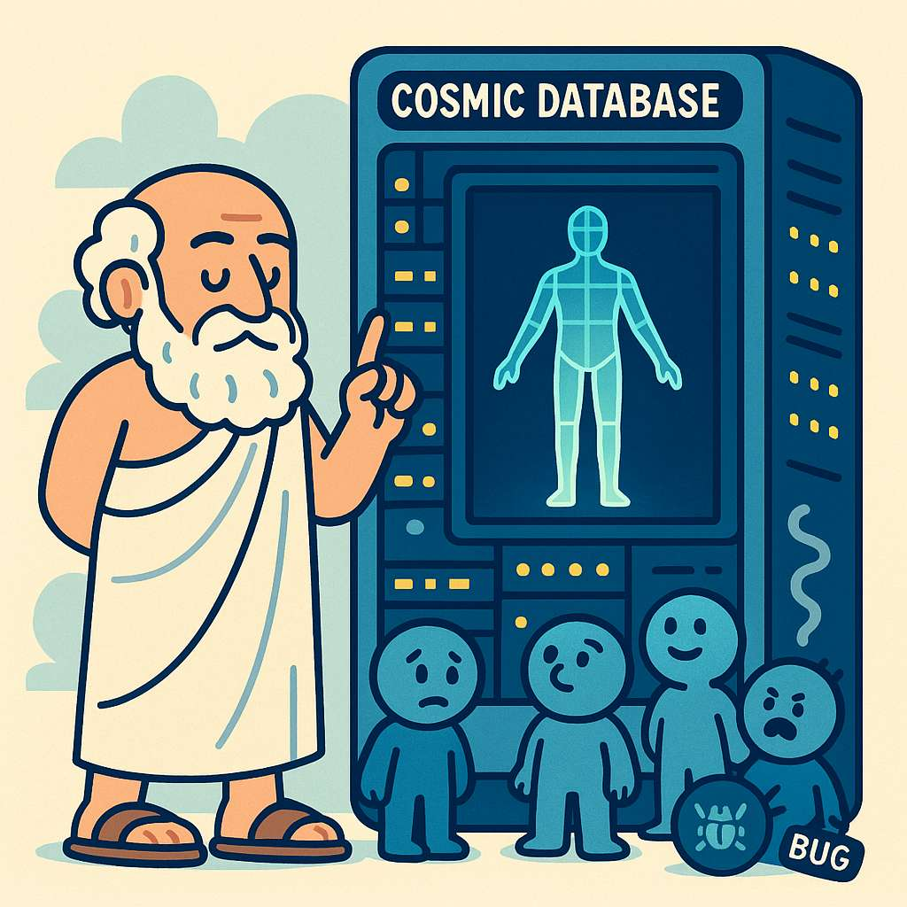

# 费尔巴哈的功劳：为什么“人类”可以被感觉到

## 引言

> 费尔巴哈不满意抽象的思维而诉诸感性的直观；但是他把感性不是看作实践的、人的感性的活动。
> ——《关于费尔巴哈的提纲》第五条

这一条，是马克思写给费尔巴哈的判决书：他后面会指出，费尔巴哈说到底还是停在了“看”，没有走到“做”。但要读懂这份判决，得先听完辩方的陈述——费尔巴哈到底做对了什么，才配让马克思专门写一条提纲来谈他的不足。

让我们先定格在一个场景：一间大学的哲学课堂，教授在黑板上写下这句天书般的引文。空气里弥漫着困惑，这句话又短又拗口，每个字都认识，但连在一起就像一句你能认出每个字、却拼不出意思的咒语。它像是哲学系期末考卷上压轴的“送命题”，专门用来区分学霸和学渣。

但请相信，藏在这句“咒语”背后的，绝不是什么枯燥的学术游戏。它是一场哲学界的“大地震”，它的冲击波，至今仍在影响我们看待“自己”、“他人”以及我们所构成的“人类社会”的方式。

我们每个人的常识都建立在一个基础上：我能看到、摸到、感知到的是一个具体的人：那个每天挤地铁的同事老王，楼下奶茶店里爱笑的女孩小李，电话那头唠叨的父母。这些都是活生生的、独一无二的个体。

但你见过“人类”本尊吗？谁能给“人类”这个东西拍张照？谁能握一握它的手，闻一闻它的气味？

显然不能。常识告诉我们，“人类”是一个概念，一个存在于我们大脑里的抽象标签，就像美术馆里挂在最高处、只能远远仰望的一幅画像——你说得出画的是“人”，却没人让你走近去看一眼画布的纹理。几千年来的西方主流哲学家，从古希腊的柏拉图到近代的黑格尔，基本都是这么想的：他们是这间“画廊”的资深讲解员，只有他们才有资格告诉你这幅画到底画的是什么。

但就在所有人都觉得这事儿理所当然的时候，一个叫费尔巴哈的德国哥们儿，像个思想界的摇滚乐手，猛地站出来，对着整个哲学传统喊了一声：“你们都错了，‘人类’不仅能被看见，更能被‘感觉’到！”

这听起来也太玄乎了，简直像是在说你能用耳朵尝到颜色。今天，我们就戴上思想的潜水镜，深潜到哲学史的激流之下，看看费尔巴哈这位“思想潜水员”到底在水下看到了怎样一番景象。

## 哲学的旧秩序：画中的“人类” vs. 活生生的人

在费尔巴哈登场之前，西方哲学界有一条根深蒂固的“鄙视链”。他们热衷于扮演画廊里最资深的讲解员和策展人。

想象一下，在他们眼中，宇宙就像一座巨大的画廊，墙上挂满了关于万事万物的“标准画像”。有一幅叫“马”的画像，画的是“马”的完美本质。还有一幅叫“人类”的画像，用最精确的逻辑线条勾勒出何以为“人”（比如：理性的、会使用工具的动物等等）。

而现实世界中具体的你、我、他，还有那匹在奔跑的白马，都只是这幅标准画像之外，一个个有瑕疵的、正在变化的“实物”。这些实物会衰老、会犯错、会死亡，不像画像那样能一直挂在墙上、保持原样。

所以，哲学家的终极任务是什么？是去研究你我这些有血有肉、会哭会笑的活人吗？不，那格局太小了。他们的目标是绕过这些嘈杂的、不完美的现实，通过最纯粹、最高级的“理性思维”，径直走到画廊最深处，去凝视、去理解那幅永恒、完美的“人类”标准画像。

这个逻辑很酷，也很“精英”：白马会死，但“马”的概念永存。你我会消失，但“人类”的理念不朽。真理，就藏在那个冰冷、抽象、但绝对正确的概念里。

但费尔巴哈对这种“讲解员”式的哲学感到极度不爽。他觉得这种哲学高高在上，不食人间烟火，甚至有点“非人”。于是，他喊出了那个时代最尖锐的一问：

:::block-1
**“我们活生生的人，带着我们所有的激情、痛苦、爱与渴望，难道就是为了给你们那个冰冷的‘人类’概念当一个注脚吗？难道我们最真实、最强烈的内心感受，都只是不值得一提的杂音吗？那个所谓的‘类’，如果和我们的真实感受毫无关系，如果它不能被我们的心跳和泪水所验证，那它还有什么意义？”**
:::

费尔巴哈的主张，简单粗暴：哲学，必须从画廊里走出来，推开那扇沉重的门，回到大地上，回到我们每个人的“感觉”之中。

## 费尔巴哈的回答：爱，就是“看见”人类的方式

那么，最关键的问题来了：到底要如何“感觉”到“人类”这个抽象的“类”呢？这听起来就像想用舌头尝出数学公式的味道一样不可思议。这不正是几千年来哲学家们认为不可能完成的任务吗？

费尔巴哈在这里，给出了一个足以扭转整场辩论方向的答案。这个答案，简单到令人意外，又深刻到足以穿透灵魂：

:::block-1
**通过“爱”与“需要”。**
:::

这个回答，直接把高冷的哲学拽回了温热的人间烟火。我们来一步步拆解这个天才般的逻辑，看看它是如何运作的：

### 第一步：你不是孤岛，你的“需要”在呐喊

想一想，一个动物，比如一只老虎，它需要捕食、需要领地、需要繁衍。但它不会为“同类”的灭绝而感到一种形而上的孤独，它不会意识到自己属于“老虎”这个伟大的“类”。它的需要是纯粹生物性的。

但人完全不同。我们可以一个人在物质上活得很好，但我们内心深处有一种无法根除的渴望——我们需要朋友，需要家人，需要爱人，需要被理解，需要被看见，需要与他人交流。这种深刻的、精神层面的“需要”，本身就是一种强大的“感觉”。它在你的灵魂深处不停地呐喊：“你不是一个孤立的原子，你是一张大网上的一个纽结，你的存在需要通过连接他人来确认！”

### 第二步：爱，是“人类”落地的地方

如果说“需要”是那根把你和世界系在一起的线，那么“爱”就是这根线绷得最紧、最滚烫的那一刻。

当你真正爱上一个人时，你爱的是什么？是对方的履历、身高、体重、银行存款这些可以罗列的条件吗？当然不是。你爱的是那个活生生的、能与你产生深刻灵魂共鸣的个体。

在“爱”这个体验中，发生了奇妙的化学反应：

  * **“我”的边界融化了：** 在爱中，你会为他人的快乐而快乐，为他人的痛苦而痛苦。你的“自我”不再是坚硬的壁垒，它变得柔软、开放。
  * **你触碰到了“人性”：** 你在对方身上，看到了和自己共通的脆弱、渴望、善良与挣扎。那一刻，你感受到的，已经超越了“他”或“她”这个个体，你触碰到的是一种更广阔的东西——那就是我们共有的“人性”。

**费尔巴哈在这里一语道破天机：爱，就是“人类”这个“类”，在我们每个个体身上最直观、最强烈、最无可辩驳的感觉形式！**

幸福、痛苦、失恋的折磨、友情的温暖……所有这些深刻的情感，都不是你一个人的私产。它们之所以能引发全人类的共鸣，正是因为我们作为“人类”的一员，拥有共通的情感结构。

所以，当你感受到爱时，你就不再是一个孤零零的、只等着被贴上标签的“标本”。你正通过一种极其真实的感觉，亲身“直观”到那个曾经被认为是纯概念的“人类”。“人类”不再是哲学教科书里那个遥远的名词，而是你心中涌动的暖流，是你眼中泛起的泪光。

## 陈述完毕，该轮到马克思了

现在，我们可以回头再看《关于费尔巴哈的提纲》里那句判决式的话了。

费尔巴哈的贡献，是把哲学研究的起点，从那幅挂在画廊高墙上的、关于“人类”的画像，一把拽回到了我们每个人充满温度的感官世界。

他雄辩地向世界证明：别再到故纸堆和逻辑公式里去寻找“人性”了。**人性，就在你对他人的每一次需要、每一次关爱、每一次共情之中；它就在每一次握手、每一个拥抱、每一次眼神交汇的瞬间。**

他让我们明白，“人类”不是一个等待我们去仰望的抽象概念，而是由无数感性的、充满爱与需要的个体所构成的、能被我们亲身“感觉”到的命运共同体。

辩方的陈述，到这里就说完了——而且说得很好。费尔巴哈没有说错什么，他只是没有说完。

马克思接下来要问的，是这样一个问题：我们通过“爱”感受到了人性，这没错；可这份“爱”本身是从哪里来的？两个人为什么会相遇、会相爱，又为什么会在柴米油盐里争吵、甚至反目？费尔巴哈的“爱”，能不能解释一个终日劳作却食不果腹的穷人，和一个锦衣玉食的富人之间，那种远比“共通的人性”更刺眼的差别？

这正是提纲第五条要下判决的地方：费尔巴哈把感性只看作“直观”——你可以感觉到人类，却不必去问这感觉本身是怎么被生产出来的。而马克思要说的是，感性首先是**实践**的：不是先有一份现成的人性等着你去感觉，而是我们在劳动、在改造世界的过程中，把这份感觉一次次做出来的。

判决，将在下一篇宣布。

