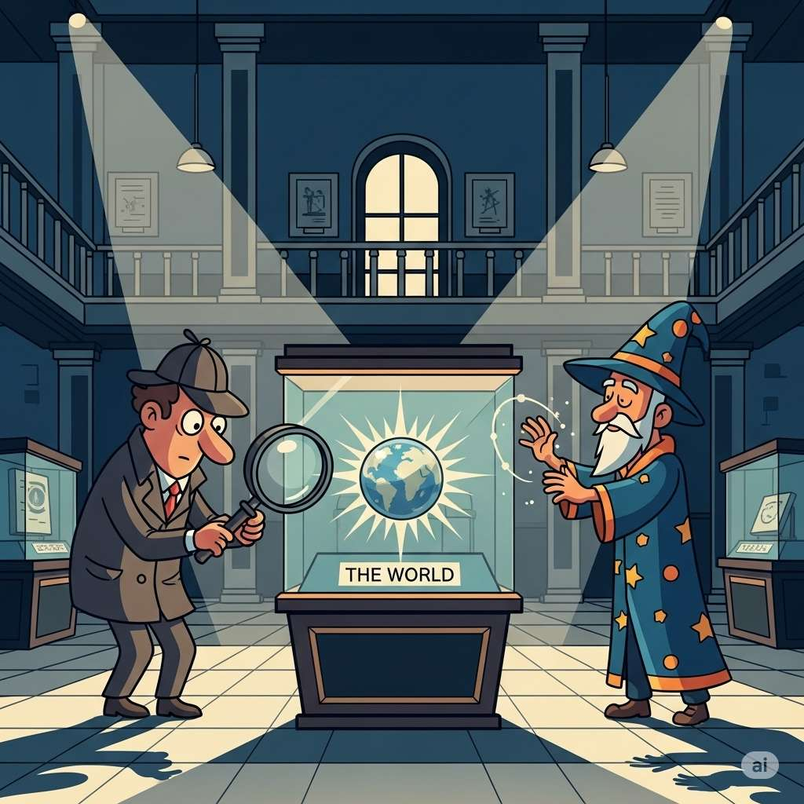
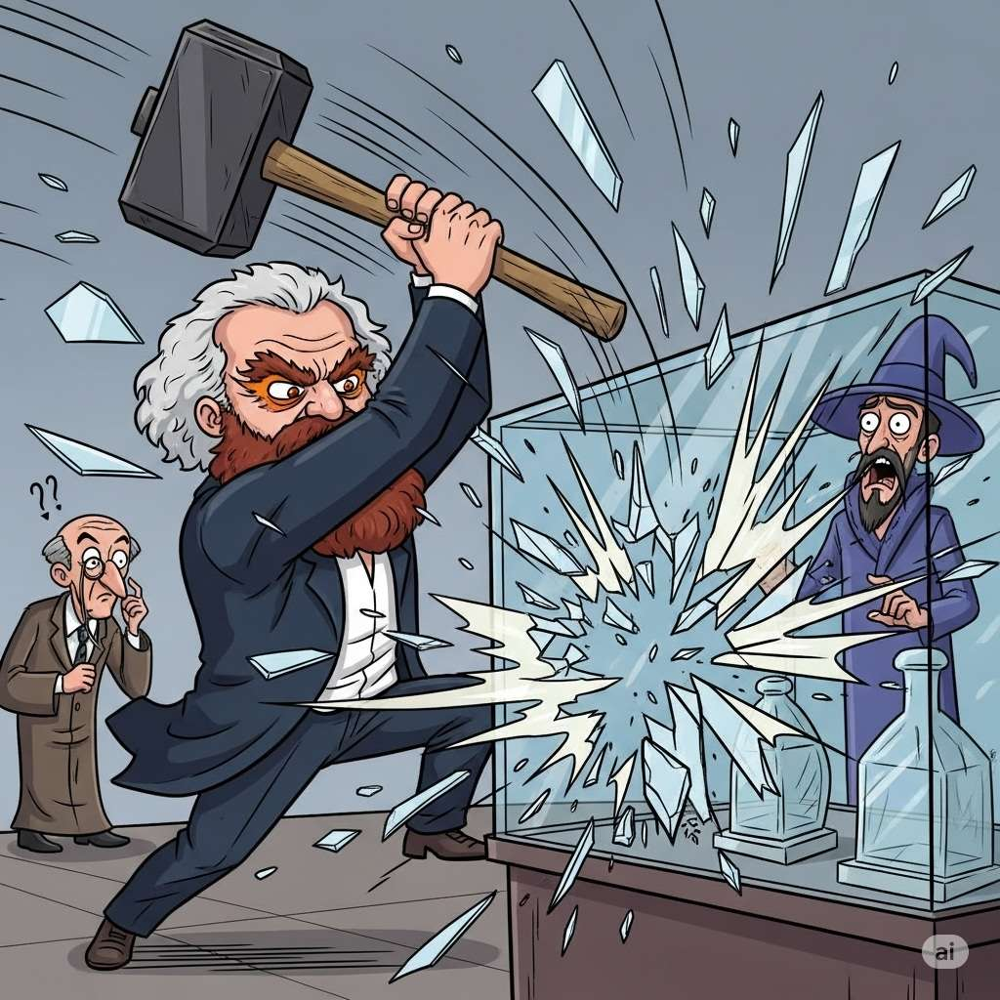

## 序章：博物馆里冰冷的玻璃展柜

在马克思登场之前，整个哲学世界就像一座宏伟、肃穆却毫无生气的博物馆。世界，就是馆内一件件被安放在玻璃展柜里的展品。

学者们分成两派，在展柜前争论不休。

一派是**“唯物主义鉴赏家”**。他们手持放大镜，全神贯注地研究展品的材质、重量和物理构成。他们会告诉你：“看，这朵玫瑰的本质，就是由这些特定的碳水化合物和色素分子构成的。”他们相信，只要把物质研究透了，就理解了世界的一切——正是这套方法论，撑起了整个近代自然科学：靠着对材质、结构、因果律的不懈钻研，人类才第一次学会了预测和支配自然，而不是匍匐在神秘面前。

另一派是**“唯心主义魔法师”**。他们对展品本身不屑一顾，目光永远聚焦在展柜旁的标签上。他们宣称：“不，这朵玫瑰的本质是‘美’、是‘爱情’这个永恒的观念。物质形态只是观念的拙劣复制品。”他们的主张同样并非无的放矢——这一追问精准地戳中了鉴赏家的软肋：如果世界只是原子和分子的排列组合，那美、意义、道德这些人类真正在乎的东西，又从何而来？在很长的历史时期里，正是这套主张，撑起了人们对价值与精神的全部追问。

然而，他们看似水火不容——一个极端被动，一个极端主动——却共享着一个神圣的前提：他们都从未真正**触碰**过那个展品。他们都与现实隔着一层名为**“直观”**的玻璃，一个满足于观看，一个满足于隔空施法。这层玻璃，将世界凝固成一个冰冷而现成的**客体**，等待着被被动地反映，或是被抽象地命令。

## 第一幕：“爱情”的展品前，两种无力的智慧

故事的转折，依然从那个名为“爱情”的展品开始。

它不是静静地躺在那里，它是一个漩涡，将你卷入其中。它是一种无法言喻的体验，混合着期待、恐惧、狂喜和不安。你发现你所有的知识储备都失效了。为了寻找答案，摆脱这甜蜜的痛苦，你决定向博物馆里最博学的两位大师请教。

你首先找到了那位德高望重的**“唯物主义鉴赏家”**。他递给你一个水晶材质的托盘，上面放着一把冰冷的金属卡尺和一个笔记本。他用不带一丝情感的语调对你说：“去测量，去记录。将对象分解为可量化的数据。分析其家庭背景的社会阶层系数，计算其教育水平与你的匹配度，记录其在不同情境下的行为模式并进行归类。爱情，不过是生物性吸引与社会性兼容的优化组合。当你收集的数据足够多，你就能绘制出它的全部图景，预测它的未来走向，并做出最理性的决策。”

你遵从了他的指引。你开始像一个秘密侦探一样收集信息，你的笔记本上写满了密密麻麻的观察结果。然而，你越是记录，就越是感到一种深深的寒意。你发现，这个过程像是在对一个活生生的人进行一场漫长的、不见血的解剖。你每记下一个“客观数据”，似乎就离那个让你心动的、真实的灵魂更远了一步。你手里攥着厚厚的报告，却感觉比以往任何时候都更不了解对方。这种理性的分析，非但没有带来确定性，反而将爱情那温暖的、流动的生命力，彻底扼杀了。

在巨大的失落中，你又求助于那位充满神秘魅力的**“唯心主义魔法师”**。他没有给你任何工具，而是让你坐下，闭上眼睛。他用一种催眠般的声音引导你：“忘掉那个充满缺点和偶然性的‘现实’的人。那只是表象。真正的力量在于你的内心。在你的精神世界里，构建一个‘完美爱人’的形象——他应该如何说话，如何微笑，如何爱你。这个‘理念’，就是一切的本源。现在，用你全部的意志去相信这个理念，用你的精神去照耀他，用你对完美的渴望去‘命令’他。只要你的信念足够纯粹，现实的顽石终将屈服于精神的雕刻刀。”

你被他的激情所感染，开始了这场精神的苦修。你努力地将对方想象成你所设定的那个完美角色。起初，这似乎很有效。你会刻意放大对方符合你“理念”的言行，而自动忽略那些不和谐的音符。你沉浸在自己创造的幻象中，感到一种虚假的力量感。但现实的引力终究是无情的。某一天，对方一个无心的举动，一句不符合“剧本”的话，或是一个你从未预料到的反应，就如同一块顽石，瞬间击碎了你那水晶般的“理念”城堡。你惊恐地发现，你一直以来爱着的，或许只是你脑海中那个听话的、被你创造出来的幻影，而不是那个有着自己独立灵魂的、真实的人。

此刻，你被彻底困在了两条路的尽头。一条路通向冰冷的停尸房，另一条路通向虚无的蜃景。你意识到，这两种看似对立的伟大智慧，都以不同的方式，杀死了爱情。

## 第二幕：卡尔登场——“这不是展柜，这是舞台！”

就在你被两种无力感彻底淹没，在博物馆的走廊里感到窒息之时，一声巨响毫无预兆地炸裂开来！那声音不属于这个静谧的世界，它带着一种要把一切重新激活的力量。

你猛地回头，看见了那个闯入者，**卡尔**。他手中那把思想的铁锤，刚刚砸碎了封存着“爱情”展品的、那层厚重无比的玻璃展柜。碎片如钻石般四散飞溅，也映照出鉴赏家和魔法师脸上那副惊愕到扭曲的表情。

卡尔的身影仿佛从历史的裂缝中走出，他先转向那位手足无措的鉴赏家，语气郑重：“你说的没错——花的物质构成确实真实，脱离物质谈本质，就是空中楼阁。这一步，你稳稳地站住了。可你也止步在这一步：你把奔腾的河流装进瓶子，分析出了水的化学成分，却从没问过，是什么让它奔腾。你拥有了所有的‘事实’，却把‘现实’关在了展柜之外。”

接着，他转向那位脸色发白、喃喃自语的魔法师：“你也说对了一半——如果没有人的能动创造，美和意义确实无从谈起，这是你比鉴赏家看得远的地方。但你的错，是把这份能动性锁进了脑子里，从没让它落地。你说你爱那只飞鸟，可你爱的，是你在头脑里养大的那一只，而不是真正扑棱着翅膀、会啄伤你手指的那一只。你所说的‘能动的力量’，还没有走出过自己的思想。”

最后，他大步流星地走到你的面前，把你从废墟的阴影中一把拉出。他没有给你任何理论或咒语，而是指着那个真实无比、充满了未知与可能的广阔世界，用一种近乎命令的、却又饱含希望的语调对你说：
“去**演**——但别再妄想当一个置身事外的评论家，也别再妄图当一个掌控一切的造物主，去当一个真正的演员：用你的眼睛去看，用你的耳朵去听，用你的声音去对话，用你的双手去触摸、去拥抱、去劳动，去感受那沾满生活泥土的真实。这，才叫实践！”

于是，大幕在你面前缓缓拉开，但上面空无一字。这不是一场有剧本的演出，而是一场即兴的、需要你用全部生命去投入的冒险。你迈出了第一步，带着恐惧和期待，开始尝试一次笨拙的对话，一个不确定的微笑。你发现，只有在这真实的、充满风险的互动中，在你来我往的给予和接受中，那颗名为“爱情”的种子，才第一次获得了生根发芽的土壤。你不再分析它，也不再命令它，你开始培育它。

卡尔的革命性，在此刻才完全显现：他没有选择两派中的任何一方，而是进行了一次伟大的**“扬弃”**。他吸收了唯心主义的“能动性”内核，又把它安放在从唯物主义那里夺回的“感性现实”大地之上。他宣告，真正的创造，既不是被动地反映物质，也不是抽象地空想精神，而是在与现实世界的物质性互动中，发挥人的主观能动性。

## 第三幕：在舞台的废墟上，读懂剧本

人生如戏，戏剧总有落幕之时。假设有一天，你们的对手戏在冲突或沉默中走向终结。聚光灯熄灭，舞台空无一人。

当热烈的实践中断，当熟悉的对手“不在场”了，巨大的痛苦与困惑才第一次迫使你，从一个沉浸其中的“演员”，变成一个置身事外的“剧评人”。你坐在空荡荡的观众席里，疯狂地回放着过去的每一幕，拼命地分析、解构，试图搞明白这部以心碎告终的戏剧，它的**“本质”**究竟是什么。

这恰好以最残酷的方式，印证了卡尔的洞察。**我们孜孜以求的所谓“本质”，往往只是对一段过去了的实践的苍白回溯与无奈命名。**

这出戏剧在更广阔的世界舞台上，每日每夜都在上演：

一位古代的中医，他并非先拥有一张完美的人体解剖图，再去指导自己的治疗。恰恰相反，是在千百次“望闻问切”、“针灸施药”的**医疗实践**中，他用自己的身体和全部感官去倾听、去触摸、去试错，才在一代代人的集体经验中，绘制出“经络”这张动态的、功能性的实践地图。这张图，就是中医们用实践写成的剧本。

一片原始的森林，本没有路。是人们为了生存、迁徙或贸易，一次又一次地**“行走”**这个实践，才在荆棘与荒草间，踩出了一条坚实的小径。这条小径，就是人类的实践活动刻写在大地上的剧本。它改变了地貌，也重新定义了人与森林的关系。

卡尔的学说，就是要揭穿一个被博物馆馆长们长期隐瞒的事实：我们奉为“天经地义”的那些客观真理——无论是爱情的法则、身体的奥秘，还是社会的秩序——其所谓的“剧本”，都是在**实践的舞台**上，由无数演员（也就是我们）在演出过程中即兴创作并修改，最终才沉淀下来的。

而之前的哲学家们，最大的错误，就是捡到了这些散落在地的“剧本”，误以为它们是戏剧的**原因**，是上帝或理念预先写好的神圣法则，而完全忘记了，它们其实是那一场场充满汗水、泪水、血水和欢笑的、活生生的演出的**结果**。

## 终章：完整的革命宣言

现在，我们终于可以理解卡尔——也就是马克思——那场哲学革命的全部雄心。他不仅要批判那些只见物质不见人的“旧唯物主义”，同样也要批判那些只见精神不见现实的“唯心主义”。他要终结的，是二者共同的根基——思想与现实的割裂。

他邀请我们扮演的，既不是一个冷漠的**“博物馆观众”**，也不是一个空想的**“空中楼阁建筑师”**，而是一个脚踏实地、用实践来改变世界的**“大地上的创造者”**。

这整个关于博物馆、鉴赏家、魔法师与舞台的故事，最终都指向了那份浓缩了全部风暴的革命性文本。现在，我们终于可以完整地读懂它的每一个字。这，就是**《关于费尔巴哈的提纲》**的第一条全文：

> 从前的一切唯物主义——包括费尔巴哈的唯物主义——的主要缺点是：对事物、现实、感性，只是从客体的或者直观的形式去理解，而不是把它们当作人的感性活动，当作实践去理解，不是从主体方面去理解。所以，结果竟是这样，和唯物主义相反，唯心主义却发展了能动的方面，但只是抽象地发展了，因为唯心主义当然是不知道真正现实的、感性的活动本身的。费尔巴哈想要研究跟思想客体确实不同的感性客体，但是他没有把人的活动本身理解为客观的活动。……所以，他不了解“革命的”、“实践批判的”活动的意义。

是的，“客体的或者直观的形式”，就是唯物主义鉴赏家们所沉迷的玻璃展柜。而唯心主义魔法师们，则“发展了能动的方面，但只是抽象地发展了”。马克思的回答，是砸碎展柜，走上舞台，用“真正现实的、感性的活动本身”——也就是“实践”，去开启一场“革命的”、“实践批判的”伟大戏剧。

