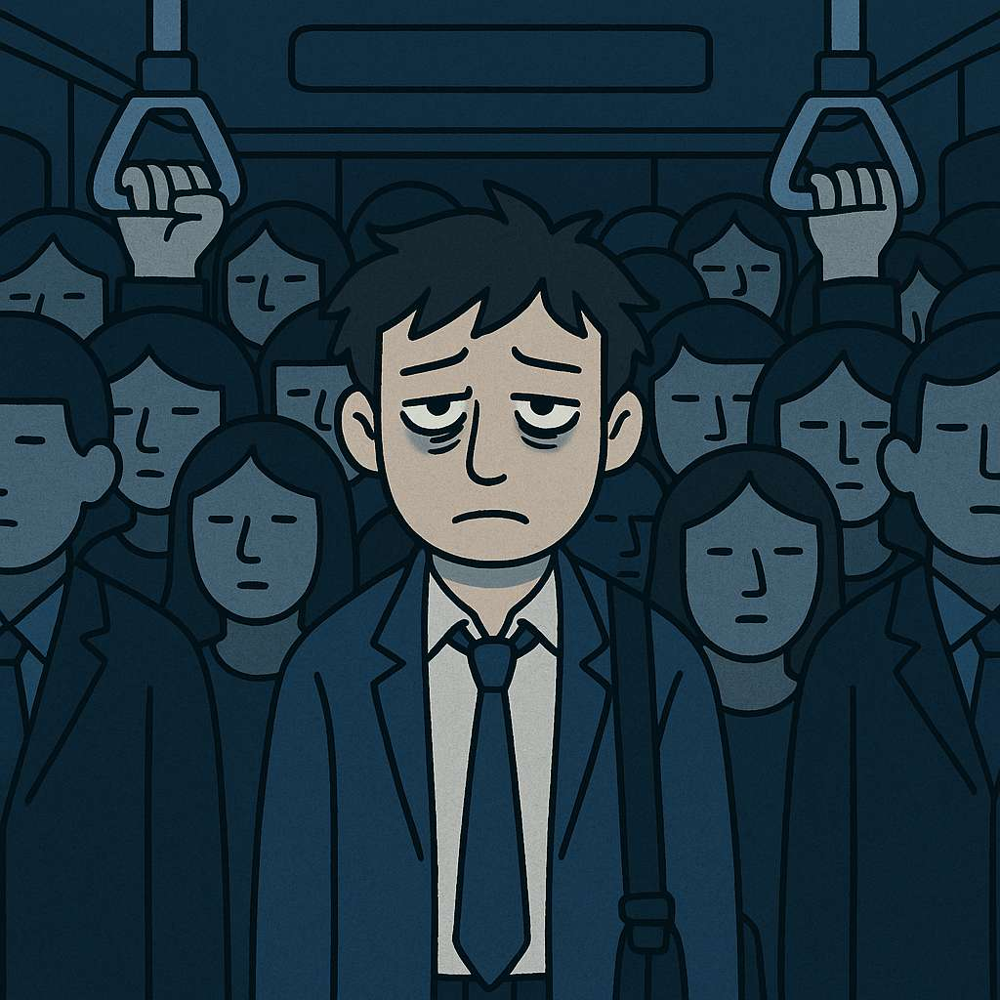
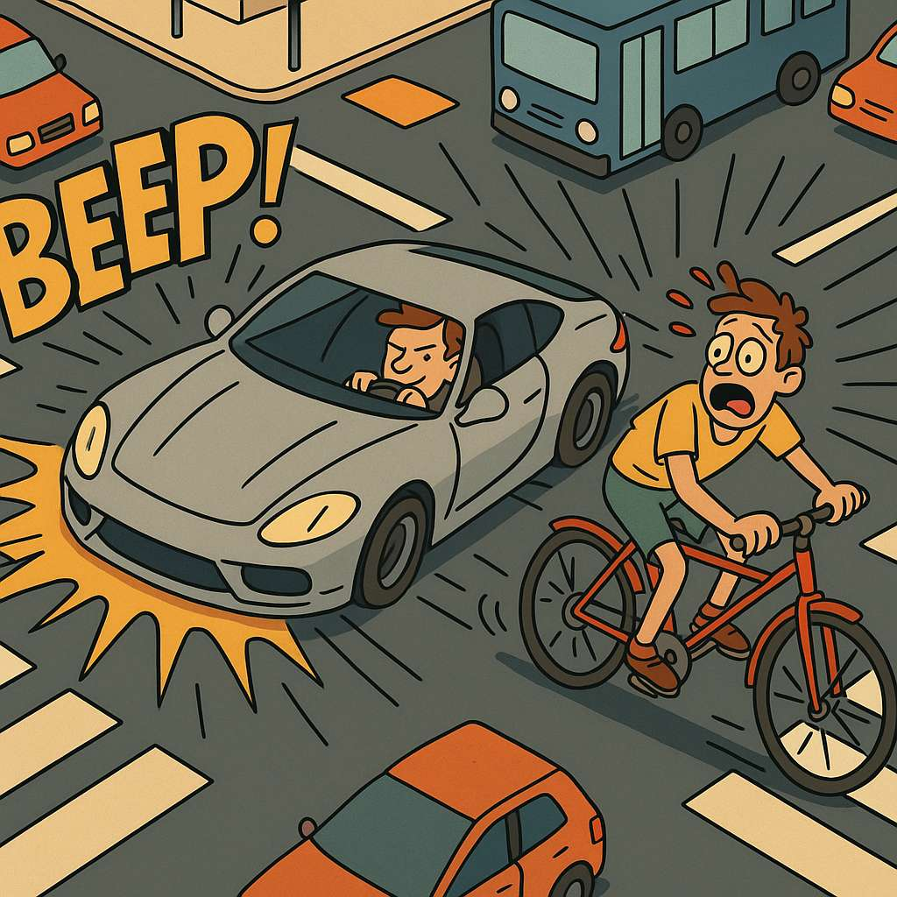
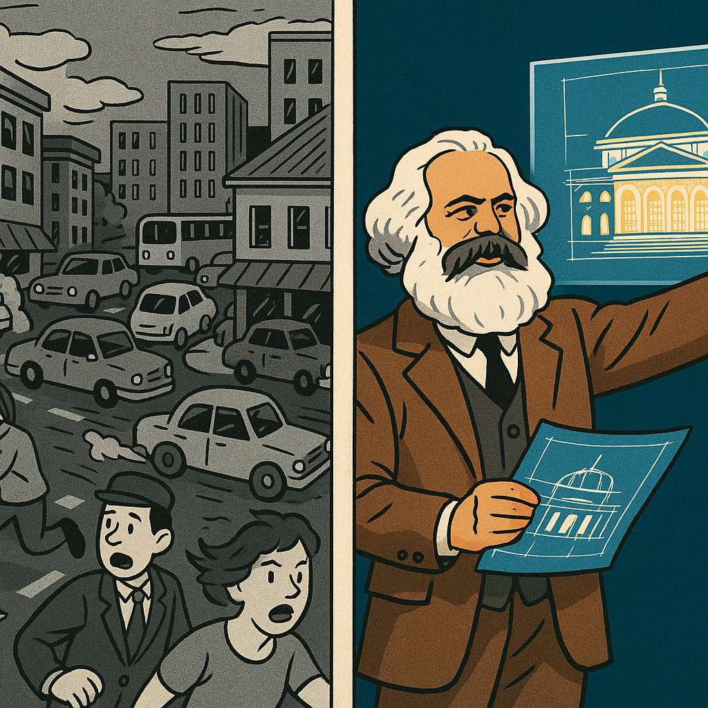
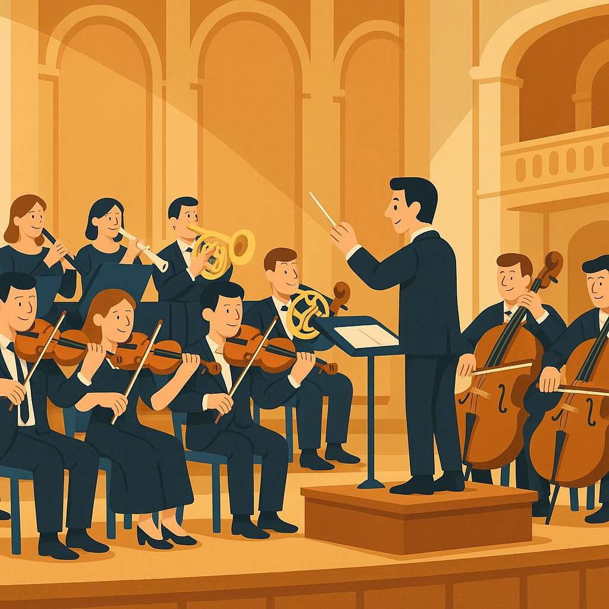
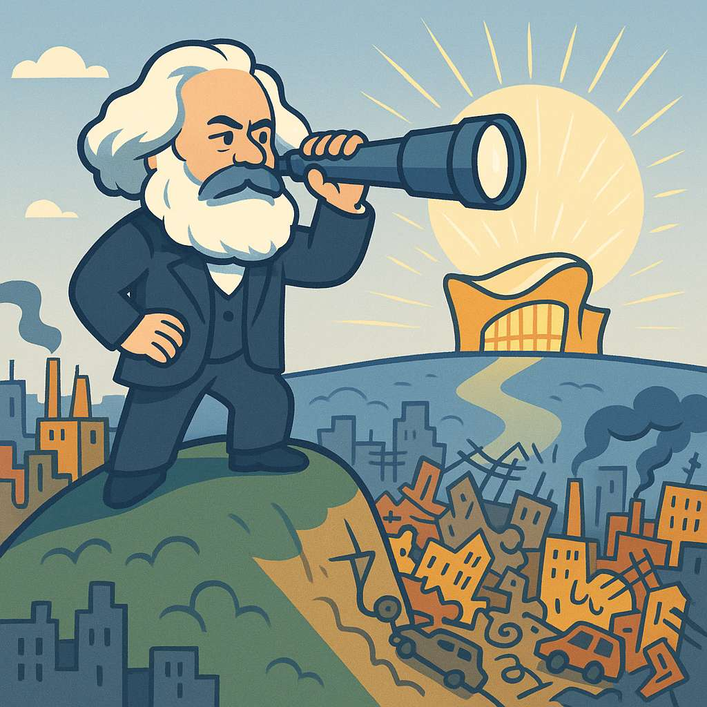
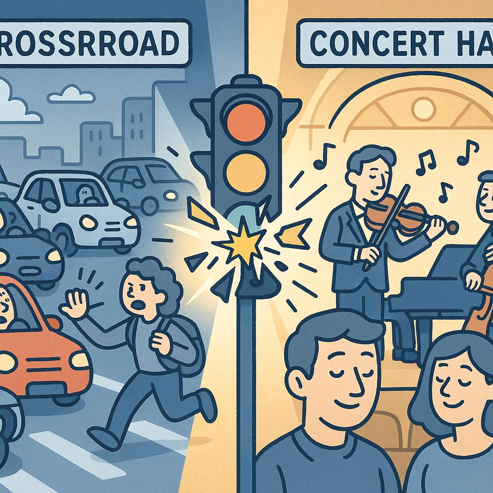

> 旧唯物主义的立脚点是“市民”社会，新唯物主义的立脚点则是人类社会或社会化的人类。
> ——卡尔·马克思《关于费尔巴哈的提纲》

你是否曾有过这样的感觉？在拥挤的地铁里，在深夜的写字楼，在永无止境的竞争与比较中，我们仿佛被困在一个巨大的、无形的系统里。我们努力奔跑，遵守规则，却常常感到身心俱疲，甚至对奔跑的意义本身产生了怀疑。我们听说过“佛系”，也践行过“躺平”，这些看似消极的姿态，背后其实是对这种“困局”最无声也最真实的抗议。

我们所感受到的这种困局，在一百多年前，被一位叫马克思的哲学家精准地命名了。他用了一个看似平淡无奇的词——“市民社会”。

这句话，出自一份堪称哲学史上最“简短精悍”的文本——《关于费尔巴哈的提纲》。它不像“改变世界”那句名言般广为人知，却像一把钥匙，能打开马克思整个思想体系最深处的一扇门。今天，我们就用这把钥匙，开启一场关于“立足点”的思想远航，看看马克思究竟站在何处，眺望着怎样的未来。

## 喧嚣的十字路口 vs. 恢弘的交响乐团

要理解马克思的这句“诊断”，我们必须先构建一个生动的场景。想象一下，我们正身处一个极其庞大、混乱的城市十字路口。

这个十字路口，就是马克思所说的**“市民社会” (Bürgerliche Gesellschaft)** 。

在这里，无数的车辆和行人拥挤在一起。每个人都是一个独立的“市民”——他们有自己的目的地，有自己的驾驶习惯，更重要的是，他们遵循着一个最根本的原则：**以最快速度通过路口，实现自我利益最大化**。

在这个路口：

*   **对抗是常态**：抢道、加塞、鸣笛催促……车辆之间充满了持续的、紧张的对抗。每个人都将他人视为潜在的障碍和竞争对手。
*   **分化是现实**：有的人开着豪华跑车（资产阶级），他们拥有更强的动力和更坚固的外壳，能更容易地挤占空间；有的人骑着快要散架的自行车（无产阶级），在车流中惊险穿行，时刻面临被撞倒的风险。
*   **“利己”是法则**：每个司机都认为，自己的行为是天经地义的。“我不往前挤，别人就会挤我”、“路就这么宽，我不争就没法走”，这种“利己本性”被视作这个路口唯一通行的“人性”。

现在，我们来看看“旧唯物主义”哲学家们在做什么。他们就像一群站在天桥上的交通观察员。他们精准地记录下每一次剐蹭，分析不同车型的通行效率，甚至总结出了一套“路口博弈论”。他们可能会提出建议，比如“请大家文明驾驶”，或者“建议跑车司机适当谦让”，但他们从未想过一件事：**这个十字路口本身的设计，是不是就有问题？**

他们把这个混乱的路口当作了世界的本来面貌，一个永恒的、无法改变的“现实”。这就是马克思所批评的——他们的“立脚点”，就是这个喧嚣混乱的“市民社会”。

而马克思，看的是同一个路口，看到的却不只是眼前的混乱。他相信，这片车流交织的空间本身可以被重新组织——不是靠“文明驾驶”的道德劝告，而是靠拆掉那套让每个人必须抢道才能通过的规则。他给出的，不是另一处地址的蓝图，而是这同一个路口的改造方案：把它，从一个人人自危的十字路口，改建成一座协作演奏的音乐厅。

这座音乐厅，就是马克思所说的 **“人类社会” (Menschliche Gesellschaft)** 。

在这个音乐厅里：

*   **和谐是主题**：舞台上，一支庞大的交响乐团正在演奏。小提琴、大提琴、长笛、圆号……每一种乐器（社会化的个人）都发出独特而优美的声音。
*   **协作是基础**：没有乐器在“对抗”。相反，它们的价值恰恰在于彼此的倾听与配合。小提琴的华彩需要长笛的铺垫，定音鼓的重击为整个乐章赋予力量。每个演奏者的个人技艺，只有在融入集体的合奏中，才能得到最完美的展现。
*   **“社会化”是本质**：他们不再是孤立的“市民”，而是“社会化的人类”。他们的目标不是压倒对方，而是共同创造出一部伟大的作品。指挥家（社会组织）的作用不是统治，而是协调，是为了让整体的和谐达到极致。

马克思告诉我们，他所创立的“新唯物主义”，它的“立脚点”，正是这座代表着未来的音乐厅。

:::block-1
**他拒绝承认那个混乱的十字路口是人类永恒的宿命。他认为，人类的历史，从原始部落到今天的种种社会形态，都只是在为进入这座真正的“音乐厅”做准备的“史前时期”。我们今天的全部历史，都只是在音乐厅外漫长的排队、候场和彩排。**
:::

这一视角的转换意义重大。它意味着，马克思的哲学从一开始就拥有了“未来向度”。

## 未来向度：哲学家的望远镜

传统哲学像一台显微镜，专注于分析当下社会的细胞结构，把它解剖得淋漓尽致。而马克思的哲学，更像一架高倍望远镜，它立足于当下，却始终眺望着遥远的地平线。

拥有“未来向度”意味着什么？

1.  **它不是道德批判，而是历史洞察**：马克思并非站在道德高地上，简单地指责十字路口的司机们“自私、丑陋”。他当然同情那些在车流中挣扎的骑行者，但他的理论根基并非建立在人类的“悲悯之心”上。他是在说：“从交通发展的历史规律看，这种低效、对抗的路口模式，注定会被更高级、更协同的交通系统（比如全自动立体交通网络）所取代。”
2.  **它不是凭空幻想，而是现实推演**：音乐厅的蓝图不是马克思躺在沙发上拍脑袋想出来的。他恰恰是在十字路口的混乱中，看到了音乐厅诞生的可能性。比如，正是因为堵车越来越严重（社会矛盾激化），人们才开始研发更先进的交通技术（生产力发展）。新世界的种子，恰恰是在旧世界的土壤里孕育的。
3.  **它赋予了历史以“目的”**：这个“目的”不是神预设的，而是历史自身运动的方向。这个方向，就是**“人类解放”**。

## 哲学的旨归：从“解放”到“人类解放”

“解放”这个词，我们听过太多。但马克思的“人类解放”，有着极其深刻的内涵。

它不是指某个阶级打败另一个阶级，然后成为新的统治者——那只是换了一批开跑车的人，十字路口依然是那个十字路口。

它也不是指个人实现“财务自由”，从骑自行车换成了开跑车——你只是在这个对抗的体系里爬到了更有利的位置，但体系本身没有丝毫改变，你依然要担心被别的车刮蹭，甚至更害怕跌落回骑车者的行列。

马克思所说的**“人类解放”**，是这个十字路口本身被彻底改建为音乐厅——不是换一批人来抢道，而是抢道这件事本身不再必要。

这是一个让**所有**人都摆脱对抗、分化和异化的过程。在这个最终状态里：
*   跑车司机（资产阶级）不再需要通过占有生产工具来维护自己的优越地位，他们可以作为一名出色的大提琴手，赢得所有人的尊重。
*   自行车手（无产阶级）不再是被支配和剥削的对象，他们可以成为技艺精湛的小提琴家，其价值得到充分的实现。

这是一个“无产阶级只有解放全人类，最后才能解放他自己”的宏大叙事。因为无产阶级的使命，不是让自己成为新的特权阶层，而是要彻底砸碎“十字路口”这个滋生一切特权和对抗的系统，从而让**所有**人——包括旧日的压迫者——都从这种病态的社会关系中解放出来，成为真正“社会化的人类”。

## 结语：你站在哪里，决定了你看到什么

现在，我们再回头看《提纲》中的那句话。

马克思发动这场哲学革命，归根结底，是为了完成一次“立足点”的迁跃。他邀请我们，不要再把自己当成一个被困在十字路口的、无助而愤怒的司机，仅仅思考如何更好地“抢道”。

他递给我们一架望远镜，让我们站到城市规划师的高度，去看到那个混乱路口的历史暂时性和被超越的可能性。他让我们相信，那座宏伟的音乐厅，那个真正属于“人类”的社会，并非虚无缥缈的幻想，而是我们脚下这条历史道路的延伸。

这个立场的转变，本身就是一种解放。它让我们从对现实的抱怨，转向对未来的构想和实践——从琢磨怎么在这个路口多抢一米，变成琢磨这个路口本身该怎么拆。

