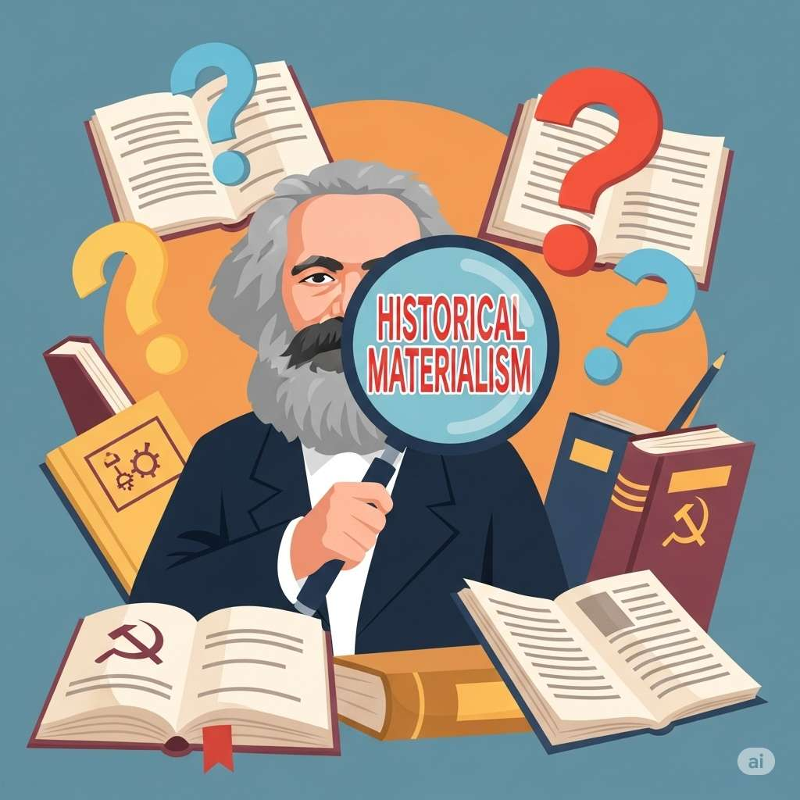

## 引言：一句被念歪了的口诀

一提到“历史唯物主义”，你可能马上想到教科书上那句绕口令：“经济基础决定上层建筑”。听起来就像是说“只有吃饱饭了，才有心思搞文艺”。这么想，可就小看马克思了。

其实，历史唯物主义更像一面“照妖镜”：它照的不是鬼怪，而是那些平时躲在规则、道德、常识背后，不肯露面的权力关系。

它的核心就两个字：**权力**。

## 一切的关键：那个看不见的“权力”

这里的“权力”，不是指市长、总统手里的公章，而是一种更底层、更“霸道”的力量。它藏在我们每天的柴米油盐里。

想象一个场景：一屋子人都饿着肚子，兜里一分钱没有，只有你带着满满一钱包的现金。

这时候，你不需要发号施令，也不需要制定任何规则，你就自动拥有了一种力量——能让别人为你干活、听你安排的力量。因为别人为了吃饭，会主动来问你：“老板，有什么需要帮忙的吗？”

这种不需要讲大道理，你就能直接感觉到的力量，就是最原始的**社会权力**。它在不同时代有不同的“马甲”：

* 在古代，它是奴隶主拴在奴隶脖子上的链子。
* 在旧社会，它是地主手里的地契，农民不得不为他种地。
* 在今天，它化身成了“资本”——一种能购买别人时间和劳动的力量。

这个看不见的权力关系，就是马克思说的**“经济基础”**。它不是指社会上有多少钱，而是指这种“谁能让谁干活”的底层游戏规则。

## 给“权力”穿上一件叫“权利”的外衣

理解了上面这一点，“经济基础决定上层建筑”就好懂了。

这个赤裸裸的、有点野蛮的权力（经济基础），总得包装一下才好看，对吧？它需要一件“合法”又“文明”的外衣。

这件外衣，就是**法律、制度和大家普遍接受的道理（上层建筑）**。

所以，这句话的真正意思是：社会底层的权力游戏规则（经济基础），决定了我们需要什么样的法律和道德（上层建筑）来让这个游戏显得公平合理。

这就像是给权力穿衣服的过程。权力本身是直接的，但当法律给它起了个名字叫“私有财产权神圣不可侵犯”时，它就从“霸道”变得“文明”了。

拿面包师来说，手里有余粮，是他能等、别人等不起；雇佣合同写的是报酬和义务。两张纸面相同的合同，背后的选择余地可能很不一样。[《面包的寓言》](面包的寓言/01-为什么我要写“面包的寓言”.md)把这件事讲成了三幕故事。这是看合同的一个角度，不是说所有权利都是伪装。

## 这面镜子，照得到自然科学吗？

你可能觉得，这套理论解释社会还行，总不能连自然科学也管得着吧？

能不能用它问科学史的问题？可以试，但要换一把证据的尺。比如，为什么在近代早期，精确计量运动会成为一些研究者特别在意的事？

比一比两个动作：工匠记录做桌子用了几个钟头，研究者记录物体走过一段距离用了多长时间。时间在两处都成了可以比较的尺度。社会中越来越受重视的计量习惯，会不会也影响了研究者选择什么问题？这是一个科学史假设。

要把它落实到伽利略，就得找他接触了哪些测量实践、怎样讨论自己的推理。前面那一钱包现金说明谁能支配劳动，并不能证明某个思想实验为什么诞生。

## 小结

所以，历史唯物主义远不是一句干巴巴的口号。它是一面照妖镜，教会我们两件事：

1.  **扒开外衣看本质**：在法律、道德这些“外衣”背后，看清那个真正说了算的、沉默的“权力”关系。
2.  **追问变化的条件**：一种新的社会需要，可能让旧问题重新进入视野；它不能替代关于具体思想和发现的历史证据。

规则、道德、乃至一门学科看待世界的方式，都可能只是权力照进镜子里的影子。下一次再看到一条“天经地义”的规矩，不妨把镜子举起来，照一照它背后到底站着谁。

