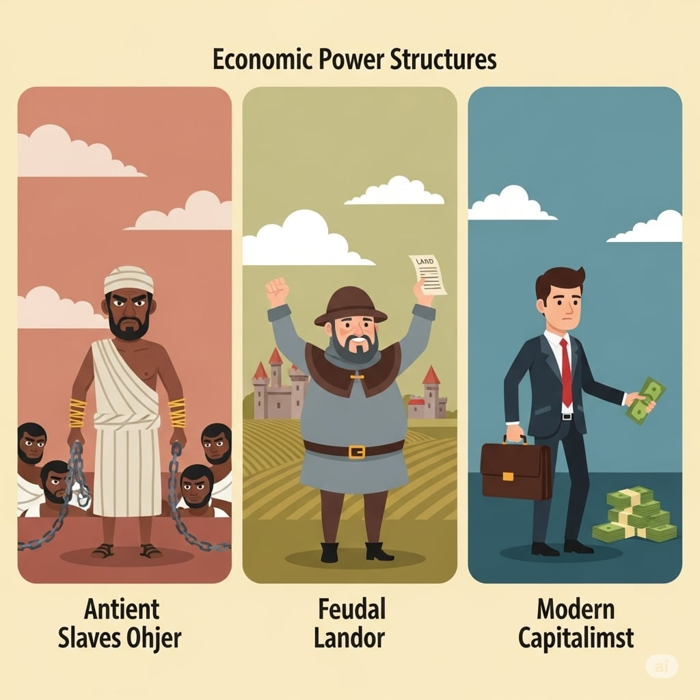

## 引言：一句被念歪了的口诀

一提到“历史唯物主义”，你可能马上想到教科书上那句绕口令：“经济基础决定上层建筑”。听起来就像是说“只有吃饱饭了，才有心思搞文艺”。这么想，可就小看马克思了。

其实，历史唯物主义更像一面“照妖镜”：它照的不是鬼怪，而是那些平时躲在规则、道德、常识背后，不肯露面的权力关系。

它的核心就两个字：**权力**。

## 一切的关键：那个看不见的“权力”

这里的“权力”，不是指市长、总统手里的公章，而是一种更底层、更“霸道”的力量。它藏在我们每天的柴米油盐里。

想象一个场景：一屋子人都饿着肚子，兜里一分钱没有，只有你带着满满一钱包的现金。

这时候，你不需要发号施令，也不需要制定任何规则，你就自动拥有了一种力量——能让别人为你干活、听你安排的力量。因为别人为了吃饭，会主动来问你：“老板，有什么需要帮忙的吗？”

这种不需要讲大道理，你就能直接感觉到的力量，就是最原始的**社会权力**。它在不同时代有不同的“马甲”：

* 在古代，它是奴隶主拴在奴隶脖子上的链子。
* 在旧社会，它是地主手里的地契，农民不得不为他种地。
* 在今天，它化身成了“资本”——一种能购买别人时间和劳动的力量。

这个看不见的权力关系，就是马克思说的**“经济基础”**。它不是指社会上有多少钱，而是指这种“谁能让谁干活”的底层游戏规则。

## 给“权力”穿上一件叫“权利”的外衣

理解了上面这一点，“经济基础决定上层建筑”就好懂了。

这个赤裸裸的、有点野蛮的权力（经济基础），总得包装一下才好看，对吧？它需要一件“合法”又“文明”的外衣。

这件外衣，就是**法律、制度和大家普遍接受的道理（上层建筑）**。

所以，这句话的真正意思是：社会底层的权力游戏规则（经济基础），决定了我们需要什么样的法律和道德（上层建筑）来让这个游戏显得公平合理。

这就像是给权力穿衣服的过程。权力本身是直接的，但当法律给它起了个名字叫“私有财产权神圣不可侵犯”时，它就从“霸道”变得“文明”了。

最经典的例子就是“投机倒把”。几十年前，这可是个贬义词，是不被允许的。但它背后代表的“钱说了算”的力量是真实存在的。后来，当国家承认了这种力量的价值时，“投机倒把”就穿上了一件漂亮的新外衣，改名叫“搞活经济”。

看到了吗？从“权力”变成“权利”，就是上层建筑为已经存在的经济基础“正名”和“打补丁”的过程。这套“给权力找一件合身外衣”的机制，接下来的“面包的寓言”系列会用一个更具体的故事讲透：一个面包师，怎样把自己对流浪汉的支配力，缝进一部叫《劳动雇佣法案》的“契约”里。

## 这面镜子，照得到自然科学吗？

你可能觉得，这套理论解释社会还行，总不能连自然科学也管得着吧？

还真能。历史唯物主义认为，不存在什么“绝对中立”的科学。我们怎么看待世界，取决于我们怎么生活。

比如，古希腊那么多聪明绝顶的哲学家，为什么没人发现“力是改变物体运动状态的原因”（牛顿定律的核心），非要等到一千多年后的伽利略？

答案不在于智商，而在于**社会的主流思维模式**。

* **古希腊是手工业社会**，像个巨大的手工作坊。大家看重的是每个东西的独特性和差异。比如“这把椅子是橡木的，手感温润”，“那个陶罐造型很优美”。
* **伽利略身处资本主义萌芽期**，社会越来越像个大工厂。工厂为了效率和交易，必须把所有不同的劳动都简化成一个标准：**时间**。比如“造这张桌子花了10小时，那把椅子花了5小时”。一切都被换算成了可以计算的、冷冰冰的数字。

当整个社会都在用这种“算数”的眼光看世界时，科学家自然也会拿起“数学”这个最厉害的算数工具去研究自然。他们不再满足于“感受”世界，而是要“计算”和“预测”世界。伽利略著名的思想实验，正是在这种“万物皆可量化”的新思维下诞生的。

## 小结

所以，历史唯物主义远不是一句干巴巴的口号。它是一面照妖镜，教会我们两件事：

1.  **扒开外衣看本质**：在法律、道德这些“外衣”背后，看清那个真正说了算的、沉默的“权力”关系。
2.  **找到变化的根源**：明白社会、思想甚至科学的变革，根子上都是因为底层的“权力”游戏规则变了。

规则、道德、乃至一门学科看待世界的方式，都可能只是权力照进镜子里的影子。下一次再看到一条“天经地义”的规矩，不妨把镜子举起来，照一照它背后到底站着谁。

