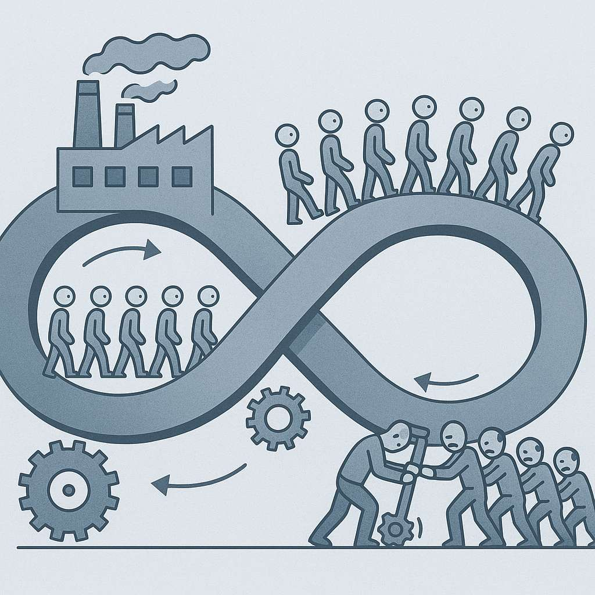
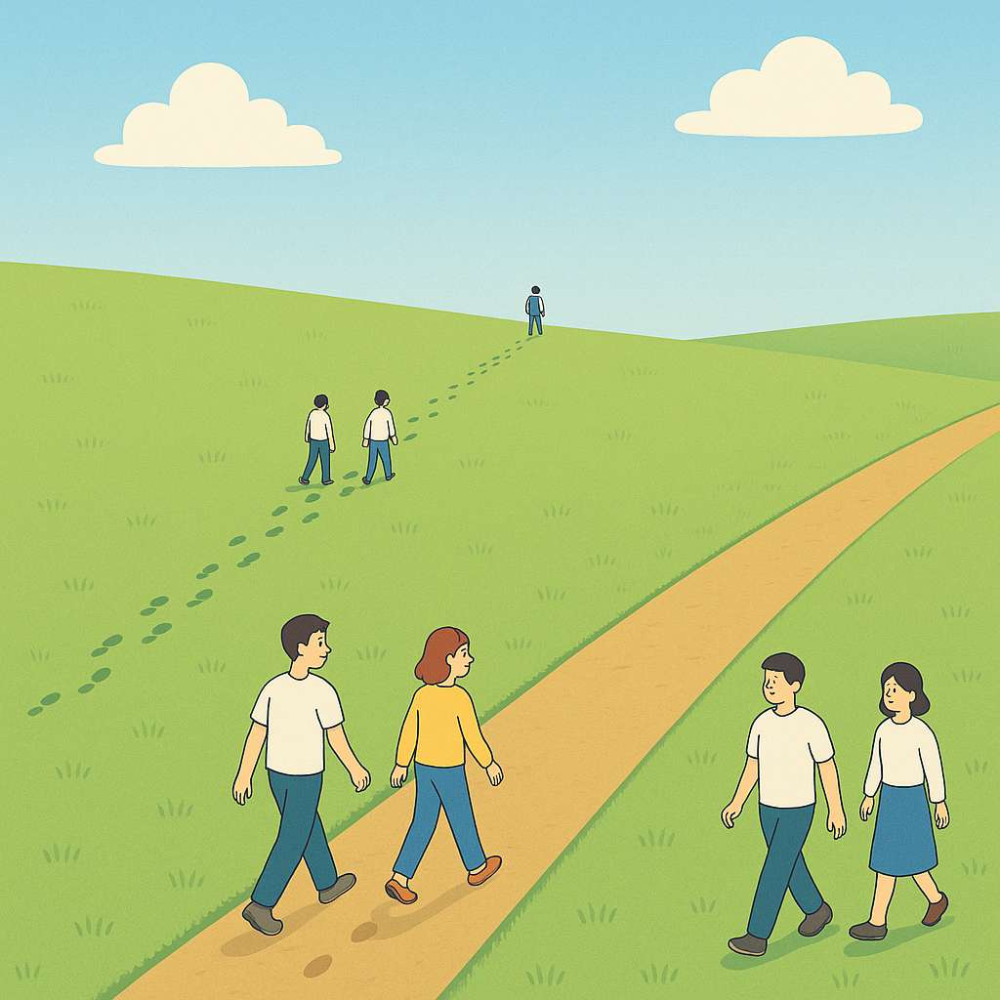
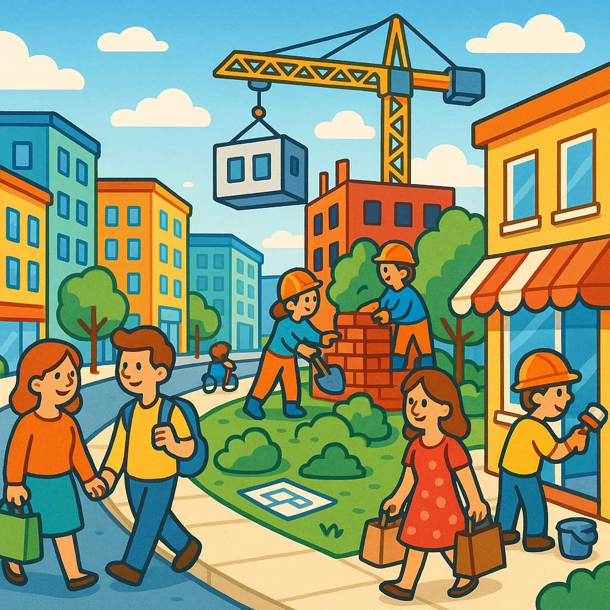
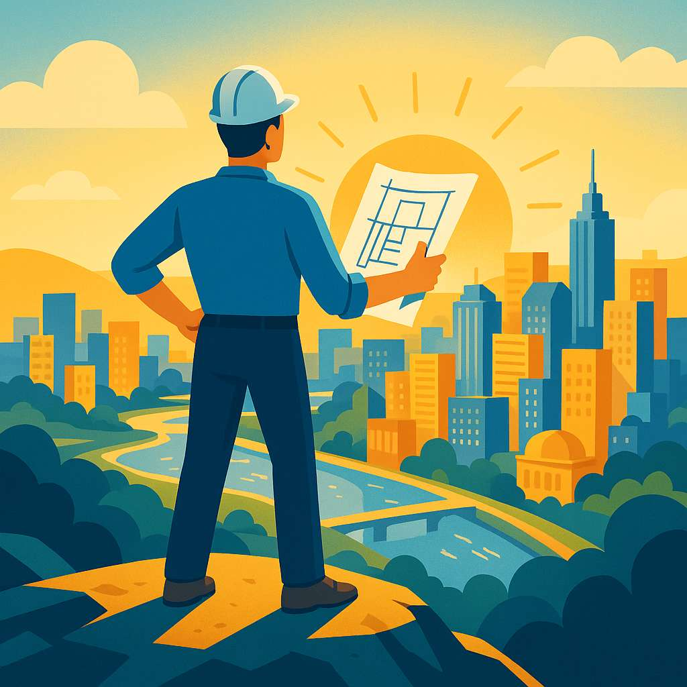

朋友，你有没有过这样的瞬间？

看着家里跟你“代沟”巨大的孩子，或者刷着手机里00后创造的、你已经完全看不懂的“梗”，你会不会冒出一个念头：**“这世界变化也太快了，我们跟他们，活得根本不像一个时代的人。”**

我们很自然地会把原因归结为：**环境变了，教育也变了。**

> 我们小时候读革命故事，他们从小看互联网；我们听着父母的教诲长大，他们跟着“社会”这个更大的老师学习。

这个解释听起来天衣无缝，对吧？人嘛，不就是环境和教育的产物吗？

但请等一下。这个看似无解的循环，其实触及了一个最根本的问题：我们应当持有怎样的**历史观**，才能真正理解我们与世界、与过去和未来的关系？

今天，我们就来深入聊聊这个关乎我们每一个人的难题。

## **第一章：“环境决定你”——一个看似完美的答案和它的死循环**

曾有哲学家提出一个在当时非常进步的观点：“人是环境和教育的产物。”

这话简直说到了大家的心坎里。

它就像一把钥匙，解释了为什么不同时代、不同地方的人会有那么大的差别。为什么生在改革开放后80、90、00后，他们的世界观、价值观，跟经历过集体主义年代的50、60后截然不同。

因为他们成长的社会环境不一样，接受的教育内容也天差地别。

这套“唯物主义”的说法，听起来比“君权神授”或者“天才论”靠谱多了。

然而，这个看似完美的逻辑，只要你轻轻一推，就会发现一个巨大的死循环。

> 好，我们承认人是环境的产物。但环境本身不是一成不变的吧？今天的社会环境是哪来的？是昨天的环境自己“进化”来的吗？显然不是，**环境恰恰是人改变的。**
>
> 同样，我们是教育的产物。但老师（教育者）也不是石头里蹦出来的，他成为教育者之前，也必须先接受教育。

你看，一个完美的闭环形成了：

**人被环境决定 → 环境又被人改变 → 改变环境的人又被更早的环境决定……**

这就像一个“先有鸡还是先有蛋”的哲学难题。如果我们坚持这种旧的、机械的**历史观**，社会就必然会被分成两部分：

  * **一小撮“超凡之人”**：他们站在社会之上，像上帝一样，负责设计和改变环境，教育大众。比如空想家罗伯特·欧文，他觉得自己掌握了真理，想凭一己之力在自己的工厂里搞一个“人间天堂”。
  * **绝大多数“凡人”**：我们就像温室里的花朵，被动地接受着环境和教育的塑造。

这不又绕回了英雄创造历史的精英史观吗？难道社会的进步，就是等着几个天才降临，给我们颁布新的“游戏规则”？显然不是。那么，这个死循环的出口到底在哪？

## **第二章：从脚下的路，到亲手建造的城市**

答案，藏在一个我们都见过的场景里：**草地上的路**。

想象一片刚刚解冻的、无垠的草地。最初，没有路，只有方向。第一个跋涉而过的人，他的脚步是自由的，也是盲目的，他踩下的一串脚印，是第一份关于“可行性”的报告。

当第二个人、第三个人出现时，他们看到了这串脚印。沿着它走，显然比在及膝的乱草中挣扎要轻松。这是一种理性的选择，也是一种无意识的追随。此刻，他们确实是“环境”的产物，他们的行为，被前人留下的痕迹所引导。

然而，真正的变化发生在他们迈出的每一步中。他们的每一次行走，都在加深、拓宽、夯实着这条最初的痕迹。日复一日，当这条痕迹从“似乎可走”变成“最好走”，再变成“唯一能走”的坚实土路时，它便从一个“建议”升级为一种“规则”。这条“路”，就是我们的社会规范、风俗习惯、乃至制度本身——不是由某个神祇或英雄一夜之间铺就的，而是无数人、无数次“行走”的集体无意识的结晶。

所以，“环境的改变”和“人的活动”从来不是因果，而是**一个硬币的两面**。这个洞察力，正是一种**革命性的历史观**的核心：我们既是行路人，更是开路者。

把这个道理放大到整个文明的尺度，无数条路纵横交错，最终会长成一座**城市**。我们每个人，都出生在这座名为“人类文明”的城市里。我们一睁眼，就看到了它的样貌：古老的神殿（传统与信仰）、威严的市政厅（政治与法律）、四通八达的街道（社会规范）、车水马龙的市集（经济活动），甚至还有那些阴暗潮湿的角落（社会问题）。这座城市的格局规定了我们的生活：我们走在它铺好的街道上，住在它建成的房屋里，遵守它颁布的法典。

但我们绝不仅仅是居民，我们同时也是这座城市的建筑工、设计师、甚至是拆迁队。当一个商贩在街角支起第一个摊位，并吸引了更多商贩聚集时，一条新的商业街就在“无意识”中诞生了。当一群居民无法忍受社区的脏乱，自发组织起来清扫、种花时，一个衰败的角落就开始被重新激活。当我们中的一些人，勇敢地指出某条法律的不公并推动其修改时，我们就在重塑这座城市的秩序。

人类社会与动物世界的根本区别，也在这里显现出来。一只海狸，会按照基因的指令建造一座堤坝，但它永远只会建造那一模一样的堤坝——海狸们不会召开“规划会议”，讨论要不要拆掉旧坝、建一座新样式的水坝。而人类的城市，永远是一个未完工的工地，它的伟大恰恰在于永远“未完成”：我们的每一次生产、每一次消费、每一次创造、每一次抗争，都是在为这座城市添上一砖一瓦，或者，拆掉一堵危墙。

## **结语：你是这座城市的居民，更是它的建筑师**

现在，让我们回到最初的问题。当你为生活中的“规则”所困，为“内卷”的洪流感到窒息时，请想起那条草地上的小路和那座我们亲手建造的城市。

那个让你感到无力的“系统”，并不是一个遥远的、冰冷的钢铁利维坦。它就是那条被我们和无数前人、同代人，用日复一日的脚步踩出来的、最拥挤的“主干道”。它之所以如此难以偏离，正是因为它是由我们的集体选择所铺就的。

理解了这一点，我们就握住了一份最根本的力量与责任。

这意味着，你永远有选择。你可以继续在最拥挤的道路上随波逐流，让它变得更加坚固；你也可以在与你志同道合的邻居的共同努力下，试着在社区里开辟出一片新的绿地，修复一段破损的台阶。

当然，这份“建筑权”从不是平均分配的。有人手握图纸和资本，能一夜之间推倒一整片街区；多数人一辈子只能在自家门口挪动一块砖。历史观告诉我们人人都在参与建造，却没有说这份参与是对等的——这份不对等本身，也是历史活动的产物，需要另外去解释。

我们不必等待某个“天才建筑师”来拯救我们。因为**这座城市的命运，就掌握在每一位“居民”的手中。**

你是谁？你不仅仅是被这座城市所塑造的居民。你的每一次呼吸、每一次行动、每一个决定，都是在参与它的建造。

你，就是这座城市的建筑师。

-----

## **思想的源头**

本文所有关于“环境”与“人”的探讨，其思想的火花，都源于**马克思主义哲学历史观**的奠基性文本——卡尔·马克思在1845年写下的《关于费尔巴哈的提纲》中的第三条。这则短小精悍的笔记，是人类思想史上一次深刻的革命。其原文如下：

> “有一种唯物主义学说，认为人是环境和教育的产物，因而认为改变了的人是另一种环境和改变了的教育的产物，——这种学说忘记了：环境正是由人来改变的，而教育者本人一定是受教育的。因此，这种学说必然会把社会分成两部分，其中一部分高于社会之上。
>
> **环境的改变和人的活动的一致，只能被看作是并合理的理解为革命的实践。**”

这段文字的上半部分，精准地指出了旧唯物主义理论的“死循环”。而其精华，则在最后那句结论——“环境的改变和人的活动的一致”，说的就是前文那条路、那座城市：改变世界和改变我们自己，不是两件事，而是同一场实践的两个侧面。

而“革命的实践”，在这里并非狭义地指暴力冲突。它指的是一切能够从根本上改变社会“游戏规则”的人类活动。每一次对不合理规范的挑战，每一次创造性的劳动，每一次推动制度的革新，都是一次“革命的实践”。

