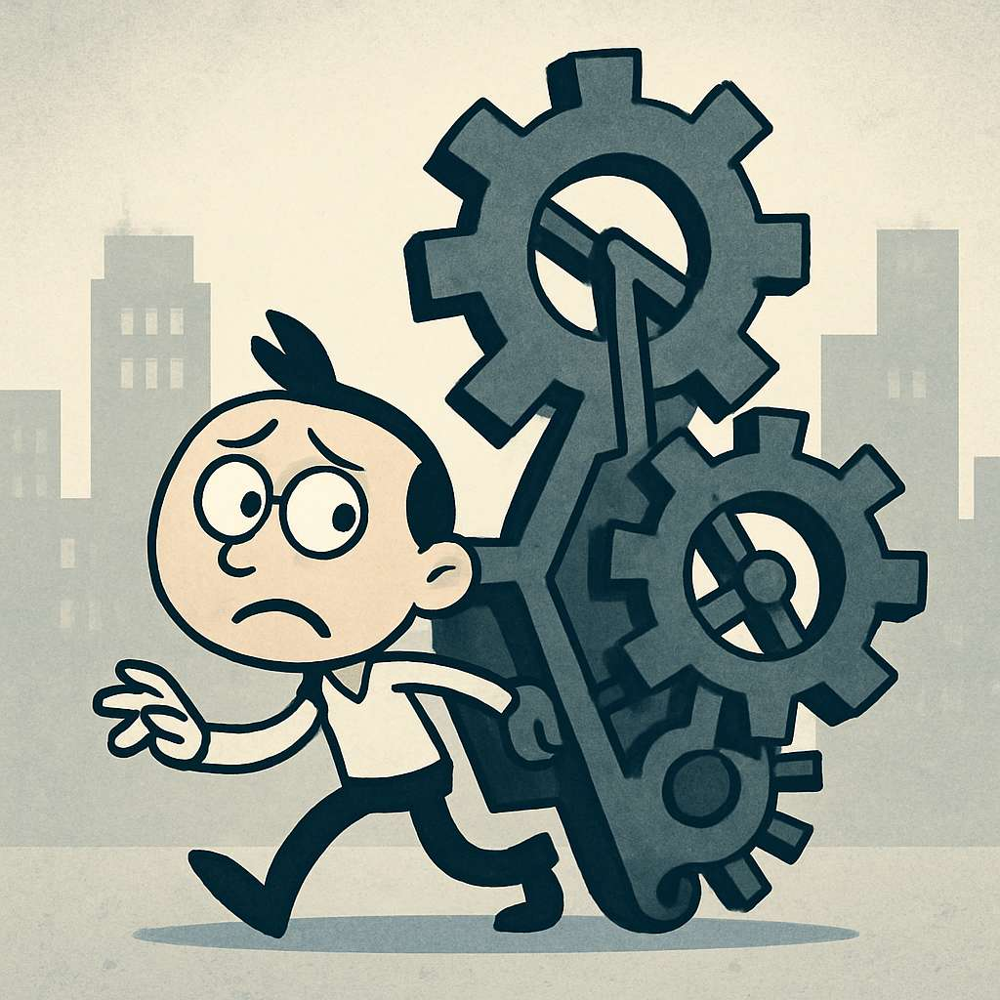
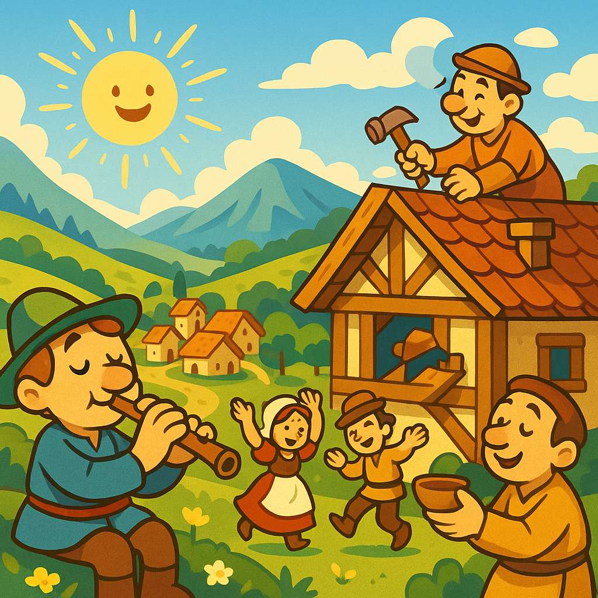
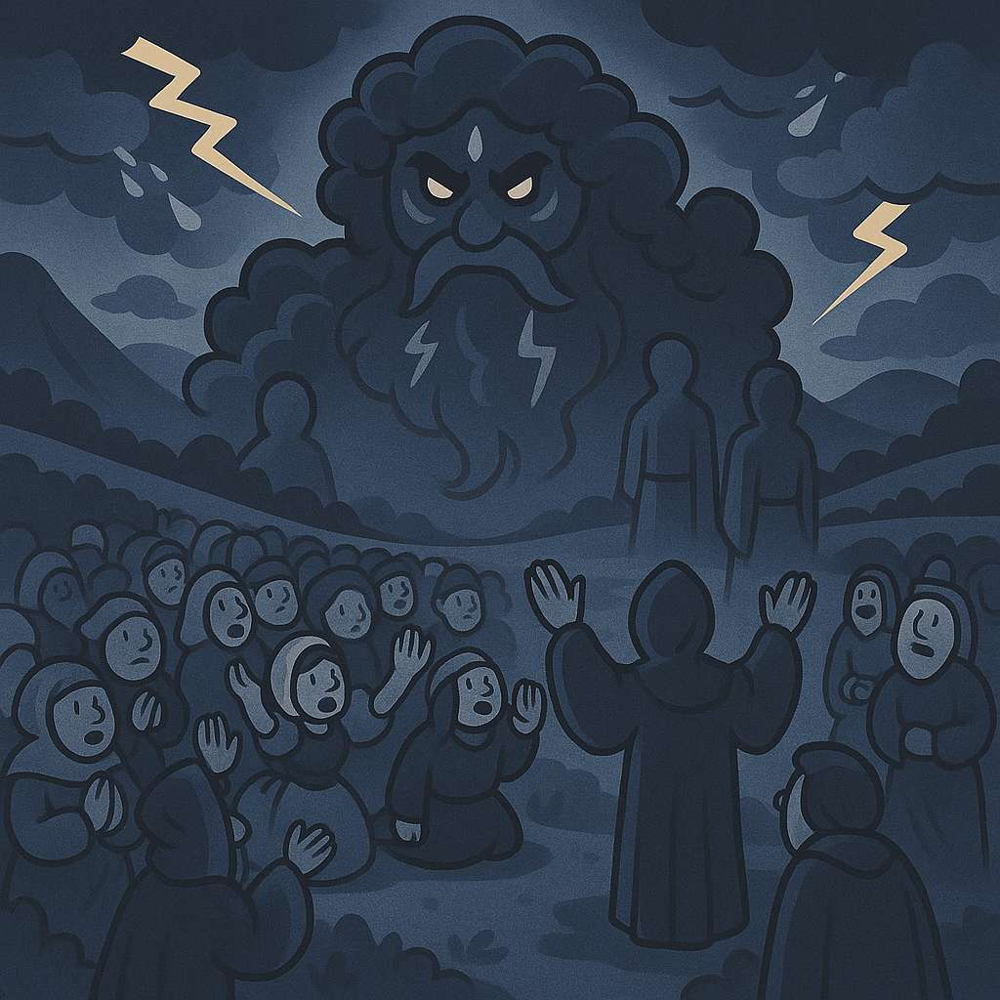
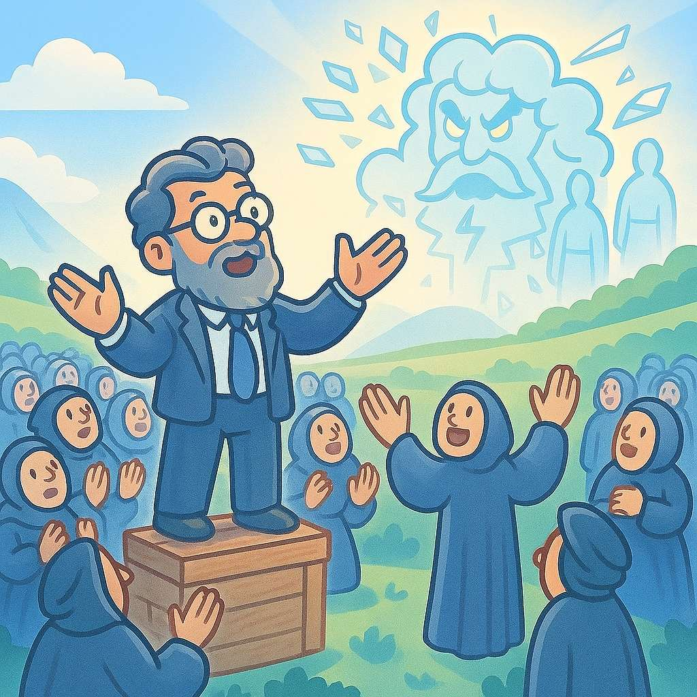
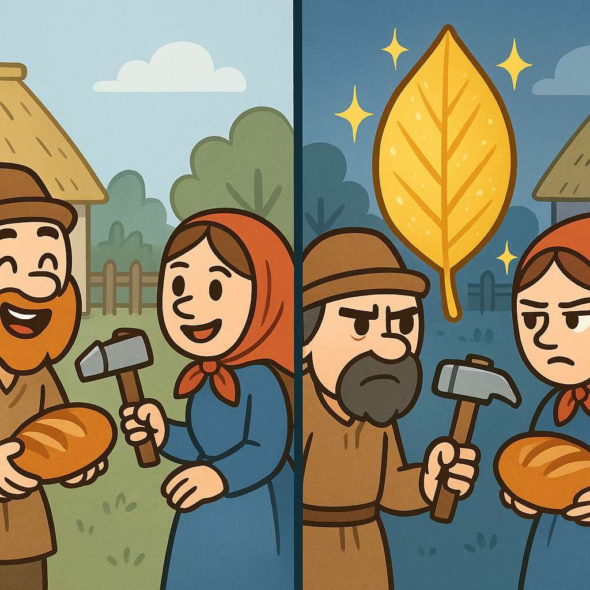
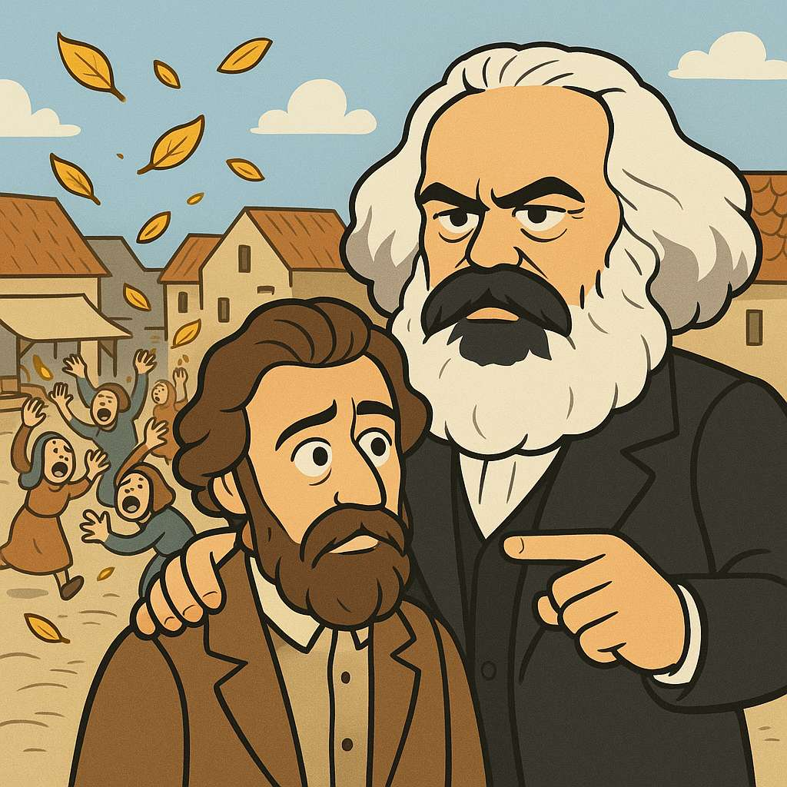
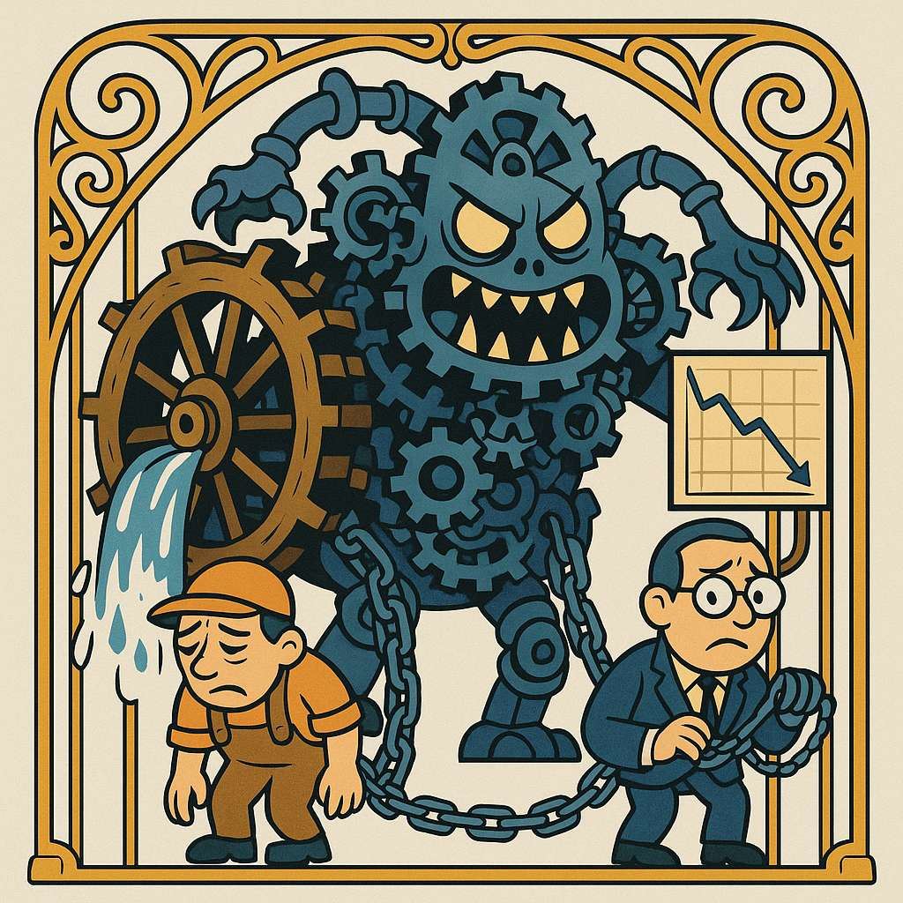
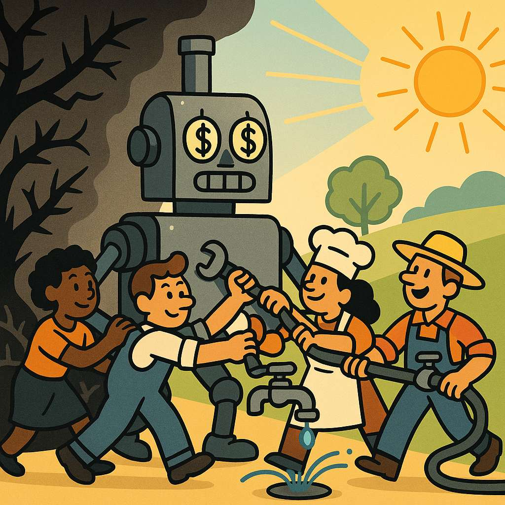

## **引言**

你是否曾有过这样的困惑：

我们身处一个物质空前丰裕的时代，许多人的内心却愈发感到空虚和焦虑？为什么我们明明是社会的主人，每天辛勤地创造着财富与文化，到头来，却感觉自己像一个身不由己的齿轮，被一个看不见的巨大机器推着走？**我们追逐着更高的职位、更丰厚的薪水，可当真正得到时，却发现并未获得想象中的自由，反而被更沉重的责任和更无休止的竞争所捆绑。**

这背后的根源究竟是什么？

不妨让我们抛开复杂深奥的理论，走进一个山谷里的村庄。从一个关于“我们”自己的寓言开始，来探寻那股让我们感到既熟悉又陌生的力量——**“异化”**。

## **第一幕：和谐的山谷**

在群山的怀抱中，坐落着一个充满活力的村庄。这里的村民们过着一种朴素而完整的“感性生活”——他们的存在，不只是为了吃饭睡觉的“肉体存在”，更是充满了人与人之间温情交往的社会与文化存在。他们共同拥有一种神奇的力量，我们称之为**“类力量”**——也就是作为人类这个集体，他们所能共同创造出的一切美好事物。

*   **村里的音乐家**，他存在的意义，就是在傍晚时分，坐在大榕树下吹起笛子。他的乐声是村庄生活的一部分，能让疲惫的农夫舒展眉头，能让相爱的青年翩翩起舞。他从不计较报酬，因为村民们发自内心的笑容、分享给他的一块烤肉，以及他在音乐中感受到的那种与众人心灵相通的快乐，就是对他劳动最直接、最丰厚的回报。
*   **技艺精湛的老木匠**，他最大的骄傲，是村里每一户人家的屋顶都由他亲手加固，能抵御最狂暴的风雨。他看到邻居家的摇篮坏了，会不待人言，主动拿去修好。他感受到的，是自己被整个村庄所“需要”的价值感。作为回报，邻居会在孩子满月时，请他喝上一碗最甜的米酒。

在这个阶段的村庄里，人与人的关系是直接、透明的。**“彼此需要”**是连接每个人的坚实纽带，他们共同创造，也共同直接地享用着自己的“类力量”。木匠在摇篮里看到了自己的手艺，音乐家在村民的舞步中听到了自己的旋律。在这里，**劳动不是谋生的负担，而是实现自我价值、与他人建立情感连接的方式。**

## **第二幕：山谷之神与第一次解放**

然而，这份和谐并非无忧无虑。在这片看似宁静的土地上，村民们同样要面对他们无法掌控的巨大力量——那便是变幻莫测的**自然**。一场突如其来的暴雨可能冲毁田地，一场干旱可能让河床干裂，一场瘟疫可能悄无声息地带走亲人。

面对这些源于自然的、不可抗拒的伟力，村民们心中充满了敬畏与恐惧。为了寻求秩序与慰藉，他们将对自然的恐惧与对生存的期望，共同投射成了一位超然的守护者——**“山谷之神”**。村里的长老和祭司们，则成为了神的代言人，他们解释神的旨意，掌管着与神沟通的仪式。

于是，一种古老的、基于**自然压迫**和**社会等级**的精神枷锁形成了。神的意志，常常与村庄的统治秩序融为一体，不可违抗。村民们虽然虔诚，但在内心深处，也感到一种被无形的神权和森严的等级所束缚的压抑。他们觉得自己生来渺小，命运必须由神和它的代言人来安排。

终于有一天，一位曾在外界学习的年轻人（我们的费尔巴哈）回到了村庄。他目睹了村民们在神权下的自我贬低和思想禁锢，内心燃起了一团火焰。他站在村庄的广场上，面对着所有村民，发出了这样的呼喊：

“朋友们，我们世世代代跪拜的神，真的是外在于我们的存在吗？你们想一想，我们赋予神的全知全能、至善至美，不正是我们人类自身最美好的理想和品质吗？我们只是把自己最精华的力量、最深沉的爱、最光辉的理性，从自己身上剥离出去，投射到天上，创造出一个完美的影子，反过来又跪拜它。**人的本质，不应该去天国寻找，它就在我们自己身上！**”

这番话语如同一道闪电，劈开了村民们思想的牢笼。他们恍然大悟，意识到所谓的“神”，不过是他们自己力量的异化。这次深刻的思想解放，极大地唤醒了人的主体性和创造力，打破了旧有的等级观念。**村民们感到前所未有的自由和振奋**，他们相信，一个真正由“人”自己做主的新时代即将来临。

## **第三幕：新的牢笼——闪亮的“金叶子”**

正当村民们庆祝着从神权下解放、热情拥抱“理性”与“自我”时，一种新事物以“进步”和“便利”的名义，悄然在村庄里流行起来——那就是一位商人带来的“金叶子”（**货币**）。

**摆脱了旧思想束缚的村民们，认为这是一种纯粹理性的工具，能高效地解决物物交换的难题，便欣然接受了它。**但他们没有意识到，一双新的、更加无形的枷锁正在被戴上。这种改变是潜移默化的，却比旧的枷锁更加致命：

*   **人情味淡了：** 过去温暖的互助，被冰冷的计算所取代。木匠帮邻居修摇篮不再是收获一碗甜酒和感激，而是要盘算这活儿“值”几枚金叶子。
*   **焦虑感来了：** 过去的安全感来自于社群的联结和自己的手艺，现在变成了对金叶子数量的渴望。没有金叶子，就换不来食物和工具，一种前所未有的生存焦虑，开始啃噬人心。
*   **掌控感没了：** 村民们惊讶地发现，他们虽然不再被神和祭司所奴役，却开始被另一种他们自己创造的力量所奴役——那就是“金叶子”的流向和它背后那“让钱生钱”的无情法则。

此时，另一位更深邃的观察者（我们的马克思）来到了村庄。他看着那些刚刚获得思想解放、却在现实中日益焦虑和分裂的村民，对那位年轻的解放者（费尔巴哈）的思想，给予了崇高的敬意和深刻的补充：

“我的朋友，你完成了一项伟大的事业！”他诚恳地说道，“你将人从天国的幻觉中拉回了人间，让人重新发现了自己的尊严和力量。这是一个决定性的进步，你出色地完成了对**宗教异化**的批判。”

他顿了顿，然后指向人来人往、金叶子不断流转的集市，用一种更沉重的语气继续说道：

“但是，你的工作只完成了一半。你没有看到，当我们把目光从天上收回来之后，这个人间的现实本身，正在产生一种**新的、更深刻的异化**。你把人从祭司的锁链中解放出来，他却转身走进了市场的牢笼。你以为人自由了，但他只是从一种奴役换成了另一种奴役。天上的谜案解决了，但地上的谜案才刚刚开始，这个谜案的核心，就叫‘资本’！”

## **第四幕：怪物成年——华丽的牢笼**

马克思的预言，不幸地成为了现实。那个由“金叶子”所代表的法则，迅速成长为一头名为**资本**的巨兽。

手握大量金叶子的村民，为了让金叶子生出更多的金叶子，联合投资建造了效率惊人的水力磨坊。资本，这头怪物，正式成年。它用前所未有的物质进步，为村庄里的每一个人，都打造了一座看似富足、实则无法逃脱的华丽牢笼。

*   **失去生产工具的村民**，如今成了工人。他每天在水力磨坊里重复着枯燥的动作，他生产的面粉堆积如山，但他感觉不到丝毫的自豪。他的劳动，对于他自己而言，只是换取那几枚金叶子的手段，是**“异化的劳动”**——他感受不到工作的意义，只有日复一日的疲惫。
*   **拥有大量金叶子的磨坊主**，看似是人生的赢家，实则也是最不自由的奴隶。他没有时间去听音乐，也无心欣赏风景。他每天都在焦虑——担心其他村庄出现效率更高的磨坊，担心金叶子的价值会波动，担心工人们会要求更多的报酬。**他被一种“必须让金叶子变得更多”的抽象逻辑所驱使，他的人生成了资本增殖的工具。**

甚至有村民在攒够了自认为一辈子都花不完的金叶子后，想要退出这场游戏，去过真正属于自己的生活。但他很快就惊恐地发现，在这个体系里，静止就意味着倒退。金叶子若不流动，就会被通货膨胀侵蚀——“你不理财，财不理你”。为了保住自己的“自由”，他又不得不重新投身于这场永无止境的资本追逐之中。

## **终章：走出“史前时代”**

现在，我们可以完整地回顾这桩贯穿古今的案件了：

我们看清了，天上的“宗教异化”只是旧时代的枷锁，人间的“资本异化”才是新时代的病根。这场新异化的核心，就是我们人类共同的、伟大的**“类力量”**，在历史的演进中，被异化为**“资本”**这一看似客观、实则充满我们血汗的独立力量，反过来造成了人与人之间的分裂、对抗和普遍的奴役。

马克思因此提出了一个论断：我们现在所处的人类社会，从古代到今天，无论多么文明，都还只是**“真正人类社会的史前阶段”**。

为什么是“史前”？因为只要我们还是被自己创造出来的、不为我们意志所转移的经济规律所支配，我们就还不是自身命运的真正主人，就还没有开始书写“我们自己”的历史。

“真正的历史”何时开始？当人类最终能够携手，在实践中洞悉并改造这个异化的现实，让资本这头我们亲手养大的巨兽重新变回服务的工具，让我们的“类力量”回归社会，直接为每一个人的自由和全面发展服务时——那时，人类才算真正走出了混沌的“史前时代”。

这个寓言当然有它的边界。不是所有的交换和市场关系都必然导向压迫——集市上的以物易物、邻里间的互相帮衬，本身并不构成异化。真正让“金叶子”变成资本、让劳动变成异化劳动的，是生产资料和劳动者的分离：一部分人只能靠出卖劳动力为生，另一部分人靠占有生产资料获利。理解了这个区分，才不至于把“异化”变成一个可以套在任何交易上的万能标签。

这个寓言，并非一个已经写完的悲剧。它更像一张诊断书，帮助我们理解这个时代的“病症”。至于如何治愈，如何走出这座华丽的牢笼，那将是另一个需要我们所有人共同书写下去的故事。

