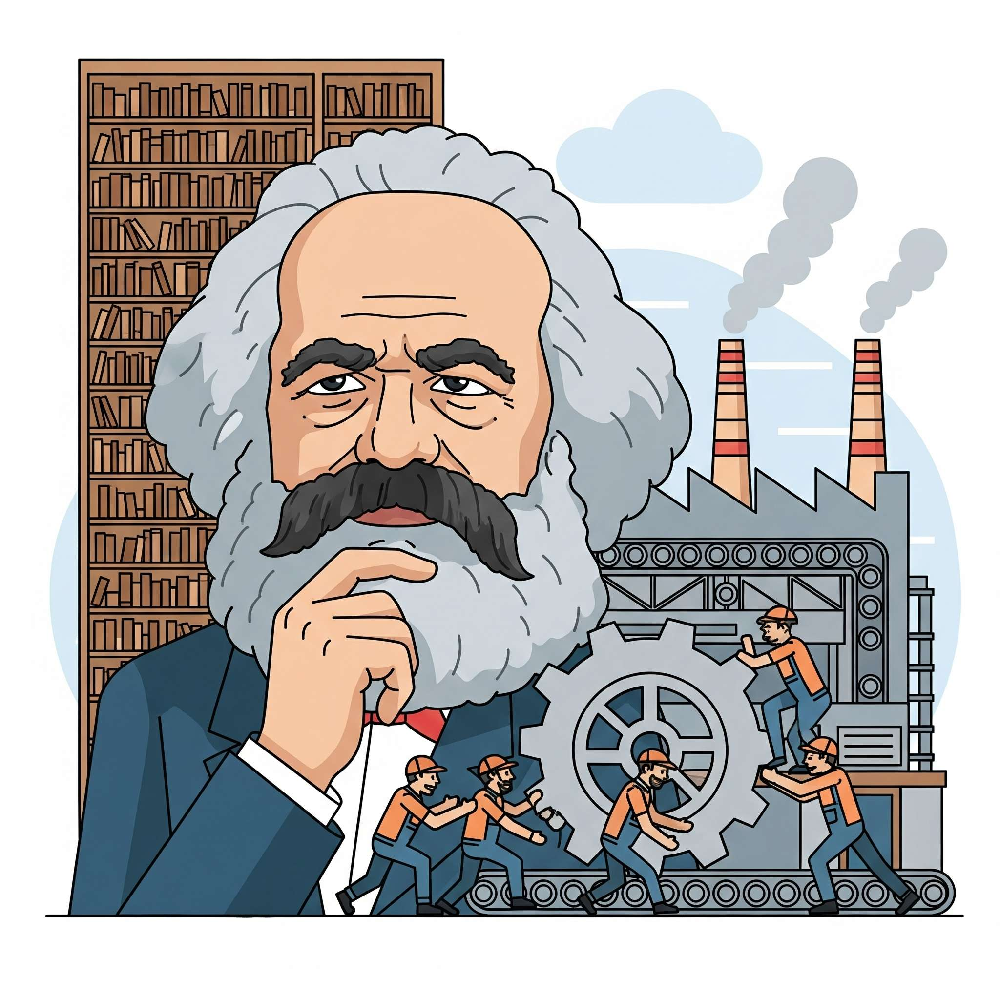
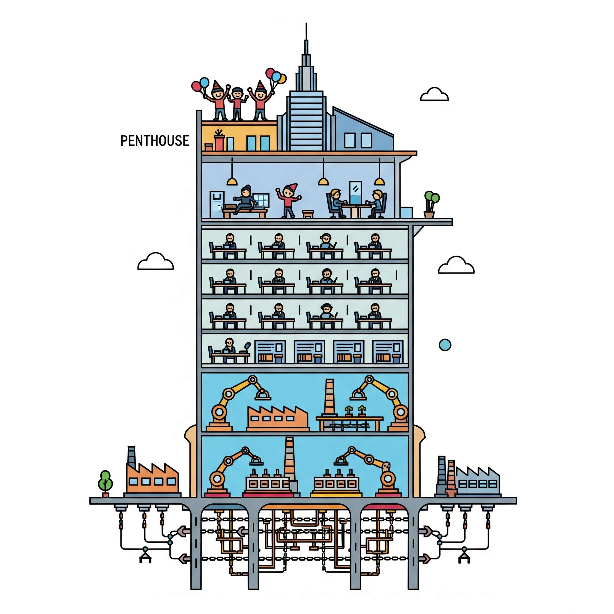
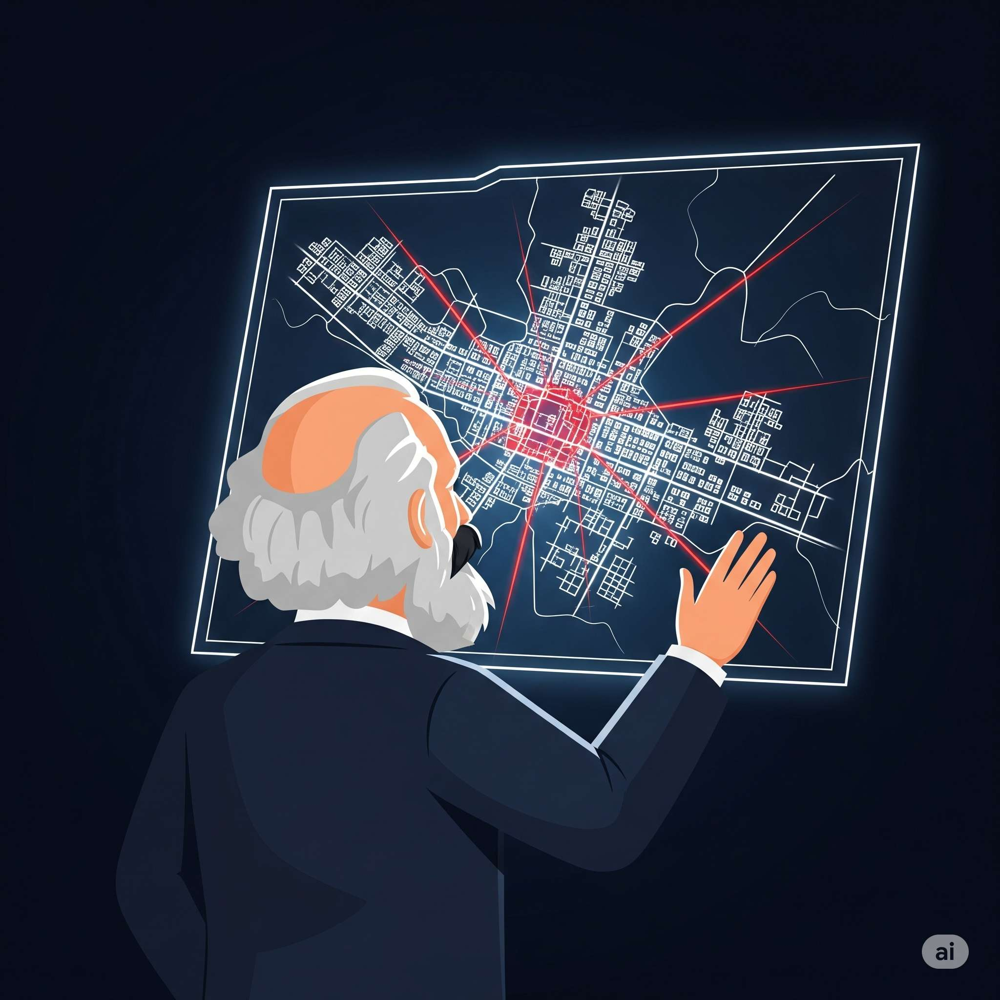

> 哲学家们只是以不同的方式解释世界，而问题在于改变世界。
> —— 卡尔·马克思

这句话，你可能在课本里读过，在讲座上听过，甚至在文艺青年的海报上见过。它像一句战斗檄文，充满了力量感，仿佛在鄙视一切“纸上谈兵”，号召我们立刻“起而行之”。

大多数人将它理解为一种行动主义的宣言：少说多做，实践至上。这个理解没有错，但这仅仅是第一层。

在这句名言的深处，隐藏着一场深刻的思想转向，它不仅回答了“做什么”，更揭示了“如何看”。今天，我们就来挖一挖这句话背后，那个容易被口号感掩盖的核心逻辑。

## 拆解名言：楼评人与建楼人

首先，让我们回到马克思的时代。他说这话时，正值德国古典哲学的巅峰。当时的哲学家们，特别是黑格尔的追随者，热衷于构建宏大而精密的思想体系。

他们就像一群站在街对面、拿着图纸和望远镜的建筑评论家。面对“世界”这栋大厦，他们能用一整套理论，从“绝对精神”到“历史逻辑”，完美地解释每一层楼的风格、来源和意义。他们的体系无懈可击，在思想的殿堂里，世界的一切似乎都被安排得明明白白。

但在马克思看来，这恰恰是最大的问题。

他看到的是，无论哲学家的理论多么精妙，现实世界里，工人们依旧在贫困线上挣扎，社会的不公与剥削依旧触目惊心。理论上的“和谐”与现实中的“苦难”形成了巨大的反差。

所以，马克思提出了他的质疑：

:::block-1
**“光说有什么用？你们在图纸室里把这栋大厦的结构说得头头是道，但这跟工地上砌墙、灌浆、真正把楼盖起来的建筑工人有什么关系？真正重要的，难道不是走进工地，改变施工方式，甚至改造整个建造过程吗？”**
:::

这第一层意思，是对脱离现实、自我满足的纯粹思辨的批判。

## 海德格尔的反问：没有图纸，如何施工？

马克思的观点如此有力，自然也引来了一场真正棋逢对手的交锋。20世纪最重要、也最深邃的哲学家之一，海德格尔，就提出了一个直击要害的疑问：

:::block-1
**“老马，你说得对，是要改变世界。但问题是，在你决定‘怎么改变’之前，你难道不需要先‘解释’一下这个世界，搞清楚它现在是什么样，问题出在哪，我们该往哪个方向走吗？”**
:::

这个质问不容易被打发掉。它触及一个几乎无法反驳的逻辑：任何“改变”的行动，似乎都必须以某种“理解”为前提，否则就只是盲动。

这就像一支准备翻修大厦的施工队。你说：“别再纠结图纸了，关键是马上动手施工！”听起来很鼓舞人心。但工程师会问：“不看图纸，我们怎么知道哪堵墙是承重墙？哪根梁一动就可能塌？施工顺序、材料强度，哪一样能离得开图纸？”

没有“解释”（图纸），“改变”（施工）不就成了一场可能葬送整栋楼的莽撞吗？

这个问题，一下子让事情陷入了“先有鸡还是先有蛋”的悖论，似乎宣判了行动必须跟在思想后面。马克思之后一百多年，仍有哲学家在这个问题上反复纠缠。我们该如何走出这个思想的“死胡同”？

## 马克思的回答：你们解释错的不是方法，是对象

面对这个诘问，马克思没有否认解释的必要，而是重新定义了解释的对象。他说：

:::block-1
**你们都搞错了！问题不在于要不要解释，而在于你们解释的对象是什么。我们不应该去“解释世界”，而应该去“解释实践”。**
:::

这个概念转换，就是理解马克思的关键。让我们回到之前那栋大厦，把这个比喻用得更精确一些。

  * **世界（World）**：把它想象成一座已经建成的、外表光鲜但内部问题重重的摩天大楼。它有豪华的顶层公寓，也有阴暗的地下室。
  * **实践（Practice）**：把它想象成 **建造这座大厦的全部活动与关系的总和**——从最初的土地拍卖、银行贷款，到建筑师的设计理念、开发商的利润目标，再到建筑工地上具体的劳动分工、薪酬合同，以及最终维持大厦运转的物业管理规则。

传统的 **“解释世界”** ，就像一个建筑评论家。他站在街对面，欣赏着大厦的轮廓，分析它的美学风格，或许还会用无人机拍下顶楼的裂缝，然后写一篇报告。他始终在谈论这个**静态的结果**。

而马克思的 **“解释实践”** ，则像一个深入现场的调查记者或结构工程师。他要问的是一系列关于**动态过程**的问题：

  * **追问如何形成**：“这座大厦是怎么拔地而起的？它的每一块砖、每一根钢筋背后，是怎样的资本运作和劳动过程？”
  * **分析社会关系**：“开发商、银行家、建筑师、包工头、建筑工人之间，到底是谁为谁工作？谁占有最终的成果？谁承担了最大的风险？他们之间是平等的合作，还是不平等的雇佣？”
  * **揭示内在矛盾**：“顶层豪华公寓的存在，和地下室工人的艰苦环境，两者之间有没有必然联系？大厦的结构性裂缝，是不是开发商为了在市场上快速套现、最大化利润而牺牲了安全标准的**必然结果**？这种 **‘利润最大化’的驱动力（实践）**，是不是就是问题的根源？”

你看，**“解释实践”** 不再满足于描述“大厦有裂缝”这个孤立的现象，而是把 **“导致裂缝的整个建造过程、其中的权力关系和利益驱动”** 全都暴露在阳光下。

## “解释实践”，到底在解释什么？

当我们谈论“解释实践”时，我们不再是空泛地谈论，而是在解剖构成社会的、活生生的核心骨架。具体来说，它包含以下几个层面：

1.  **生产方式 (Mode of Production)** ：这是地基。一个社会如何生产它所需要的一切？是少数人占有土地和工厂，多数人出卖劳动力的资本主义方式？还是其他的生产方式？这决定了社会的基本形态。
2.  **社会关系**：这是钢筋骨架。在特定的生产方式下，人与人之间必然会结成特定的关系，其中最核心的就是阶级关系。比如，资产阶级（占有生产资料）和无产阶级（出卖劳动力）的关系。这种关系不是温情脉脉的，而是充满了内在的、结构性的矛盾。
3.  **权力与意识形态**：这是外墙和装修。为了维护这种生产方式和社会关系，统治阶级会建立起一整套“上层建筑”——包括法律、政府、警察等强制力量，也包括教育、媒体、文化等，它们会不断地告诉我们：“这个世界本就如此，这样是合理且自然的。” 这就是意识形态，它让被统治者心甘情愿地接受现存的秩序。

“解释实践”，就是把这栋大厦的地基、骨架和外墙都剖开，让你看清社会运转的真实逻辑。

## 结语：拿到图纸之后

现在，我们可以回答海德格尔的提问了。

马克思并非不需要“图纸”，而是认为传统的图纸画错了对象。它只画出了这栋大厦此刻的外观和平面布局（世界现状），却没有画出它是如何被建造、被维护，又是如何出现裂缝的（实践过程）。

而“解释实践”的意义在于，它提供了一整套全新的、动态的施工与结构图纸。这套图纸带来的，是一种实实在在的赋权：

它让我们从一个面对巨大社会问题而感到无力的旁观者，转变为一个清醒的分析者和行动者。我们不再将贫困、不公等问题看作是随机发生的、个人的不幸，或是无法改变的“命运”。

我们开始懂得，这些都是特定“实践”——即特定的社会经济结构——的必然产物。

当你通过“解释实践”，看清了我们这座社会大厦是如何被建造、被维护的，你就不仅仅是在“解释”它了。

**你已经拿到了它的结构检测报告和设计图纸，清楚地看到了它的病灶、裂缝和承重柱。这份图纸，就是你“改变世界”的行动蓝图。**

你知道了要去改造哪种关系、推翻哪个结构、挑战哪种不合理的规则——这就是“改变世界”四个字，落到具体行动上的含义。

