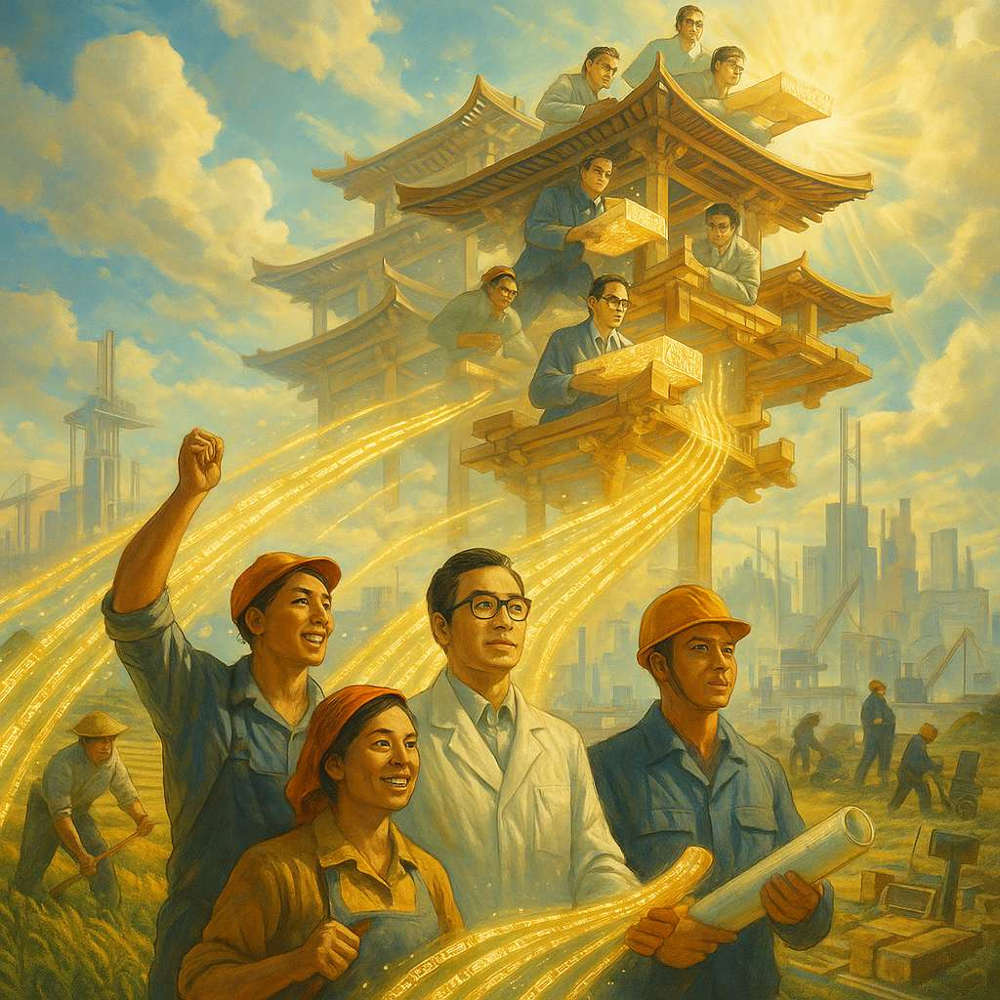

## **导言：理论的“水土不服”与思想的“刻舟求剑”**

同一条生产线，在厂长看来可能闲得太久，在能源规划者看来却可能不够用。两个人真有一个算错了吗？谈理论的“水土不服”，不妨从他们手里那两张不同的表谈起。

我关心的不是理论从哪国来，而是拿来衡量眼前问题时，它省略了谁的需求、哪一段时间。省略的东西不同，结论就可能完全不同。

## **1. 同一条组件产线，两把时间尺**

把行业缩到光伏组件，不把硅料、电池片、电站一锅端。假设要判断一家组件厂过去一年的闲置情况，就要用同期实际产量除以同期有效产能，并说明新线何时投产。同样一批出口量，既可能来自满负荷的生产线，也可能来自还有大片闲置的工厂。

转头看未来五年的能源转型，就不是这道除法题了。要先估计哪些项目能融资、并网，预计每年新增多少装机，再换算成对组件的需求，并和届时能投产的供给相比。规划目标不是已经下单的需求。

因此，**今年某地的厂房闲着，和未来某些地区可能缺组件，两件事可以同时为真。** 当期经营收益与长期公共需求，两把尺各有用途；哪把尺都不能代替另一把，更不能仅凭发展目标就宣告整个行业过剩或有缺口。

这种现象深刻揭示了理论应用中的本质冲突。一个振聋发聩的反问是：**如果连作为中国立国之本的马克思主义，都需要经历与中国具体实践和中华优秀传统文化相结合的本土化过程（即“两个结合”），以避免教条主义，那么那些诞生于特定资本主义历史环境、并内嵌了其价值观的西方理论，又怎能被当作普适真理而不加改造地直接套用呢？** 

这种不加审视的“理论移植”正是导致我们陷入“死胡同”的起点。

## **2. 认知扭曲：从“预设立场”到“理论空心化”**

对西方理论框架的路径依赖，其直接后果是导致了“思想的独立自主”的严重缺失。

一个研究如果先认定“出口就是过剩”，再只挑出口数字，它就回避了产能利用率；反过来，如果先认定绿色转型一定需要更多组件，再只挑远期目标，它也回避了今天的库存。刻舟求剑的问题，两边都会遇到。

这种现象的背后，是全球学术体系中根深蒂固的权力不平衡。西方，特别是美国，长期主导着国际学术期刊、评价标准和话语体系。 

中国学者为了在国际上获得承认，常常面临着必须使用西方通行的理论和方法论的巨大压力。这种学术上的依附关系，使得许多研究在选题、框架建构乃至语言表达上都呈现出“言必称西方”的倾向。

其结果，便是一种实质性的“理论空心化”。**大量学术产出看似繁荣，却充斥着对西方理论的复述、验证和修补，缺乏能够解释中国独特实践的原创性概念和理论。**

这种研究无法真正回答“中国之问、世界之问、人民之问、时代之问”，因为它从一开始就站错了立场，用错了标尺。

正如一些学者深刻指出的，**西方现代化理论等范式在解释中国历史时，往往预设了一个静止、守旧的“传统中国”需要被外部力量唤醒和改造，这本身就带有深刻的“西方中心论”偏见，无法真正理解中国内生的、连续的变革动力。**这种理论上的“削足适履”，最终只会让我们离深刻理解自身的现实越来越远。

## **3. 思想破局：构建自主知识体系的时代召唤**

面对上述智识困境，中国已经明确提出了根本性的解决方案——加快构建中国特色哲学社会科学，其归根结底是建构中国自主的知识体系。这不仅是一项学术倡议，更是一场关乎理论主权和民族精神独立的深刻自觉。

这场“思想破局”的核心要义在于“立足中国实际，解决中国问题”。它要求哲学社会科学工作者从中国独特的历史、文化和国情出发，将波澜壮阔的中国式现代化实践作为理论创新的最大源泉。 

这意味着要“用中国理论阐释中国实践，用中国实践升华中国理论”，在此基础上打造融通中外的新概念、新范畴、新表述，形成具有中国特色、中国风格、中国气派的学科体系、学术体系和话语体系。

构建自主知识体系并非闭门造车、盲目排外。相反，它强调以我为主、为我所用，善于在比较、对照、批判、吸收、升华的基础上，借鉴国外哲学社会科学的有益成果。但其根本立足点必须是主体性的、原创性的。它要求我们打破学科壁垒，推动多学科交叉融合，以更宏阔的视野，关注并致力于解决关系人类前途命运的重大问题，从而为世界知识体系的增量贡献独特的中国智慧。

这项工程被视为确保中华民族伟大复兴与中国式现代化成功推进的内在要求与根本保证。因为一个大国的崛起，必须伴随着思想的崛起。如果缺乏一套能够有效解释自身道路、引领社会发展、并能与世界平等对话的强大理论体系，那么经济和科技的硬实力将是根基不稳的。

## 从范式跟从到范式自立

自主不是给答案换个国籍。回到那间组件厂：有没有开足，得看实际生产；将来够不够用，得看新增需求能不能落实。研究者能根据自己的问题选择尺度，也愿意让不同尺度所得的结果同桌接受检验，才算真的有了判断力。

这要求我们的人文社会科学研究完成一次根本性的范式转型：**从被动地跟从、验证西方理论，转向主动地、创造性地从自身实践中提炼、构建属于自己的理论。**这不仅是学术发展的需要，更是国家走向全面强大的必然要求。作为“马克思主义问题”系列探讨的开篇，明确这一批判性前提，是我们后续展开一切有益讨论的思想基石。

