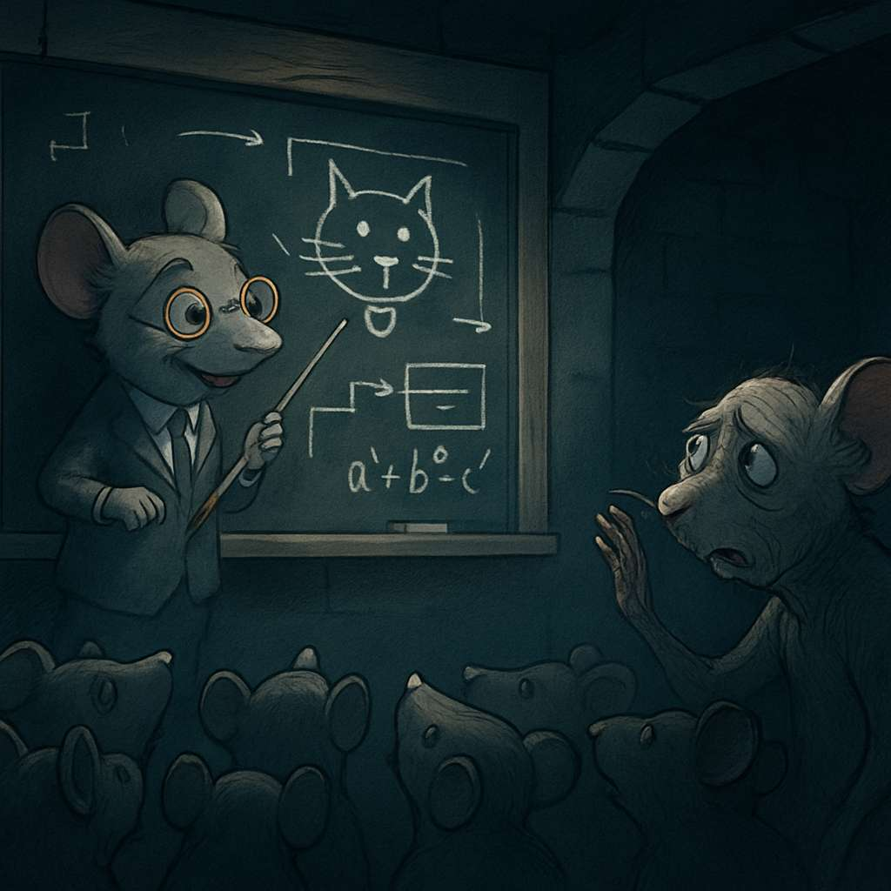

> 真正的理论家的任务是什么？注意眼前发生的事情，有意识地把这些事情表达出来就行了。
> —— 卡尔·马克思（思想转述）

想象一下这个场景。

地下室里，空气因恐惧而凝固，挤满了瑟瑟发抖的老鼠。几个世纪以来，它们都活在一只巨大、神秘、喜怒无常的猫的阴影之下。在经历了又一次血腥而惨痛的突袭后，它们终于意识到，不能再这样下去了。

于是，一场关系到种族存亡的“世界鼠民代表大会”在黑暗中召开了。在无数的争吵、恐慌和不切实际的幻想（比如祈祷猫会改吃素）之后，一只戴着金边眼镜、刚从“西方鼠类高等学府”留学归来的年轻老鼠，昂首走上用奶酪盒搭成的讲台。

它清了清嗓子，用一种不容置疑的、带有学术口音的语调，公布了一个闪闪发光的、被誉为“顶层设计”的方案：“同胞们，问题很简单，我们只需在猫的脖子上挂一个铃铛。根据声学原理和行为动力学，当猫移动时，铃声就会触发我们的听觉神经，为我们争取到3.7秒的黄金逃生时间。问题，将迎刃而解！”

方案一出，全场先是死寂，随即爆发出山呼海啸般的掌声。简洁，高效，科学，一劳永逸——这简直是天才的、划时代的构想！

然而，当掌声渐息，一只在角落里沉默许久、毛都快掉光的年迈老鼠，用它那被岁月和苦难磨砺得嘶哑的声音，问出了那个足以让所有理论瞬间崩塌的“灵魂拷问”：

:::block-1
**“主意确实是天才的主意……但我的问题是，我们这些鼠辈里，究竟谁，去把这个铃铛，挂到那只猫的脖子上去呢？”**
:::

全场，瞬间陷入了比坟墓更深的死寂。

这个故事，我们通常当个关于“理论与实践脱节”的鸡汤寓言来读。

但今天，我们要认真对待这个寓言，用它来切入一个更宏大的议题：当代中国社会科学所面临的巨大困境，以及可能的“破局之路”。

## 铃铛设计师的陷阱

改革开放的浪潮，不仅带来了集装箱里的机器和资本，也带来了思想上的一整船西方社会科学理论。

它们就像一个个在无菌实验室里打造出的、设计精美的“铃铛”——拥有完美数学曲线的计量经济模型、逻辑上天衣无缝的法理框架、流程上无可挑剔的社会治理方案。

伴随这些“铃铛”一同到来的，是一大批技艺精湛的“铃铛设计师”。

他们是这个时代最聪明的头脑，是象牙塔里令人尊敬的贵族。他们相信理性的力量，痴迷于模型的优雅和逻辑的自洽。

对他们而言，这些来自西方的理论，不只是一种工具，更是一种“捷径”的承诺——仿佛只要掌握了这些先进的“铃铛”，就能绕过泥泞的探索，直接抵达现代化的彼岸。

面对中国社会转型这只体型庞大、历史悠久、时而温顺时而暴躁的“东方大猫”，他们自信地打开了自己的工具箱，试图将这些闪闪发光的铃铛套在它的身上。

然而，现实却一次又一次地，用一种近乎残酷的方式，上演着寓言里的那一幕。一个被认为能“优化资源配置”的经济铃铛，却可能引发了剧烈的社会撕裂；一个被认为能“实现司法公正”的法律铃铛，却在盘根错节的现实关系面前变得悄然无声。

我们陷入了一个巨大的思维陷阱，一种“理论的傲慢”：

:::block-1
**我们疯狂地迷恋于设计一个“普适”、“理性”、“完美”的铃铛，却从根本上忘记了，我们的任务对象，是一只活生生的、有自己的历史记忆、独特脾气、切身利益和强大力量的猫。**
:::

我们把全部智力资源都投入到了“铃铛应该是什么样”，却很少去研究“这只猫是什么样”。我们忘了，任何在西方土壤上长出的理论，都只是对“那一只猫”的观察总结。

拿着一张描述“欧洲街猫”的说明书，就想去给一只基因里刻着五千年历史、经历过革命与重生、正在进行前所未有的社会实验的“亚洲虎斑猫”挂铃铛，这不叫科学，这叫智力上的懒惰和教条主义的傲慢。

## 别再看铃铛，去看猫

面对这个死局，我们该怎么办？放弃所有理论，凭着一腔热血冲上去蛮干吗？那不叫勇敢，那叫“白给”。

此时，马克思的哲学，像一道闪电，劈开了思想的迷雾。他没有提供一个新的、更完美的铃铛，而是完成了一个堪称“柔道翻转”的伟大动作，直接把问题的核心翻了个底朝天。

他的潜台词是：

:::block-1
**你们都搞错了：理论家最重要的任务，不是把自己关在窗明几净的实验室里，空想一个完美的铃铛，而是穿上最厚的防护服，拿起最高倍的望远镜，带上最详尽的笔记本，成为这个世界上最懂“这只猫”的专家！**
:::

这个角色的转换，是走出困境的唯一钥匙。这不仅是研究重心的转移，更是研究者自我身份的革命——从一个高高在上的“评判者”，转变为一个深入其中的“理解者”。

*   **铃铛设计师 (旧哲学)** ：他站在猫的“外部”，像一个工程师审视一个需要被修复的机器。他追求方案的普遍性，相信存在一个放之四海而皆准的“最优解”。猫，只是他理论需要改造的、被动的“客体”。

*   **猫科专家(新哲学)** ：他必须进入猫的“内部”，与它一同呼吸，感受它的心跳。他深知每一只猫都是其独特历史和环境的产物，不存在万能药。他致力于揭示这只猫活生生的、充满内部矛盾的**生命过程**。

## 田野调查手册：研究这只猫

那么，“研究那只猫”到底在研究什么？这绝不是一句空话。它意味着，我们需要建立一套全新的、属于我们自己的“田野调查手册”。

**第一章**：解剖猫的身体——经济基础与利益格局

这只猫的“新陈代谢系统”（资本如何流动、积累和增值）是怎样的？

它的“骨骼结构”（生产资料归谁所有）决定了它的基本形态；

它的“肌肉群”（社会中的不同阶级、阶层和利益集团）哪个强壮，哪个孱弱；

它的“消化系统”（社会总财富的分配机制）又是如何工作的？谁吃到了最肥美的肉，谁只能舔舐骨头，谁又在为这一切提供能量？

不画出这张解剖图，你设计的所有方案都只是隔靴搔痒。

**第二章**：理解猫的心理——历史进程与内在矛盾

这只猫不是一张白纸，它有记忆，甚至有深刻的“历史创伤”。它对哪些“口令”（比如社会主义原则）会下意识地服从，又对哪些“猫薄荷”（比如资本的诱惑）难以抗拒？它为何有时看似矛盾？（比如，既要市场效率，又要共同富裕）。

这些矛盾，不是需要被“消除”的缺陷，恰恰是驱动这只猫不断运动、变化、甚至进化的内在“心跳”。一个优秀的猫科专家，必须是一个深刻的历史学家和心理学家，他能从猫当下的一个眼神里，读出它百年的记忆。

**第三章**：洞悉猫的“自我认知”——上层建筑与意识形态

这只猫如何看待自己？社会上流传着哪些关于它的“神话”和“滤镜”？（比如，是“自由市场的神猫”，还是“伟大复兴的圣猫”？）

法律、媒体、教育、文化，是如何像一套精密的“美颜相机”，日复一日地建构和维护这个“官方形象”，从而让它的统治显得理所应当、不容置疑的？

这种强大的意识形态，像一种麻醉剂，让许多身处其中的老鼠感觉不到疼痛。理论家的任务，就是提供一副“去滤镜”的眼镜，戳破这些迷雾，揭示出形象背后的真实力量关系。

## 我们需要的不是藏宝图，而是动态航海图

现在，我们可以回到那个终极问题了：“谁去挂铃铛？”

马克思主义的答案是：**理论家自己不去挂。但他们可以成为那个点亮火把的人，为所有“挂铃铛的行动者”提供一张最详尽、最动态、甚至带有天气预报的地图。**

这张地图，不再是一张画好了终点和宝藏的静态藏宝图，让你按图索骥。它是一张活的、不断更新的动态航海图。

它实时告诉你，哪里有暗礁（社会矛盾），洋流的方向（资本的逻辑），风向的变化（政策的摆动），以及我们这艘船（社会主体）的真实状况、它的承重极限和动力来源。

当你通过“研究那只猫”，拿到了它的基因测序报告、血液化验单和深度心理评估，你就不仅仅是在“解释”它了。

**你已经拥有了“改变”它的行动蓝图。**

你清楚地看到了它的病灶、它的力量枢纽、它的敏感神经。这张蓝图，将赋予一切“挂铃铛”的行动以自觉、方向和策略。

中国的社会科学工作者，正站在人类历史上最波澜壮阔的变革甲板上，面对着最独一无二的研究对象。这是一个无与伦比的挑战，更是一个千载难逢的机遇。

放弃做那个在岸边指点江山、空想完美铃铛的“聪明小老鼠”吧。

让我们成为勇敢的水手和清醒的领航员，用历史唯物主义去解剖我们所处的时代，去“注意眼前发生的事情”，并有意识地、有根据地，为脚下这艘巨轮的前行，找到清醒而坚定的方向。

