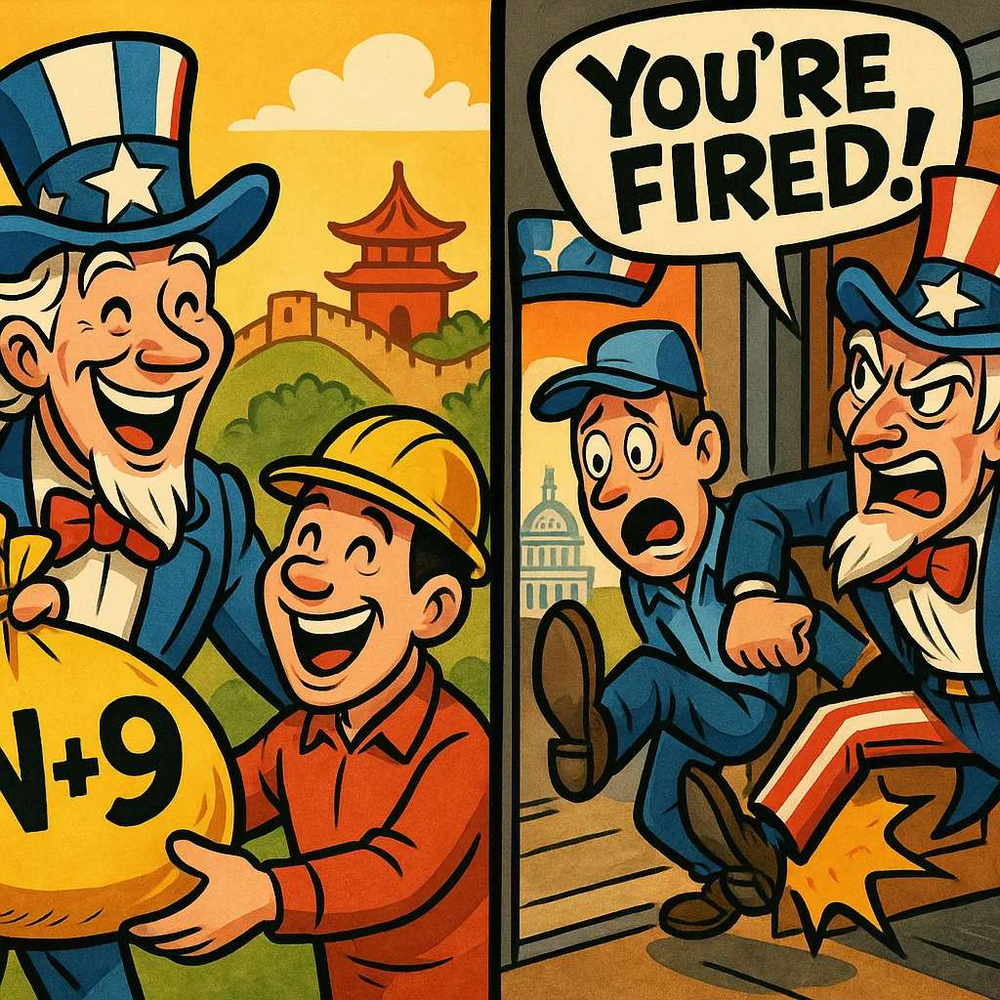
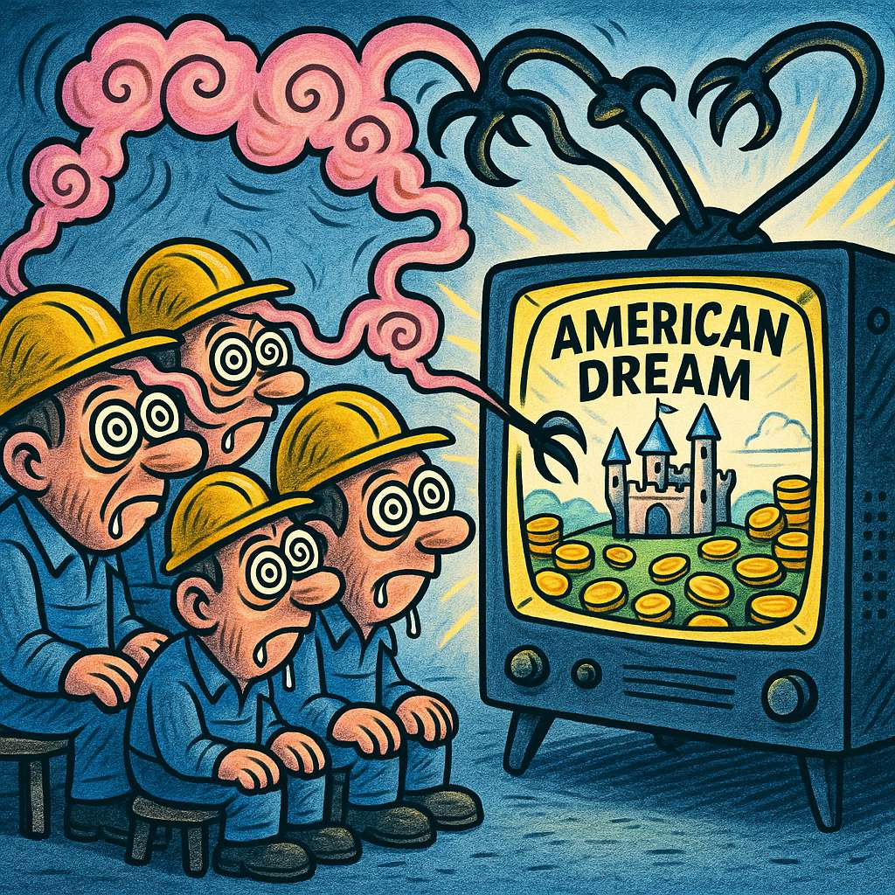

嗨，大家好，我是方小达。

今天我们来聊一个流传甚广，甚至很多人深信不疑的“都市传说”：美国的劳动保护，比我们中国要好得多。

证据呢？很多人会立马举例：你看看那些在华美企，裁员时动不动就给出“N+8”甚至“N+9”的“天价赔偿”，多有“契约精神”！再看看我们身边，被裁员的糟心事还少吗？

是不是一听，觉得特别有道理？感觉人家的“发达”，不仅体现在科技和经济上，连法律都充满了“人文关怀”。

但如果我告诉你，这可能是一个天大的误会呢？这个误会的背后，不仅藏着一个残酷的现实，更隐藏着一套精密的、值得我们用哲学去剖析的“思想迷雾”。

今天，就让我们当一回思想的“侦探”，运用马克思主义哲学的分析工具，查一查这个流传甚广的“神话”到底站不站得住脚。

## **一、戳破表象：一个叫“任意性雇佣”的残酷现实**

在我们深入分析之前，必须先摆出一个冷冰冰的事实。

美国劳动领域的基本原则，从1877年至今，叫做 “任意性雇佣” (At-will Employment)。

这是什么意思？简单粗暴地总结就是“**三无原则**”：

**无通知、无理由、无赔偿。**

没错，除非有特殊合同或涉及法定歧视，否则你的美国老板可以在任何时间、因为任何理由（甚至不需要理由），让你卷铺盖走人，而且一分钱赔偿都不用给。

大家在美剧里看到的经典场景——老板一句“You're fired”，员工就默默收拾东西走人，没有任何争执和讨价还价——那不是影视剧的夸张，那就是“任意性雇佣”原则下的日常。因为掰扯也没用，法律不站在你这边。

这下你明白，为什么马斯克能对推特员工进行“毁灭式”裁员了吧？因为他有美国法律这个“尚方宝剑”。

那“N+9”的慷慨赔偿又是怎么回事？

答案恰恰相反：**那不是因为美国法律的要求，而是因为中国《劳动合同法》的强大约束力！**

在中国，企业想裁员，尤其是大规模裁员，有着极其严格的法律程序。一旦被认定为“违法裁员”，企业将面临支付双倍赔偿金等严厉惩罚。那些在华外企，作为“门面担当”，监管部门盯得更紧。它们支付高额赔偿，本质上是为了规避中国法律风险的“花钱买平安”，是用钱来息事宁人，而不是出于它们的“良心”或美国法律的“仁慈”。

好了，事实已经清楚。但真正值得我们深思的问题是：

**为什么我们如此轻易地就相信了这个与事实完全相反的神话？**

这就需要我们从更深层次的哲学角度来审视了。

## **二、深度透视：我们为何会掉入“美丽的陷阱”？**

马克思主义哲学为我们提供了三个强大的分析工具，能帮助我们看清迷雾背后的真相。

**1. 经济基础决定上层建筑：法律究竟为谁服务？**

这是马克思主义的基石。一个社会的法律、政治、文化等“上层建筑”，归根结底是由它的“经济基础”（生产关系的总和）决定的。

  * **美国的经济基础**是成熟的资本主义，生产资料掌握在少数资本家手中。因此，它的法律（上层建筑）必然要为资本的利益服务。“任意性雇佣”就是这种服务的完美体现，它赋予了资本最大的灵活性和权力，让劳动力可以像零件一样被随时替换，以保证资本利润的最大化。
  * **中国的经济基础**是公有制为主体、多种所有制经济共同发展。这决定了我们的《劳动合同法》必须旗帜鲜明地体现对劳动者权益的倾斜和保护。
  

所以，期望一个以资本为核心的社会，会自动诞生出一部保护劳动者的法律，这本身就是一种脱离了经济基础的幻想。

**2. 意识形态与虚假意识：被精心编织的“美国梦”**

在阶级社会中，统治阶级的思想就是占统治地位的思想。他们会通过媒体、文化、教育等工具，构建一套符合自身利益的“意识形态”，让人们不知不觉地接受。

“美国劳动保护好”的观念，就是一种典型的、被资本主义意识形态成功塑造的“**虚假意识**”。

好莱坞电影、主流媒体，不断向世界描绘着一个充满机遇、人人平等、崇尚“自由契约”的“美国梦”。它巧妙地将资本家解雇工人的“自由”，和工人选择工作的“自由”画上等号，**完全掩盖了两者之间巨大的权力不平等。**

当我们长期沉浸在这种叙事中，便会内化这种“虚假意识”，把个别公司在特定环境下（比如在中国）的公关行为，当成是整个制度优越性的证明。

**3. 现象与本质：看见“N+9”，更要看见背后的制度鸿沟**

任何事物都有其表面的“现象”和内在的“本质”。现象是多变的、零散的，而本质是稳定的、根本的。我们认识世界，就是要透过现象抓住本质。

  * **现象是**：我们看到了“N+9”的高额赔偿；我们看到了美国是世界头号发达国家。
  * **本质是**：支撑这个发达国家运转的，是一套以“任意性雇佣”为代表的、有利于资本而牺牲劳动者稳定性的制度。那个高额赔偿，恰恰是它在另一个制度（中国）面前“水土不服”的体现。

这个误解，就是典型的“只见树木，不见森林”，我们被“N+9”这个耀眼的现象迷惑，而没有去探究其背后完全不同的制度本质。

**但话说回来，这套解释也不是万能公式。** 所有制性质不会直接、单独决定每一条具体法律条文——中美劳动保护的差异之间，还夹着执法力度、工会的博弈能力、行业与企业规模、以及外企在华格外谨慎的公关考量这些中介环节。“N+9”很大程度上就是这类中介的产物，而不是两种制度对比之下的直接结果。“经济基础决定上层建筑”描述的是一种长期的、结构性的趋势，不是给每一处具体差异找一个一一对应的原因。而且，法律文本上写明的保护力度，和劳动者实际能拿到手的保护，中间也常有落差——这一点，在中美两边都成立。

## **三、从法律条文到权利觉醒：我们的方向在哪里？**

聊到这里，我们剖析这个误解，绝不是为了简单地分出“谁好谁坏”，更不是为了获得一点虚幻的自豪感。

真正的意义在于“升华”我们的认知，看清未来的方向。

**首先，要明白权利不是从天而降的。**

我们今天拥有的《劳动合同法》，是经过无数次博弈和斗争换来的宝贵成果。它不是理所当然的存在，而是国家意志和社会主义制度的选择，是保障我们劳动者尊严的坚实盾牌。我们必须珍视它，了解它。

**其次，法律的生命力在于实践。**

法律条文写得再好，如果劳动者自己不敢、不愿、不懂得用它来维护自己的权益，那它也只是一纸空文。就像原文提到的，面对不公，我们不应沉默，因为已经有千万人通过法律途径成功维权。当每一个劳动者都敢于对不公说“不”的时候，法律的尊严才真正得以彰显。

**最后，也是最重要的，真正的安全感源于思想的觉醒和集体的力量。**

看穿“美国劳动保护神话”的过程，本身就是一次思想的解放。它让我们明白，**劳动者的尊严和安全，从来不应寄希望于资本的“仁慈”或虚幻的“神话”，而必须植根于我们自身的团结、斗争和权利意识的觉醒。**

马克思曾说：“哲学家们只是用不同的方式解释世界，而问题在于改变世界。”

今天，我们用哲学解释了这个误解。而明天，当现实中的不公再次来临时，我们更需要用行动去改变它。

下一次再看到“N+9”的新闻，不妨先问一句：这笔钱，到底是谁在向谁让步。

