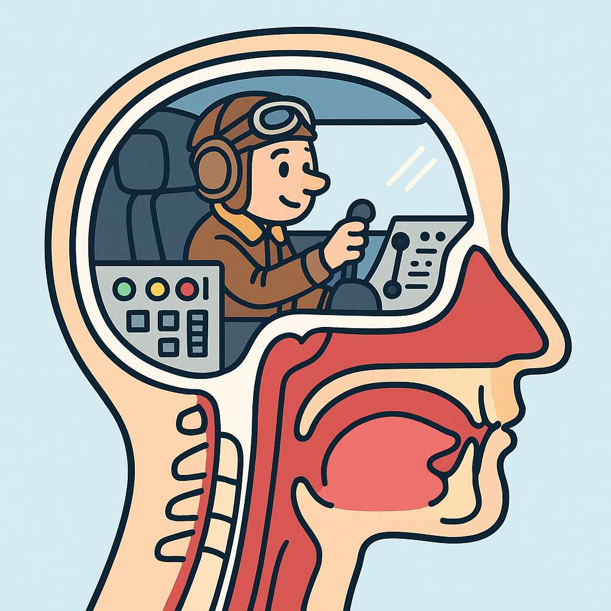
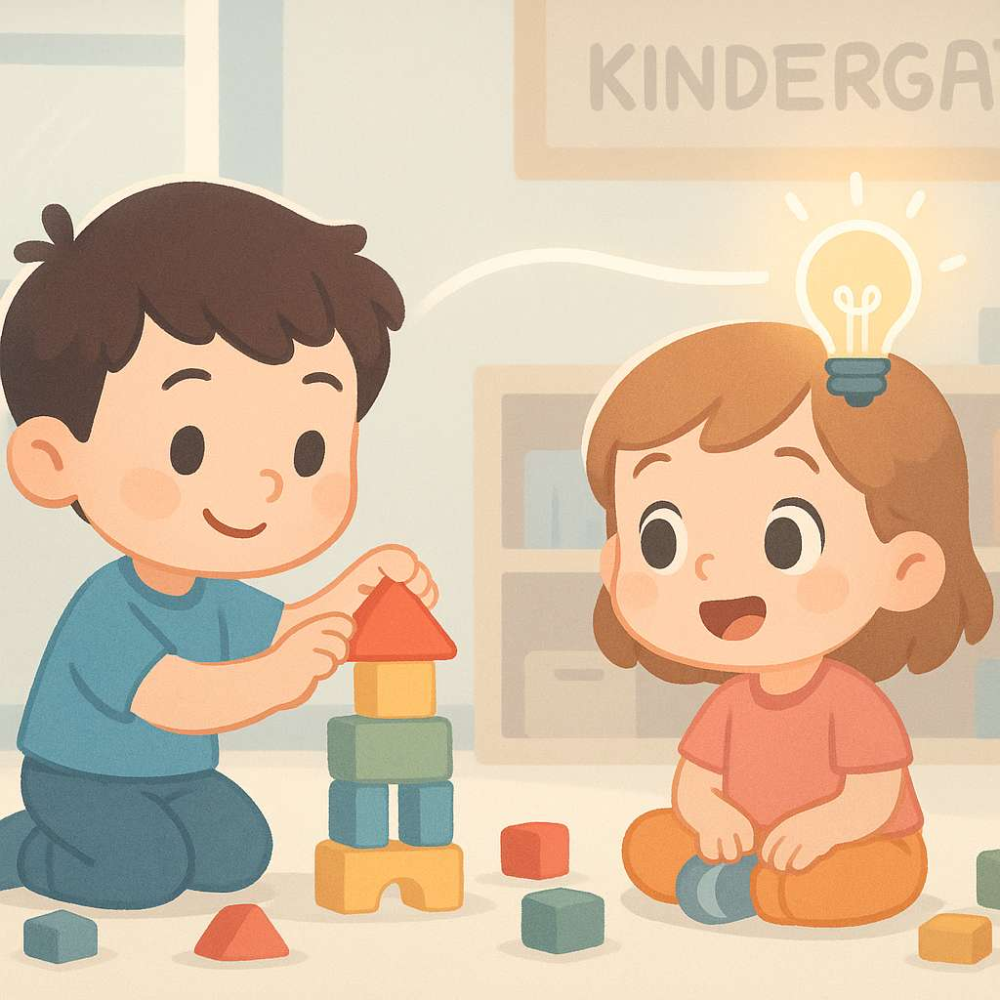
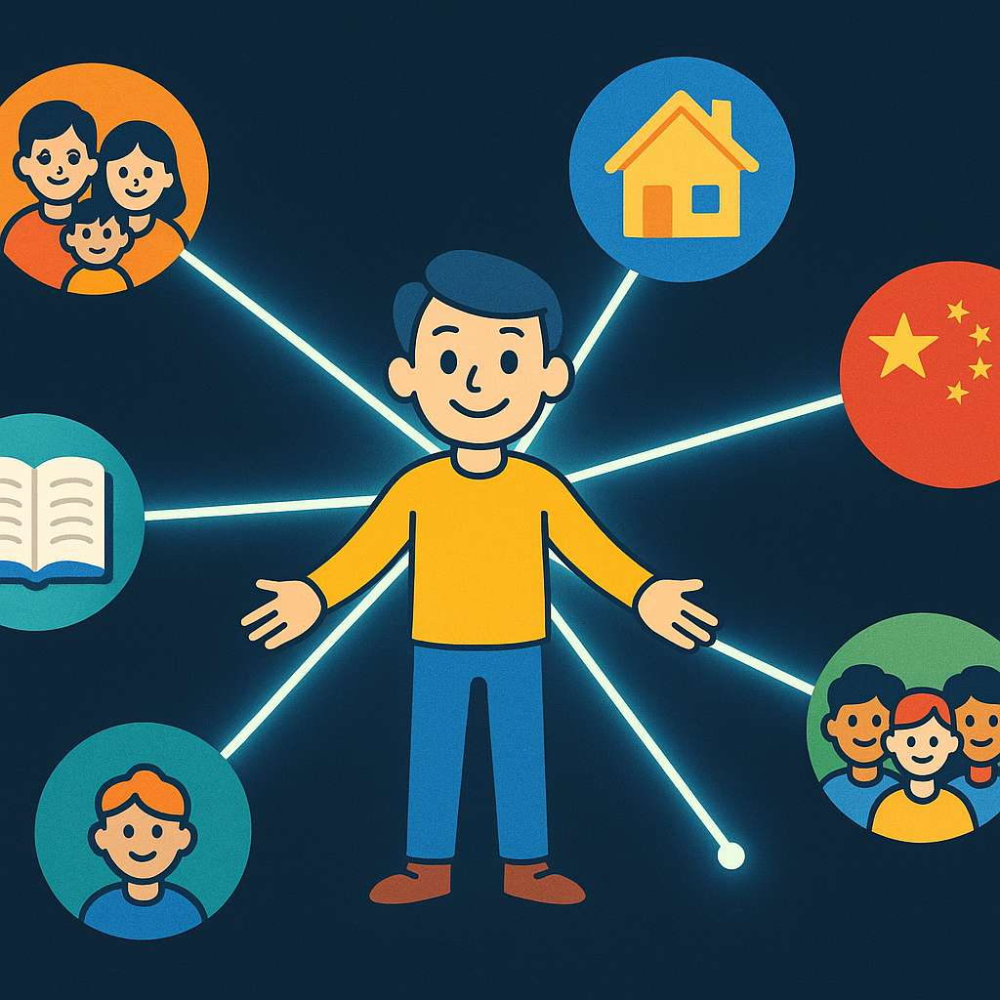

> “爸爸，为什么你是你，而不是我？为什么我是我，而不是你？”

这个问题，在我童年时脱口而出，换来的是父亲困惑的眼神。这听起来像小孩子的胡言乱语，但它可能是有史以来最深刻、也最令人着迷的哲学追问。

那个独一无二的“我”，这个装着我所有痛苦、狂喜、秘密和梦想的容器——“自我意识”，它究竟是从哪儿来的？

我们很容易给出一些直觉性的答案，但稍一推敲，就会发现它们都站不住脚。

*   **是照镜子照出来的吗？** 一条狗看到镜子里的影像，顶多是好奇。它会拨弄、会吠叫，但研究半天发现对面那个家伙完全是在模仿自己，觉得无趣就走了。它不会产生“啊，这就是我，一个独一无二的、名叫旺财的狗格存在”这种复杂的感悟。
*   **是和别人比较出来的吗？** 一只白毛小狗看到一只高大的黄毛恶犬，能立刻分辨出体型、颜色和威胁等级的差别。但这只是一种生存本能的判断，并不会让它产生“我属于白毛小型犬这个类别，拥有一个独立的狗格”的意识。
*   **是求生本能吗？** 那就更不是了。从单细胞的病毒到院子里的大树，任何生命体都有趋利避害、自我保存的本能，但我们绝不会说病毒拥有“自我意识”。

那么，这个神秘的“我”，到底是怎么从一片混沌中诞生的？

## 一个经典的误解：我，是藏在身体里的“小驾驶员”

在我们的惯性思维里，总会不自觉地把“自我”想象成一个核心实体。它像一个技术高超的驾驶员，住我们的大脑或心脏里，操控着我们这台名为“肉体”的高达。这个“我”是纯粹的、独立的、与世隔绝的，被我们的皮肤严严实实地包裹着。

我们总以为，是这个“小驾驶员”先存在了，然后才小心翼翼地打开驾驶舱门，伸出触角，去和外面的世界打交道。

但马克思告诉我们，这个想法，从根本上就是一场华丽的误会。**自我意识，从来不是一个需要向内挖掘的“神秘宝藏”，而是一个必须向外、在与世界的互动中才能完成的“宏大工程”。**

## 自我是被“关系”点亮的

面对这个哲学难题，马克思给出了一个颠覆性的答案，它藏在《德意志意识形态》里一段有点绕口的话中：

:::block-1
**“意识起初只是……对处于开始意识到自身的个人以外的其他人和其他物的联系的一种意识。”**
:::

别被绕晕了，我们把它翻译成一幅生动的场景：

想象一个幼儿园。你还是个懵懵懂懂的小屁孩，呆呆地坐着，世界对你来说就是一团模糊的色彩和声音。突然，你看到你的小伙伴，正全神贯注地用积木搭建一个漂亮的城堡。

在这一瞬间，一场思想的“大爆炸”在你脑中发生。

你看到的，不仅仅是一个小孩和一堆木头。你看到了 **“其他人”**（你的小伙伴），以及他与 **“其他物”**（积木）之间建立的一种 **“联系”**（搭建城堡这个创造性行为）。

就在你完整地意识到这种“联系”的刹那，一道闪电击中了你的小脑袋。你突然明白了：“哦，原来世界不是铁板一块，它是可以被改变的！原来人可以这样创造东西，他能做到，我是不是也行？”

**就在这一刻，你的“自我”被点亮了。**

你不再是一个混沌的旁观者，你成了一个有潜在行动力的“主体”。你开始把自己和那个小伙伴看作是同一种存在——“人”，一种可以主动与世界发生关系的存在。于是，你也想伸出手去，拿起积木，搭建属于你自己的城堡。

**他人与世界的关系，像一面神奇的镜子，第一次照出了你自己的可能性，从而塑造了你的自我。** 甚至，当你独自一人走到河边，看到岸上停泊着一条空船，你的自我意识也会被唤醒。你会立刻知道，这不是一截天然的浮木，它是一个“物”，它与一个你没见过的“他人”之间，存在着“制作”和“使用”的联系。这个看不见的他人，同样定义了你作为人的存在——因为你也可以使用它，甚至制造它。

## 你不是一个点，而是一张网

如果说“关系点亮自我”是思想的第一层冲击，那更深的一层还在后面。马克思认为，自我不仅是被关系**点亮**的，它根本就是由关系**构成**的。

这个说法听起来很玄。不信？我们先来做一个小小的思想实验。

**想象一下，你如何向一个陌生人介绍自己？**

你几乎不会说：“你好，我是一个有意识的精神实体。” 这种哲学式的回答在现实中毫无意义。

你的第一反应，一定是搬出你的“关系”。你会说：
*   “我是XX公司的程序员。”（你与工作的关系）
*   “我是小明的妈妈。”（你与家庭的关系）
*   “我是一个来自成都的旅行者。”（你与地域文化的关系）

你看，在定义“我”是谁的那一刻，我们下意识地就从那张巨大的社会关系网络中，扯出了几条最重要的线来展示给别人。我们用这些“关系”来定位自己，也让别人通过这些“关系”来认识我们。

**这就引出了那个终极比喻：自我，不是一个坚硬的点，而是一张柔软但坚韧的网。**

“你”就是这张网的中心，但这张网的形态、大小和韧性，完全取决于它连接了多少个“锚点”，以及这些锚点有多牢固。你的工作、你的家庭、你的爱好、你的家乡、你所热爱的球队……所有这些，都是你自我之网上的关键锚点。

现在，我们就能真正理解那个最扎心的场景了：

**一个为公司奉献了30年的老员工，在被裁员的那一刻，为什么会感到天塌地陷般的“自我”危机？**

按理说，他只是失去了一份工作，他的身体、记忆、性格都还在。但我们都明白，他失去的远不止薪水。

他失去的，是那根最粗壮的“锚点”。那个“XX公司高级工程师”的身份，是他自我之网的“主承重索”，几十年来，他大部分的自信、社交和日常节奏都系于其上。当它被突然剪断时，整个自我之网都剧烈震动，甚至有崩塌的危险。他会茫然自问：“现在，我是谁？”，因为定义他“是谁”的最重要的关系，消失了。

这个“自我之网”的逻辑，可以解释我们生活中的许多情感共鸣：

*   **球队认同**：一个豪门球队的铁杆球迷，当主队在决赛中被绝杀时，他会感到发自内心的痛苦，仿佛是自己输掉了比赛。因为球队的胜负，这个“锚点”，已经和他自我的荣辱感紧紧地系在了一起。
*   **家乡认同**：你在异国他乡的街头，听到有人用你那独特的家乡话交谈，你的心会立刻被揪住，仿佛听到了自己的名字。你的“自我”，有一部分就安放在那片土地和那独特的乡音所构成的关系里。
*   **家庭烙印**：那个你从小就又爱又恨、拼命想摆脱其影响的父亲，他的言行举止、他的期望与失望，都早已像基因一样深深地烙印在你的性格里。他，这个最熟悉的“他人”，就是你自我之网的核心结构。

**构成你自我的，正是这些对你至关重要的人、事、物、地所构成的关系总和。你这张网越大、越坚韧、越丰富，你的自我意识就越厚重。**

## 感性的缺失：为什么“社恐”和“完美网恋”不靠谱？

理解了“自我是一张关系网”这个核心结构后，一个更深层次的问题自然浮现：编织这张网的“线”，究竟是用什么“材料”做的？是坚韧的钢缆，还是脆弱的蛛丝？

马克思的答案是：唯一真实、能构筑坚韧自我的材料，是感性的社会实践。它需要真实的触摸、眼神的交汇、声音的颤抖，甚至肢体的冲突。

这就是为什么孩子需要和小伙伴一起玩耍，甚至打打闹闹。在真实的对抗和合作中，他们在对方的眼神里看到胆怯或勇敢，在推搡中感受力量的边界，在分享玩具时学会妥协。这种粗糙但真实的“感性交往”，是构筑健康自我最坚实的地基。而互联网这把双刃剑，恰恰在消解这种感性。

理解了这一点，我们就能看清当今社会许多“现代病”的根源。

*   **“社恐”的流行**：当一个孩子从小就习惯于在虚拟世界里交往，他面对的是一个个被精心包装的ID和头像。一旦下线，面对现实中复杂、不可预测的真人，他就会感到无所适从，因为他感性成长的关键一课被跳过了。
*   **“完美网恋”的脆弱**：你在网上可以把自己塑造成一个无所不能、风趣幽默的观念强者。对方爱上的，是你的观点、你的文采、你的人设。但爱，终究是感性的。它需要线下见面，需要感受你说话时紧张到脸红的羞涩，需要体会你笨拙却真诚的关心。有时候，恰恰是这些“不完美”的感性瞬间，才构成了爱的真正魅力。一个只存在于观念中的爱人，在现实的感性冲击面前，往往不堪一击。

## 结语：在“他人”中，看见真正的自己

现在，我们终于可以回答开头的那个问题了。

“我是我”，不是因为我有一个与生俱来的、密封的灵魂。**“我是我”，是因为我身处于一个独一无二的、由父母、朋友、家乡、祖国、事业、热爱……所共同编织起来的社会关系网络之中。**

这个发现，带来了一个深刻的启示：

一个健康的自我，绝不是把自己封闭起来，追求所谓的“纯粹独立”和“不被影响”。恰恰相反，它需要我们勇敢地投入到真实、感性的社会交往中去。

**自我，不是一个需要守护的孤岛，而是一张需要我们用一生去编织、去拓展的关系网。**

你与他人的每一次深刻交流，你对世界的一次全新探索，你投入热情去创造的每一件作品，都在扩展你“生存场”的边界，都在让你这个“我”变得更加辽阔、更加清晰。儒家所追求的“修身、齐家、治国、平天下”，正是一个将自我生存场不断扩大的过程，其极致就是“吾心即是宇宙”。

所以，别再向内苦苦求索那个虚无缥缈的“真我”了。去看看你身边的人，看看你所处的世界，看看你和它们之间千丝万缕的联系。

**因为，他人，就是你看见自己的镜子。整个世界，都是你塑造自我的材料。**

