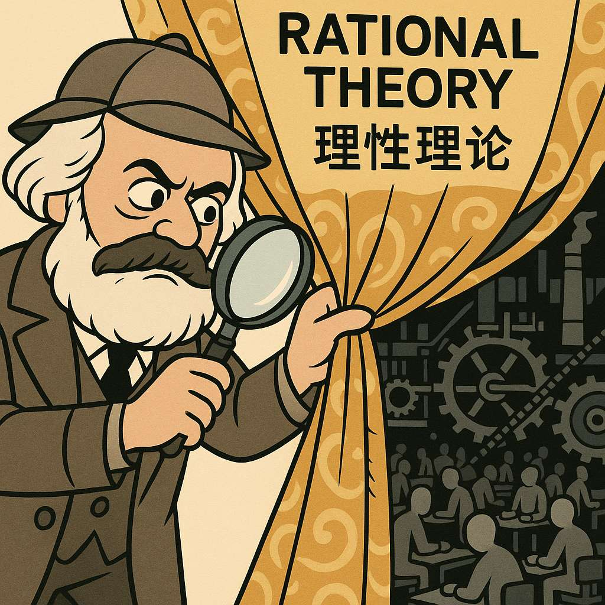
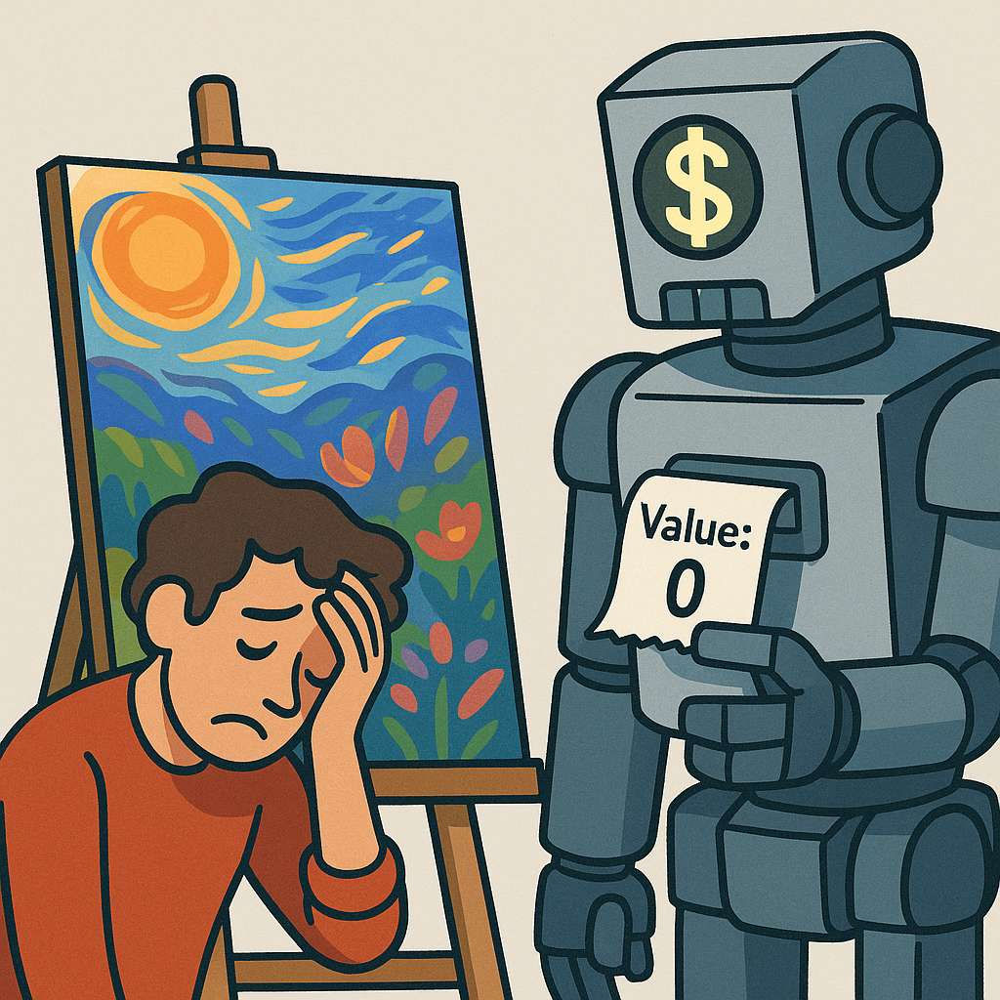
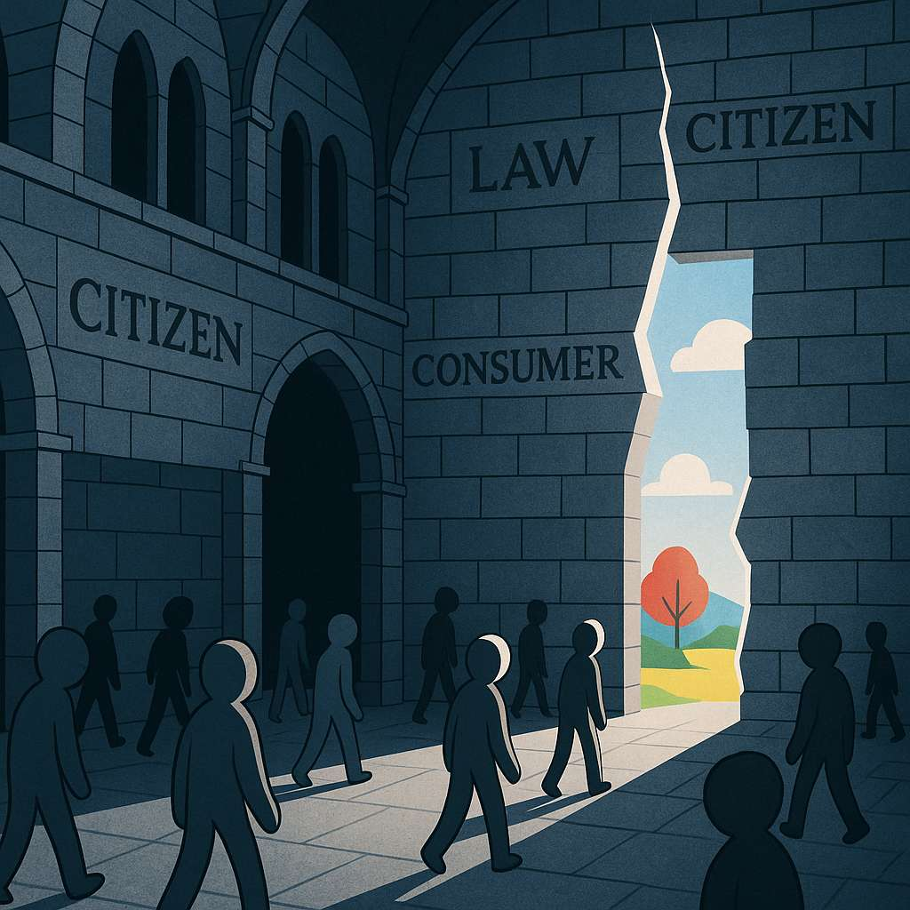

> 社会生活在本质上是实践的。凡是把理论导致神秘主义的神秘东西，都能在人的实践中以及对这个实践的理解中得到合理的解决。
> —— 卡尔·马克思，《关于费尔巴哈的提纲》第八条

你是否有过这样的体验？当你满怀激情地投入一份事业，感受到的却是与机构之间一份冰冷的“甲方/乙方”合同；当一对恋人决定相守一生，拿到的却是一份强调“婚前财产登记”的法律文书——我们的婚姻，本应是同甘共苦的生命交融。然而，这一切活生生的、充满温度的关系，似乎都被一套冷静、理性的“范畴”——经济的、法律的——所重新定义和覆盖了。

我们感到的那份微妙的失落与疏离，并非无病呻吟。它指向了一个由马克思在一百多年前就深刻诊断出的现代社会症候：我们的现实，正在被理论的“范畴”所层层遮蔽。

今天，就让我们化身思想的侦探，跟随意有所指的线索，揭开这层名为“理性”的神秘面纱，看看面纱之下，我们遗失了怎样一个真实的世界。

## **一场家庭辩论：被遗忘的“事情本身”**

让我们虚构一个极端的思想实验场景，来放大这个问题的荒谬性。

想象一个家庭，丈夫是一位纯粹的经济学家，妻子是一位纯粹的法学家，两人都在各自领域登峰造极。一天，他们需要共同决定一件重要的家庭事务——比如，是否要投入一大笔钱来支持孩子的某个冷门艺术梦想。

辩论开始了。

丈夫清了清嗓子，以一贯的严谨姿态开口：“亲爱的，在我们讨论‘该不该做’以及‘怎么做’之前，我们必须先解决一个前提性问题。”

妻子饶有兴致地问：“什么前提性问题？”

“当然是**投入产出比**和**成本效益分析**。”丈夫的眼中闪烁着理性的光芒，“我们需要评估这笔投资的未来回报率，无论是经济上的，还是名誉上的。这才是我们决策的基石。”

妻子听后，优雅地摇了摇头：“不，你搞错了。你所谓的‘前提’，根本不是最根本的。在讨论谁投入、谁受益之前，有一个真正的前提性问题需要厘清。”

“是什么？”

“当然是**权利和义务**。”妻子的逻辑同样坚不可摧，“我们首先要明确，作为父母，我们对孩子的培养负有哪些法律和道德上的义务？孩子又享有哪些被支持的权利？在这个权利义务框架内，我们才能讨论后续的成本与效益问题。”

于是，一场长达两小时的争论开始了。丈夫挥舞着“机会成本”、“边际效用”的利剑，妻子则构筑起“法定权利”、“契约精神”的坚盾。他们引经据典，逻辑自洽，但诡异的是，他们争论得越激烈，就离那个最初的问题越远。

:::block-1
**那个充满爱、焦虑、希望与担忧的“家庭事务本身”——那个孩子闪着光的眼神，那份对艺术纯粹的热爱，那个家庭对未来的共同梦想——被彻底遗忘了。**
:::

取而代之的，是一场针锋相对的“范畴之战”——一座尚未被我们察觉的建筑，已经把这场战争的规则先写好了。

这个虚构的故事，正是我们现代社会生活的缩影。我们以为自己在讨论生活，但实际上，我们往往在讨论关于生活的“范畴”。

## **社会科学的“原罪”：将历史的终点定格于当下**

为什么会这样？马克思一针见血地指出，这源于现代社会科学（经济学、法学、政治学等）一个与生俱来的“非历史性”缺陷。

这些科学在看待它们的研究对象时，都有一种强烈的自负。它们认为，人类在走了几千年的弯路之后，终于在今天，找到了关于经济、政治、法律的唯一“合乎理性”的组织形式。

  * **经济学说**：资本主义市场经济，是人类所能发现的、最有效率、最理性的资源配置方式。资本雇佣劳动，是基于自由、平等的市场交换。之前的一切经济形态，都是非理性的蒙昧。
  * **法学说**：基于个人权利和契约精神的现代法律体系，是保障社会秩序和个人自由的终极理性框架。之前的一切，要么是人治，要么是神权。
  * **政治学说**：基于代议制和法治的现代国家，是管理复杂社会的理性范式。

因为它们是“合乎理性的”，所以它们就是“不朽的”。它们自认为是站在历史终点的科学，负责解释这个“最终形态”的完美逻辑。

这就像一位建筑评论家，他站在一座刚刚封顶的宏伟大教堂前，宣布：“人类建筑史到此终结，这就是最完美的建筑形态。” 于是，他创立了一门“大教堂学”，专门研究这座教堂的结构力学、空间布局和装饰美学，并认为此前的茅草屋、木栅栏和石垒城墙，都只是通往这座终极圣殿的幼稚尝试。

这种“非历史的”视角，恰恰是最大的不科学。它冻结了时间，否定了社会生活本身所具有的、不断自我变革的内在动力——也就是马克思所说的“实践性”。“社会生活在本质上是实践的”，意味着它永远在运动，永远在自我批判，永远在酝酿着新的关系和新的可能。它不是一座已经封顶的、静止的教堂，而是一个永远在施工、甚至在不断改造和拆建的工地。

## **理论的“神秘主义”：当范畴成为现实的主人**

当一门科学，把自己研究的、由范畴构建的理论模型，看得比脚下的现实还重要时，一种“理论的神秘主义”就诞生了。

“神秘主义”听起来很玄，其实它的意思很简单：**本应是工具的“范畴”，反过来成了现实的主人。**

我们不再是从现实生活中提炼出概念去理解它，而是用一套预设好的概念框架去套现实、去格式化现实。现实中不符合这套框架的部分，要么被视为“非理性”需要纠正，要么干脆被视而不见。

想象一位医生，走到病床前还惦记着有张表没签。患者却想问：做与不做各意味着什么？我最担心的那件事有没有别的办法？这几句话里的怕与信任，同样是医患关系的“事情本身”。

收费项目记录了服务，却记不全一次谈话。知情同意也不是给医生免责：说明方案、风险和替代选择，让患者理解并自主决定，本来就是它要保障的事。真正挤压关怀的，是把“他签过字”当成“他听懂了、选好了”，然后匆匆走向下一张床。

这就是理论的神秘力量：它将事情本身中那些无法量化、充满感性的部分全部过滤掉，只留下可以被逻辑和理性操作的骨架。我们以为自己看到了“事实”，其实只看到了被范畴建构过的“事实”。

## **终极追问：这层神秘的面纱从何而来？**

那么，为什么我们的理论会不约而同地走上这条“神秘主义”的道路？为什么它们热衷于用冰冷的范畴去遮蔽火热的生活？

马克思给出了一个石破天惊的答案：**因为在理论背后的社会实践本身，就隐藏着一个更深的“神秘东西”——人的自我异化。**

“异化”（Alienation），是理解这一切的关键。

让我们用一个简单的例子来戳破这个概念。想象一位热爱绘画的青年，他的偶像是梵高。绘画对于他来说，是他个性的挥洒，是他生命力的延伸，是一种具体的、充满情感的创造性劳动。这是他的“类力量”——作为人类进行创造的本质力量——最真实的体现。

但在资本主义的生产方式中，一个劳动是否有价值，不由其具体性、创造性或是否满足人的精神需求来决定。它只有一个标准：**它能否带来资本的增殖？**

于是，这位青年的绘画劳动，被拿到市场上进行抽象的价值衡量。如果他的画能卖出高价，能让画廊老板赚到钱，那么他就是一位成功的“艺术家”，他的劳动就是有价值的“生产性劳动”。如果他的画卖不出去，就像梵高生前一样，那么他的全部热情和才华，在经济系统看来，就不是“劳动”，而是一种无用的“个人怪癖”。

:::block-1
**看，这就是异化：他自己充满个性的创造力（类力量），被抽象成了一个陌生的、外在的、不属于他自己的力量（资本增殖的逻辑），而这个外在的力量反过来支配、评判、甚至否定他本人。**
:::

当我们的社会实践本身就充满了这种“异化”——具体的、感性的东西被抽象的、量的逻辑所统治——那么，反映这种实践的社会科学理论，自然也会充满“神秘主义”。理论上的“范畴抽象”，不过是现实中“生活异化”的一面镜子。

**结语：困在“范畴大教堂”里的我们**

至此，我们完成了一次诊断。我们看到，现代社会科学，就如同我们那位经济学家丈夫和法学家妻子一样，它们手持着各自的理性范畴，构建了一座宏伟而森严的“范畴大教堂”。

它们宣称这座教堂是历史的终点，是唯一理性的圣殿。我们每个人，从出生起就被戴上了一顶顶范畴的帽子——公民、消费者、劳动力、纳税人……我们在这座大教堂里生活、交往、思考，并逐渐相信，教堂的结构就是世界的本来面貌。

我们忘记了，在这座教堂之外，还有一个充满泥土芬芳、矛盾冲突、爱恨情仇的，由我们亲手创造又反过来塑造我们的，真实运转着的实践世界。

那么，我们注定要被囚禁在这座大教堂里吗？有没有可能砸开一扇窗，甚至一扇门，重新回到那个被遮蔽的“事情本身”？

马克思并没有在诊断完问题后转身离开。他不仅是伟大的诊断师，更是锻造钥匙的匠人。他要锻造的，是一把能够打开“范畴大教堂”之门的钥匙，引领我们走向一种全新的、能够拥抱真实世界的科学。

下一篇[《走出范畴大教堂：马克思如何创立历史科学》](走出范畴大教堂：马克思如何创立历史科学.md)把这把钥匙带到一份雇佣合同面前，看能不能为现实“卸妆”。

