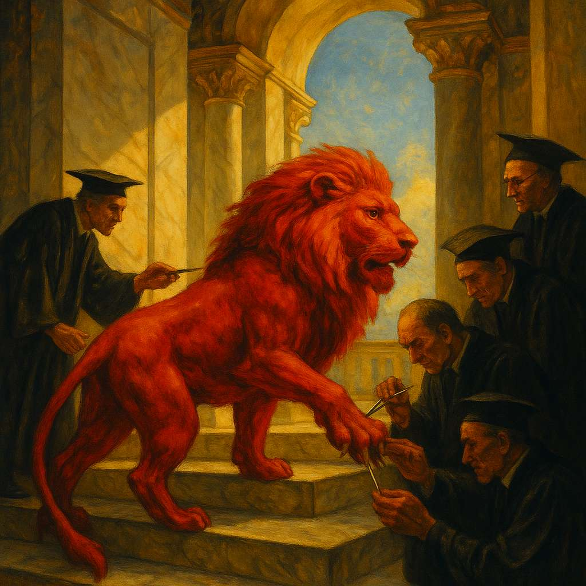
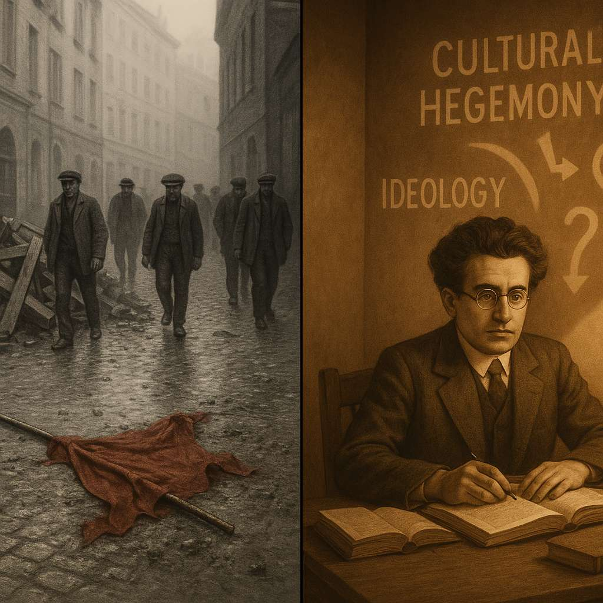
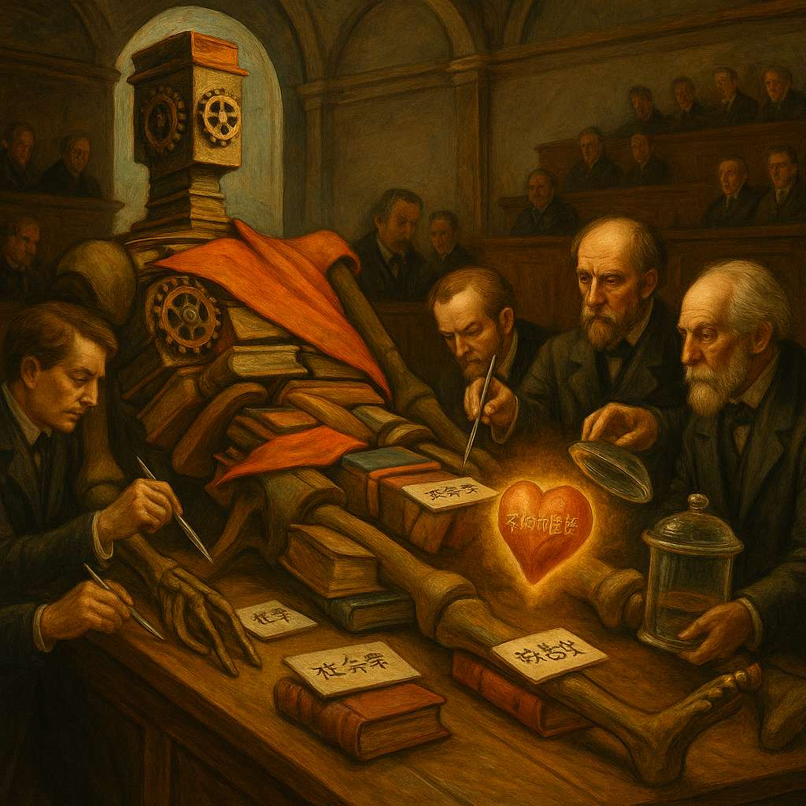

# **系列六 | 马克思主义问题（二）**

## **解构西方的“沉默”：收编、改造与学术化的思想围城**

## **引言：一个比“压制”更复杂的故事**

在当代关于马克思主义的讨论中，一个流传甚广的观点认为，西方世界出于对其颠覆性的“惧怕”，而刻意对马克思主义保持着一种系统性的“沉默”。

这种叙事描绘了一幅思想压制的图景：一个强大的资本主义体系，动用其全部力量将一个危险的、与之对立的理论驱逐出公共与学术领域。

然而，尽管这一观点在宏观政治层面，尤其是在冷战的激烈对抗时期，具有不容否认的真实性，但它却极大地简化了过去一个世纪里西方思想界与马克思主义之间复杂、微妙且影响深远的互动。

现实远非简单的“沉默”或“压制”所能概括。事实上，西方主导意识形态体系所采用的，是一种远比直接禁止更为精巧、也更为有效的策略——**收编与改造**。

通过一个被称为“学术化”（academicization）的漫长过程，马克思主义在很大程度上从一种旨在彻底推翻资本主义的革命性政治经济学理论，被巧妙地转化为一个专门化的、时常被去政治化的文化与哲学批判工具。它进入了大学的殿堂，却被安置在了一个被严密规训的“思想保留地”之中，其革命的锋芒被钝化，其行动的召唤被消解。

本文旨在深入剖析这一“中和”与“收编”的复杂过程。我们将追溯“西方马克思主义”的诞生，审视其如何因应历史挫败而将理论重心从经济基础转向文化上层建筑。

我们还将考察当代西方学术界如何将马克思主义“学科化”，将其拆解为众多可供选择的分析“镜片”之一，并系统性地将其从主流经济学的核心场域中排除。

通过解构这套精密的思想围城，本文试图揭示，一个主导体系应对威胁性思想最有效的方式，往往不是将其消灭，而是将其吸纳并改造为一个无害化的版本。理解这一点，对于我们思考马克思主义在当代中国的地位，以及构建真正自主的知识体系，具有至关重要的警示意义。

### **1. 历史的拐点：从革命失败到“西方马克思主义”的诞生**

要理解马克思主义在西方的演变，就必须回到一个关键的历史时刻：第一次世界大战后欧洲无产阶级革命的普遍失败。从德国的斯巴达克同盟起义被镇压，到匈牙利和意大利的革命浪潮相继退去，马克思主义者所预言的、由经济危机引发的西欧连锁革命并未成为现实。

这一历史性的挫败，不仅是政治和军事上的，更深刻地动摇了经典马克思主义理论的根基，并直接催生了后来被称为“西方马克思主义”的思想流派。

这一挫败导致了佩里·安德森（Perry Anderson）所精准概括的“社会主义理论与工人阶级实践的分离”。经典马克思主义的核心特征在于其理论与革命实践的紧密结合，理论家本身往往就是政党领袖和工人运动的组织者。

然而，当西方的工人阶级并未像预期的那样成为革命的主体，甚至在相当程度上被整合进资本主义体系之后，理论家们与他们曾经的革命基础渐行渐渐远。这种分离迫使他们将研究的重心进行一次决定性的转移。

如果说经典马克思主义聚焦于**经济基础、政治结构与阶级斗争**这些“硬核”议题，那么“西方马克思主义”则几乎是系统性地将目光转向了**文化、哲学、艺术与意识形态等“上层建筑”领域**。这一转向的先驱人物是匈牙利思想家卢卡奇（György Lukács）和意大利的葛兰西（Antonio Gramsci）。卢卡奇在其著作《历史与阶级意识》中，深入阐发了“物化”（Reification）和异化的概念，将分析的重点从纯粹的经济剥削，转向资本主义如何渗透并扭曲人类的意识与社会关系。葛兰西则在狱中提出了影响深远的“文化霸权”（Cultural Hegemony）理论，雄辩地论证了资产阶级的统治并不仅仅依赖于国家机器的暴力，更依赖于通过文化、教育和媒体等机构制造出一种被统治阶级自愿接受的“共识”。

紧随其后的法ранк福学派（如霍克海默、阿多诺、马尔库塞等）则将这一转向推向了极致。他们对“文化工业”、大众传媒、消费主义和技术理性进行了猛烈的批判，深刻揭示了发达资本主义社会如何通过文化产品来塑造和麻痹大众意识，从而消解任何反抗的可能。

这一系列理论创新的共同点在于：它们不再直接探讨如何夺取政权或变革所有制，而是转而追问：**“在经济决定论似乎失效的情况下，资本主义的文化和意识形态是如何维持其统治的？”** 这使得马克思主义在西方学术界得以幸存，甚至在某些领域（如文化研究、社会学理论、文学批评）获得了极大的发展。但这种“幸存”是有代价的。它以牺牲理论的直接政治性与革命性为前提，使其日益远离了马克思本人所强调的“哲学家们只是用不同的方式解释世界，而问题在于改变世界”。因此，“西方马克思主义”的诞生，既是一次深刻的理论创新，也是一次重大的政治退却。它为马克思主义在西方的“学术化”铺平了道路，也预示了其最终被“收编”的命运。

### **2. 象牙塔中的雄狮：马克思主义的“学术化”及其后果**

“西方马克思主义”所开启的理论转向，为马克思主义进入并立足于西方大学提供了完美的契机。然而，大学这一独特的制度环境，在接纳马克思主义的同时，也对其进行了深刻的规训与改造，最终完成了对其颠覆性的“中和”。这一“学术化”过程主要通过以下几种机制实现：

**首先是学科化的分割与拆解。** 在现代大学高度分化的学科体系中，马克思主义作为一个原本旨在提供总体性世界观的宏大理论，被人为地进行了“肢解”。它的不同部分被分配到不同的学科领域中去。其哲学思想（如异化、历史唯物主义）被归入哲学系和思想史课程；其政治理论（如国家理论、阶级斗争）进入了政治学系；其社会分析（如社会分层、意识形态）成为社会学的研究对象；而其文化与美学思想，则在文学系、艺术史和新兴的文化研究领域大放异彩。

这种分割的直接后果是，学生和研究者接触到的，往往是一个个被“专业化”了的马克思主义碎片，而非其作为一个整体的革命性蓝图。人们学习如何“运用葛兰西的霸权理论分析一部电影”，或者“用马克思的异化概念解读一首诗”，却很少被引导去思考这些理论与现实政治经济制度的根本变革之间的联系。马克思主义从一套旨在“改变世界”的行动指南，变成了一套用于“解释世界”的学术工具箱，成为众多理论“范式”或“视角”中的一种，与韦伯、涂尔干、福柯等人的理论并列，供学者们在学术市场上自由选用。

**其次是主流经济学的系统性排斥。** 这是整个“学术化”过程中最为关键、也最具决定性的一环。尽管马克思主义在人文学科和社会科学的许多分支中占有一席之地，但在被视为现代资本主义“圣殿”的主流经济学界，它却几乎被完全放逐。马克思经济学的核心——劳动价值论，早在19世纪末就被边际效用论所取代，并被现代主流经济学视为早已“过时”的理论。

这意味着，马克思主义对资本主义最根本的批判——即对其核心生产方式、剥削机制和内在矛盾的经济学分析——在最重要的学术场域中被系统性地“沉默”了。没有了经济学内核的支撑，马克思主义在其他领域的批判，无论多么激烈，都容易显得像是“漂浮在空中”，缺乏坚实的根基。这就好比允许人们自由讨论一栋建筑的装修风格、文化象征甚至居住者的心理状态，却唯独禁止讨论这栋建筑的地基和结构是否稳固。这种选择性的接纳与排斥，精准地切断了马克思主义理论中最具威胁性的部分。

**最后是研究者身份的“去政治化”。** 随着马克思主义研究在大学里制度化，成为一种可以带来教职、研究经费和学术声望的职业路径，成为一名“马克思主义学者”也逐渐从一种政治身份转变为一种学术身份。理论探讨取代了政治组织，发表学术论文取代了发布行动纲领。这种环境自然会筛选和塑造出更适应学术游戏规则的学者，而非致力于颠覆现有秩序的革命者。

综上所述，“学术化”是一个极其成功的收编过程。它表面上给予了马克思主义以学术尊荣和生存空间，但实际上却通过学科分割、核心排斥和身份改造，系统性地消解了其政治上的颠覆性。西方大学里的马克思主义，就像一头被拔去利爪和牙齿的雄狮，虽然仍被允许在“理论动物园”里漫步，供人观赏和研究，但已不再对园外的世界构成真正的威胁。因此，西方世界对马克思主义的反应，并非简单的“闭口不谈”，而是一种更为高明的策略：**允许你“谈”，但要在我设定的规则、领域和话语体系内谈。** 这种看似开放的围堵，远比粗暴的压制更为有效和持久。

### **结论：对中国构建自主知识体系的启示**

通过深入剖析西方世界“学术化”马克思主义的复杂过程，我们可以清晰地看到，那种认为西方因“惧怕”而完全“沉默”的观点，未能捕捉到问题的本质。西方的策略并非压制，而是更为精巧的“中和”与“收编”。它成功地将一种革命性的政治经济学，改造为一种主要在上层建筑领域进行批判的哲学和文化理论，并将其安全地禁锢在象牙塔的围墙之内。

这一分析对于我们理解当前中国所面临的“马克思主义问题”，具有深刻的启示。

首先，它清晰地界定了两种性质截然不同的马克思主义。在西方学术界占据主导地位的“西方马克思主义”，其根本属性是在资本主义体系**“内部”**对其进行的一种文化与哲学层面的**“批判”**。它的理论预设、问题意识和分析工具，都是围绕着发达资本主义社会的内部矛盾展开的。而对于当代中国而言，马克思主义的核心任务，是作为**“建设”**社会主义现代化强国的理论**“工具”**和行动指南。试图将一个主要用于“内部批判”的理论，直接移植来指导“外部建设”，必然会导致前文所述的“水土不服”与“理论死胡同”。

其次，这一分析极为有力地佐证了中国推动“构建哲学社会科学自主知识体系”的极端重要性与紧迫性。它警示我们，绝不能天真地认为可以从西方大学里“引进”一套现成的、有活力的马克思主义理论。因为被允许在西方学术界流通的马克思主义，在很大程度上已经是经过“去势”处理的版本。中国学者如果满足于仅仅是学习、模仿和套用这些理论框架，那么就有可能在不经意间，将自身的研究锁定在西方设定的议程之内，从而丧失理论的自主性和现实的解释力。

因此，要真正激活马克思主义在中国的生命力，就必须走出一条自己的路。这条路的核心，正是“两个结合”——即将马克思主义基本原理同中国具体实际相结合，同中华优秀传统文化相结合。这并非一句空洞的口号，而是一项艰巨卓绝的智识工程。它要求我们必须摆脱对西方学术范式的路径依赖，敢于从中国波澜壮阔的社会实践中提炼出新的概念、新的范畴和新的理论，用自己的话语来解释自己的道路。

解构西方对马克思主义的“沉默”骗局，其最终目的，是为了更清醒地认识我们自己所处的思想方位和时代任务。只有深刻理解对手的战略，才能真正建立起自己的思想防线，并在此基础上，铸就真正属于21世纪中国的、指导民族复兴伟业的马克思主义新篇章。

