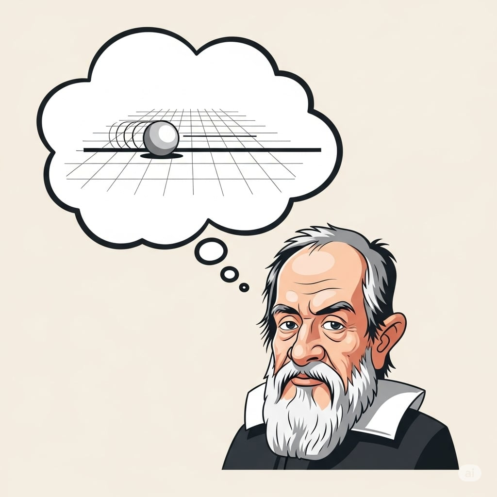

## 引子

朋友，你有没有这种感觉：我们正生活在一个“内卷”又“加速”的时代。

上班要跟同事卷，下班要跟朋友圈卷；工作节奏快得让人喘不过气，新东西层出不穷，好像总有一只无形的手在后面推着我们跑，想停都停不下来，生怕一不小心就掉队了。

我们一边享受着科技带来的便利，一边也承受着它带来的疲惫。

但你有没有想过，这个让我们“逃不掉”的循环，它的**“根子”** 到底是什么？为什么我们的世界偏偏是今天这个样子？

答案藏在两个词里：**资本和技术**。它们不是各自为政，而是一对相互成就的搭档——我们现代社会的底层代码，就是它们一起写出来的。

接下来，我们花点时间，聊聊这对搭档是如何联手塑造出今天这个世界的。

## **第一章：给“赚钱”找一个体面的理由**

在很久很久以前，“老板”这个物种还很稀有。社会上谁说了算？是国王和贵族，他们靠血统和手里的剑。

后来，城里的一些商人、工厂主慢慢变有钱了。但他们地位很尴尬，老贵族们从内心深处瞧不起这些“暴发户”，觉得他们浑身都是铜臭味。这帮新富起来的老板们，自己心里也嘀咕：“我天天琢磨怎么赚钱，是不是有点不太光彩？”

所以，他们当时特别需要有人来为“赚钱”这件事，找一个体面的理由。

还真让他们找到了两个有力的帮手：

**帮手一：新教——赚钱，是上帝对你的认可**

当时欧洲爆发宗教改革，新教应运而生。新教的牧师们有一套新说法，简直是给老板们量身定做的精神按摩。他们说：你能赚到钱，说明你工作勤奋、生活自律，这恰恰证明你是上帝的“天选之子”，是上帝在保佑你。

这套说法一出，商人们的心态立刻不同了。原来赚钱不是因为贪婪，而是在完成上帝给的任务，是在荣耀上帝。从此，他们赚钱赚得心安理得、理直气壮。他们赚了钱也不敢乱花，而是省吃俭用，把利润全都投回去扩大生产，因为工厂的规模越大，就越能证明自己没被上帝抛弃。

**帮手二：理性主义——世界像一台大机器，得用脑子算计着来**

同一时期，哲学家们也掀起了一场思想革命。他们说，这个世界不是什么神秘花园，它就像一台巨大的、精密的钟表，可以用理性和数学把它研究得明明白白。

这套想法，与商人们的日常思维不谋而合：开公司、办工厂，每天打交道的不正是成本、利润、效率这些数字吗？把世界看成一台可以计算的机器，这不正是生意人的思维方式吗？

就这样，靠着“上帝的支持”和“理性的头脑”，资本家们终于为自己正名，可以放开手脚干了。

## **第二章：“老板思维”如何改变了科学**

当“算计”和“量化”成了主流思想后，有趣的事情发生了——它不仅改变了商业，甚至连“科学”这门高冷的学问，都被带得有点“跑偏”了。

在此之前，需要先破除一个常见的误解。我们总觉得，科学嘛，就是牛顿、爱因斯坦这些天才，在实验室里探索宇宙的终极真理，这跟社会上谁有钱谁没钱有什么关系？

关系很大。马克思说过一句相当尖锐的话，大意是：**“要是有人跟你说，生活是一回事，科学是另一回事，那他肯定是在忽悠你。”**

这句话的意思是，一个社会怎么组织生产、怎么赚钱，就会决定它怎么做科学。**你用什么眼光看待你的生意，就会用同样的眼光去看待星星和苹果。**

核心的转变，就在于“**抽象化**”这个听起来有点玄乎的词。

说白了就是：一个鞋匠和一个铁匠。你作为老板，怎么比较他俩的劳动价值？很简单，别管他们具体在干啥，也别管鞋子好不好看、铁锤结不结实。你就只算一件事：**完成这活儿花了多长时间。**

“你这双鞋花了20小时，他那把锤子花了2小时，好，一鞋换十锤，成交！”

你看，在这个“老板思维”里，所有活生生、有手感、有温度的劳动，都被“抽象”成了冷冰冰的数字。

接下来，神奇的事情发生了：**科学家们开始用一模一样的“老板思维”去研究自然。**

古代的科学家，比如亚里士多德，他更像个博物学家，靠眼睛看，靠感觉想。他觉得石头重，所以掉得快，这很直观。

但到了伽利略这儿，画风突变。他不在乎现实中石头长啥样，空气有多大阻力。他在脑子里玩了一个“思想游戏”：**假设有个完美的球，在一个绝对光滑的平面上滚动……他通过这种纯粹的、抽象的数学计算，得出了全新的物理定律。**

为啥伽利略能这么干？因为他生活的那个时代，资本主义已经萌芽了。整个社会的“操作系统”，已经从“凭感觉”升级到了“靠计算”。

那么问题来了，为啥非要把大自然变成一堆数学公式呢？背后只有一个赤裸裸的目的：**为了“控制”！**

你想啊，一旦你能用公式描述一个东西，你就能预测它的行为。一旦你能预测，你就能通过调整公式里的参数去改变它、控制它。**这种对“控制”的渴望，和资本家想要控制成本、控制生产、控制利润的渴望，简直一模一样。**

所以，近代科学从一开始，就带着强烈的“技术”属性。它不仅仅是“看懂世界”，更是为了“改造世界”，把它变成一个可预测、可利用、能为我所用的资源库。

## **第三章：停不下来的“升级”，老板为什么总想要新机器？**

好了，现在这位有钱、有理、有科学思维的“老板”，他的人生目标只有一个：让钱生出更多的钱。

怎么才能让利润最大化？两条路：

:::block-1
1.  **笨办法：让大家加班。**（延长工作时间）

    但这招很快就不灵了。工人会累，会反抗，一天也就24小时，总不能不让人睡觉吧。

2.  **聪明办法：让大家在同样的时间里，干出更多的活儿。**（提高效率）

    这才是真正的财富密码！
:::

怎么提高效率呢？一开始，老板们想把人变成机器。有个叫泰勒的“管理大师”，就拿着秒表去研究工人的动作，把所有他觉得多余的花架子都砍掉，让工人像机器人一样干活。

但人毕竟不是机器，总有极限。于是，终极解决方案闪亮登场——**用真正的机器！**

一个人手再快，也快不过一台机器。一台机器不会喊累，不会闹情绪，只要给它能源，它就能24小时高效产出。在机器面前，人的手艺和技巧，突然变得不那么重要了。

**机器，成了这套系统里效率最高的加速模块，是提高效率、让老板赚取更多利润的最强推手。**

从此，资本和技术就锁死了，进入了一个疯狂的“内卷”循环：

> 你家工厂买了新机器，效率翻倍，成本降低，抢走了我的订单 → 为了活下去，我只能借钱买个更牛的机器 → 整个行业的效率都上去了，大家又回到同一起跑线，利润变薄了 → 为了再次领先，你又开始琢磨，有没有更新、更快的技术……

这个循环，一直持续到今天。这就是为什么我们感觉世界越转越快，因为资本这个“引擎”一旦发动，就必须靠技术这个“燃料”不停地加速。

## **结语：我们都生活在这台“机器”里**

聊到这里，我们大概能明白了。

资本，不光是钱，它是一种改变了世界的思维方式和权力体系。它为了让自己“师出有名”，改造了道德和哲学；它用“一切皆可计算”的眼光，重塑了科学的面貌；最后，它为了满足自己永不停歇的增长欲望，和技术结成了“最佳拍档”。

这对搭档联手，确实创造了巨大的物质财富，让我们过上了古人无法想象的生活。但同时，它也把世界变成了一台高速运转的巨大机器，我们每个人，都是其中的一个齿轮。**自然不再是那个充满神秘和敬畏的家园，更像是一个等着我们去开采的巨大仓库。**

了解这些，不是为了抱怨，也不是为了躺平。而是为了让我们在被这只“无形的手”推着向前跑的时候，能偶尔抬起头，**看得更清醒一点**。

至少，我们可以问问自己：在这场永无止境的“加速”之外，还有哪些东西，对我们来说，同样重要？

