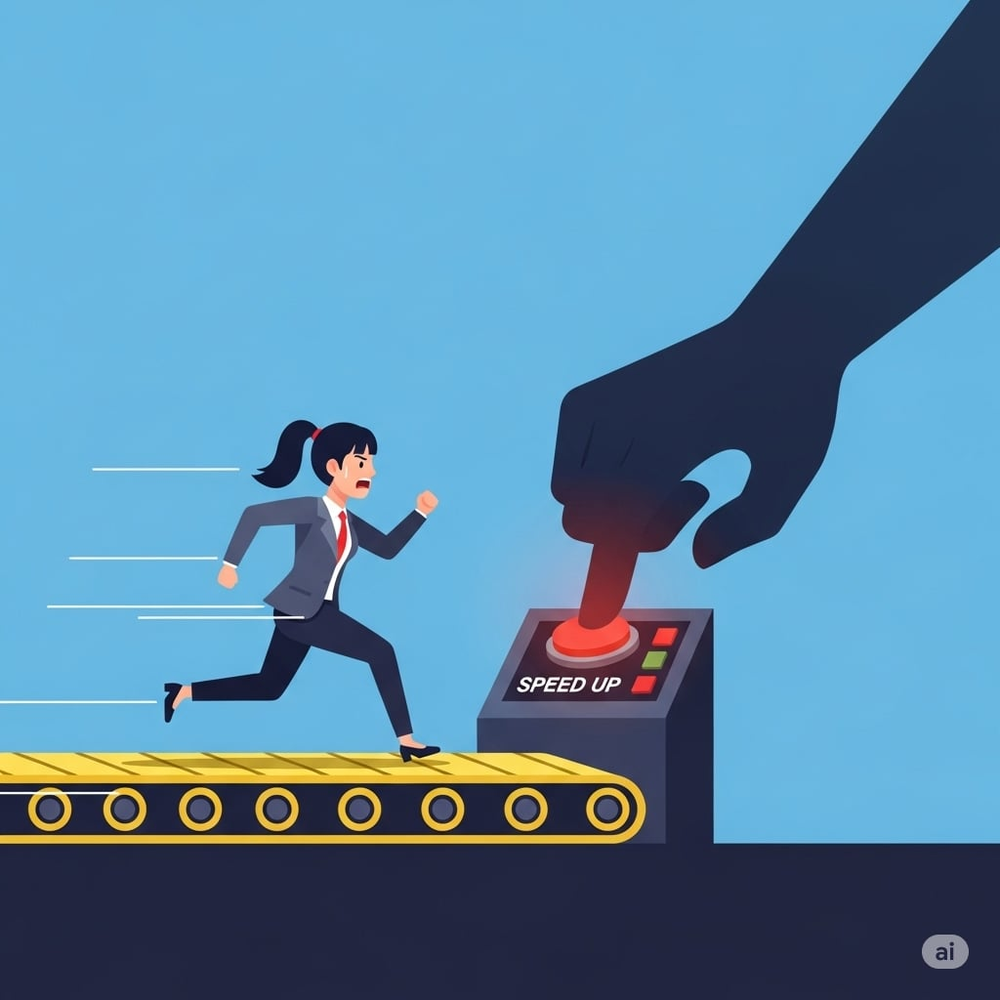
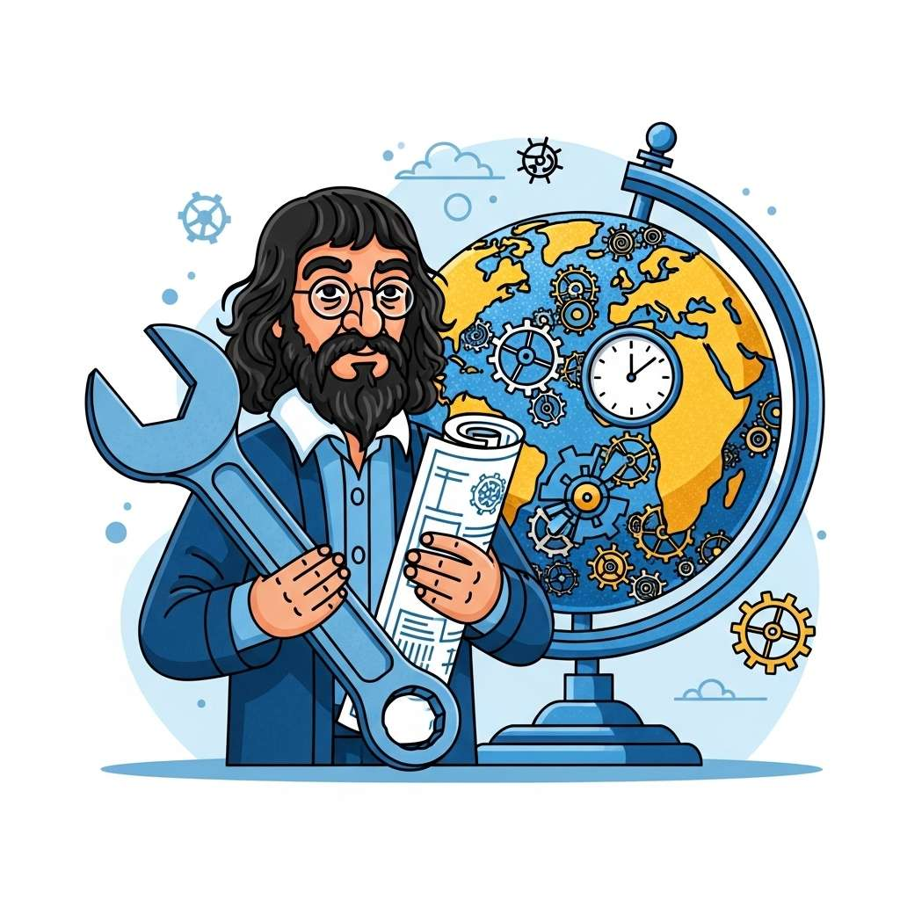
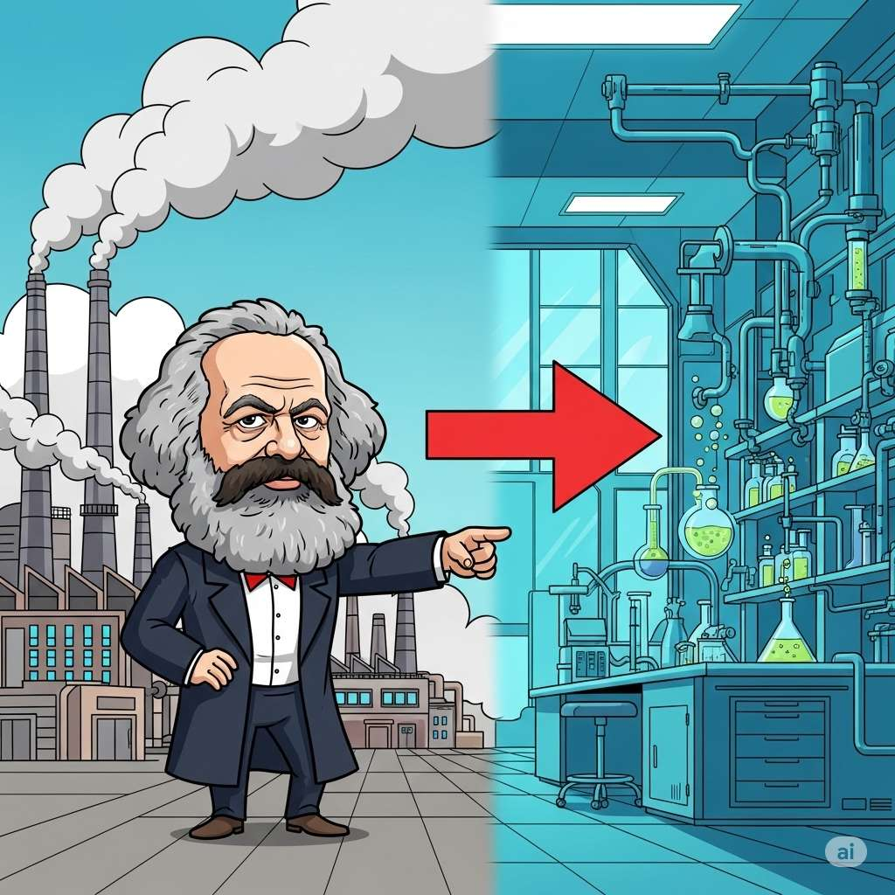
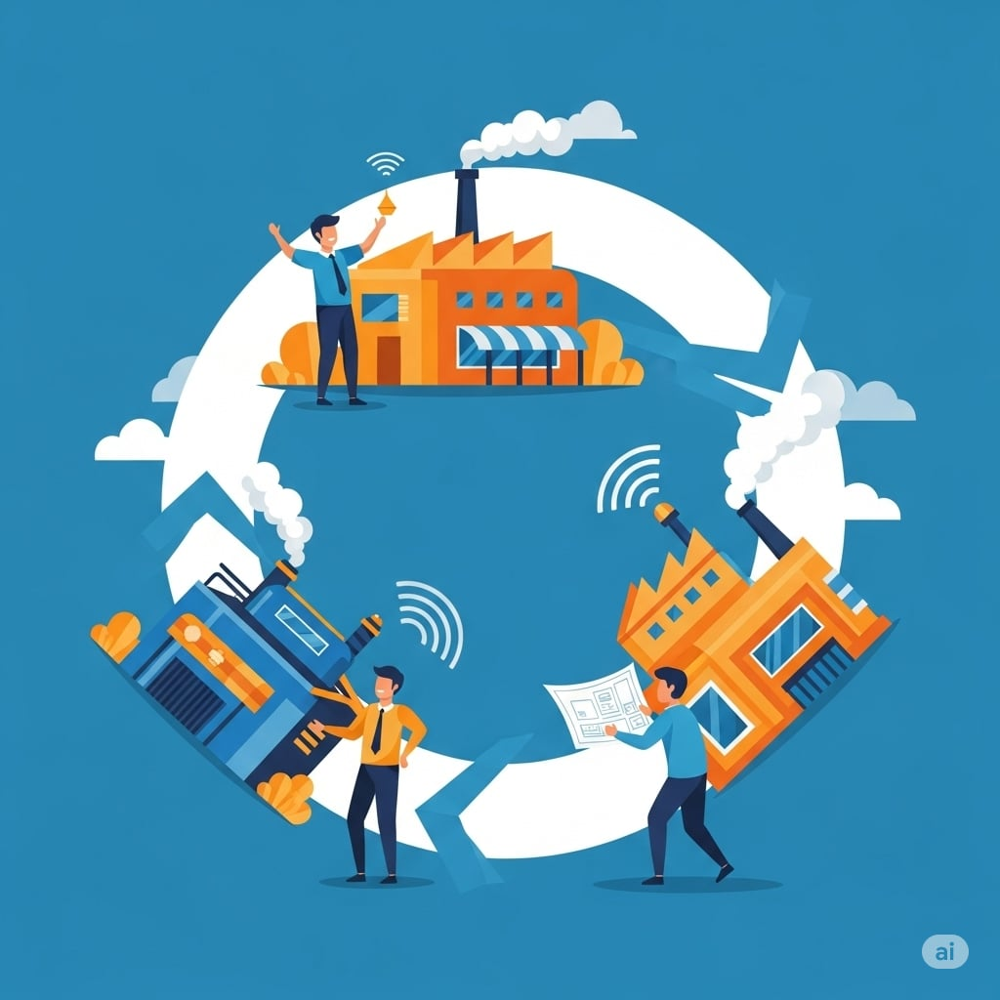

## 引子

朋友，你有没有这种感觉：我们正生活在一个“内卷”又“加速”的时代。

上班要跟同事卷，下班要跟朋友圈卷；工作节奏快得让人喘不过气，新东西层出不穷，好像总有一只无形的手在后面推着我们跑，想停都停不下来，生怕一不小心就掉队了。

我们一边享受着科技带来的便利，一边也承受着它带来的疲惫。

但你有没有想过，这个让我们“逃不掉”的循环，它的**“根子”** 到底是什么？为什么我们的世界偏偏是今天这个样子？

答案藏在两个词里：**资本和技术**。它们不是各自为政，而是一对相互成就的搭档——我们现代社会的底层代码，就是它们一起写出来的。

接下来，我们花点时间，聊聊这对搭档是如何联手塑造出今天这个世界的。

## **第一章：给“赚钱”找一个体面的理由**

在很久很久以前，“老板”这个物种还很稀有。社会上谁说了算？是国王和贵族，他们靠血统和手里的剑。

后来，城里的一些商人、工厂主慢慢变有钱了。但他们地位很尴尬，老贵族们从内心深处瞧不起这些“暴发户”，觉得他们浑身都是铜臭味。这帮新富起来的老板们，自己心里也嘀咕：“我天天琢磨怎么赚钱，是不是有点不太光彩？”

所以，他们当时特别需要有人来为“赚钱”这件事，找一个体面的理由。

还真让他们找到了两个有力的帮手：

**帮手一：把职业当作召命**

这里说的不是所有新教教派都让人靠发财证明得救，而是围绕预定论的一种解释：人不能靠挣钱买来救赎，却可能在有纪律的职业生活中寻找内心的确信。

这套解释与商人的日常生活有个接点：认真经营，克制消费，把结余留给下一轮生意。同样的行为可以被理解为自律，不只是贪婪。但不是赚得越多，就能给自己开一张“天选”证明。

**帮手二：理性主义——世界像一台大机器，得用脑子算计着来**

同一时期，哲学家们也掀起了一场思想革命。他们说，这个世界不是什么神秘花园，它就像一台巨大的、精密的钟表，可以用理性和数学把它研究得明明白白。

这套想法，与商人们的日常思维不谋而合：开公司、办工厂，每天打交道的不正是成本、利润、效率这些数字吗？把世界看成一台可以计算的机器，这不正是生意人的思维方式吗？

一套语言让勤勉经营显得正当，另一套语言让成本和效率变得可比较。两者能彼此呼应，不必设想商人事先定制了这些思想。

## **第二章：鞋匠的钟和研究者的钟**

生意人爱算账，做实验的人也爱测量。这两种“算”，有没有可比的地方？

在此之前，需要先破除一个常见的误解。我们总觉得，科学嘛，就是牛顿、爱因斯坦这些天才，在实验室里探索宇宙的终极真理，这跟社会上谁有钱谁没钱有什么关系？

先别急着把科学从生活里单独摘出去，也别急着说前者全由后者决定。我们可以从一个很小的动作说起：看钟。

在摊开的账本上，鞋和锤子还是两样东西，工时却可以写进同一栏。

核心的转变，就在于“**抽象化**”这个听起来有点玄乎的词。

一个鞋匠做鞋，一个铁匠打锤。要比工时，就可以先记下各用了多久，暂时撇开皮子的手感和锤头的硬度。“只看时间”这个动作就是抽象；它没有告诉你一双鞋最终能卖几把锤子的钱。

再看研究者：设想球在越来越光滑的平面上运动，先把一些干扰搁在一边，才好辨认速度怎样变化。这里与记工时相似的，是为了一个问题暂时撇开另一些差别，不是科学家脑子里装着同一套生意经。

能计算，常常就能更好地预测；能预测，有时就能改进机器。这解释了企业为什么对某些发现特别有兴趣，却不能据此断定伽利略为什么做思想实验，更不能说科学家做研究只有“控制”这一个目的。

## **第三章：停不下来的“升级”，老板为什么总想要新机器？**

好了，现在这位有钱、有理、有科学思维的“老板”，他的人生目标只有一个：让钱生出更多的钱。

怎么才能让利润最大化？两条路：

:::block-1
1.  **笨办法：让大家加班。**（延长工作时间）

    但这招很快就不灵了。工人会累，会反抗，一天也就24小时，总不能不让人睡觉吧。

2.  **聪明办法：让大家在同样的时间里，干出更多的活儿。**（提高效率）

    这才是真正的财富密码！
:::

怎么提高效率呢？一种做法是重新组织人的动作。泰勒的秒表是这个思路的一个例子。另一种是改变设备，让同样人数在同样工时内做出更多东西。这是两条可以同时走的路，不是先有秒表管理、后来才发明机器。

**机器，成了这套系统里效率最高的加速模块，是提高效率、让老板赚取更多利润的最强推手。**

从此，资本和技术就锁死了，进入了一个疯狂的“内卷”循环：

> 你家工厂买了新机器，效率翻倍，成本降低，抢走了我的订单 → 为了活下去，我只能借钱买个更牛的机器 → 整个行业的效率都上去了，大家又回到同一起跑线，利润变薄了 → 为了再次领先，你又开始琢磨，有没有更新、更快的技术……

这个循环，一直持续到今天。这就是为什么我们感觉世界越转越快，因为资本这个“引擎”一旦发动，就必须靠技术这个“燃料”不停地加速。

## **结语：我们都生活在这台“机器”里**

聊到这里，我们大概能明白了。

资本不光是钱，它也是一种迫使企业反复比较成本的关系。一家工厂先换机器，别家随后追上，昨天的优势就成了今天的入场条件。这比“所有人都喜欢加速”更能解释那种停不下来的感觉。

这对搭档联手，确实创造了巨大的物质财富，让我们过上了古人无法想象的生活。但同时，它也把世界变成了一台高速运转的巨大机器，我们每个人，都是其中的一个齿轮。**自然不再是那个充满神秘和敬畏的家园，更像是一个等着我们去开采的巨大仓库。**

了解这些，不是为了抱怨，也不是为了躺平。而是为了让我们在被这只“无形的手”推着向前跑的时候，能偶尔抬起头，**看得更清醒一点**。

至少，我们可以问问自己：在这场永无止境的“加速”之外，还有哪些东西，对我们来说，同样重要？

