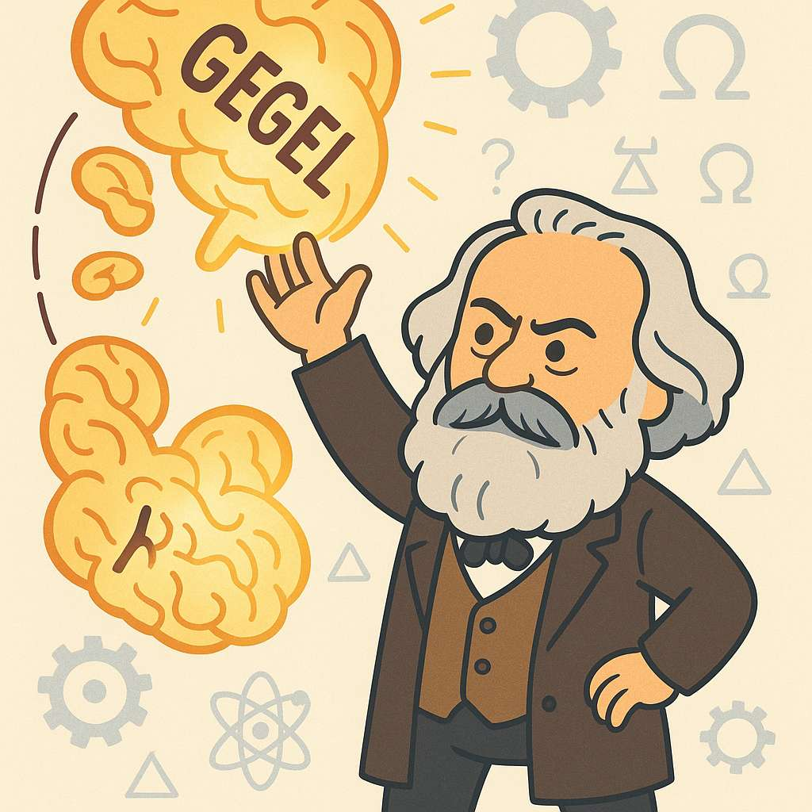
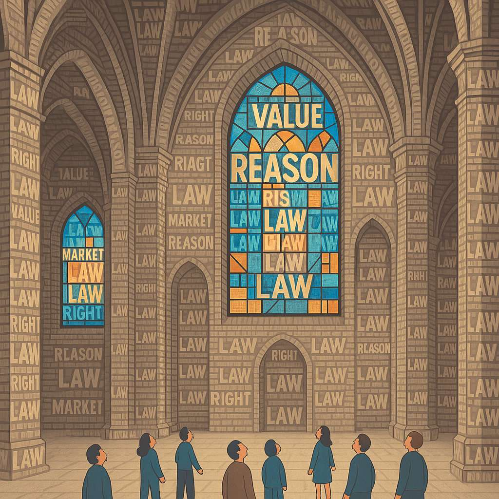
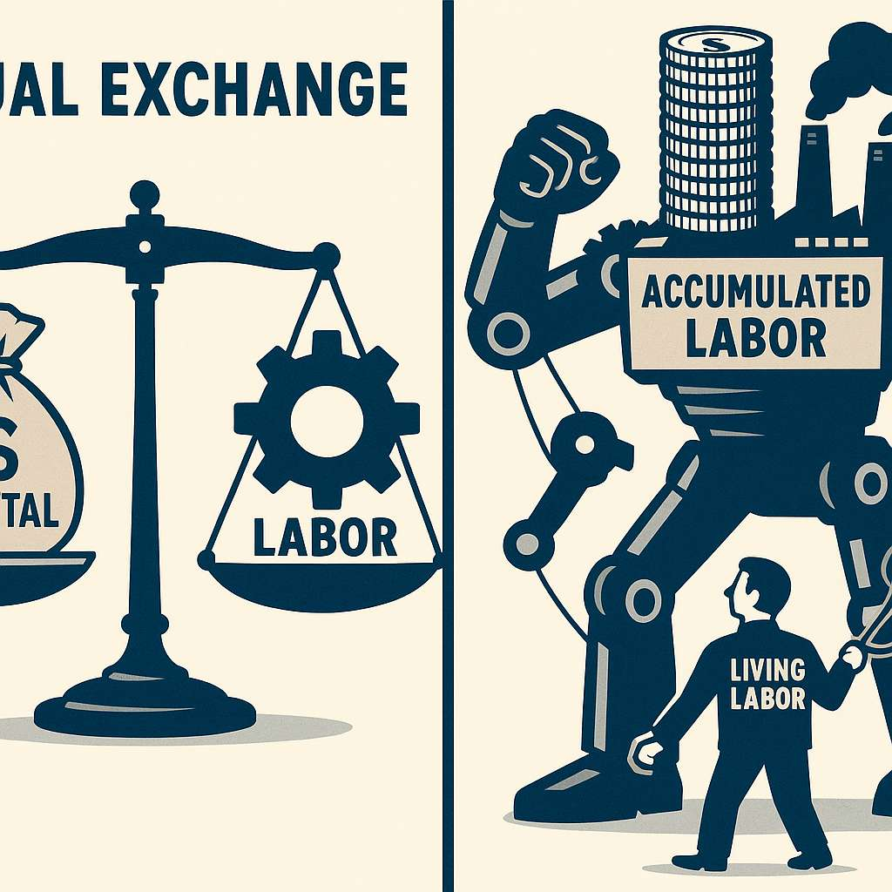
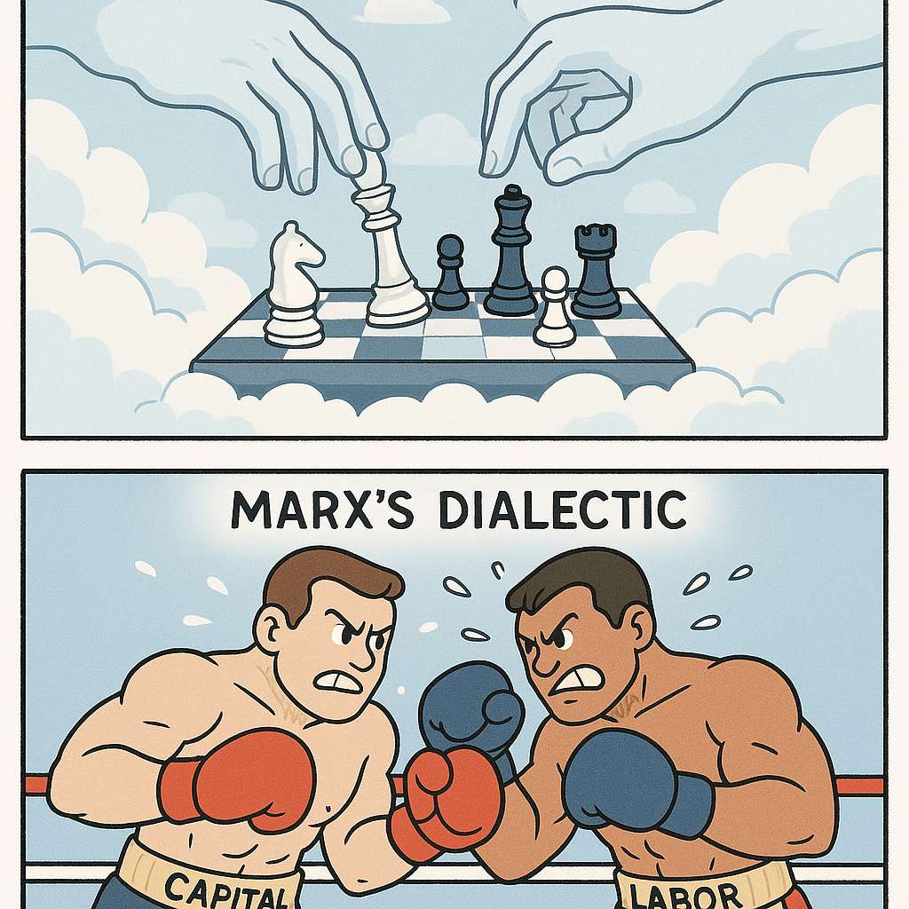
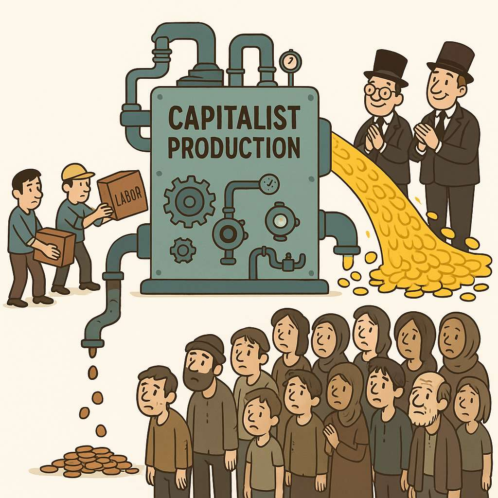

> 我的辩证方法，从根本上来说，不仅和黑格尔的辩证方法不同，而且和它截然相反……在他那里，辩证法是倒立着的。必须把它倒过来，以便发现神秘外壳中的合理内核。
> —— 卡尔·马克思，《资本论》第一卷第二版跋

在[《被范畴遮蔽的现实》](被范畴遮蔽的现实：历史社会科学的出发点.md)中，我们发现自己如同生活在一座由经济、法律等范畴构建的“大教堂”中，冰冷的理性遮蔽了火热的生活。如何走出这座大教堂，回到那被遗忘的“事情本身”？

答案，就蕴藏在马克思所发动的另一场更为深刻的革命之中——一场**社会科学的革命**。

他并非要给这座大教堂再增加一种新的装饰风格（比如“马克思主义经济学”），而是要从根本上改变我们看待和研究社会的方式，创立一种全新的知识类型——**历史科学**。

这门新科学，就像一位技艺高超的修复师，它的任务不是给雕像涂上更漂亮的油彩，而是要小心翼翼地“清洗”掉历代积累的、遮蔽其本来面目的层层油彩和灰尘。

今天，我们就来学习这门为现实“卸妆”的绝技。

## **历史科学的第一招：为现实“卸妆”——清洗范畴**

历史科学的起点，也是它最根本的一步，就是**清洗范畴**。它要求我们像剥洋葱一样，将社会科学强加给现实的那些理性范畴一层层剥掉，直至触及内核。

让我们回到那个最核心的例子：“**资本雇佣劳动**”。

在经济学这座“范畴大教堂”里，这是一个庄严、和谐的圣坛。它由三个核心范畴构建而成：**资本**、**劳动**、**价值**。整个场景被描绘成一场公平的交易：
*   资本家拿出自己的一部分“资本”（积累的价值）。
*   工人出卖一定时间内的劳动力。
*   两者在市场上根据供求关系，进行平等的“价值交换”，工人获得工资，资本家获得服务。
*   这是一个“经济事实”，理性、自愿、不存在超经济的强制。

现在，历史科学的“卸妆”工作开始了。

**第一步：清洗“资本”这个范畴。**
“资本”那华丽的妆容背后是什么？不是一堆会自己生钱的神秘符号，而是**“积累起来的以往的劳动”**。它是一代代劳动者过去的劳动成果，以货币或生产资料的形式，集中到了少数人手中。

**第二步：清洗“劳动”这个范畴。**
雇主买到的不是一堆现成的“劳动”，而是在约定时间内使用劳动力的权利。真正开工以后，消耗的是一个个具体的人的时间和力气。

**第三步：清洗“雇佣/等价交换”这个范畴。**
这层“平等”的粉底之下，隐藏的真实动作是什么？是**“支配”**。因为一方掌握着“积累起来的劳动”（生产资料），而另一方除了“活劳动”之外一无所有，所以后者为了生存，必须接受前者的支配。

好了，卸妆完毕。让我们看看镜子里浮现出的“事情本身”：

:::block-1
**那个和谐理性的“经济事实”——“资本雇佣劳动”——消失了。取而代之的，是一个充满内在张力和权力关系的“生产关系”——“积累起来的劳动支配活劳动”。**
:::

这短短一句话的转换，石破天惊。

它告诉我们，看似平等的交换关系，其本质是一种不平等的支配关系。你可以反驳说：“我现在可以随时炒老板鱿鱼啊！”没错，你可以。但只要你手中没有掌握足够的“积累起来的劳动”（资本），你炒掉这个老板之后，还得去找下一个老板来“支配”你的“活劳动”。这种结构性的支配关系，并未因你个人的选择而改变。

通过“清洗范畴”，合同没有消失，我们却能看见只读合同时容易漏掉的东西：生产资料的占有，怎样左右活劳动的安排。

## **历史科学的第二招：拥抱冲突——感性的辩证法**

当现实的妆容被卸下，我们看到的不再是一张平静的脸，而是一张充满各种表情、甚至因内在矛盾而扭曲的脸。这里有合作，更有对抗；有统一，更有斗争。

如何理解这张充满动态和冲突的脸？马克思动用了他的第二个武器：**感性的辩证法**。

“辩证法”这个词，通常让人联想到黑格尔，联想到“正、反、合”那套在思想的云端里进行的逻辑体操。黑格尔的辩证法，是“概念的辩证法”，马克思形容它是“倒立着的”，用头在走路。

马克思要做的，就是把它整个倒过来，让它用脚站立在坚实的感性大地上。

  * **黑格尔的辩证法**：像一场棋局。白子（正题）和黑子（反题）在棋盘上按照严密的逻辑规则进行推演，最终达到一个更高级的“和棋”（合题）。整个过程是纯粹思维的、超然的。
  * **马克思的辩证法**：像一场拳击赛。红方和蓝方，两个活生生的、有血有肉的拳手，在拳台上相互冲撞、攻击、防守。他们的每一个动作，都充满了力量、汗水和疼痛。比赛的结果，不是逻辑推演出来的，而是双方在真实的、感性的对抗中打出来的。

“积累起来的劳动”（资本）与“活劳动”（工人）的关系，就不是一个可以被经济学范畴的逻辑所“消解”的矛盾。它是一场真实的、持续进行的拳击赛。有时，双方会达成暂时的“合作”（比如签订集体合同、提高工资福利），但这种合作，是在对抗和斗争（比如罢工、谈判）的基础上达成的，并且随时可能因为新的冲突而打破。

历史科学，就是要直面这场“感性辩证法”的拳击赛，描述它的进程，分析双方的力量和策略，揭示其内在的运动规律，而不是像个裁判一样，试图用一套抽象的规则去宣布比赛在理论上“已经结束了”。

## **历史科学的应用：戳破“创新型资本主义”的童话**

掌握了“清洗范畴”和“感性辩证法”这两招，我们就有了一副X光眼镜，可以看穿许多看似美好的社会改良方案的本质。

设想有一项商业计划，要靠卖更便宜的产品让穷人受益。这个希望值得认真对待：少花的钱是真钱。可如果买家正是制造这种产品的工人，商品降价之后，他能不能决定自己的工时和工资？

我把这种方案同马克思在《哲学的贫困》中讨论的“博爱学派”作个比较。相似之处在于，想保留利润和市场，同时消除与这些关系相连的对抗。这是借旧问题追问今天的方案，不是说马克思评论过某次现代演讲。

历史科学会冷静地指出这个童话的破绽：
1.  **“清洗范畴”后我们知道**：你所希望服务的“穷人”，他们的贫困，恰恰是“市场经济”这个体系本身，依据其“剩余价值”生产原则，首先**制造**出来的。资本的利润，其源头必然是对劳动者剩余劳动时间的无偿占有。这是一个硬币的两面。
2.  **“感性辩证法”告诉我们**：资本主义生产关系，其核心就是“积累起来的劳动支配活劳动”的对抗性关系。这个对抗必然导致财富向一端聚集，贫困向另一端积累。二次分配（如税收、慈善）或许可以缓和症状，但只要一次分配的生产关系不变，这个“制造贫困”的引擎就永远不会停止。

所以，问题不在于“如何让市场为穷人服务”，而在于这个生产方式本身就在系统性地、持续性地制造贫困。试图在不改变游戏规则的前提下，让所有人都成为赢家，这本身就是一个逻辑上的悖论。

**结语：从解释世界到获得改变世界的蓝图**

现在，我们可以完整地理解马克思的“历史科学”了。

它不是另一门社会科学，而是对所有社会科学的“批判”。《资本论》的副标题“政治经济学批判”，其意义就在于此。它不是一本更高级的经济学著作，而是一部从根本上解剖和颠覆整个政治经济学基础的著作。

历史科学的诞生，意味着人类知识迎来了一种全新的可能。它要求我们将这种“清洗”和“批判”的方法，应用到政治学、法学、社会学乃至自然科学史等一切领域。

回到“解释世界”和“改变世界”，用本文的大教堂来打比方：与其只解释建筑落成后的样子，不如也问问谁建造了它，又是谁一直在维护它。这就是我在这里说的“解释实践”。

这里需要交代一点分寸：“清洗范畴”不等于宣布一切范畴都是骗局。价格、契约这类范畴，确实也承载着协调分工、降低交易成本的真实功能，不是纯粹的虚构。历史科学要拆穿的，是把它们当成“自古皆然、别无可能”的自然事实、看不见其背后支配关系的那种叙述方式，而不是否认它们曾经解决过真实的问题。守住这条界线，“卸妆”才是一种分析，而不是一种虚无主义。

当你通过“解释实践”，看清了我们这座社会大厦是如何被建造、被维护的，你就不仅仅是在“解释”它了。

你已经拿到了一张它的X光片和结构设计图，看到了它的病灶、裂缝和承重柱。这张图纸，是你理解“改变世界”这句话该从何处着手的起点。

