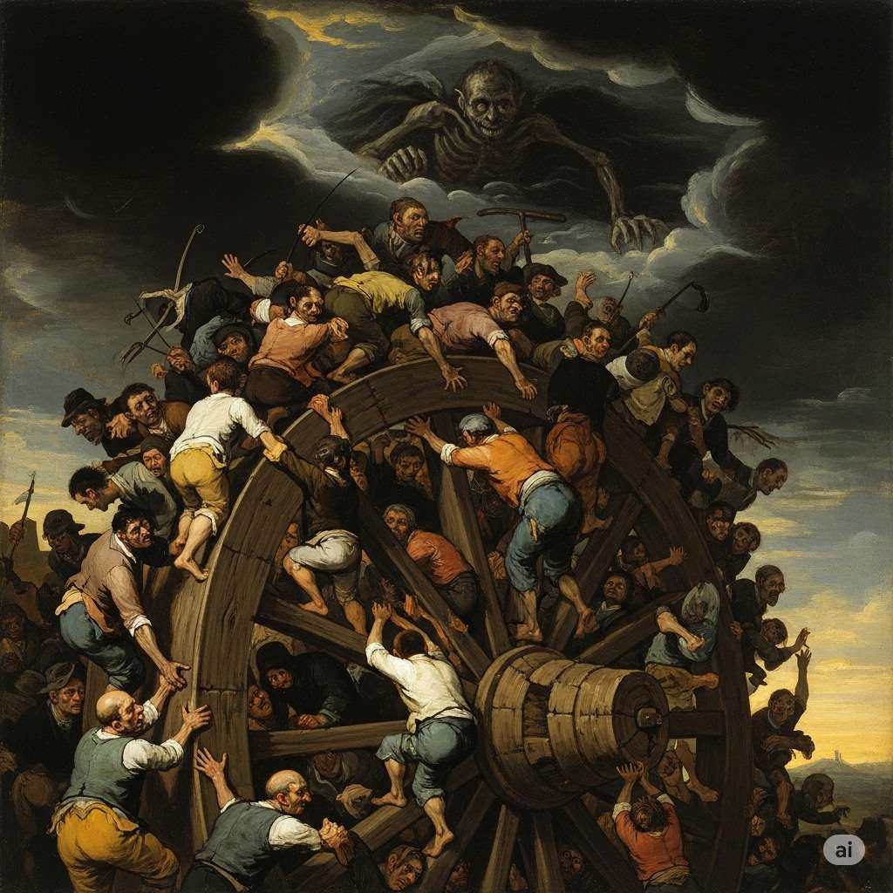
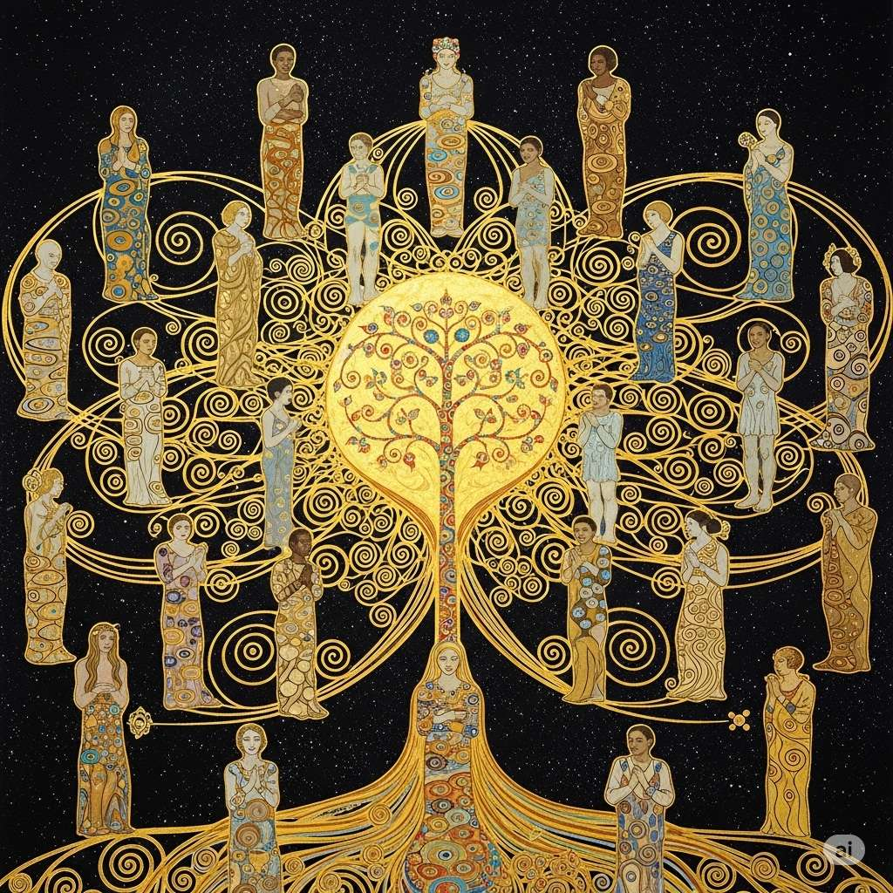

## 缘起：我为何要写“面包的寓言”？

朋友，你好。

在展开今天的随笔之前，我想先坦诚地聊聊，我为什么会写那三篇关于面包的寓言故事。

和我们这一代许多人一样，我的大学和考研备考阶段，都绕不开马克思主义哲学。但说实话，那时候它对我来说，更多的是一些需要背诵的知识点，一些僵硬的条条框框。**面对那些抽象的概念和宏大的论断，我总感觉隔着一层，始终无法真正地“感同身受”。**

这种困惑，一直持续到几年前，我偶然在B站上看到了王德峰老师的课程《马克思的哲学革命及其当代意义》。毫不夸张地说，那是一种**醍醐灌顶**的感觉。许多过往人生中感受到的、却又说不清道不明的无力感、身不由己，仿佛都在他的讲述中找到了逻辑的根源。我心中积郁多年的诸多困惑，在那一刻豁然开朗。

从那以后，我没事就反复看那个课程。但同时我也意识到，即便王老师的讲解已经足够精彩，它对于许多没有哲学基础的普通人来说，依然有不低的门槛。于是我便萌生了一个想法：我能不能用一种更柔软、更贴近生活的方式，把这套深刻的道理，变成几个一听就懂的故事？

这就是那三篇“面包寓言”的由来。我希望它能成为一座桥梁，让更多的人，特别是那些在教育阶段对它感到枯燥、认为它“没用”的朋友，能够重新走近马克思主义哲学，把它当做一个**真正能解释我们现实困境、值得我们深入思考和讨论的强大思想工具**。

而今天，我想做的，就是顺着这座桥，聊聊我们身处的、最真切的当下。

## 寓言照进现实：我们的“理想小镇”

我时常觉得，我们这一代人，仿佛是活在一个巨大的、逻辑无比自洽的“理想小镇”里。**从小，我们就被一套“理性”的话语体系所包裹：好好学习，考上好大学，找到好工作，你就能拥有美好的未来。**这就像寓言里那个“一个面包卖10个铜板”的规则一样，清晰、公平、不容置疑。我们笃信不疑，拼尽全力地去玩这场游戏。

然后，我们长大了，走进了社会。我们手里攥着辛辛苦苦积攒的“10个铜板”——我们的学历、我们的努力、我们对未来的憧憬——我们想去换那个属于自己的“面包”。

可我们看到了什么？

我们看到，那个我们赖以生存的、最基础的“面包”——房子，它的价格早已不是我们口袋里那“10个铜板”所能衡量的了。它更像是寓言里的面包师手中那“多余的面包”，**它不再仅仅是居住的必需品，它成了一种资格，一种筛选机制，一种无需言语就能支配我们未来数十年人生的“社会权力”**。

为了得到这块“面包”，或者说，为了获得一个能稳定换取“面包”的资格（一份体面的工作），我们发现自己成了那个站在面包店门口的“流浪汉”。我们拥有的，只剩下我们自己的时间和劳动力。于是，一场看似“公平自愿”的交易开始了。

我们签订劳动合同，那份白纸黑字的《劳动合同》，就像寓言里写的那样，处处闪烁着“理性”和“契约精神”的光辉。它告诉你，你付出劳动，公司支付报酬，这是平等的交换。但我们心里都清楚，当成千上万的人都在争抢一个工作岗位时，当我们的生存完全依赖于这份薪水时，这种“平等”背后，**天平究竟倾向于哪一边**。

于是，“内卷”开始了。这不就是一群饥饿的“流浪汉”，为了能换到面包师手中的那个面包，**争先恐后地向他证明“我劈的柴比别人更多、更快、更好”吗？** 我们相互竞争，不是为了创造更大的价值，而只是为了获得一个被支配的资格。我们把无意义的消耗当成奋斗，把对身体的透支包装成“成长”，我们每个人都精疲力尽，却发现那个面包的价格，依然在水涨船高。

慢慢地，有些人累了，倦了。他们看懂了这场游戏的本质。他们发现，无论自己怎么努力劈柴，面包师手中的面包只会越来越多，而自己能得到的，永远只是那个勉强糊口的面包。**于是，他们选择了“躺平”。这是一种最无声，也最无奈的反抗。它不是懒惰，而是一种清醒。** 就像那个流浪汉，他或许会对着面包师说：“算了，你的面包我不要了，你的柴我也不劈了。我饿死，也好过在你制定的规则里，被活活累死。”

## 最动听的故事：为社会权力打造的“理性”外衣

而最精妙的，是寓言里的第三幕。当这一切发生时，总会有无数个“亚当先生”站出来，用一套套宏大而完美的经济学理论告诉我们：这一切都是“市场规律”！房价高，是“供需关系”决定的；你找不到工作，是你的“竞争力”不够；996是“奋斗者”的福报，是为了整体的“效率”。

这些理论，就像《小镇经济学原理》，它们是如此的“可爱而可信”。它们把一个充满着权力、资本和历史积累的不平等问题，巧妙地转换成了一个个关于个人选择和理性计算的技术问题。
> 它让我们相信，我们之所以困顿，不是规则出了问题，而是我们自己不够努力。**这是这个时代最宏大，也最令人窒息的PUA。**

## 从切肤之痛到坚定信心：我们这一代的觉醒

写到这里，你可能会觉得我的文字里充满了悲观和煽动。

是的，我从不否认这种切肤之痛。因为寓言里的一切，不仅仅是理论推演，在某种程度上，它就是我们这一代人生活的逻辑本身。我们中的许多人，都曾是“理性”最忠实的信徒。**我们坚信，只要遵循规则，只要勤勤恳恳地掌握一门复杂的技艺，付出足够的时间和努力，就理应能换来一个安稳而有尊严的生活。**

然而，现实却给我们上了最深刻的一课。当严谨的逻辑推导，最终却指向一个荒诞的结果时，我们不得不去反思：问题，或许不在于我们不够努力，而在于**游戏规则的起点，就存在着一个被刻意忽略的前提**。

但你问我是否因此而绝望？不，恰恰相反，我所有的信心都根植于此。

**真正的绝望，不是愤怒，不是呐喊，而是麻木与默然的接受**。而今天，无论是“内卷”的疲于奔命，还是“躺平”的无声抗议，都已经震耳欲聋地宣告：**我们这一代人，拒绝再麻木地走下去**。

这种觉醒，是我信心的第一个来源。我看到它发生在我们身边的每一个角落——在深夜朋友间的交谈里，在网络上心照不宣的段子里，在我们对那些“理所当然”的规则发出的每一次追问里。我们这些曾经最原子化、最信奉个人奋斗的个体，正在重新连接彼此，开始意识到我们共同的困境，并尝试去描绘我们共同的出路。我们不再孤单地面对那个强大的“面包师”，**我们开始成为了彼此**。

我信心的第二个来源，是一种更宏大的历史感。寓言里的“社会权力”看似坚不可摧，它为自己打造了法律、道德甚至科学作为铠甲。但历史的规律告诉我们，**人民对公平正义和美好生活的向往，是最终极的、能穿透一切铠甲的力量**。没有任何一种权力结构可以宣称自己是历史的终点。那些看似牢固的东西，其本身就在不断地运动和变化之中。

因此，我们这一代人的迷茫与痛苦，绝不是一个时代的尾声，它恰恰是一个新时代的序章。它迫使我们去思考，去学习，去辨认那些曾经被华丽外衣所遮蔽的真相。

我们正处在那个寓言故事的第四幕：在看清了规则之后，“觉醒者们”开始重新讲述自己的故事。前方的道路依然漫长，那“多余的面包”也依旧高度集中。但我们已经拥有了我们这一代人最宝贵的“剩余物”——**那就是清醒的认知与共同的觉醒**。

**这是创造一个更公正未来的真正起点，也是我们最坚实的力量所在。**

