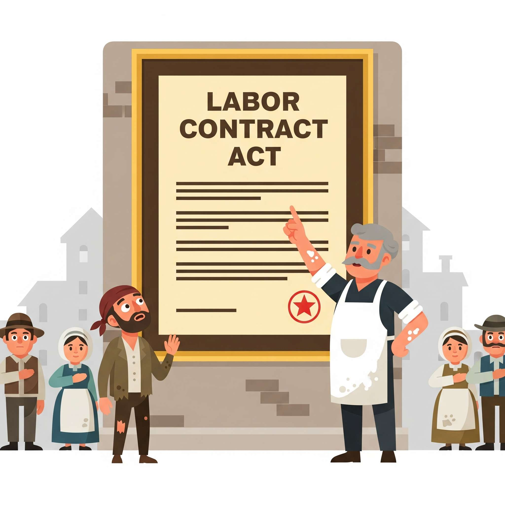

## 序章：一个遗留的问题

在上一篇文章中，我们留下了一个面包师和流浪汉的故事。这个“面包的寓言”帮助我们清晰地区分了两种截然不同的力量：

:::block-1
* **“理性”**：它如同桌面上一套公开、透明且适用于所有人的游戏规则。比如，一个面包就该卖10个铜板，童叟无欺。
* **“社会权力”**：它则是桌面下那只看不见的手，是隐藏的实力天平。这天平的一端是我有多余的面包，另一端是你快饿死了。正是这种不均衡，决定了你最终必须听我的。
:::

这个发现无疑是重要的，它像一道闪电，划破了温情脉脉的表象。但闪电过后，我们看到的并非一片坦途，而是一个更深、更棘手的问题：那套看起来如此公平、如此普适的“游戏规则”，难道真是凭空出现的吗？它是否像日出日落、四季更替一样，是一种我们只能被动接受和观察的自然现象？

恐怕答案并非如此，甚至恰恰相反。这一次，让我们将寓言的时钟拨回到那个关键的时刻，仔细观察当“社会权力”第一次意识到自己的存在时，接下来究竟发生了什么。这不再仅仅是一个关于“潜规则”的故事，而是一个关于“规则”如何被创造的故事。

## 第一幕：权力的“自我意识”与深层不安

故事回到面包师第一次让流浪汉为他劈柴，以换取一个面包的那个下午。

交易顺利完成了。流浪汉捧着面包，狼吞虎咽地补充着活下去的能量；面包师的院子里也多了一堆劈好的柴火。从“社会权力”的角度看，面包师无疑大获全胜。他仅仅动用了自己并不急需的“剩余物”，就成功地支配了另一个人的生命与时间。这是一种令人陶醉的、近乎造物主般的体验。

然而，当最初的满足感退去后，一种隐秘而持续的**不安**，如同水中的涟漪，开始在面包师心里悄然扩散。

他为什么会不安？因为这种支配关系太过赤裸裸了。它的根基，完全建立在“我有多余，你一无所有”这个残酷、偶然且毫不修饰的事实之上。这感觉不像是“文明人”之间体面的交易，更像是一种野蛮的、凭实力说话的丛林法则。每当他看到流浪汉那双混杂着感激、恐惧与一丝难以察觉的怨恨的眼神时，他都会清晰地想起自己力量的真正来源——不是他的智慧，不是他的勤劳，而是对方濒临死亡的绝望。

这种赤裸裸的权力，虽然在当下极为有效，但它至少有三个致命弱点：

1.  **它不稳定**：这种权力维系于流浪汉的“一无所有”。万一明天镇上来了另一位慷慨的富人，或者流浪汉自己幸运地找到了一份工作，这种支配关系就会瞬间瓦解。
2.  **它不体面**：在内心深处，面包师也受到社会普遍道德的约束。他希望自己被看作是“乐善好施的好人”，而不是一个“趁人之危的剥削者”。这种赤裸的权力交易，让他产生了道德上的心理负担。
3.  **它不可复制**：他可以支配这一个流浪汉，但如何确保这种模式可以持续下去，甚至推广开来？如果更多的流浪汉来到镇上，他们可能会联合起来，挑战他这种“一对一”的实力压制。

面包师敏锐地意识到，**他的“社会权力”需要一件合法的、体面的、坚固的外衣。** 它必须从一个“我和你之间的特殊情况”，升华为一个“所有人都应遵守的普遍规则”。

## 第二幕：从“潜规则”到“明规则”的精密创造

于是，面包师做了一件远比单纯施舍或压榨更为聪明的事。

他没有再私下里对下一个饥饿者重复“劈柴换面包”的交易。相反，他开始积极地奔走，找到了镇上其他拥有“剩余物”的乡绅们——比如那位因为布料太多而发愁的裁缝，那位啤酒产量过剩、担心卖不完会变质的酿酒师，以及那位拥有大片土地、总需要人手帮忙收割的农场主。

他们悄然成立了小镇的第一个“商业委员会”。

在委员会的第一次会议上，面包师发表了一番慷慨激昂的演说。他绝口不提“如何保住我们的优势”，而是郑重其事地提议：“各位，为了小镇的长远繁荣与社会秩序，为了保障每一次交易都能在‘公平’与‘理性’的框架下进行，避免不必要的纠纷，我提议，我们应该共同制定一部《劳动雇佣法案》。”

他阐述道，这部法案的核心精神在于“契约”。其具体内容包括但不限于：

:::block-1
* “经双方自愿同意，一方为另一方提供约定时间的劳动，另一方则支付约定数量的报酬（如面包、布料或啤酒），此等行为神圣不可侵犯，是受法律保护的‘契约’。”
* “任何形式的劳动契约，一旦订立，双方均需严格履行，违约方将受到惩罚。”
* “为保障公平，所有报酬标准应‘随行就市’，由雇主根据市场行情进行合理调整。”
:::

这番提议立刻获得了所有人的热烈响应。裁缝看到了他清理库存布料的希望，酿酒师则盘算着如何用啤酒雇佣固定的帮工。他们都看到了一个将自己目前“临时、不稳定”的优势，转化为“长期、合法”的权力的绝佳机会。

法案全票通过，并由小镇德高望重的法官，在一场庄严的仪式上向全体镇民公布。从此，它成为了全镇都必须遵守的“理性”规则。

现在，请注意这里发生的**关键转变**：

1.  **顺序变了**：过去是**先有**“我能支配你”这个事实，**后有**“你为我劈柴”这个口头约定。现在，则是**先有**一部看起来普遍适用的法律，然后，所有的支配行为都在这部法律的光环下进行。权力不再是原因，而成了一个“合法”的结果。
2.  **性质变了**：面包师支配流浪汉的行为，从一个“强者对弱者的个别支配”，摇身一变，成了“契约精神”和“法律秩序”的光荣体现。支配关系被巧妙地**合法化、非人格化和抽象化**了。它不再是面包师“个人”的决定，而是“法律”的规定。

## 第三幕：当“外衣”成了“身体”本身

几年后，小镇的经济“繁荣”了起来，新的流浪汉也慕名而来。

当又一个饥肠辘轆的人站在面包店门口时，那个曾经内心感到不安的面包师早已消失不见。他可以心安理得、甚至理直气壮地指着墙上用木框裱起来的《劳动雇佣法案》，平静地说：“你看，我们这里有规矩。我提供工作，你付出劳动，我们签订一份受法律保护的、平等的劳动合同。你自愿劳动，我支付报酬，这完全合乎我们镇的‘理性’和‘公平’。”

周围的路过的镇民也纷纷点头称是：“没错，面包师先生给了多少人一口饭吃啊。”“这就是规矩，不想干，你可以去别处嘛，没人强迫你。”

此时，几乎已经没有人记得，这部被誉为小镇基石的“理性”法案，最初正是由那一小撮手握“多余面包”的人，为了将自己赤裸裸的权力包装起来、并使其万古长存而亲手制定的。

那件精心缝制的“外衣”，因为穿得太久，已经和权力的“身体”融为一体，再也分不开了。不仅如此，这件外衣还长出了自己的血肉和神经。它催生了新的职业（律师、法官），塑造了新的道德（“守信是最高的美德”），甚至改变了人们的思维方式。**“社会权力”成功地将自己隐藏了起来，它不再需要躲在桌下，因为它已经变成了桌子本身，变成了整个房间的结构。** 它为自己创造出了一套看似中立、普遍、不容置疑的“理性”体系。

## 结论：我们到底在遵守什么？

上一篇文章告诉我们，在看似公平的“理性”规则之下，可能隐藏着“社会权力”的角力。

而今天这个被补充完整的故事，则揭示了一个更深、甚至更令人不安的逻辑：**在绝大多数时候，“理性”规则本身就是“社会权力”的产物、工具和最终的样貌。**

“社会权力”这股力量，它的最高明之处，并非仅仅满足于在桌子底下悄悄行事，而是要理直气壮地站到桌面上，拿起笔，亲自来**制定那本官方的游戏规则手册**。它的终极目标，是把自己这种不平等的、偶然的优势状态，定义为对所有人来说“最理性”、“最公平”、“最自然”的永恒状态。

所以，当我们审视现实世界中的一切“规则”——无论是法律条款、公司章程，还是那些被我们视为“理所当然”的行业惯例与社会风俗——我们或许可以提出一个比上次更尖锐的问题：

**这个规则在逻辑上是否自洽当然重要，但远比这更重要的是，它最初被建立时，是为了解决谁的问题？它今天的存在，又在维护着谁的利益？在它被书写和确立的那个房间里，谁在场，谁又缺席了？**

看懂了这一层逻辑，我们就不再是那个仅仅困惑于规则为何不公的年轻学者，而是开始理解权力是如何构建我们所见的世界，以及我们每个人置身其中的真实位置。这才是真正从寓言的启示，走向现实的清醒。

